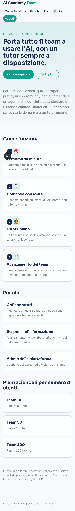
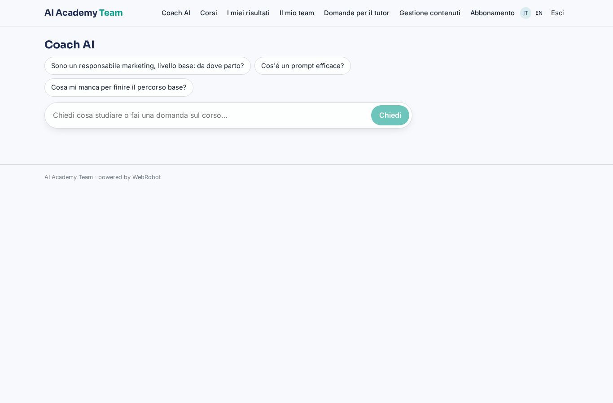
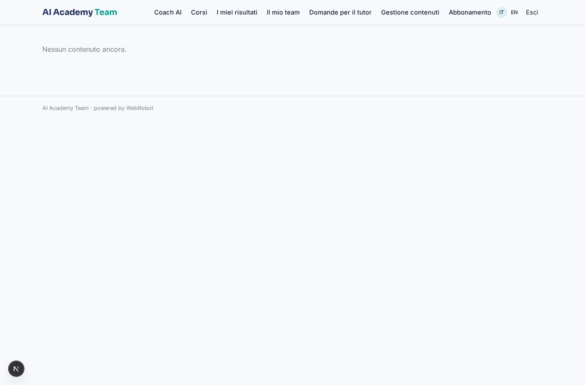
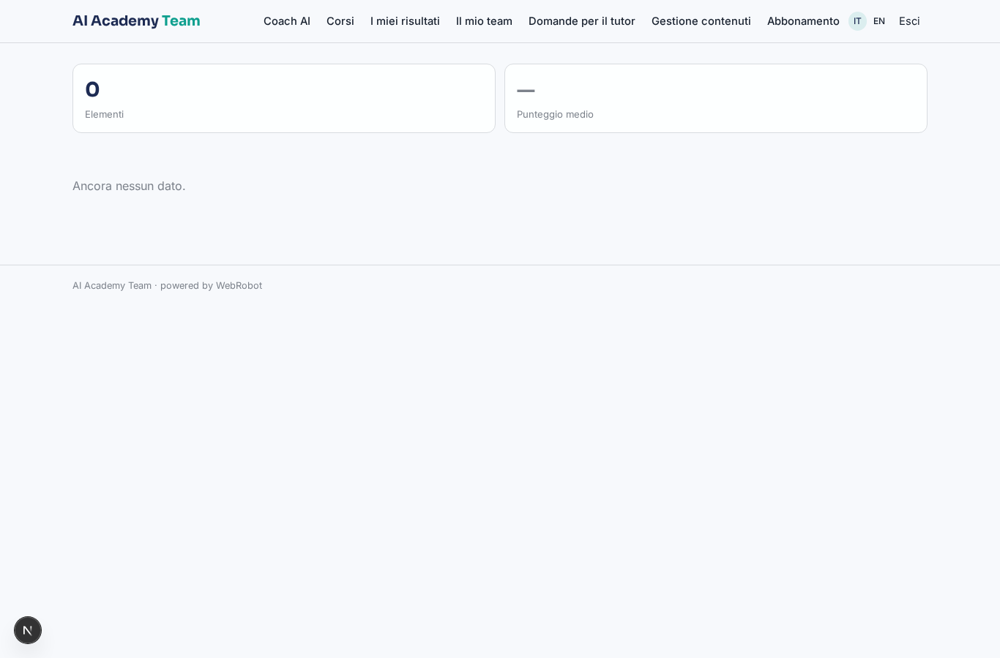
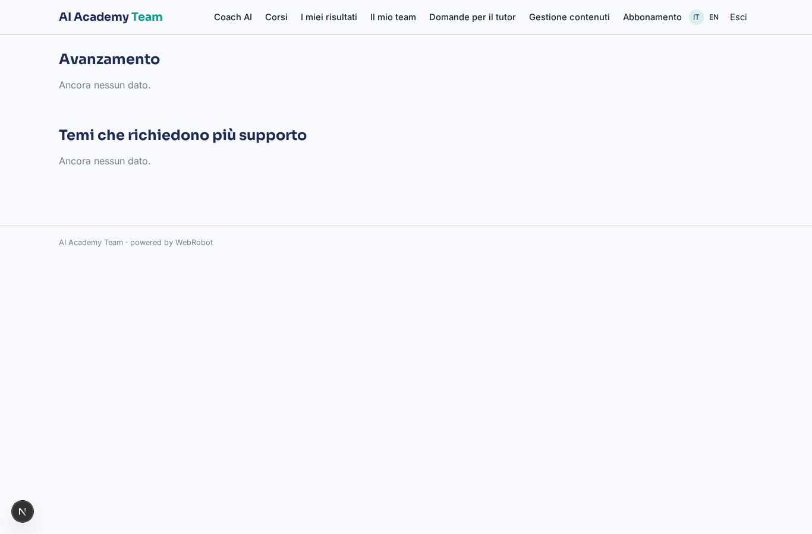
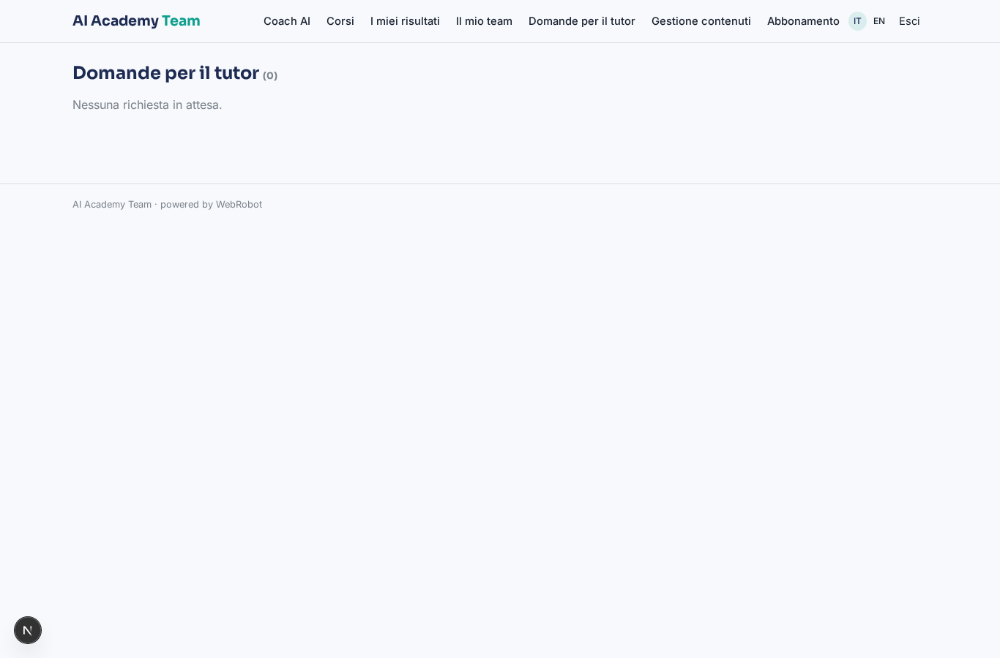
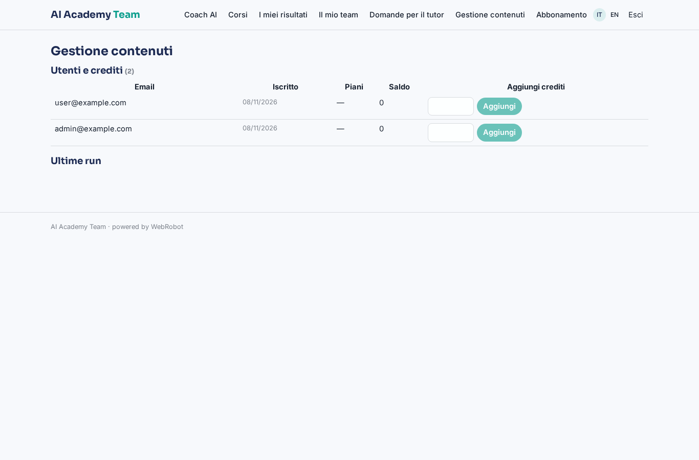
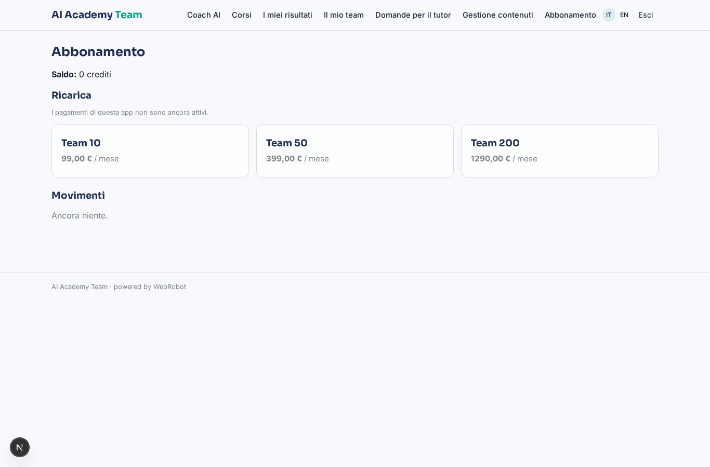

# AI Academy Team

_Percorsi, community e un tutor AI per far adottare l'AI a tutto il team._

**Manifest status:** valid (schema validator + runtime contract)

## Description given to the app builder (Italian)

Descrivo solo lo strato software di un servizio che aiuta le imprese ad adottare l'AI tramite una community e percorsi formativi; la consulenza e i servizi erogati da persone restano a parte. L'azienda iscrive i propri collaboratori a una piattaforma dove trovano percorsi formativi sull'AI, con lezioni, quiz e progetti pratici, e una community in cui fare domande. Un agente consiglia a ciascun utente i contenuti giusti in base al ruolo e al livello, risponde in chat alle domande basandosi sui materiali del corso citando la fonte, e quando non sa passa la domanda a un tutor umano. Il responsabile formazione dell'azienda vede l'avanzamento dei propri collaboratori, i progressi e i temi su cui serve piu supporto, e riceve un report mensile via email. Gli utenti vedono i propri corsi e i propri risultati, il responsabile la propria azienda, l'admin tutto. I contenuti li gestisce l'admin della piattaforma. Monetizzazione: abbonamento aziendale per numero di utenti. In italiano e inglese.

## Features not expressible today (spec.extensions)

- **company_scoping**: Records are scoped per user, not per company: the training manager sees only progress and questions the learners share with them (sharing viewer). Automatic scoping of a company's employees to its manager, and admin-wide aggregates, need custom logic.
- **seat_limits**: Plans are priced by number of users (10/50/200) but the runtime does not yet enforce a seat cap or invite employees by company.
- **monthly_email_report**: Monthly report to the training manager by email: notifications and email digests are not available yet. For now the manager reads the team view.
- **community**: Community forum (public threads, replies between learners) is not available as a view type; questions go to the coach and, when needed, to a human tutor.
- **files**: Uploading course files is not available: the admin enters lessons as text and links in the courses collection.

## Screenshots (interpretive runtime)

### home-anon

### home-mobile

### home

### assistant

### catalog

### my_results

### team

### tutor_queue

### content_admin

### account

