# CasaGiusta

_L'animale giusto per la casa giusta._

**Manifest:** valid (schema + runtime contract) · **Functional test:** 1 failure(s) (25 checks passed)

## Description given to the app builder (Italian)

Vorrei un'app per le associazioni animaliste che si chiami CasaGiusta. Ogni associazione ha un account e inserisce gli animali in adozione: specie, razza, età, taglia, carattere, compatibilità con bambini e altri animali, esigenze sanitarie, foto e canile di provenienza. Chi vuole adottare si registra e compila un questionario pre-affido: tipo di casa, giardino, ore fuori casa, esperienza, composizione della famiglia, altri animali. Un agente confronta il questionario con le schede e propone gli animali più compatibili con una spiegazione, segnalando anche le incompatibilità. L'adottante invia la candidatura per un animale; il volontario dell'associazione la riceve, vede questionario e punteggio, può fare domande e approva o rifiuta. Ad ogni passaggio l'adottante riceve un'email; dopo l'adozione l'app manda promemoria per i controlli post-affido. Ogni associazione vede solo i propri animali e candidati, l'adottante solo le sue candidature, l'admin della piattaforma tutto. Gratuita per gli adottanti, abbonamento piccolo per le associazioni. Italiano.

## Functional test: what did not pass

- **form can be filled (options, uploads)** (form apply): required animal_ref (options from collection:animals) has no option to choose
- **page opened by a role allowed to** (view account): only role association may open it, the test cannot hold it _(warning)_

## Screenshots (interpretive runtime, no data)

### home-anon
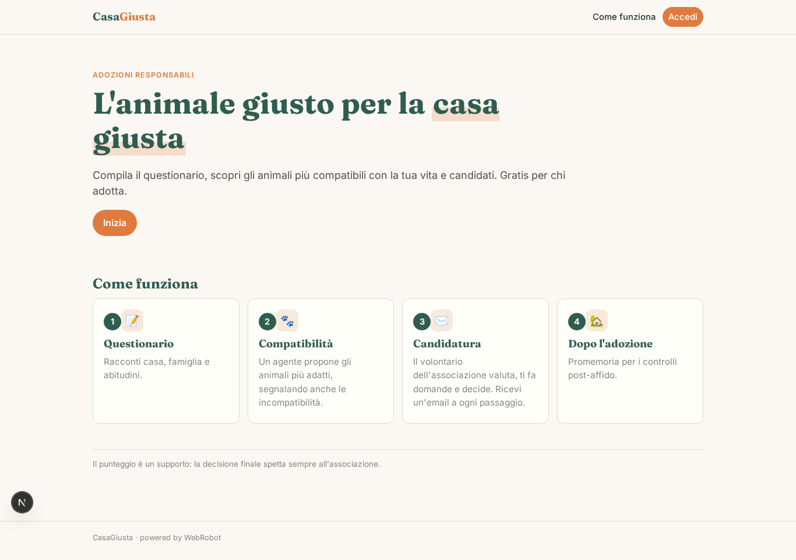

### home-mobile
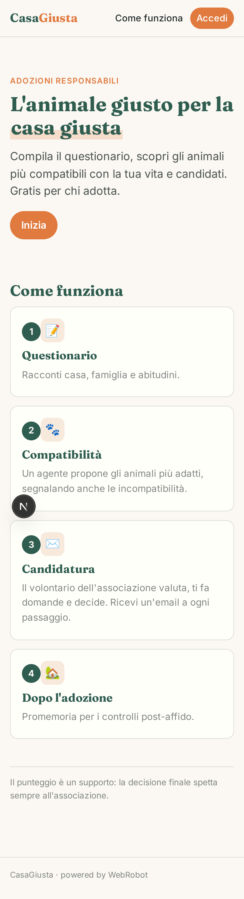

### home
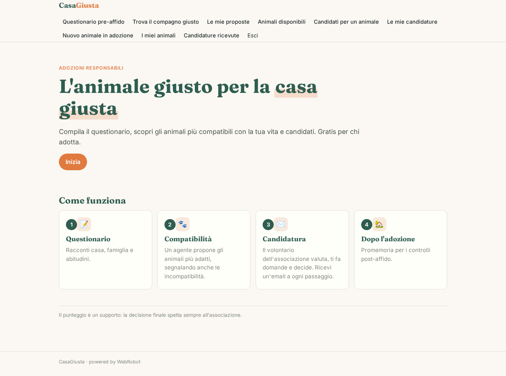

### questionnaire
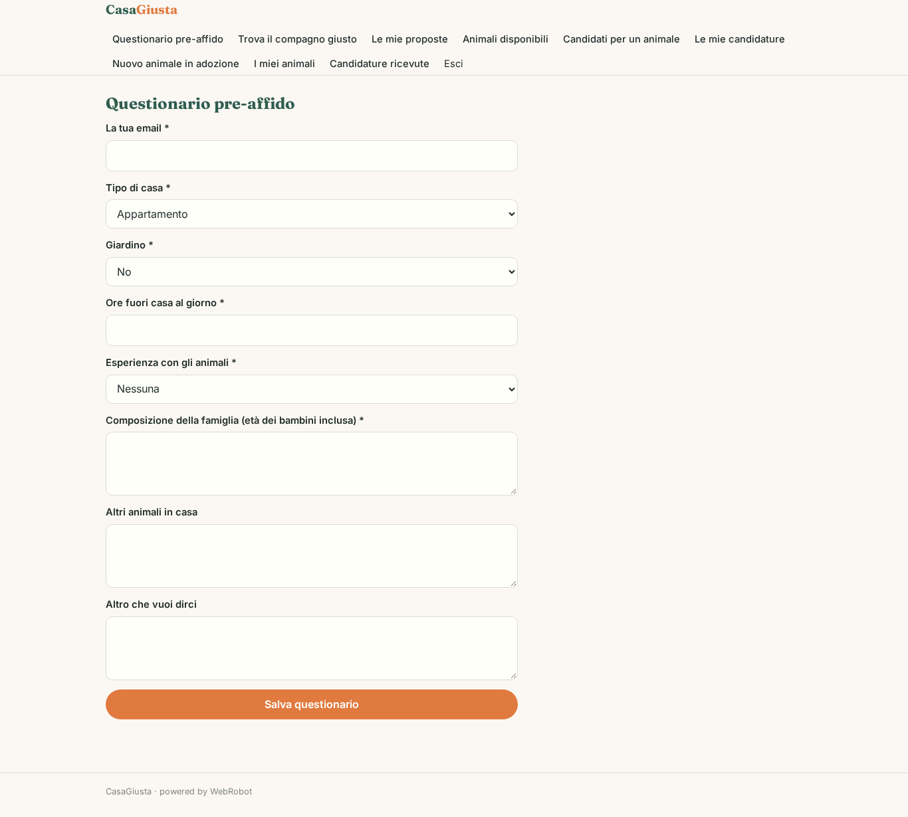

### new_match
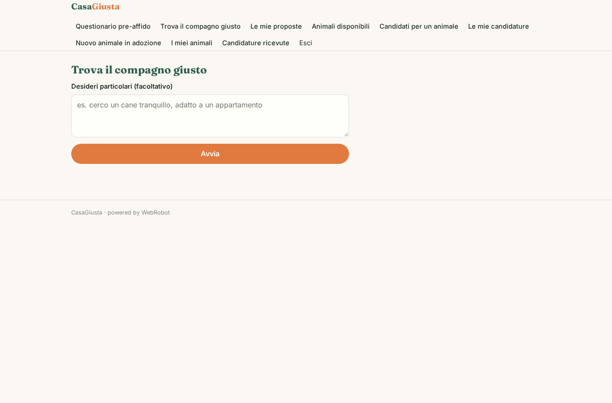

### matches

### browse
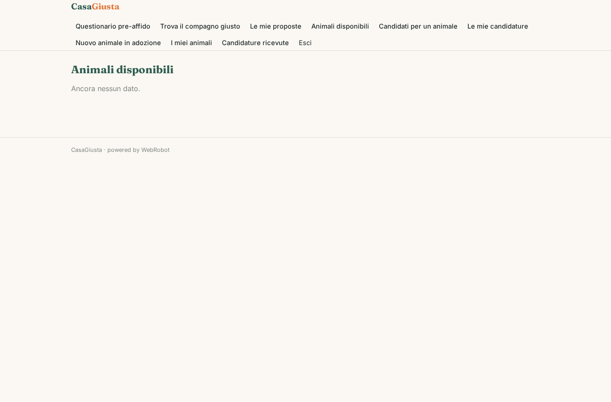

### apply
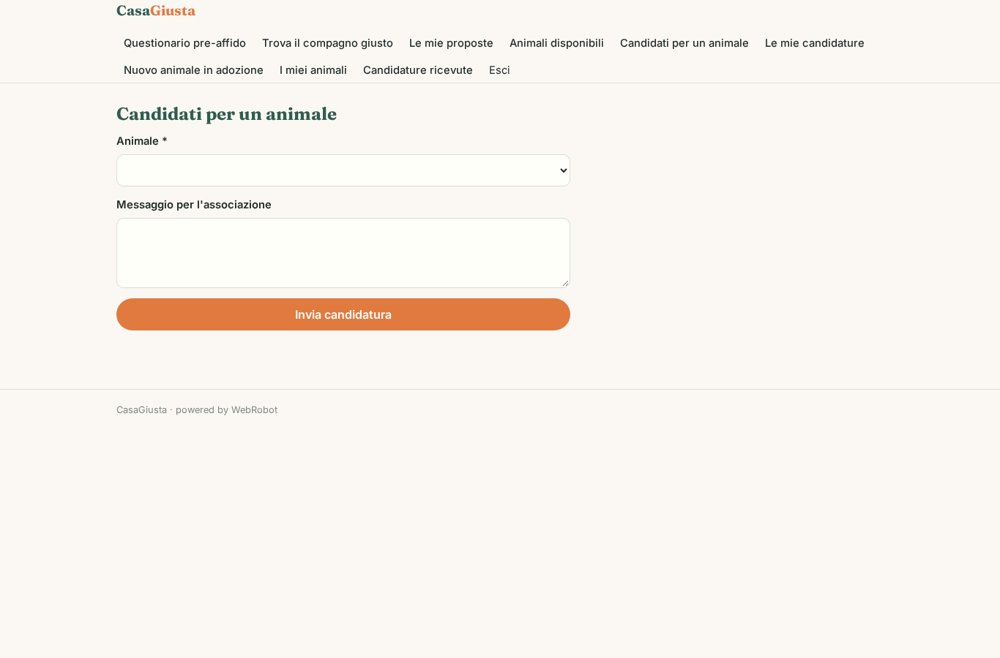

### my_applications
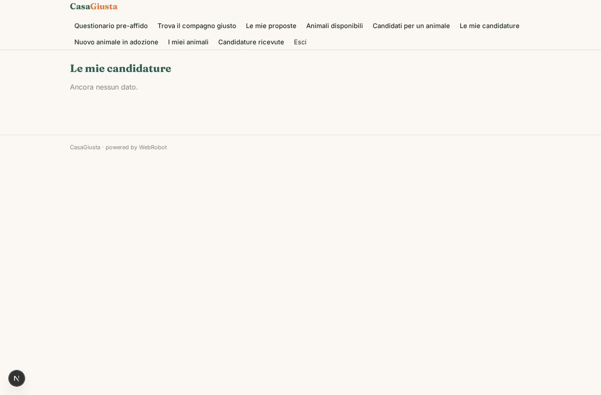

### answer
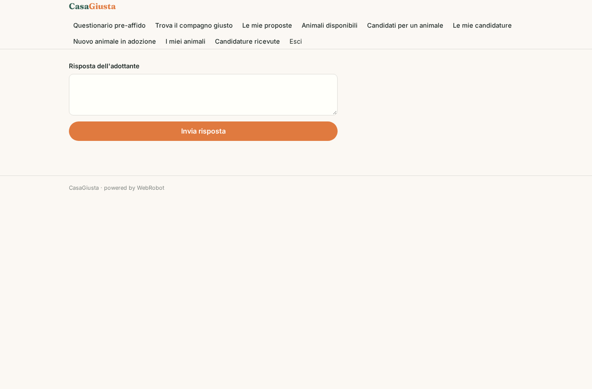

### animal_new
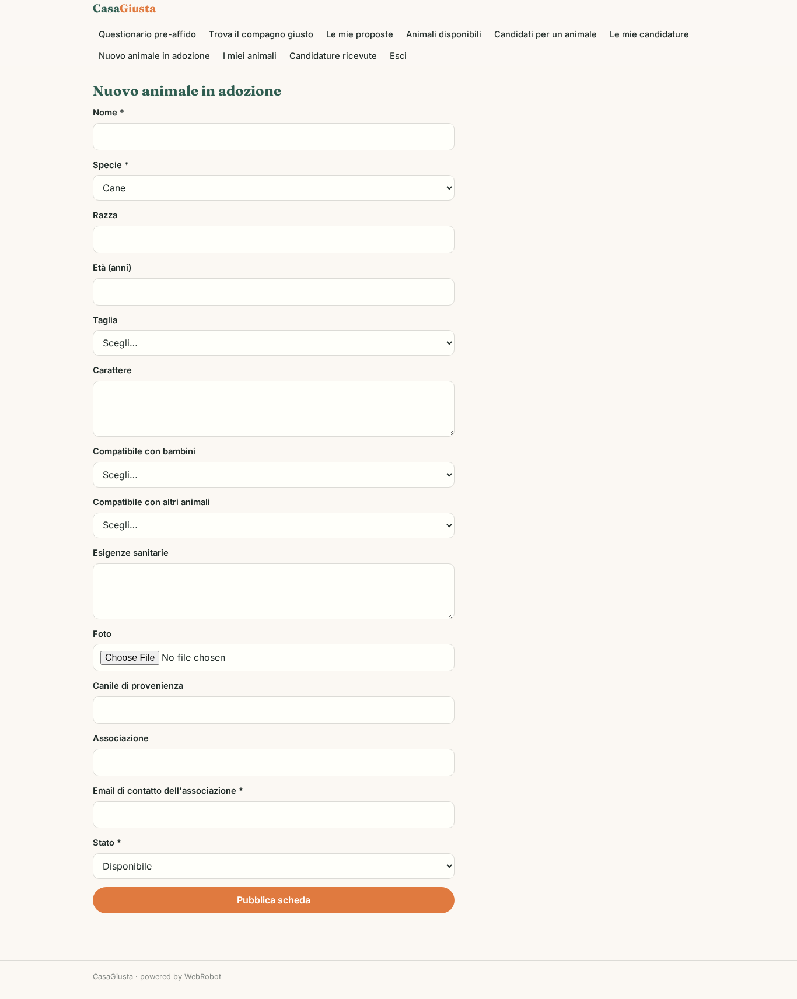

### my_animals
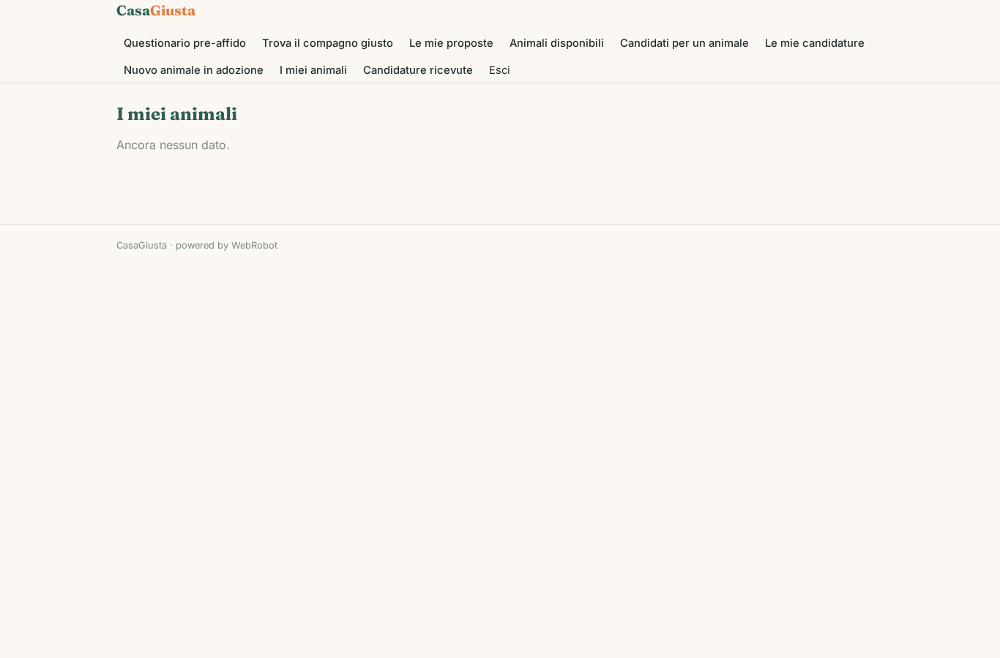

### candidates

### decide
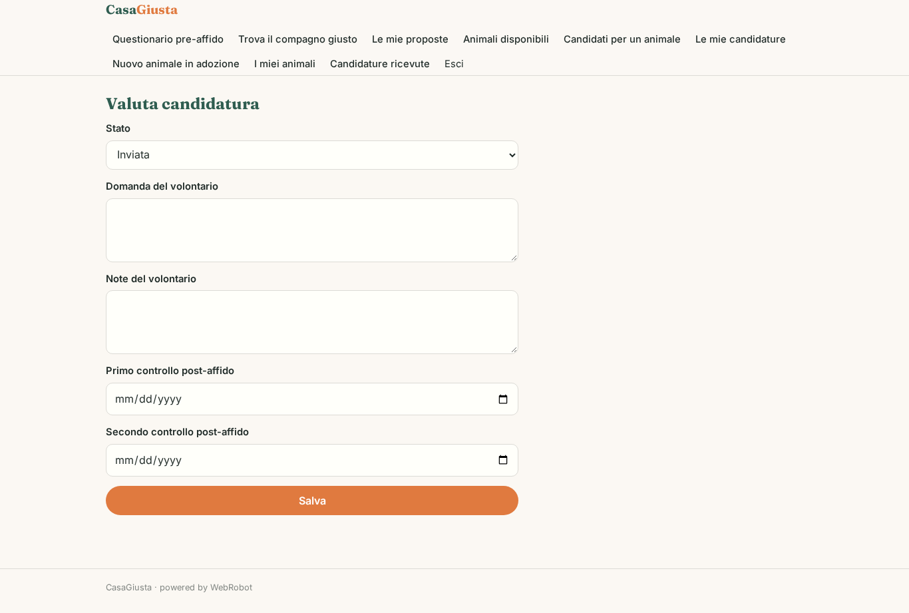

### account

