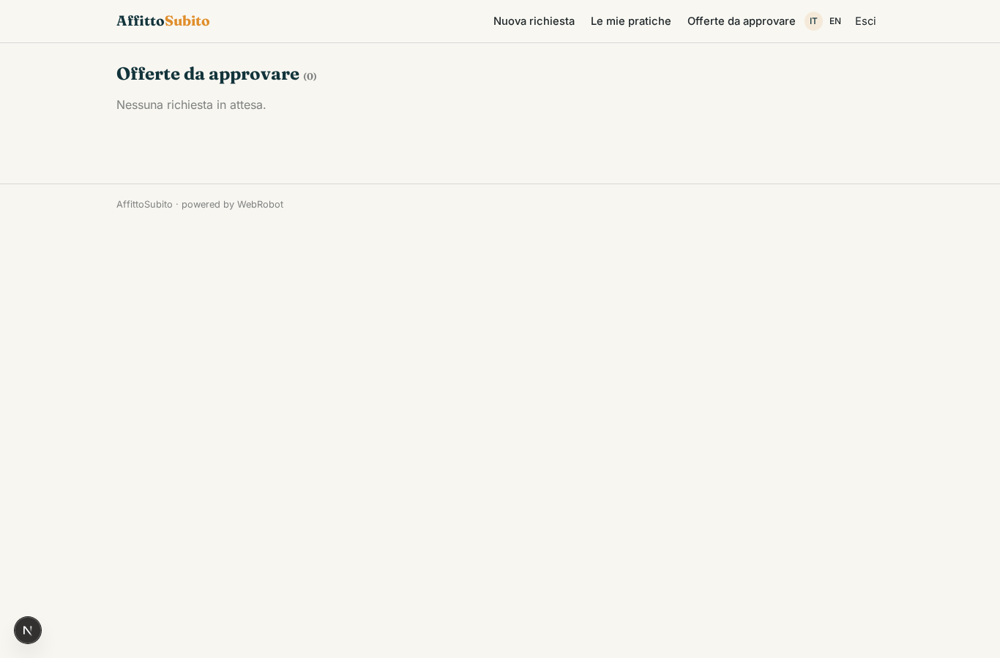
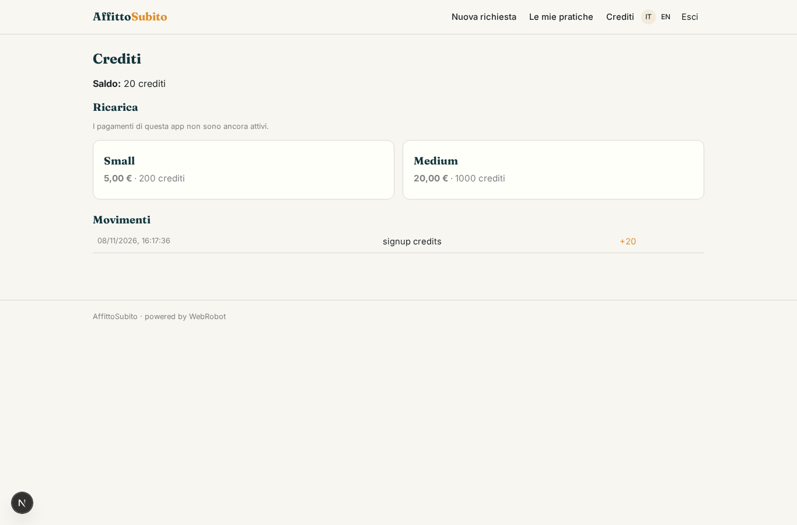

# AffittoSubito

_Ricevi in anticipo i canoni futuri del tuo affitto._

**Manifest status:** valid (schema validator + runtime contract)

## Description given to the app builder (Italian)

Vorrei AffittoSubito, un servizio per proprietari che affittano casa e vogliono ricevere in anticipo i canoni futuri. Il proprietario si registra, inserisce i dati del contratto di locazione registrato e carica il contratto e le ultime ricevute di pagamento. Un agente controlla la coerenza dei documenti, verifica la regolarità dei pagamenti e calcola un'offerta di anticipo con lo sconto applicato. L'offerta passa all'approvazione di un analista del partner finanziario autorizzato, che la accetta o rifiuta; il finanziamento è erogato dal partner, non dall'app. Il proprietario riceve l'esito via email e segue lo stato della pratica. Ogni proprietario vede solo le proprie pratiche. Commissione sull'importo anticipato.

## Features not expressible today (spec.extensions)

- **file_upload**: Uploading the contract and receipt files is not available yet: the owner pastes the text or gives a link.
- **email_outcome**: Email notification of the outcome (approved/rejected) to the landlord is not available yet: the landlord follows the status in 'My cases'.
- **fee_on_advanced_amount**: The fee (2% of the net advanced amount) is computed in the offer; its collection is settled with the financial partner outside the app, since funding does not pass through the app.

## Screenshots (interpretive runtime)

### home-anon

### home-mobile

### home

### new_practice

### practices

### reviews

### account

