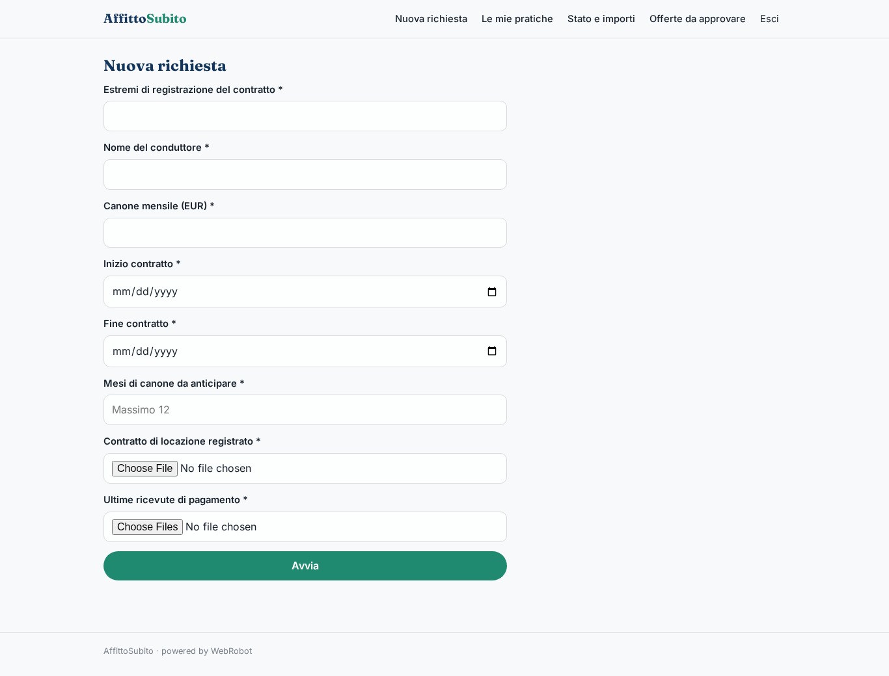
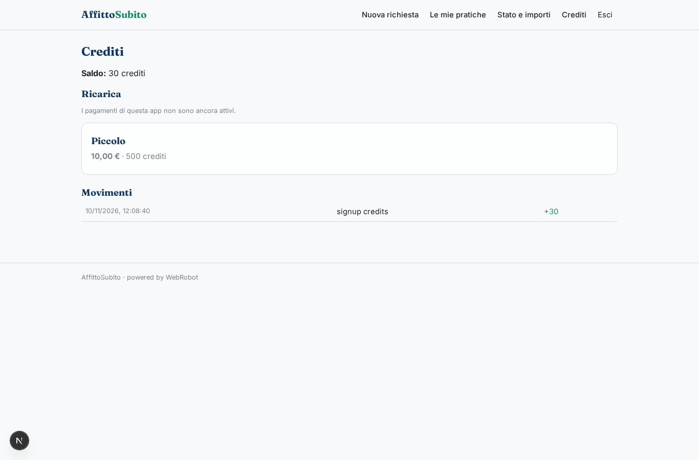

# AffittoSubito

_Ricevi in anticipo i canoni futuri del tuo affitto._

**Manifest:** valid (schema + runtime contract) · **Functional test:** passed (8 checks passed)

## Description given to the app builder (Italian)

Vorrei AffittoSubito, un servizio per proprietari che affittano casa e vogliono ricevere in anticipo i canoni futuri. Il proprietario si registra, inserisce i dati del contratto di locazione registrato e carica il contratto e le ultime ricevute di pagamento. Un agente controlla la coerenza dei documenti, verifica la regolarità dei pagamenti e calcola un'offerta di anticipo con lo sconto applicato. L'offerta passa all'approvazione di un analista del partner finanziario autorizzato, che la accetta o rifiuta; il finanziamento è erogato dal partner, non dall'app. Il proprietario riceve l'esito via email e segue lo stato della pratica. Ogni proprietario vede solo le proprie pratiche. Commissione sull'importo anticipato.

## Features not expressible today (spec.extensions)

- **advance_fee**: La commissione in percentuale sull'importo anticipato non è esprimibile oggi (le tariffe sono in crediti fissi o a consumo): va concordata con il partner e applicata fuori dall'app, oppure con un pagamento per transazione.
- **practice_status_update**: Lo stato della pratica nella tabella resta 'in_review': l'esito (approvato/rifiutato) arriva via email e nella vista approvazioni. L'aggiornamento automatico del record dopo la decisione non è disponibile.

## Screenshots (interpretive runtime, no data)

### home-anon

### home-mobile

### home

### new_practice

### my_runs

### practices

### reviews

### account

