# Affitti Medio-Lungo

_Cerca, candidati e prenota la visita: tutto in un portale._

**Manifest:** valid (schema + runtime contract) · **Functional test:** passed (27 checks passed)

## Description given to the app builder (Italian)

Descrivo solo lo strato software di un servizio di affitti a medio e lungo termine: il portale di ricerca, candidatura e gestione, non l'attivita di intermediazione immobiliare svolta dall'agenzia. L'inquilino in cerca compila un modulo con citta, budget, date, durata e preferenze; un agente propone gli alloggi compatibili tra quelli pubblicati sulla piattaforma dai gestori e spiega perche. L'inquilino salva i preferiti, invia la candidatura caricando i documenti richiesti e prenota una visita scegliendo uno slot. Il gestore dell'alloggio pubblica gli annunci con foto, prezzo e disponibilita, riceve le candidature, le valuta e conferma; un operatore umano dell'agenzia segue la trattativa e la firma del contratto fuori dalla piattaforma. Entrambe le parti comunicano in chat e ricevono aggiornamenti via email. Gli annunci provengono solo dai gestori che li caricano sulla piattaforma. L'inquilino vede le proprie candidature, il gestore i propri alloggi e le candidature ricevute, l'admin tutto. Monetizzazione: commissione sul contratto concluso. In italiano e inglese.

## Features not expressible today (spec.extensions)

- **manager_chat**: Direct human-to-human chat between tenant and manager is not available yet; the assistant chat is provided instead. Per-manager filtering of 'my listings' is also not available: listings are a shared catalogue and each carries manager_email.
- **contract_signing**: Contract negotiation and signing are done by an agency operator outside the platform; the operator marks the application contract_signed, which triggers the fee.

## Screenshots (interpretive runtime, no data)

### home-anon

### home-mobile

### home

### search

### history
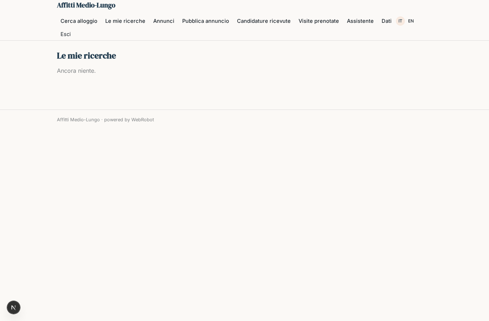

### browse
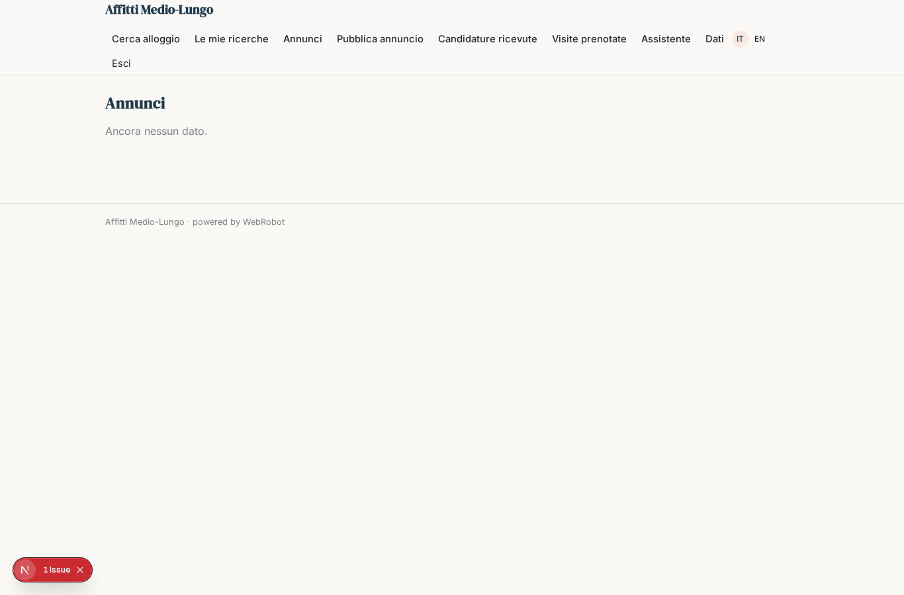

### favorite
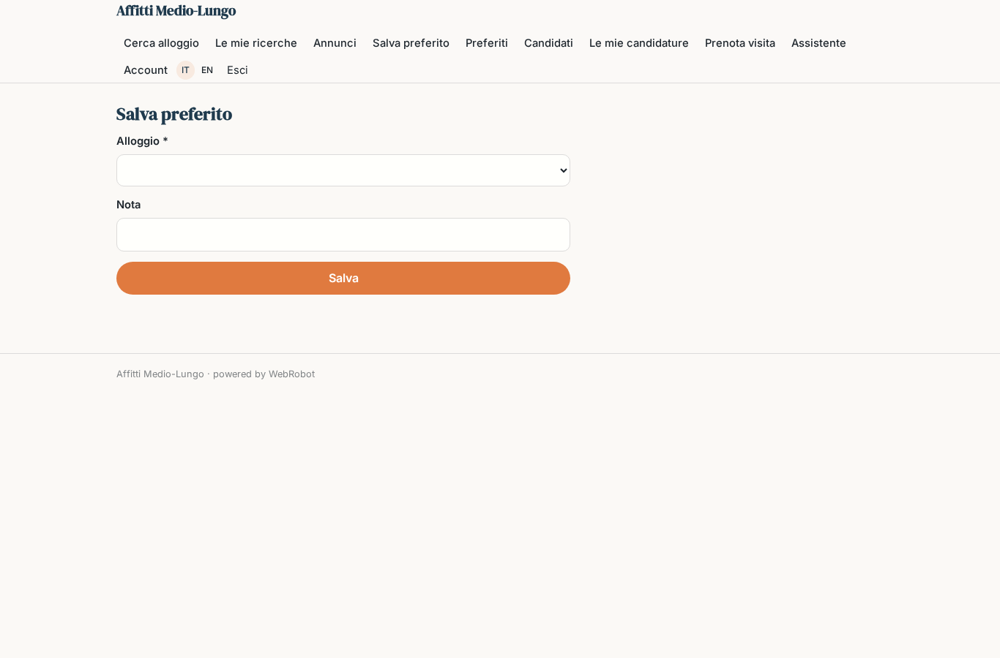

### my_favorites
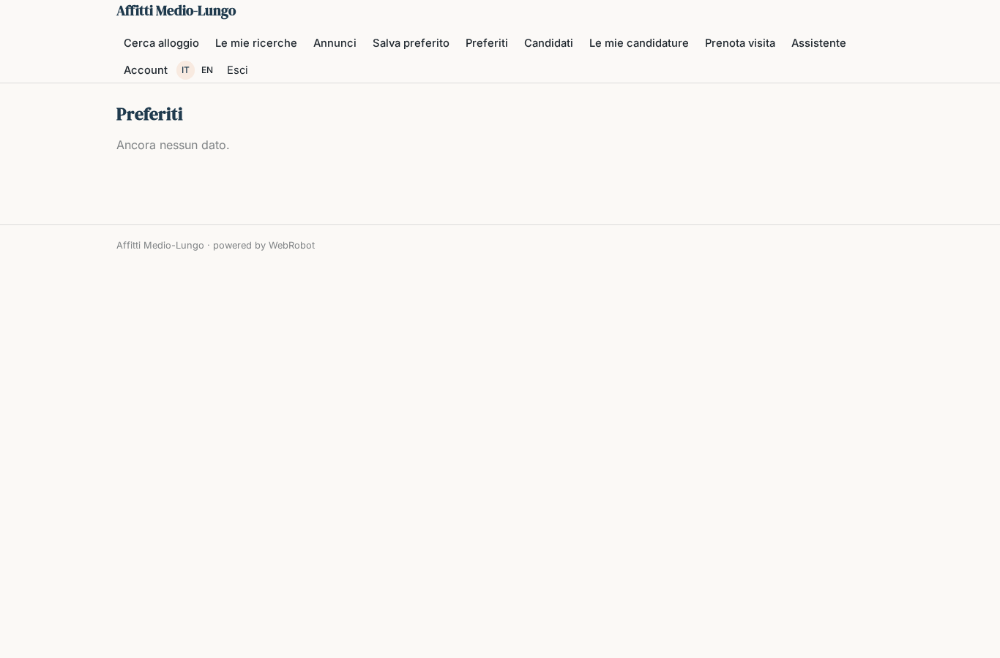

### apply
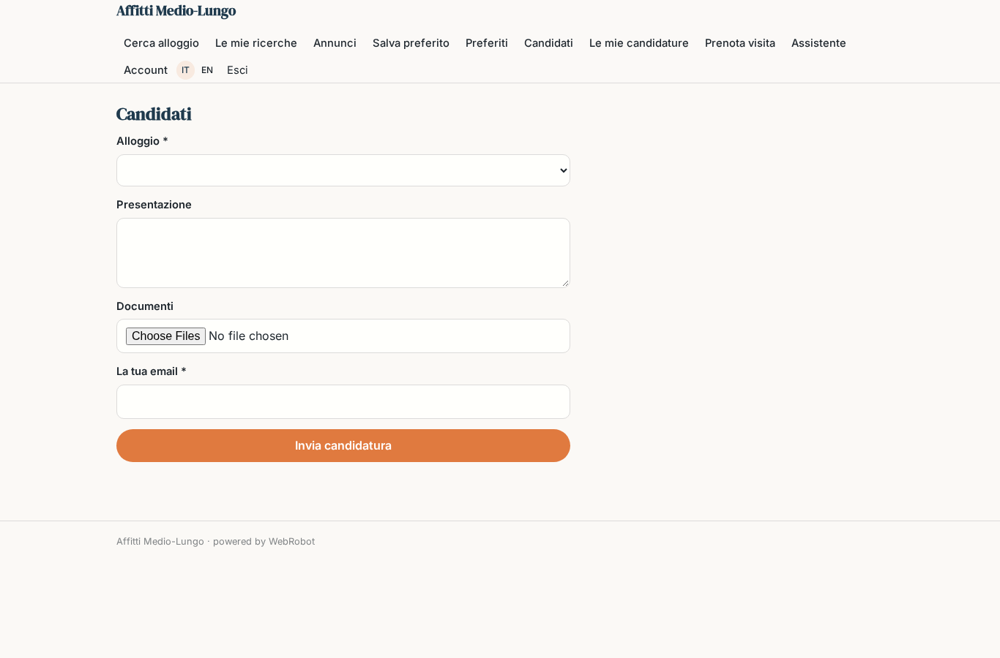

### my_applications
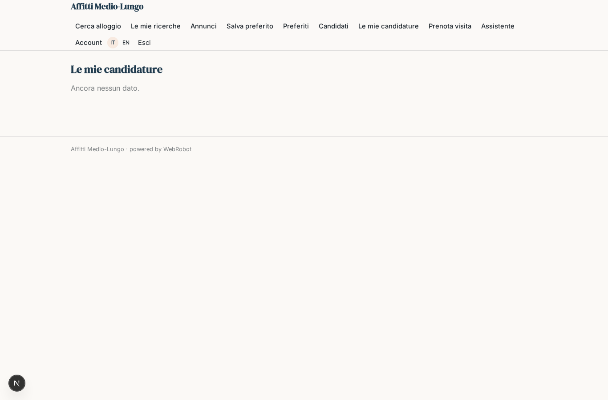

### book
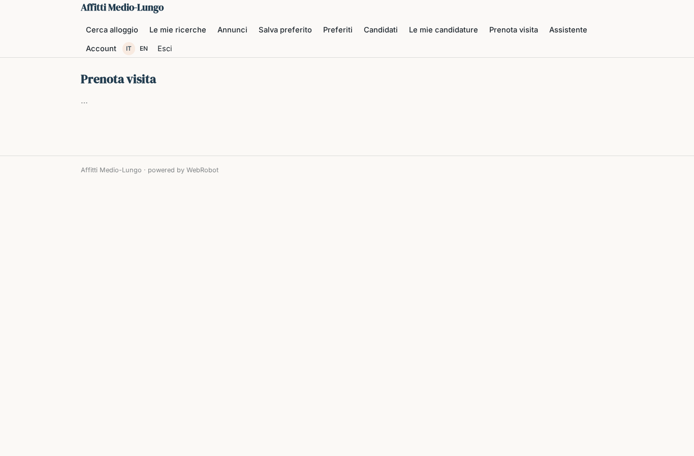

### publish
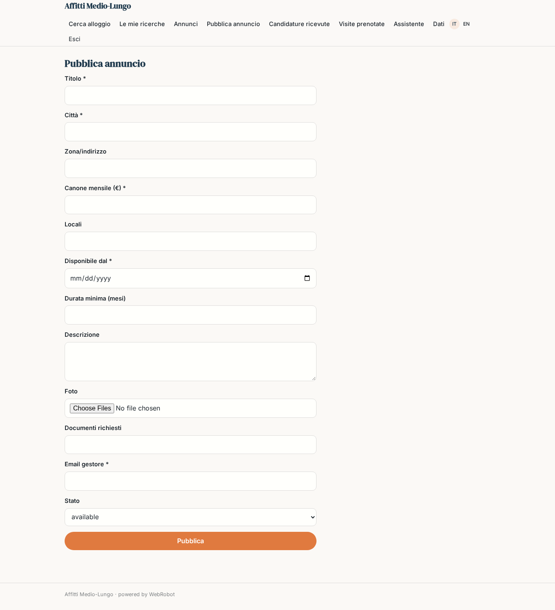

### received
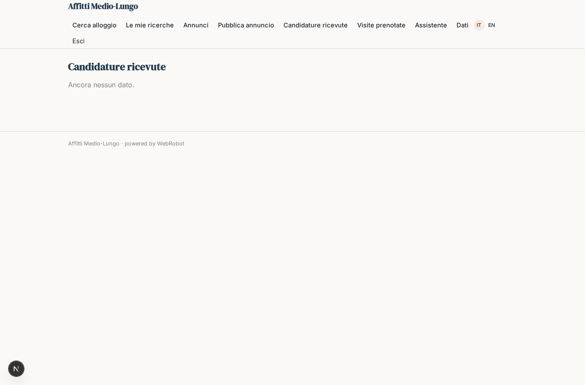

### review
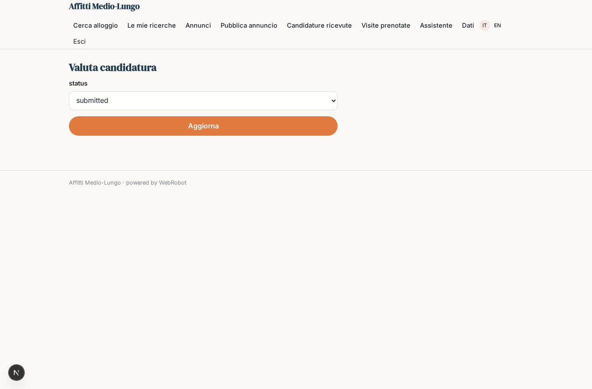

### bookings
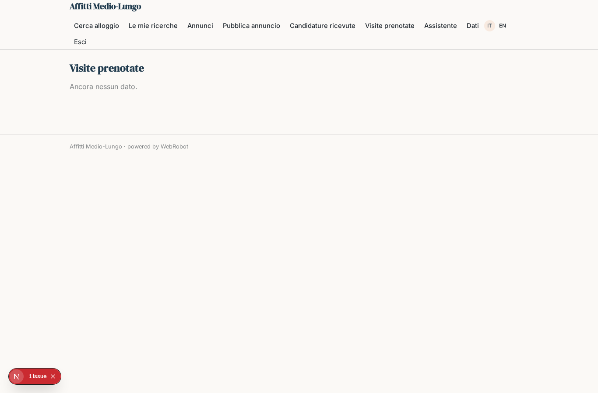

### chat
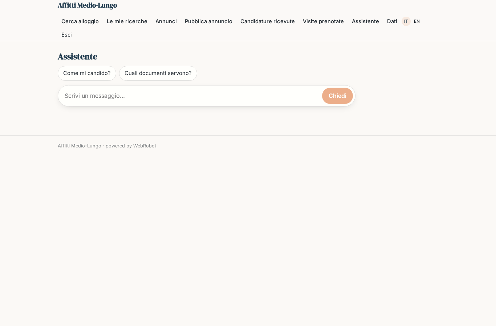

### account
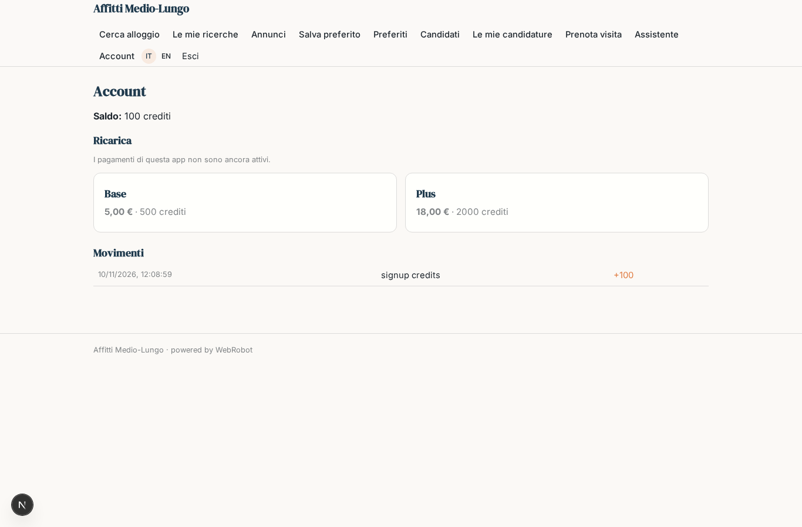
