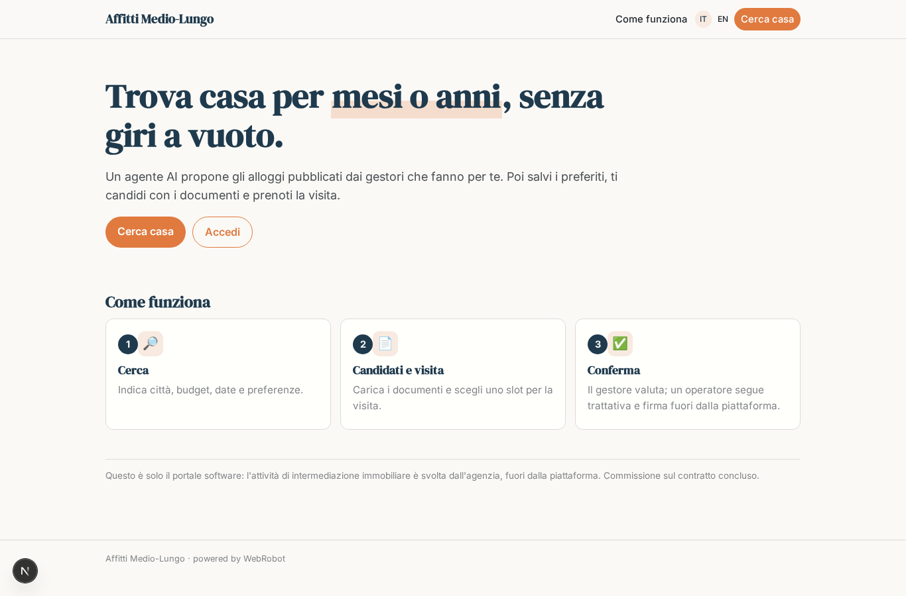
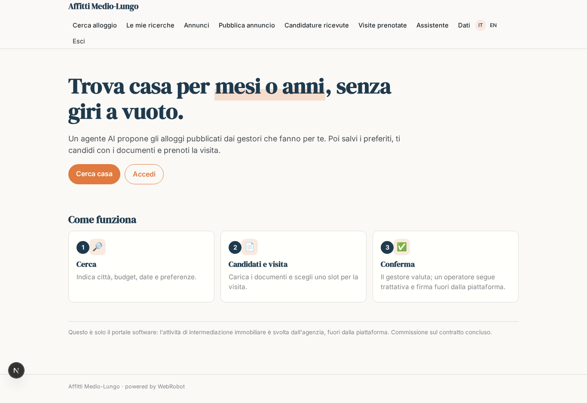
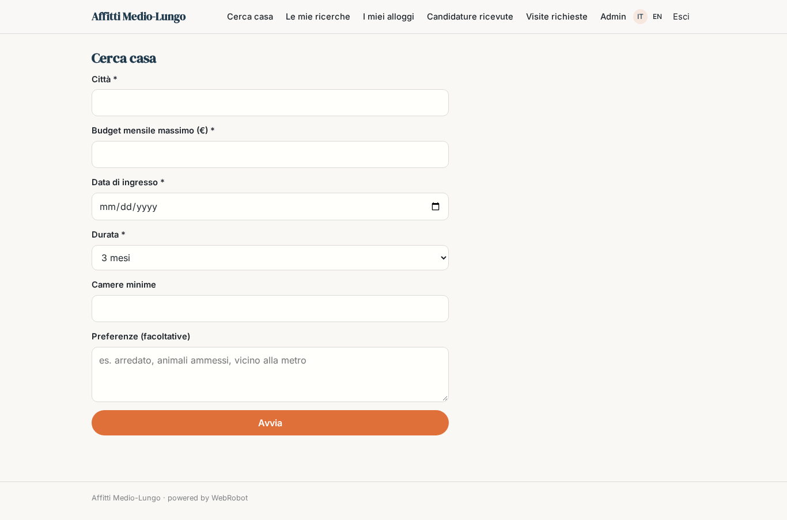
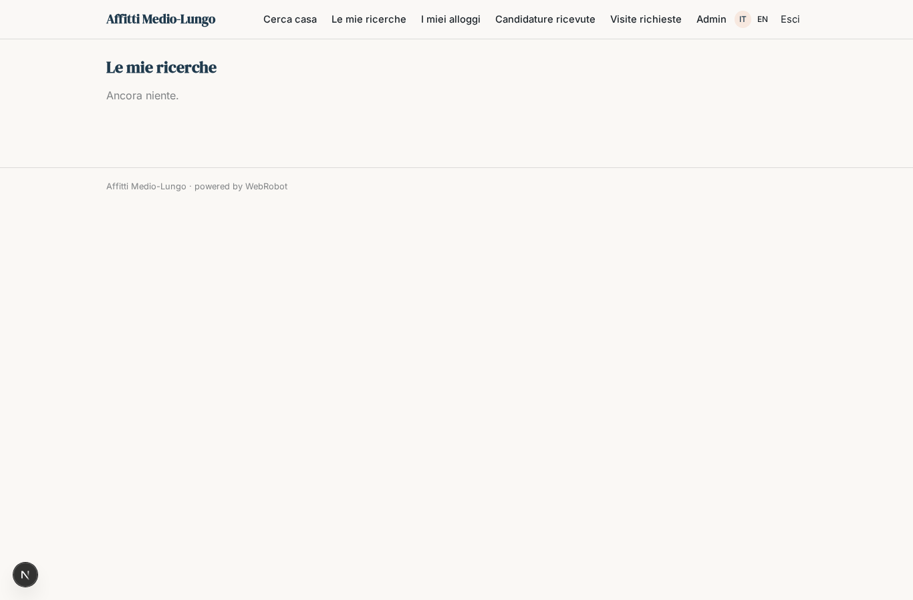
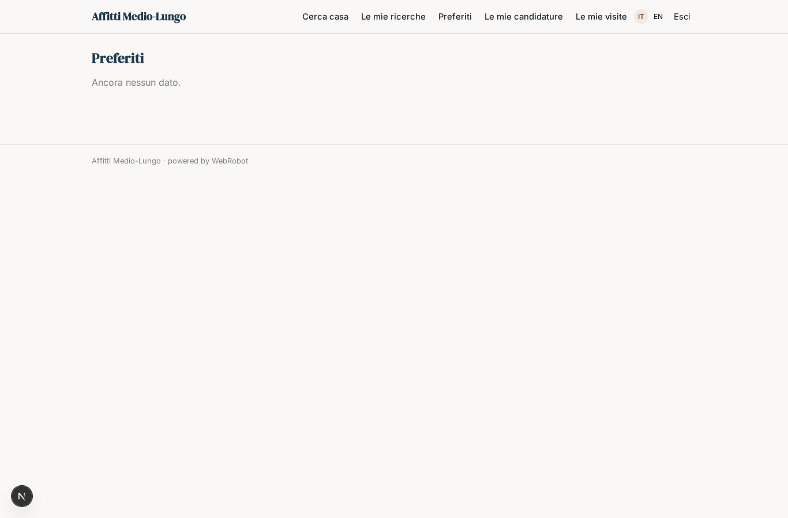
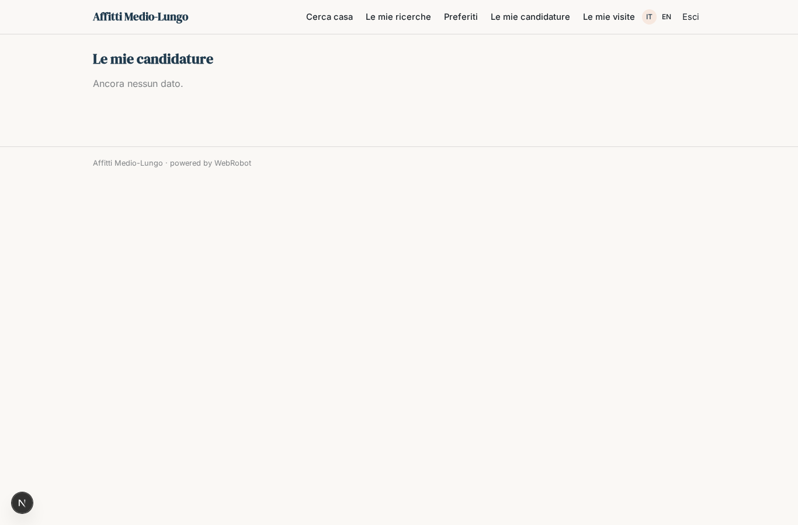
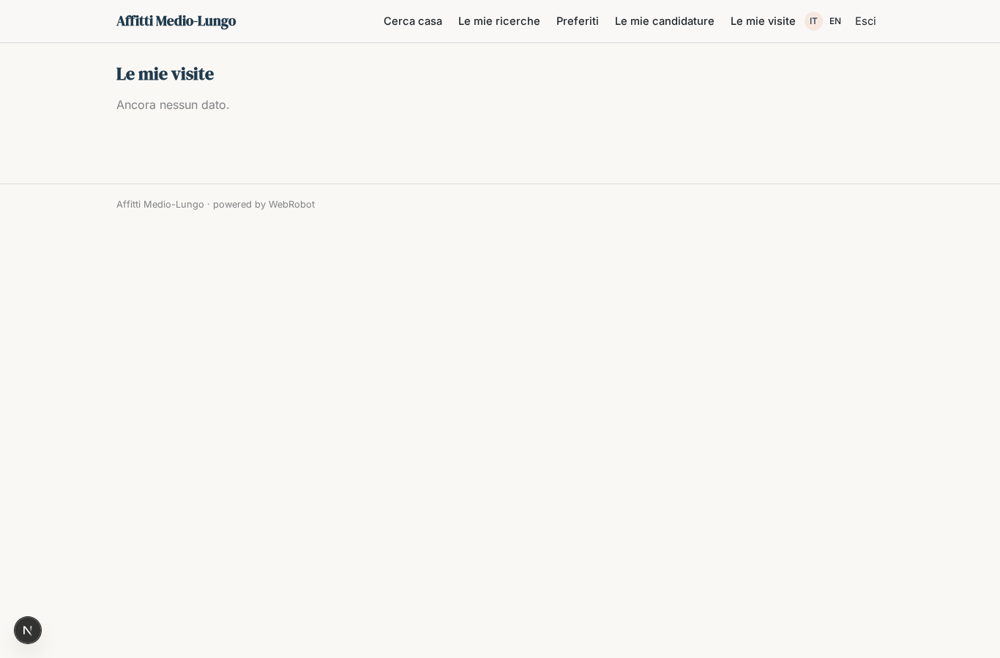
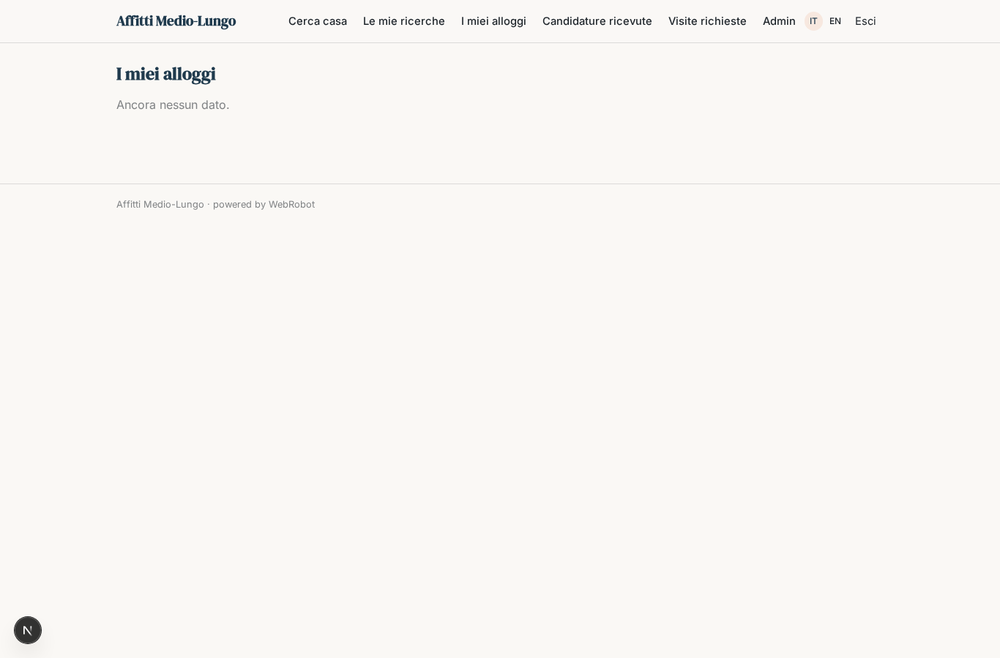
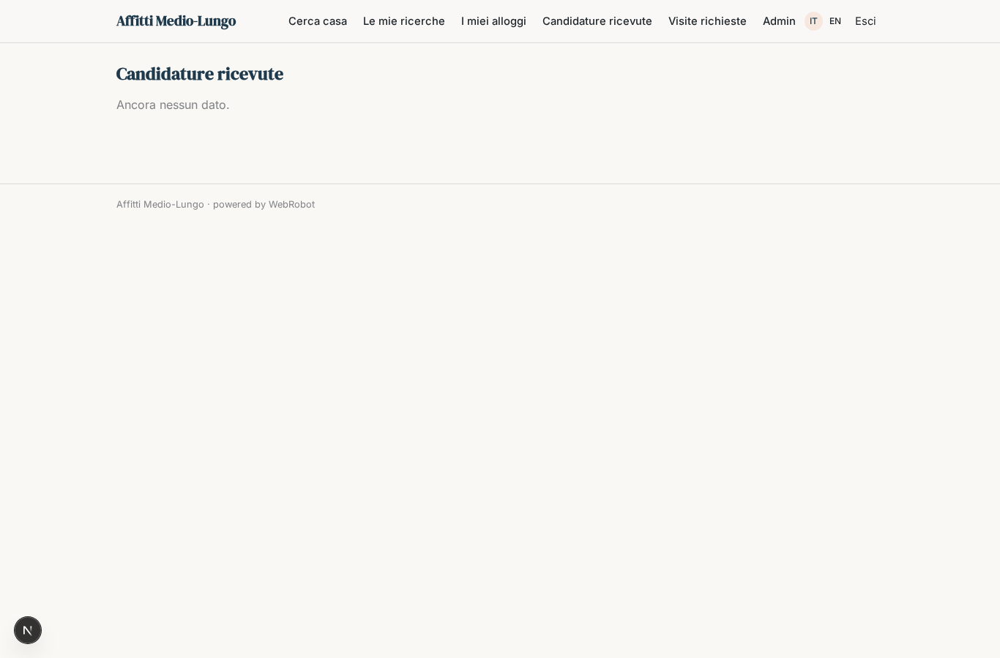
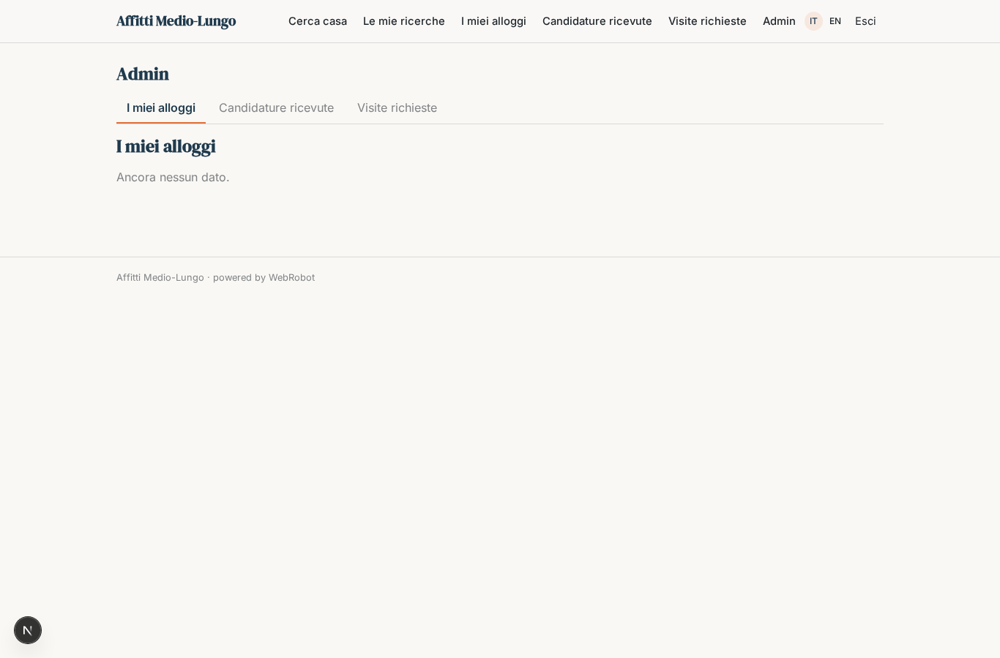

# Affitti Medio-Lungo

_Cerca, candidati e prenota una visita: l'alloggio giusto per mesi o anni._

**Manifest status:** valid (schema validator + runtime contract)

## Description given to the app builder (Italian)

Descrivo solo lo strato software di un servizio di affitti a medio e lungo termine: il portale di ricerca, candidatura e gestione, non l'attivita di intermediazione immobiliare svolta dall'agenzia. L'inquilino in cerca compila un modulo con citta, budget, date, durata e preferenze; un agente propone gli alloggi compatibili tra quelli pubblicati sulla piattaforma dai gestori e spiega perche. L'inquilino salva i preferiti, invia la candidatura caricando i documenti richiesti e prenota una visita scegliendo uno slot. Il gestore dell'alloggio pubblica gli annunci con foto, prezzo e disponibilita, riceve le candidature, le valuta e conferma; un operatore umano dell'agenzia segue la trattativa e la firma del contratto fuori dalla piattaforma. Entrambe le parti comunicano in chat e ricevono aggiornamenti via email. Gli annunci provengono solo dai gestori che li caricano sulla piattaforma. L'inquilino vede le proprie candidature, il gestore i propri alloggi e le candidature ricevute, l'admin tutto. Monetizzazione: commissione sul contratto concluso. In italiano e inglese.

## Features not expressible today (spec.extensions)

- **file_upload**: Document upload for applications and photo upload for listings are not available yet: tenants and managers paste links to documents and photos instead.
- **email_updates**: Email updates to tenant and manager on application and viewing status are not available yet.
- **tenant_manager_chat**: Direct chat between tenant and manager (per listing/application) is not expressible yet; communication is via the status fields for now.
- **viewing_slots**: Slot picking against the manager's real availability needs a manager-defined slot calendar; for now the tenant proposes a date and the manager confirms.
- **manager_scoped_visibility**: Managers seeing only their own listings and the applications to them (and the tenant only their own) needs per-record ownership across users; the current collections give tenants their own records and shared listings, and the admin sees everything.
- **contract_commission**: The commission on concluded contracts is settled outside the platform by the agency operator after signing; the platform records the outcome only. Contract negotiation and signing are out of scope.

## Screenshots (interpretive runtime)

### home-anon

### home-mobile

### home

### search

### searches

### favorites_view

### my_applications

### my_viewings

### my_listings

### received_applications

### received_viewings

### admin_all

