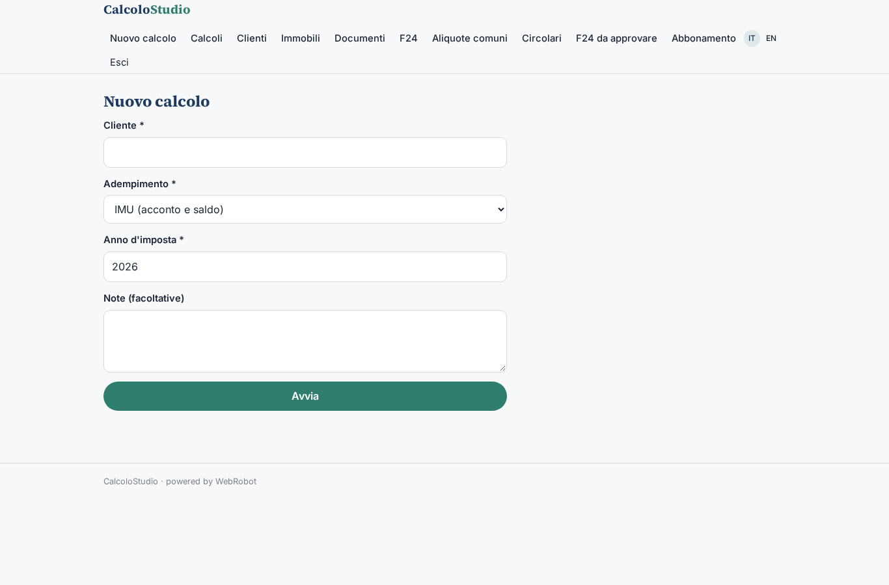
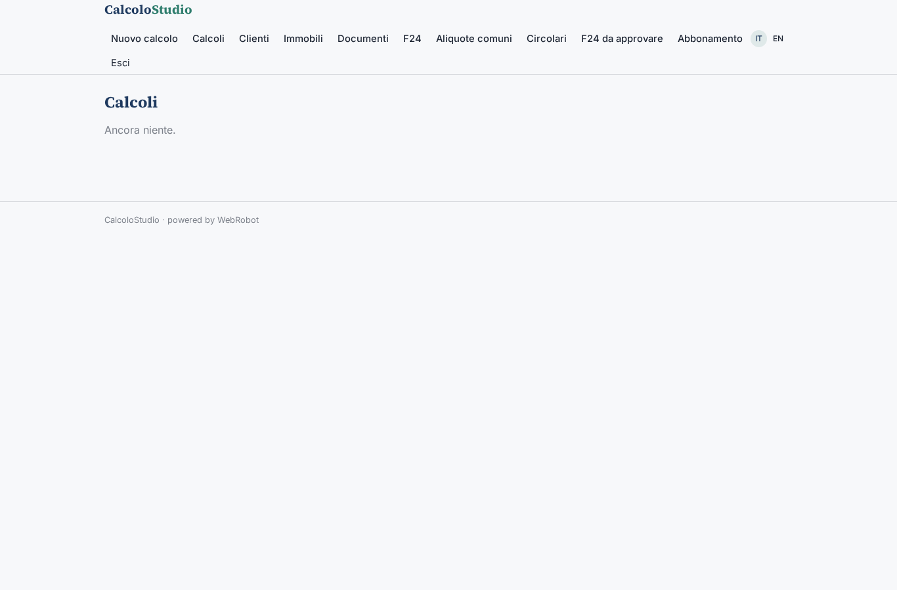
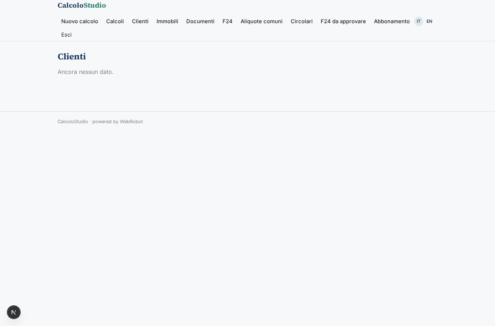
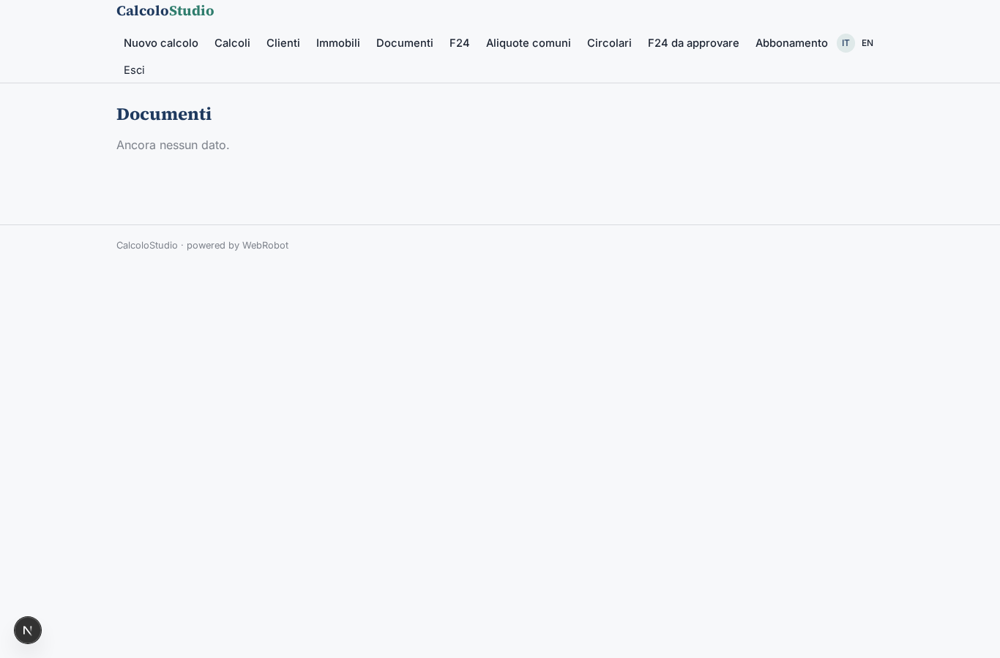
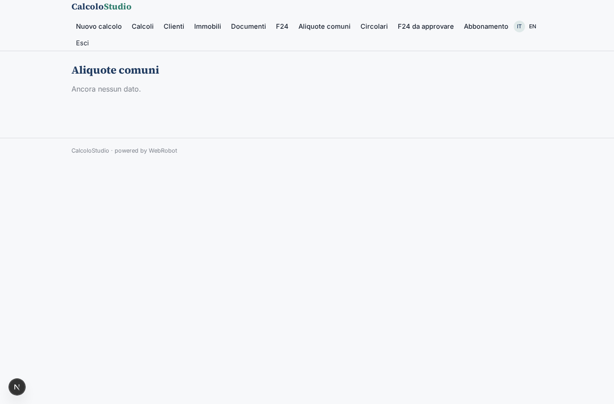
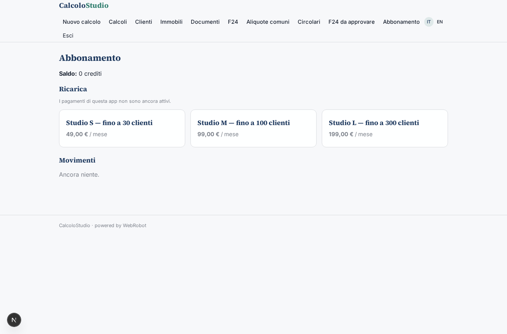

# CalcoloStudio

_Gli adempimenti ripetitivi dello studio, calcolati passo per passo._

**Manifest status:** valid (schema validator + runtime contract)

## Description given to the app builder (Italian)

Siamo uno studio di commercialisti e vogliamo un'app interna, CalcoloStudio, con agenti che preparino gli adempimenti ripetitivi. Il collaboratore apre la scheda del cliente (anagrafica, regime fiscale, immobili con rendite catastali e comune) e chiede un calcolo: IMU con aliquote del comune, acconti e saldi, compilazione del modello F24 con codici tributo corretti, ravvedimento operoso con sanzioni e interessi. Un agente esegue i calcoli in modo deterministico, consulta le circolari e le risoluzioni dell'Agenzia delle Entrate indicizzate per motivare le scelte e mostra il dettaglio passo per passo. I documenti del cliente (visure, dichiarazioni precedenti, cartelle) devono potersi caricare in PDF, e l'ideale è scaricare i dati direttamente dal cassetto fiscale del cliente con la delega. Ogni F24 prodotto deve essere approvato dal professionista prima di essere inviato al cliente via email. Il collaboratore vede i clienti assegnati, il titolare tutti. Abbonamento mensile per studio in base al numero di clienti. Italiano.

## Features not expressible today (spec.extensions)

- **upload_pdf**: Il caricamento di PDF (visure, dichiarazioni, cartelle) non è ancora disponibile: per ora si inserisce un link o si incolla il testo nella scheda Documenti.
- **cassetto_fiscale**: Il download dal cassetto fiscale con delega richiede credenziali del cliente/studio (connettore non disponibile ancora): per ora i dati si inseriscono a mano o dai documenti.
- **invio_email_f24**: L'invio via email dell'F24 approvato al cliente non è ancora disponibile: dopo l'approvazione il collaboratore scarica/stampa l'F24 e lo invia.
- **visibilita_clienti**: Il collaboratore vede i clienti assegnati e il titolare tutti: oggi i clienti sono dati per utente; serve una vista del titolare su tutti i record e l'assegnazione per collaboratore (campo 'collaboratore' già previsto).
- **caricamento_fonti**: Le collezioni 'aliquote_imu' e 'circolari' vanno popolate (a mano o con un'importazione) con le delibere comunali e le circolari/risoluzioni dell'Agenzia delle Entrate.

## Screenshots (interpretive runtime)

### home-anon

### home-mobile

### home

### nuovo_calcolo

### calcoli

### clienti

### immobili_v

### documenti_v

### f24_v

### aliquote_v

### circolari_v

### da_approvare

### account

