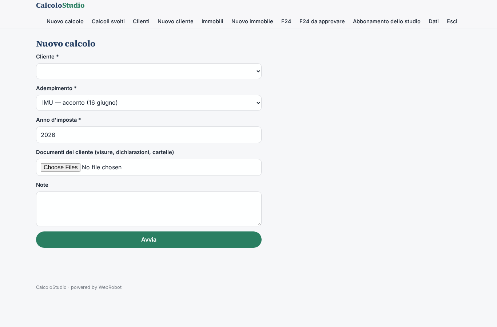
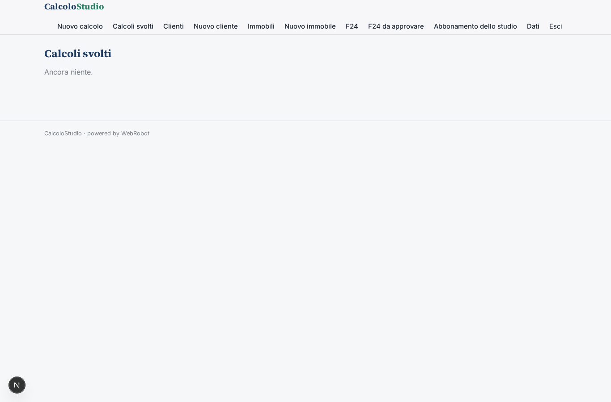
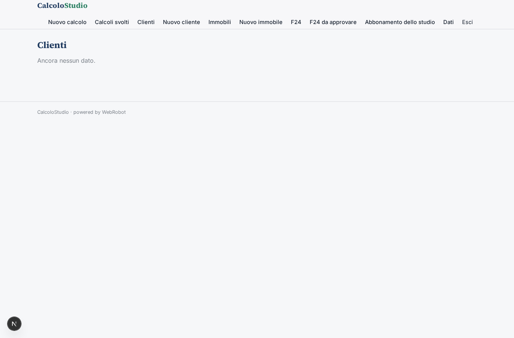
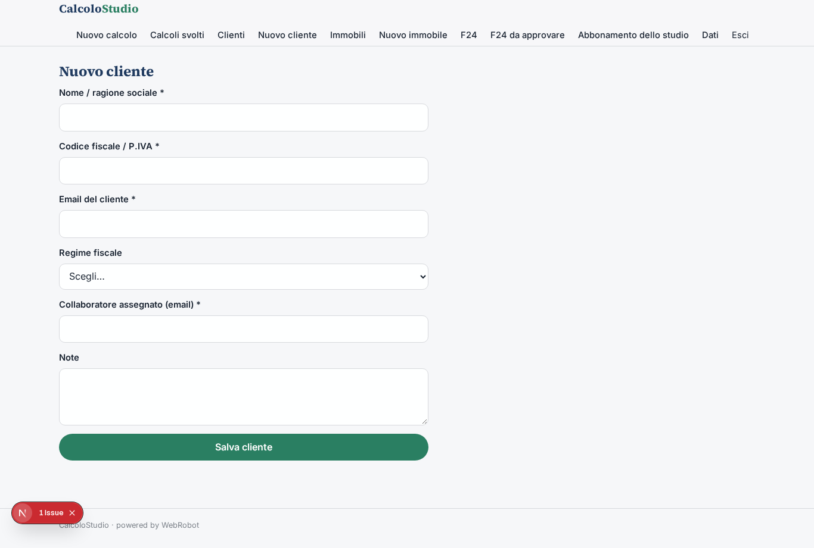
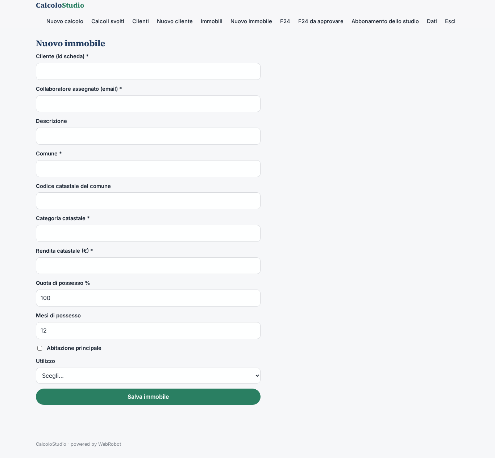
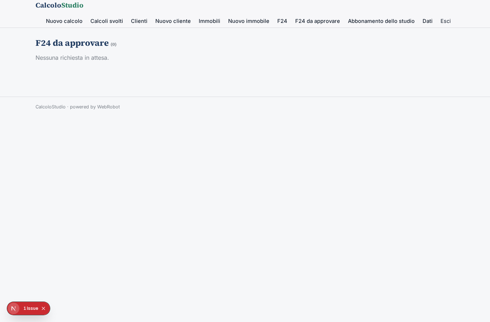
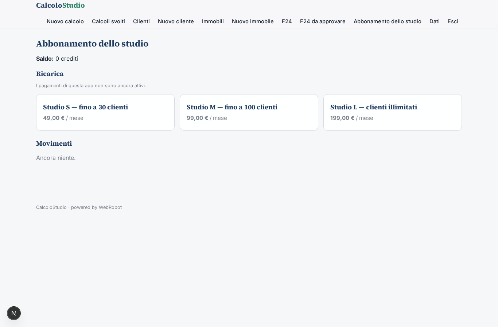

# CalcoloStudio

_Gli adempimenti ripetitivi dello studio, calcolati passo per passo e approvati dal professionista._

**Manifest:** valid (schema + runtime contract) · **Functional test:** passed (26 checks passed)

## Description given to the app builder (Italian)

Siamo uno studio di commercialisti e vogliamo un'app interna, CalcoloStudio, con agenti che preparino gli adempimenti ripetitivi. Il collaboratore apre la scheda del cliente (anagrafica, regime fiscale, immobili con rendite catastali e comune) e chiede un calcolo: IMU con aliquote del comune, acconti e saldi, compilazione del modello F24 con codici tributo corretti, ravvedimento operoso con sanzioni e interessi. Un agente esegue i calcoli in modo deterministico, consulta le circolari e le risoluzioni dell'Agenzia delle Entrate indicizzate per motivare le scelte e mostra il dettaglio passo per passo. I documenti del cliente (visure, dichiarazioni precedenti, cartelle) devono potersi caricare in PDF, e l'ideale è scaricare i dati direttamente dal cassetto fiscale del cliente con la delega. Ogni F24 prodotto deve essere approvato dal professionista prima di essere inviato al cliente via email. Il collaboratore vede i clienti assegnati, il titolare tutti. Abbonamento mensile per studio in base al numero di clienti. Italiano.

## Features not expressible today (spec.extensions)

- **cassetto_fiscale**: Il download automatico dal cassetto fiscale con delega richiede accesso con SPID/CIE/Entratel e i servizi dell'Agenzia delle Entrate, non una chiave API: non disponibile. Per ora i documenti si caricano in PDF nel modulo di calcolo.
- **circolari_indicizzate**: Un archivio indicizzato e ricercabile di circolari e risoluzioni non è ancora disponibile: l'agente le consulta sul sito ufficiale tramite il MCP WebRobot e cita la fonte. Un archivio proprio potrà essere aggiunto come job di indicizzazione.
- **abbonamento_per_studio**: L'abbonamento è unico per lo studio (il titolare lo gestisce) e la soglia di clienti è applicata a livello di app; le fasce S/M/L sono configurabili.

## Screenshots (interpretive runtime, no data)

### home-anon

### home-mobile

### home

### new_calc

### calcs

### clients

### client_new

### properties

### property_new

### f24s

### approvals_view

### account

