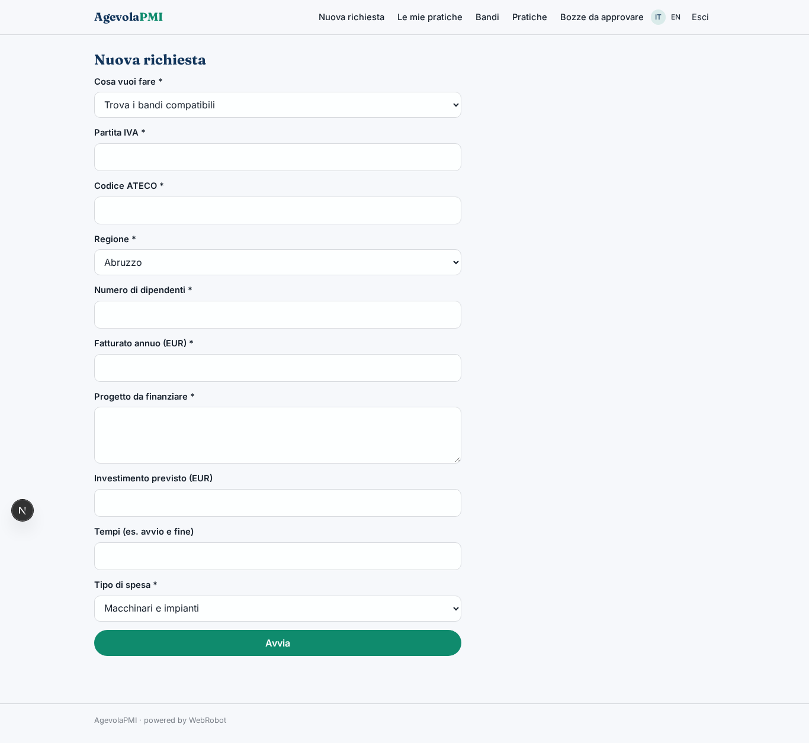
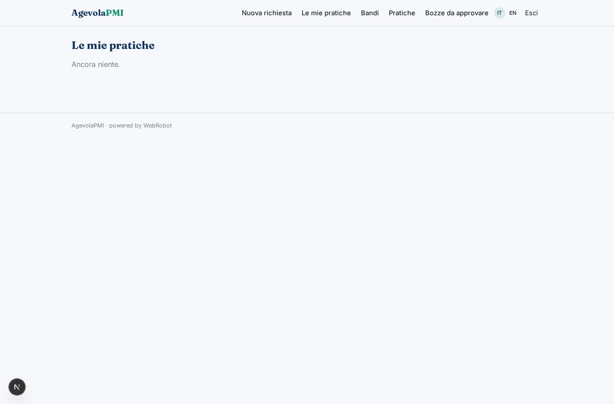
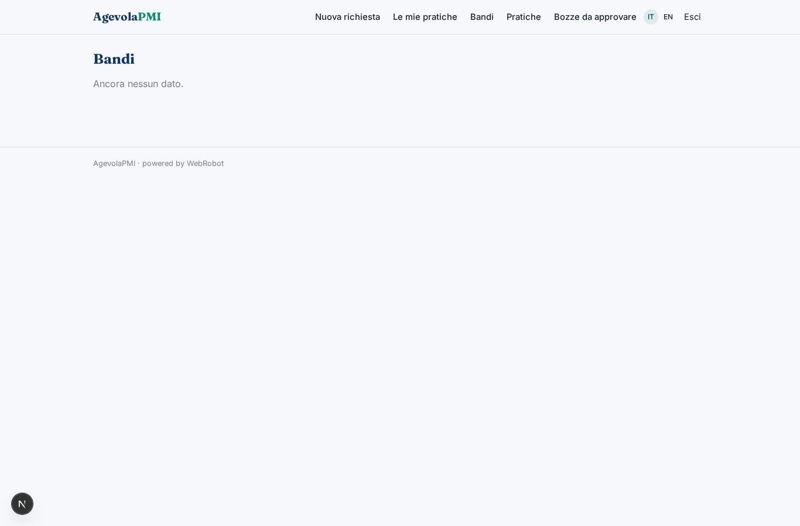
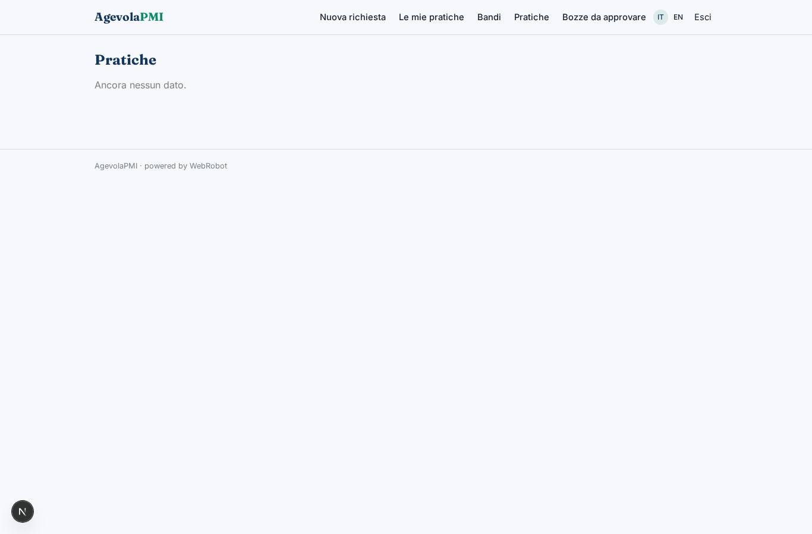
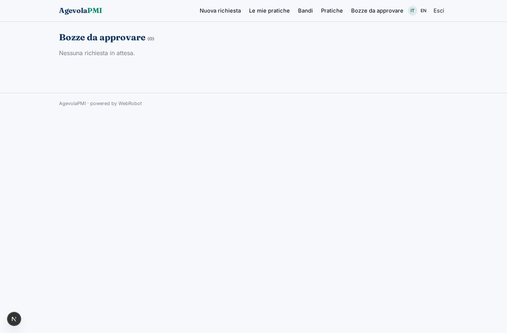
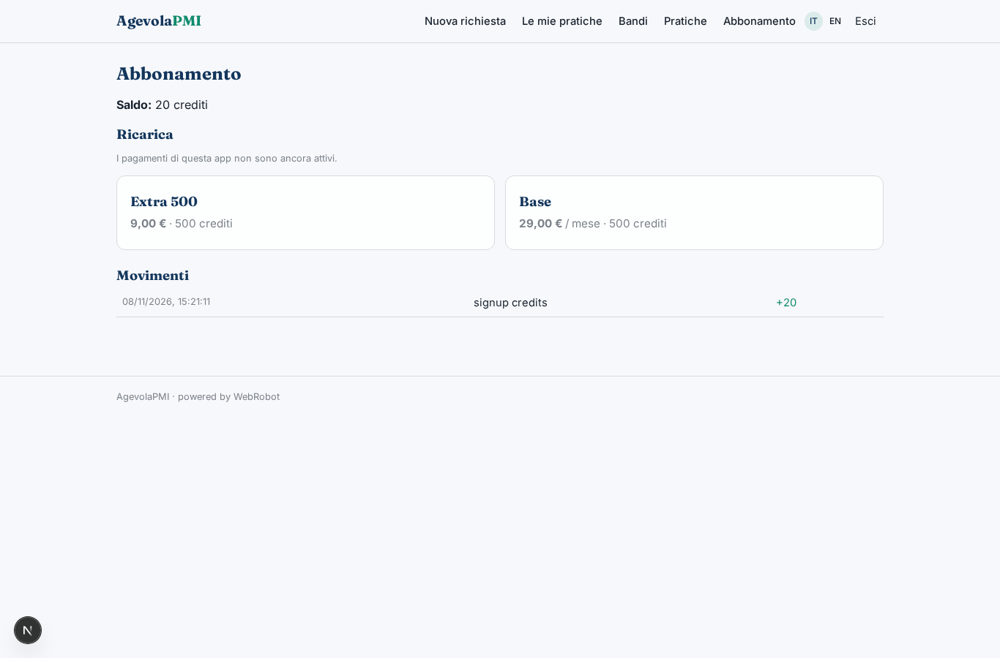

# AgevolaPMI

_Il bando giusto per la tua impresa, dalla domanda alla rendicontazione._

**Manifest status:** valid (schema validator + runtime contract)

## Description given to the app builder (Italian)

Mi serve AgevolaPMI, un'app per piccole imprese e consulenti di finanza agevolata. L'impresa inserisce partita IVA, codice ATECO, regione, numero di dipendenti, fatturato e una descrizione del progetto che vuole finanziare (investimento previsto, tempi, tipo di spesa). Un agente consulta ogni giorno i bandi pubblicati da ministeri, regioni, camere di commercio e dal portale incentivi, ne estrae requisiti, spese ammissibili, intensità dell'aiuto e scadenze, e li confronta con il profilo per proporre una classifica di bandi compatibili con la motivazione. Quando l'utente sceglie un bando, una squadra di agenti scrive la bozza della domanda: descrizione del progetto, piano dei costi, cronoprogramma, e la sottopone al consulente, che la approva o la corregge prima dell'invio. Dopo l'eventuale concessione l'impresa deve poter caricare fatture, quietanze e contratti per la rendicontazione, e l'agente verifica che le spese corrispondano al piano approvato. Alert email per nuovi bandi e scadenze. Il consulente vede tutti i suoi clienti, l'impresa solo i propri dati. Abbonamento base più una commissione a pratica approvata.

## Features not expressible today (spec.extensions)

- **file_upload**: Caricamento di fatture, quietanze e contratti non ancora disponibile: l'utente incolla il testo o indica link; i file andranno gestiti quando il tipo 'file' sarà supportato.
- **email_alerts**: Alert email per nuovi bandi compatibili e scadenze non ancora disponibili (notifiche non supportate): per ora i bandi si consultano nella vista Bandi e nelle pratiche.
- **success_fee**: Commissione per pratica approvata (oltre all'abbonamento base): serve un addebito a evento sulla concessione, da configurare a parte; per ora solo abbonamento e crediti.
- **consultant_clients**: Il consulente vede i clienti che condividono con lui le pratiche (sharing per record); un elenco clienti dedicato con ruolo derivato è un'evoluzione futura.

## Screenshots (interpretive runtime)

### home-anon

### home-mobile

### home

### new

### history

### bandi_list

### practices_list

### reviews

### account

