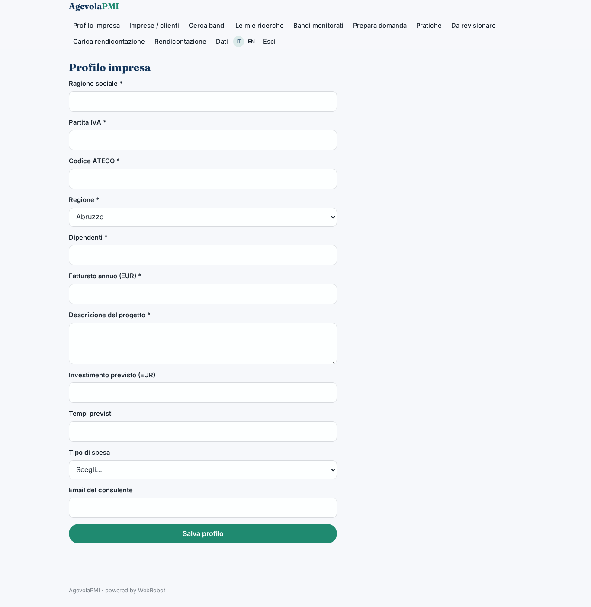
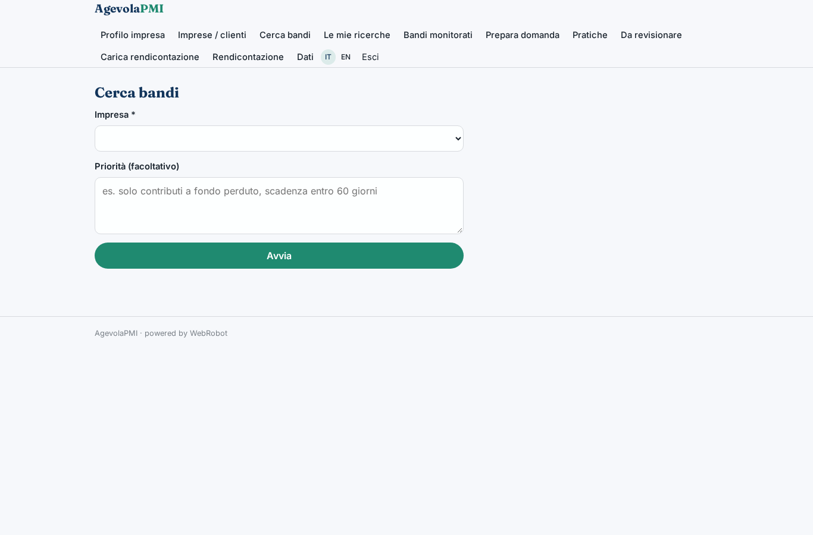
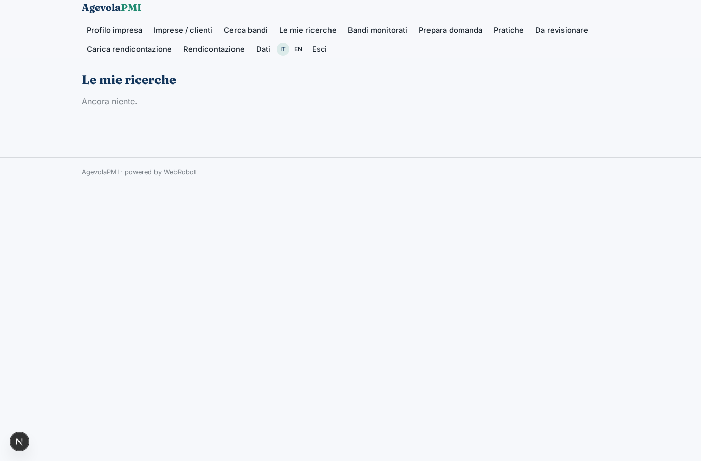
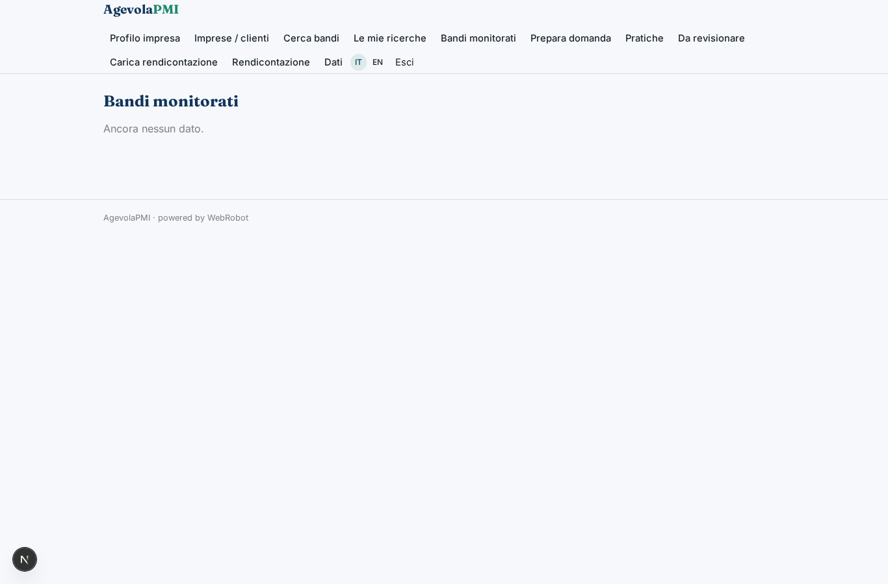
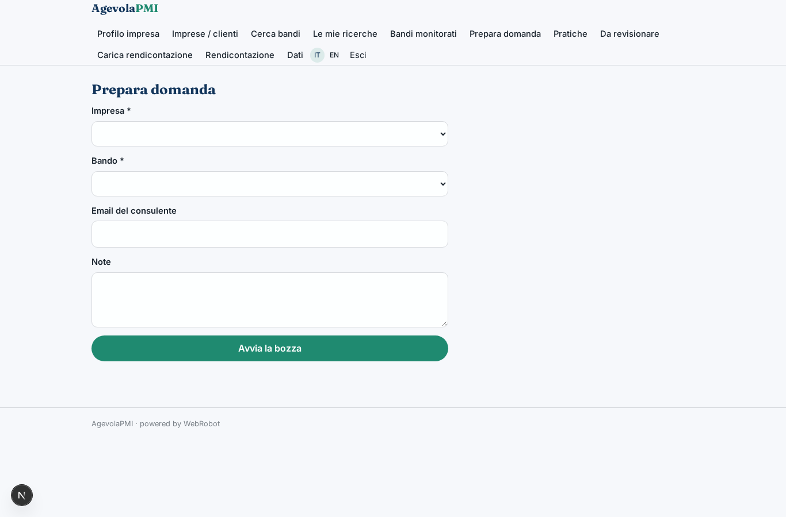
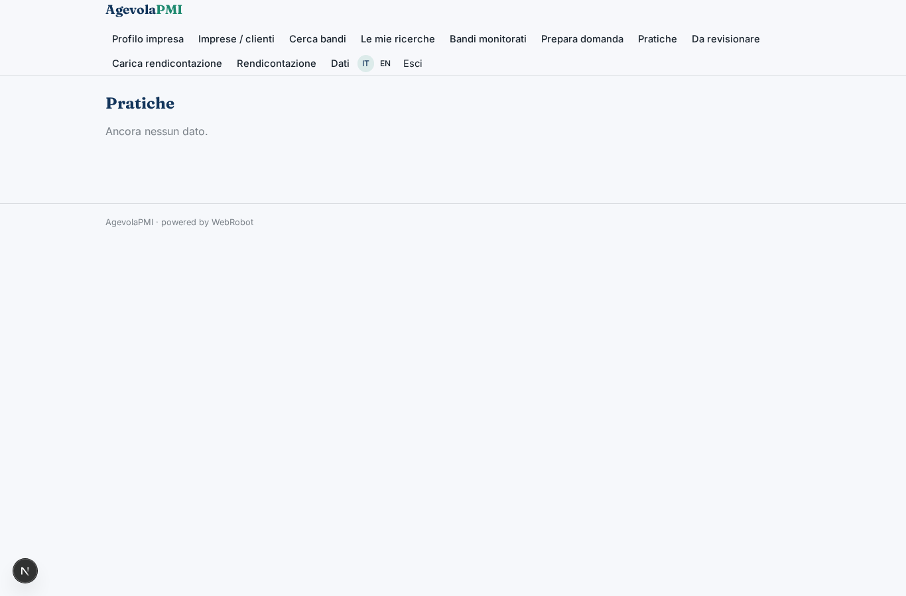
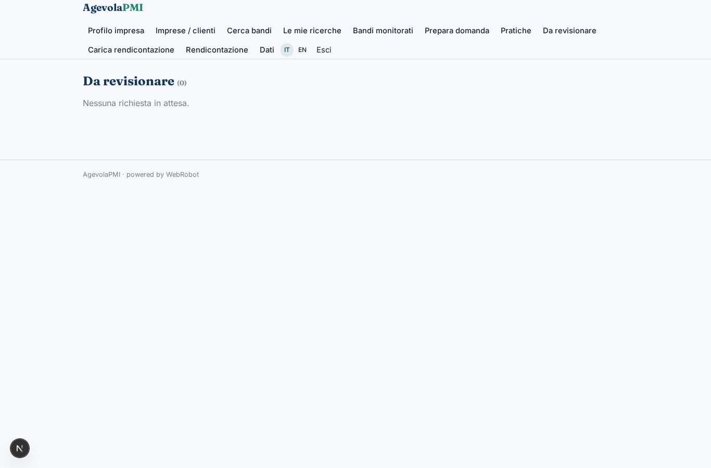
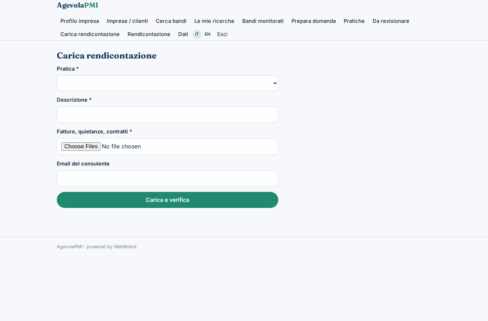
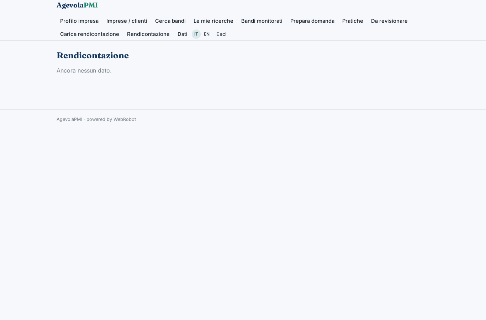
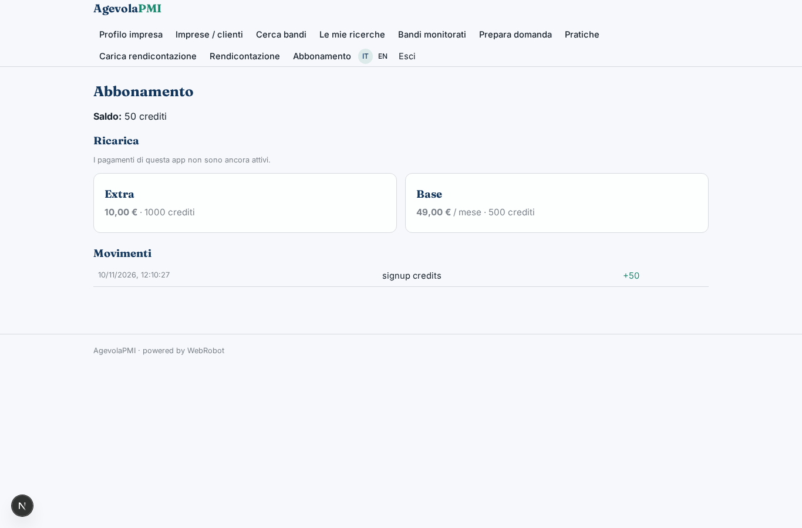

# AgevolaPMI

_Trova i bandi giusti, prepara la domanda, rendiconta senza errori._

**Manifest:** valid (schema + runtime contract) · **Functional test:** passed (24 checks passed)

## Description given to the app builder (Italian)

Mi serve AgevolaPMI, un'app per piccole imprese e consulenti di finanza agevolata. L'impresa inserisce partita IVA, codice ATECO, regione, numero di dipendenti, fatturato e una descrizione del progetto che vuole finanziare (investimento previsto, tempi, tipo di spesa). Un agente consulta ogni giorno i bandi pubblicati da ministeri, regioni, camere di commercio e dal portale incentivi, ne estrae requisiti, spese ammissibili, intensità dell'aiuto e scadenze, e li confronta con il profilo per proporre una classifica di bandi compatibili con la motivazione. Quando l'utente sceglie un bando, una squadra di agenti scrive la bozza della domanda: descrizione del progetto, piano dei costi, cronoprogramma, e la sottopone al consulente, che la approva o la corregge prima dell'invio. Dopo l'eventuale concessione l'impresa deve poter caricare fatture, quietanze e contratti per la rendicontazione, e l'agente verifica che le spese corrispondano al piano approvato. Alert email per nuovi bandi e scadenze. Il consulente vede tutti i suoi clienti, l'impresa solo i propri dati. Abbonamento base più una commissione a pratica approvata.

## Screenshots (interpretive runtime, no data)

### home-anon

### home-mobile

### home

### profile

### clients_list

### new_match

### history

### grants_list

### apply

### applications

### reviews

### upload_expense

### expenses

### account

