# Pappa su Misura

_Il piano alimentare del tuo cane, calcolato per lui e in abbonamento._

**Manifest status:** valid (schema validator + runtime contract)

## Description given to the app builder (Italian)

Questo e lo strato software di un servizio di cibo per cani su abbonamento: descrivo l'app di prenotazione e gestione, non la produzione o la consegna fisica del cibo. Il padrone compila un modulo con dati del cane: razza, eta, peso, livello di attivita, allergie, obiettivo (mantenimento, dimagrimento). Un agente calcola il fabbisogno calorico e nutrizionale e propone un piano alimentare personalizzato con razioni giornaliere e prodotti consigliati, spiegando le scelte. Il padrone conferma e attiva un abbonamento ricorrente con carta, scegliendo la frequenza delle forniture; l'app gestisce il calendario delle consegne previste, permette di mettere in pausa o modificare il piano e invia promemoria via email prima di ogni rinnovo. Quando il cane cresce o cambiano le esigenze, l'agente aggiorna il piano e ricalcola le razioni. Il padrone vede solo i propri cani e abbonamenti, l'admin gestisce prodotti e piani. Monetizzazione: abbonamento ricorrente. In italiano.

## Features not expressible today (spec.extensions)

- **email_reminders**: Promemoria email prima di ogni rinnovo e delle consegne: le notifiche email non sono ancora disponibili; per ora il calendario consegne e visibile nell'app.
- **food_subscription_charges**: Il pagamento ricorrente con carta e l'abbonamento al servizio (Stripe Connect); l'addebito del prezzo dei prodotti per singola fornitura e la logistica restano fuori dall'app.

## Screenshots (interpretive runtime)

### home-anon
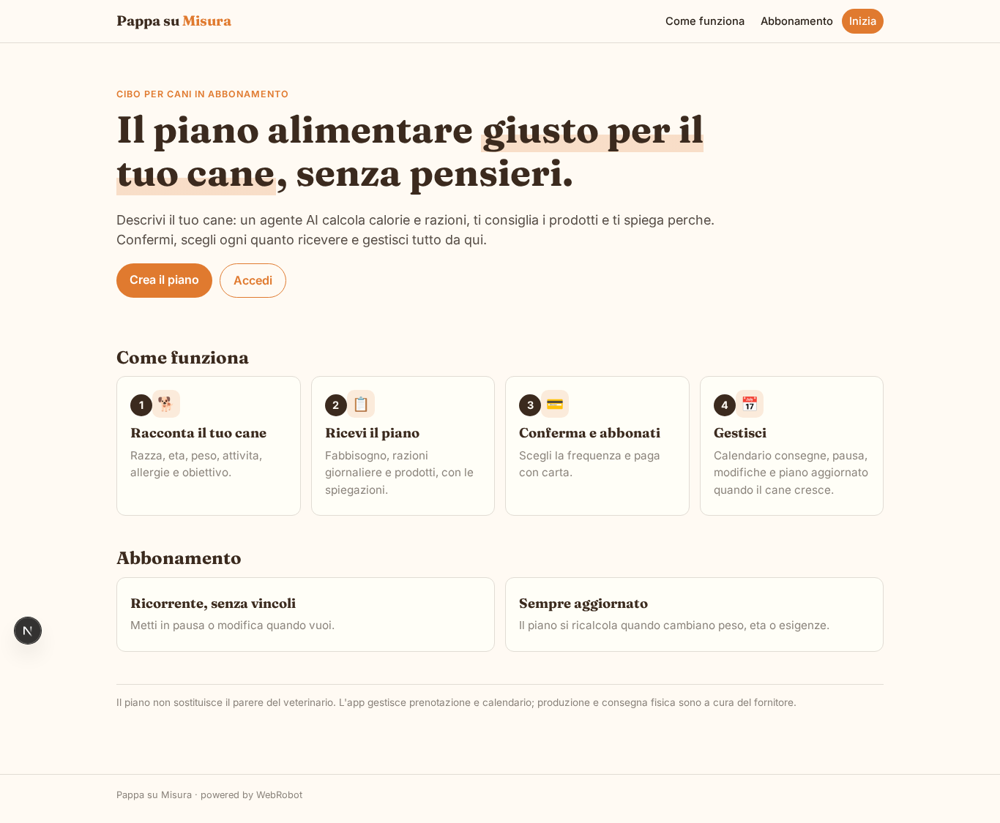

### home-mobile
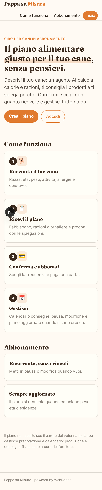

### home
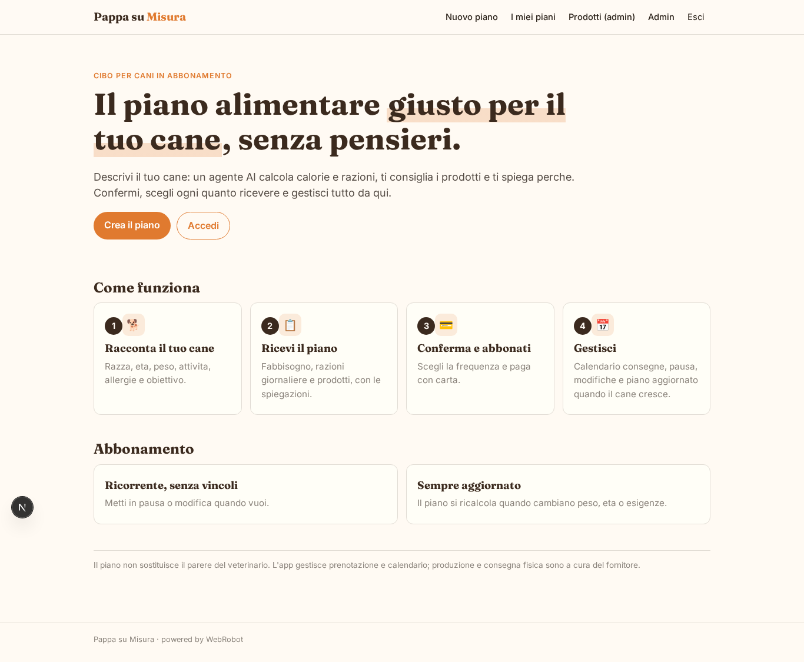

### new_plan
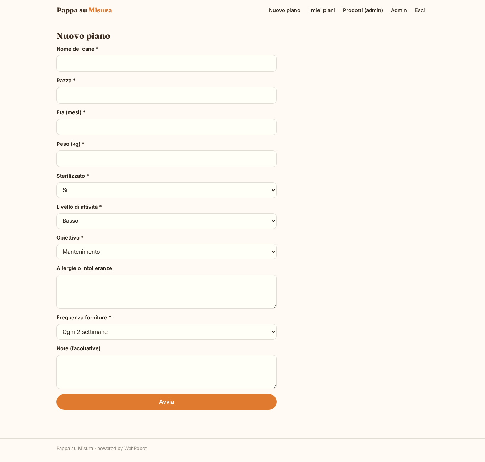

### plans
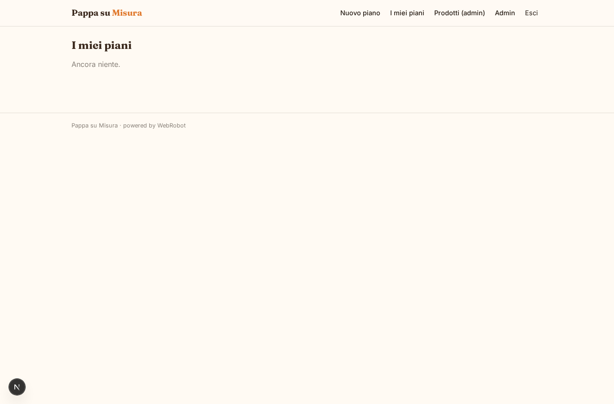

### confirmations
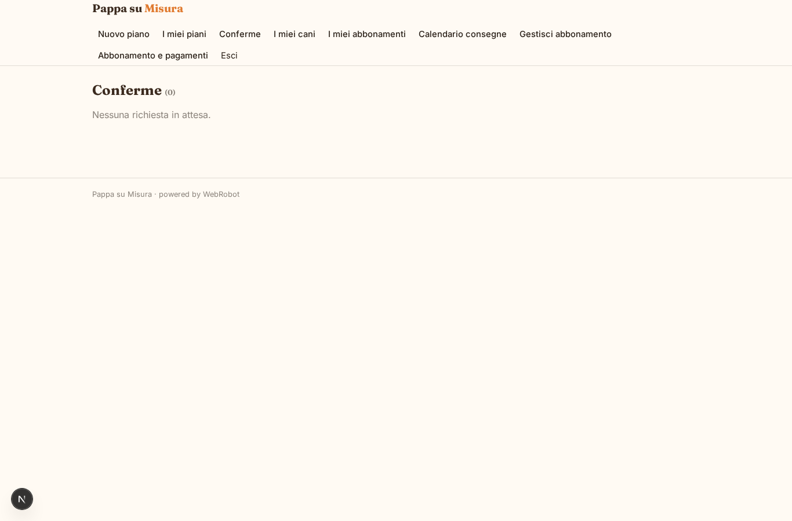

### my_dogs
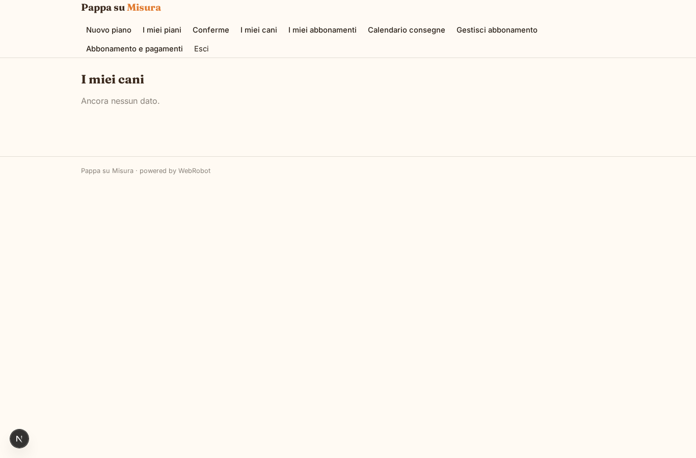

### my_subscriptions
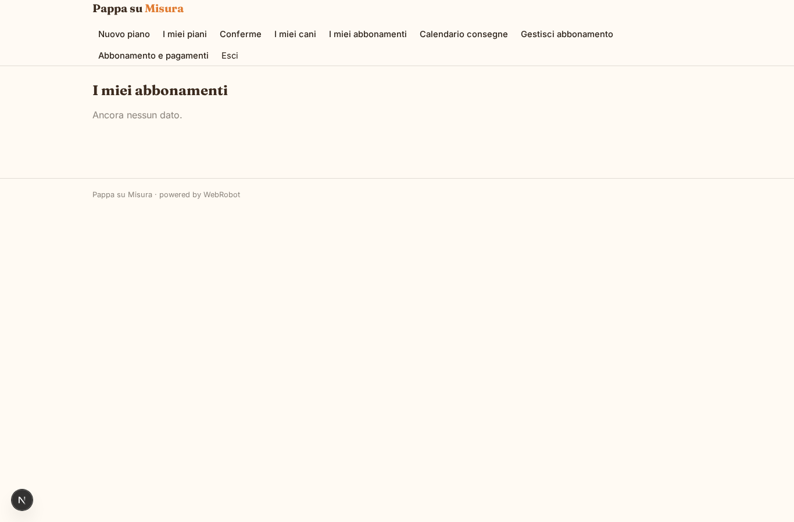

### calendar
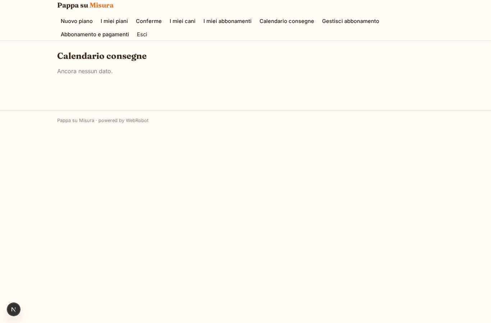

### assistant
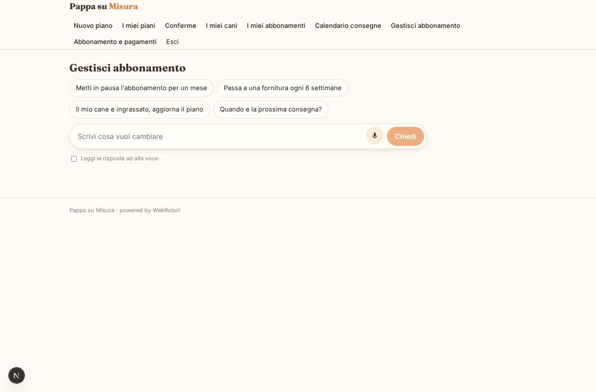

### account
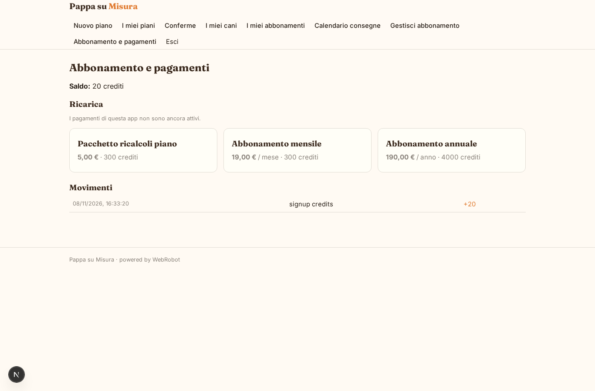

### admin_products
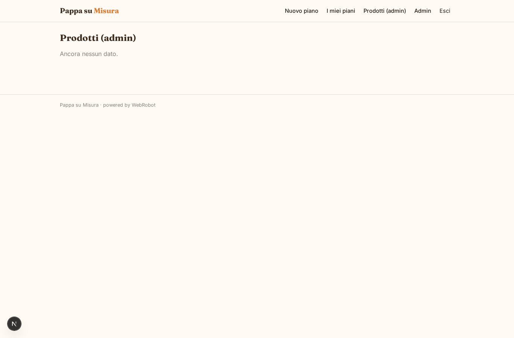

### admin
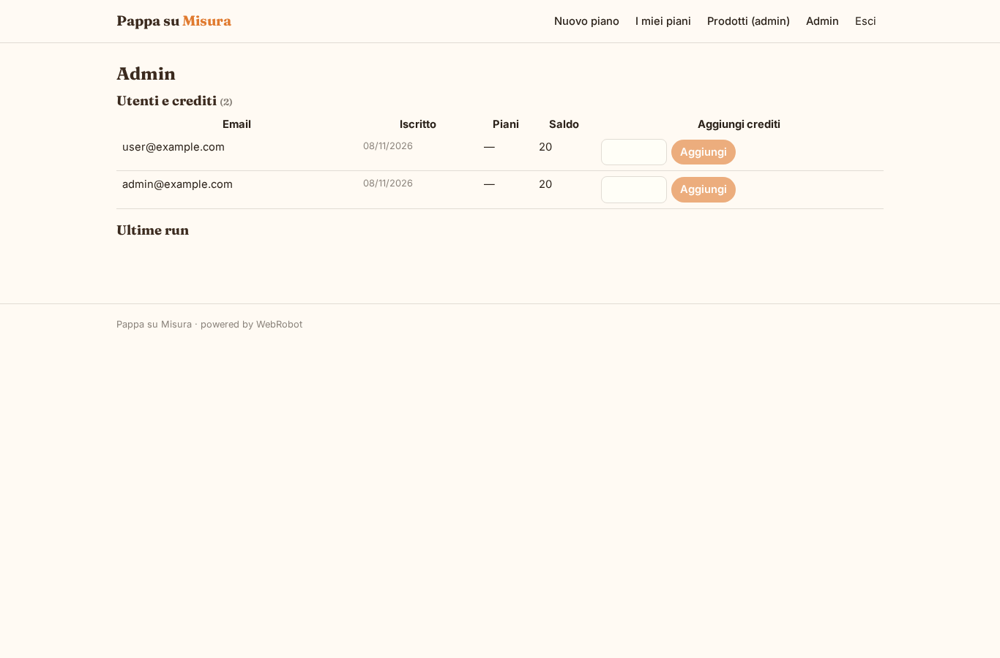

