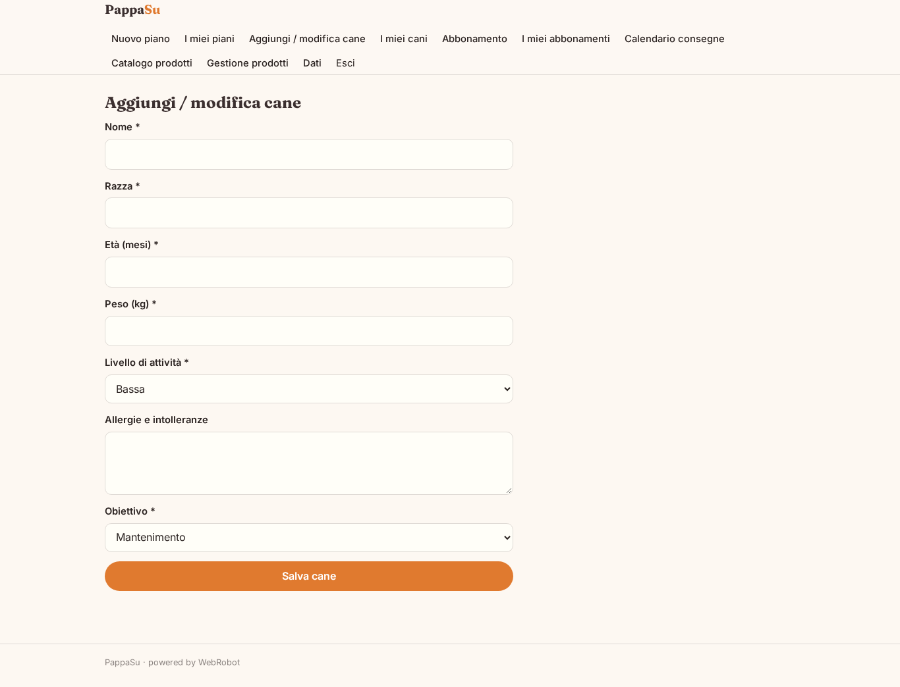
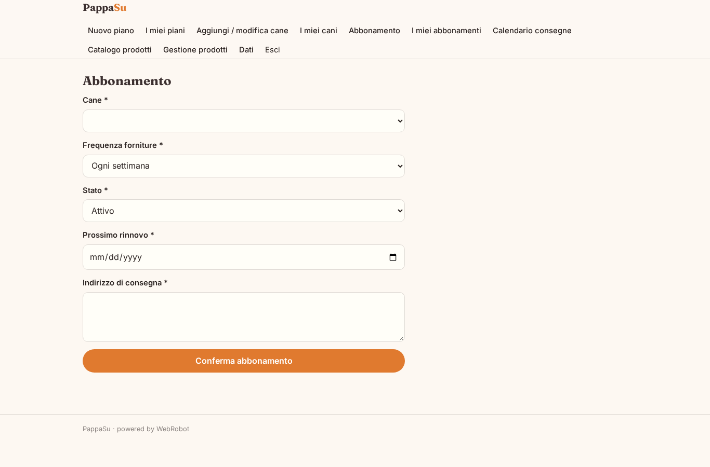
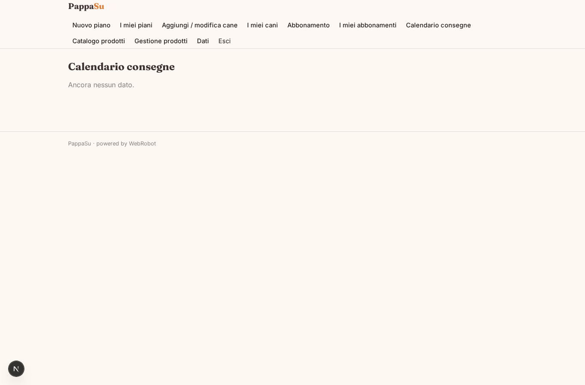
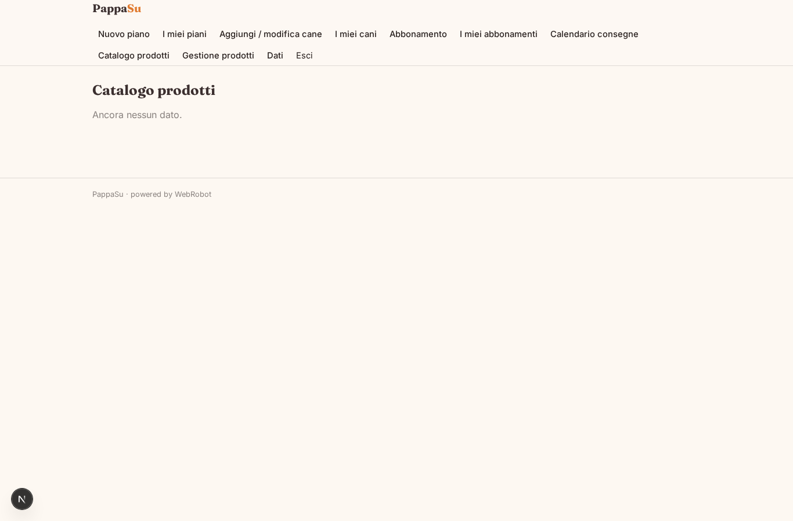
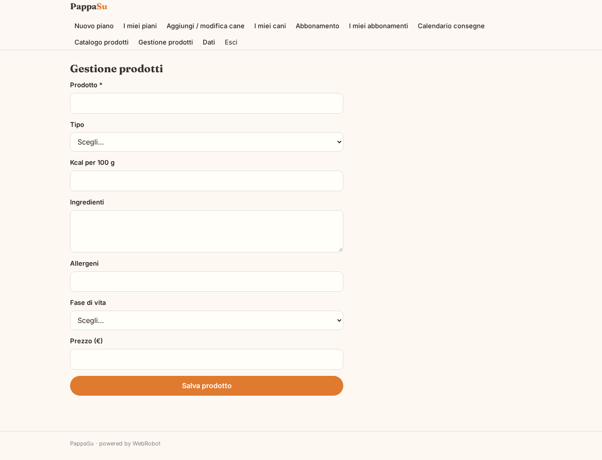
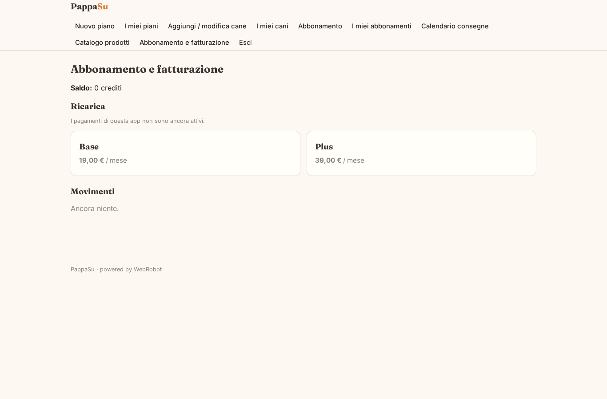

# PappaSu

_Il piano alimentare su misura per il tuo cane, in abbonamento._

**Manifest:** valid (schema + runtime contract) · **Functional test:** passed (18 checks passed)

## Description given to the app builder (Italian)

Questo e lo strato software di un servizio di cibo per cani su abbonamento: descrivo l'app di prenotazione e gestione, non la produzione o la consegna fisica del cibo. Il padrone compila un modulo con dati del cane: razza, eta, peso, livello di attivita, allergie, obiettivo (mantenimento, dimagrimento). Un agente calcola il fabbisogno calorico e nutrizionale e propone un piano alimentare personalizzato con razioni giornaliere e prodotti consigliati, spiegando le scelte. Il padrone conferma e attiva un abbonamento ricorrente con carta, scegliendo la frequenza delle forniture; l'app gestisce il calendario delle consegne previste, permette di mettere in pausa o modificare il piano e invia promemoria via email prima di ogni rinnovo. Quando il cane cresce o cambiano le esigenze, l'agente aggiorna il piano e ricalcola le razioni. Il padrone vede solo i propri cani e abbonamenti, l'admin gestisce prodotti e piani. Monetizzazione: abbonamento ricorrente. In italiano.

## Features not expressible today (spec.extensions)

- **card_delivery_note**: Il pagamento ricorrente con carta dell'abbonamento è gestito da Stripe Connect tramite i piani di fatturazione; il costo dei prodotti inviati e la logistica fisica sono fuori dall'app.

## Screenshots (interpretive runtime, no data)

### home-anon

### home-mobile

### home

### new_plan

### plans_history

### dog_form

### my_dogs

### subscribe

### my_subs

### my_deliveries

### products_list

### product_admin

### account

