# MatchLab

_Dalle partite già raccolte a schede, metriche e risposte in chat._

**Manifest status:** valid (schema validator + runtime contract)

## Description given to the app builder (Italian)

Descrivo solo lo strato software di analisi delle partite: il portale che elabora e mostra i dati, non il sistema di tracciamento in tempo reale proprietario, che e un prodotto a parte. L'analista della societa carica o collega i dati di una partita gia raccolti (eventi, posizioni, esiti) concessi in licenza o forniti dal cliente. Un agente applica modelli matematici per calcolare indicatori di prestazione di squadra e di singolo, individua schemi di gioco ricorrenti e produce una scheda partita con metriche confrontabili tra gare e avversari. L'analista vede dashboard con grafici, mappe di gioco e tabelle filtrabili, e puo fare domande in chat tipo "come e cambiato il possesso nel secondo tempo". Un report viene generato dopo ogni partita e inviato allo staff via email. Ogni societa vede solo le proprie partite e i propri dati. Abbonamento stagionale per squadra, con quota per numero di partite analizzate. In italiano e inglese.

## Features not expressible today (spec.extensions)

- **email_report**: Sending the post-match report by email to the staff is not available yet; the report is in the run history and printable.
- **file_upload**: Uploading files is not available yet; data is linked by URL or pasted as text.
- **pitch_maps**: Graphical pitch maps/heatmaps are not available as a block; the agent describes zones in tables and charts.

## Screenshots (interpretive runtime)

### home-anon
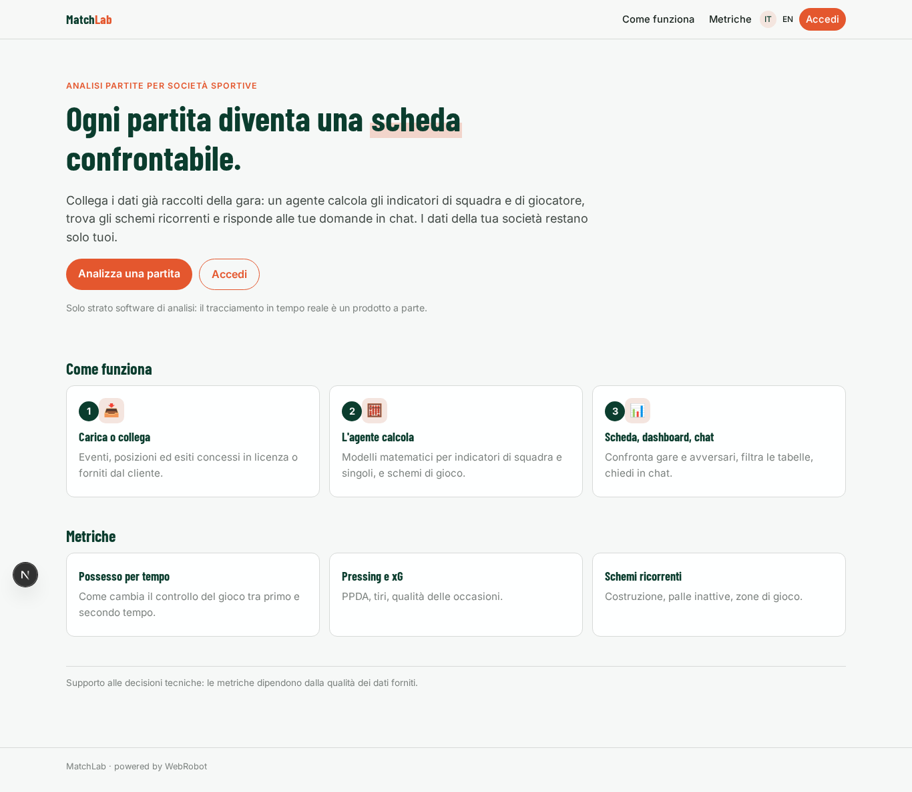

### home-mobile
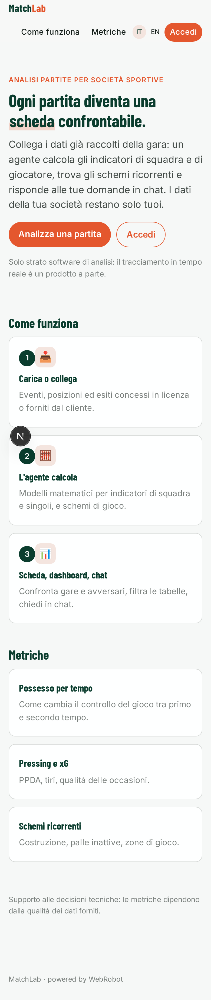

### home
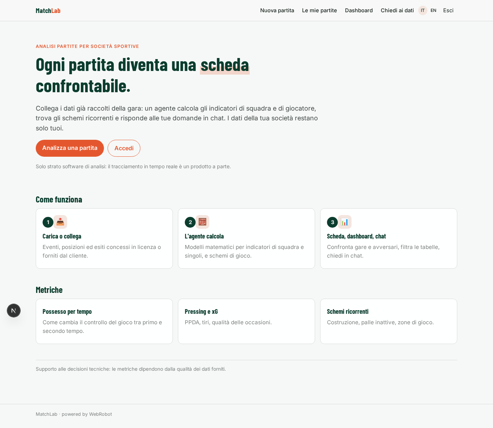

### new_match
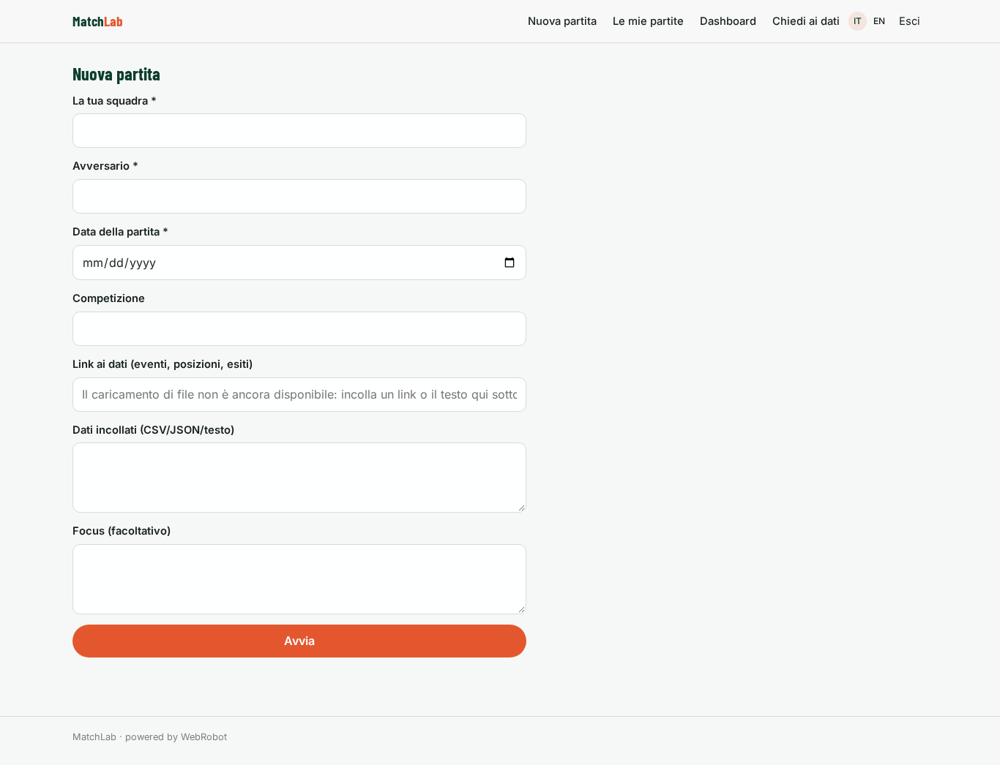

### matches
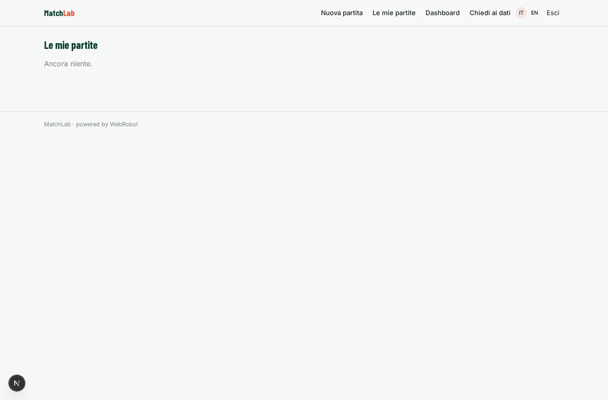

### dashboard
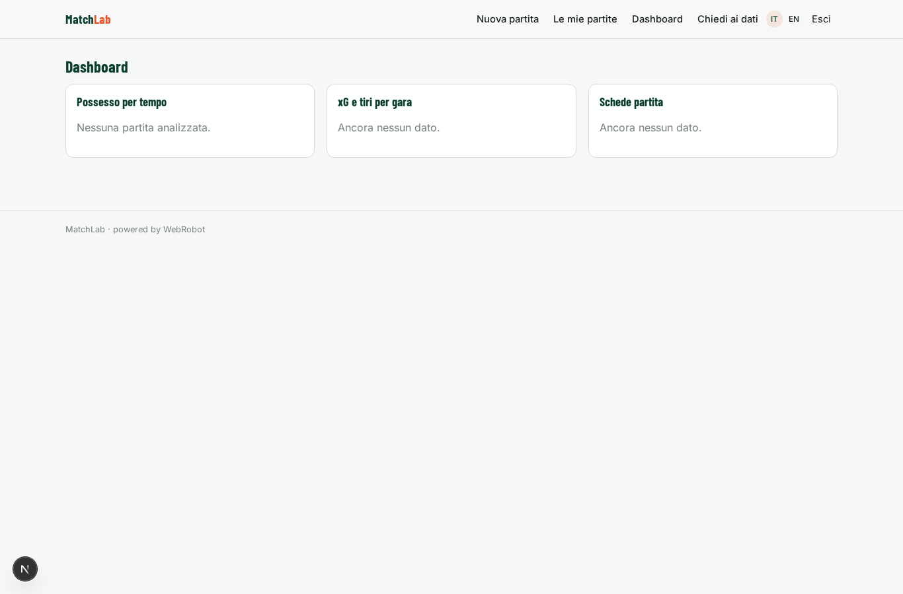

### possession_chart
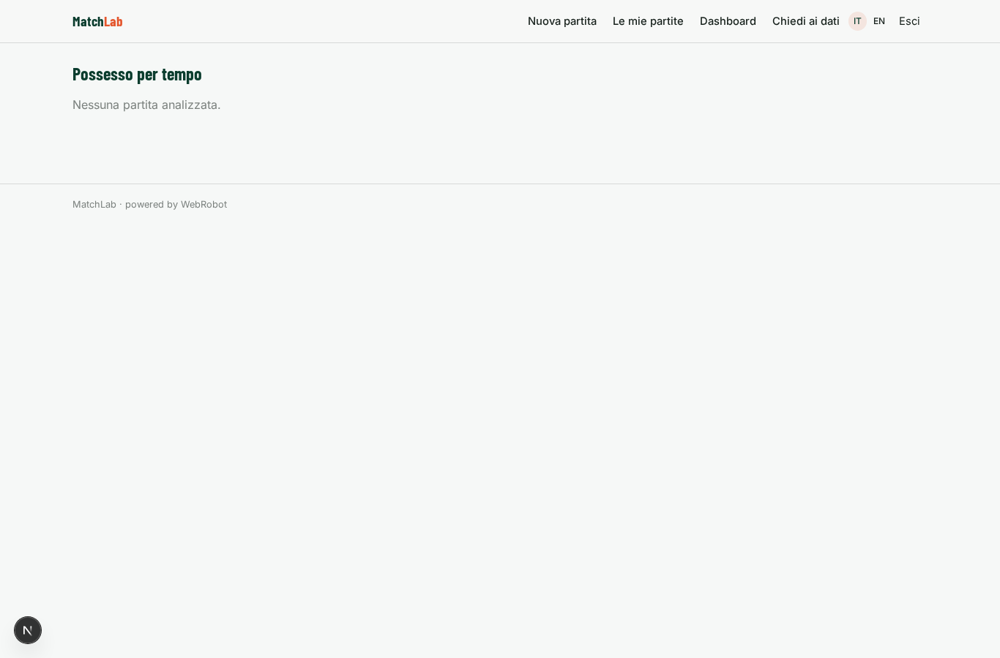

### metrics_chart
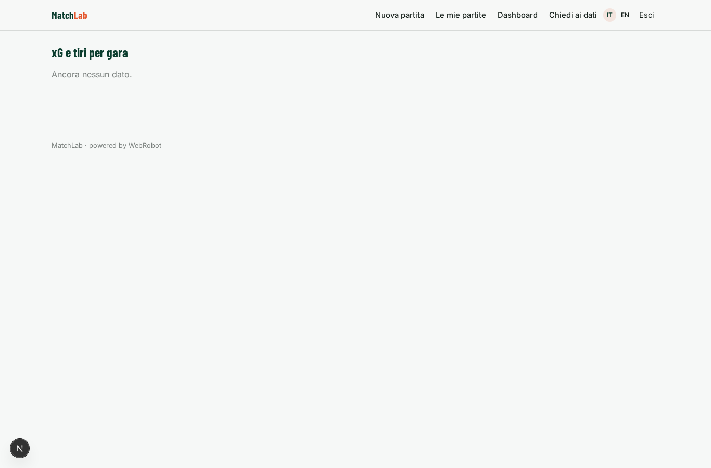

### cards_table
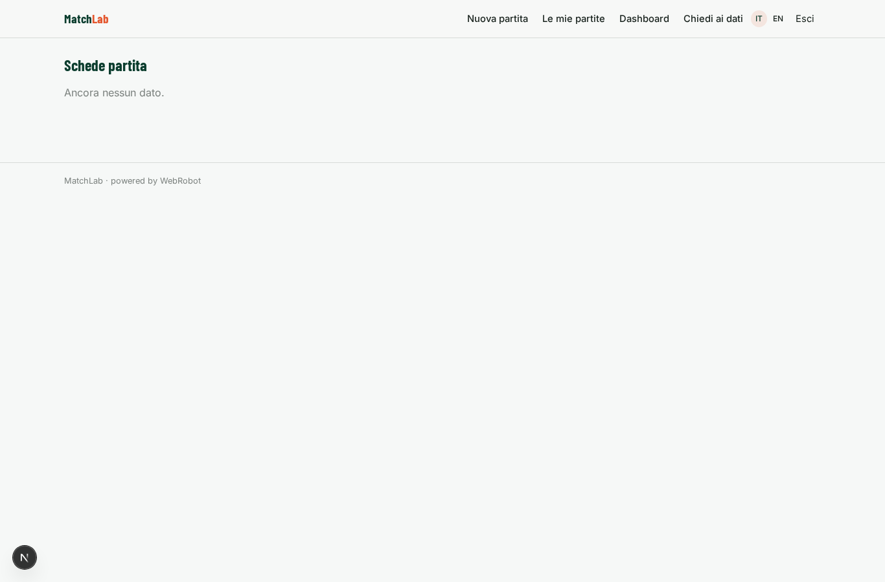

### chat
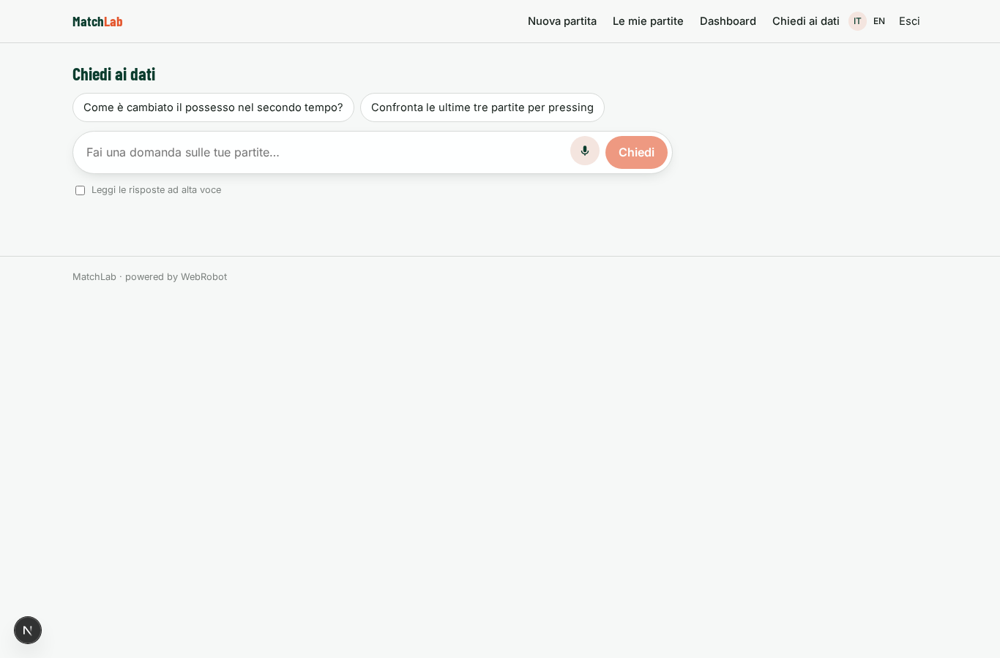

### account
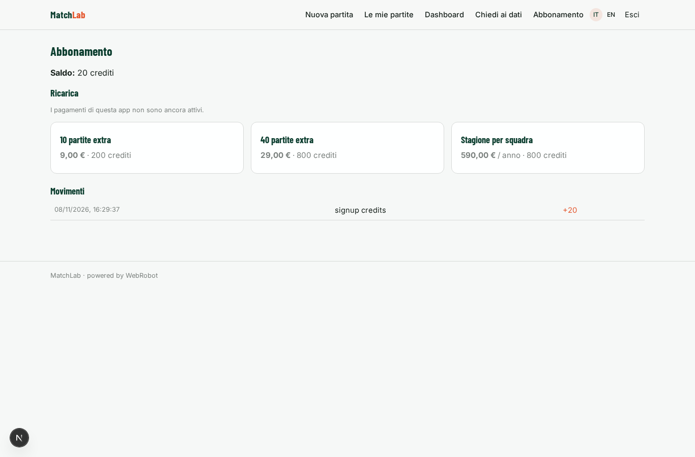

