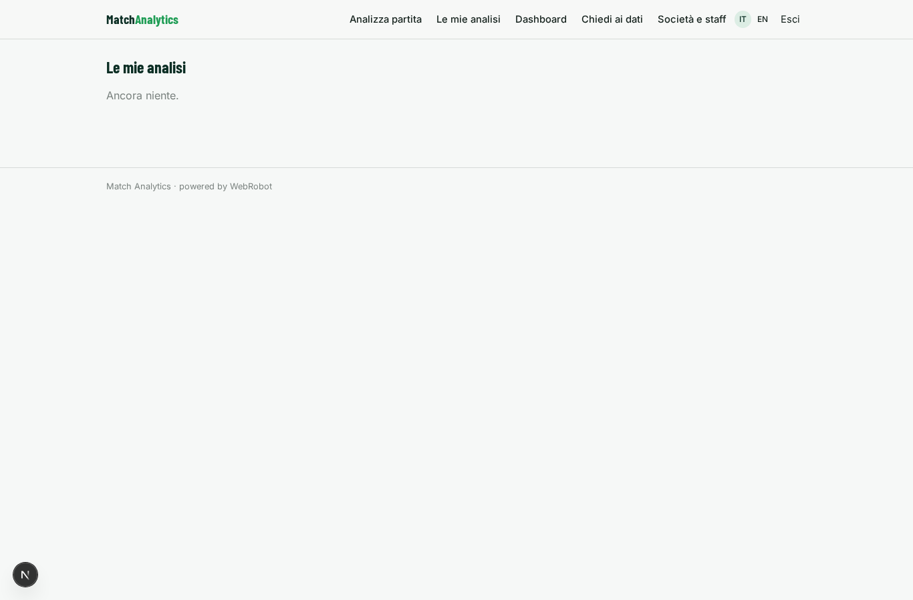
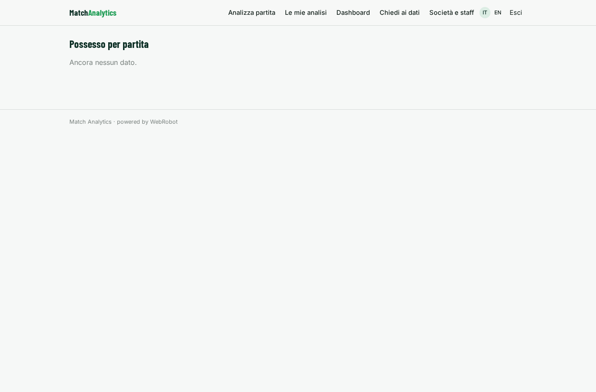
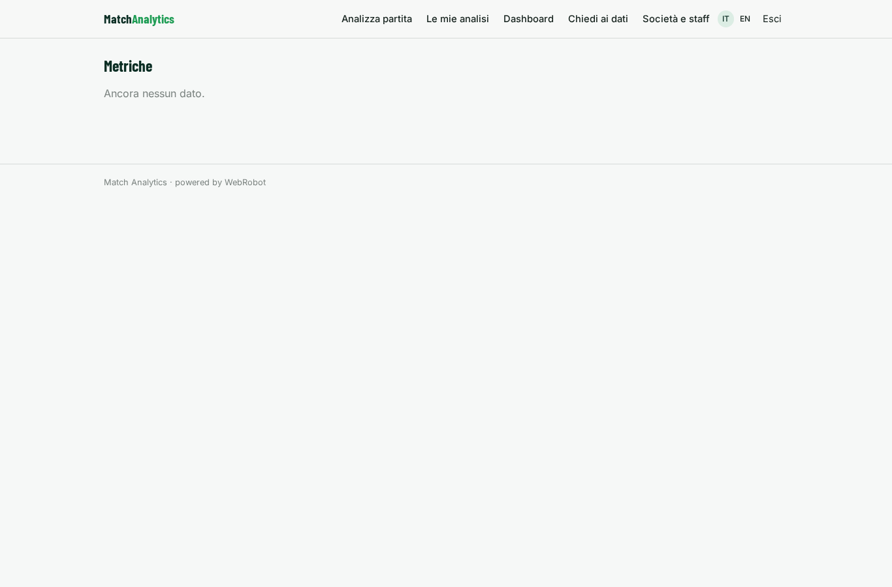
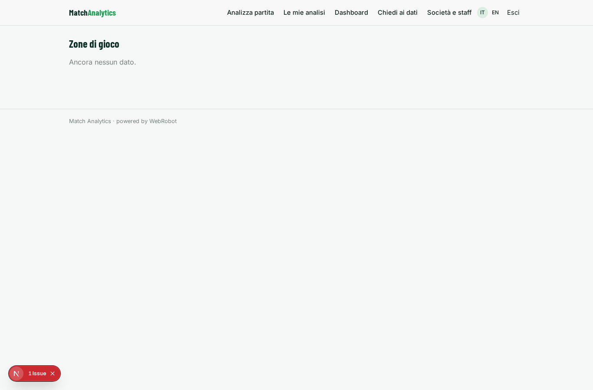
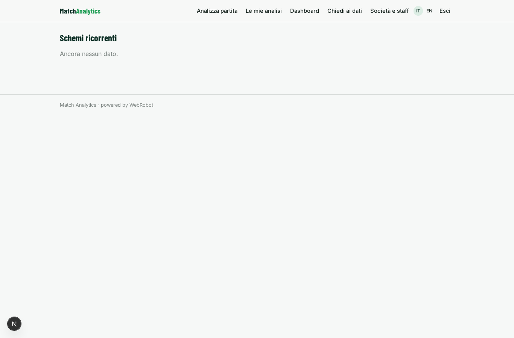
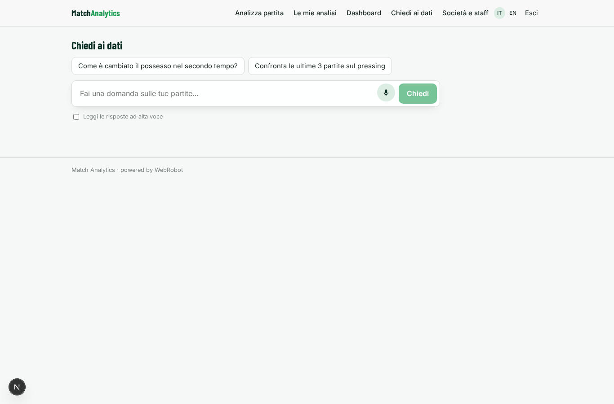
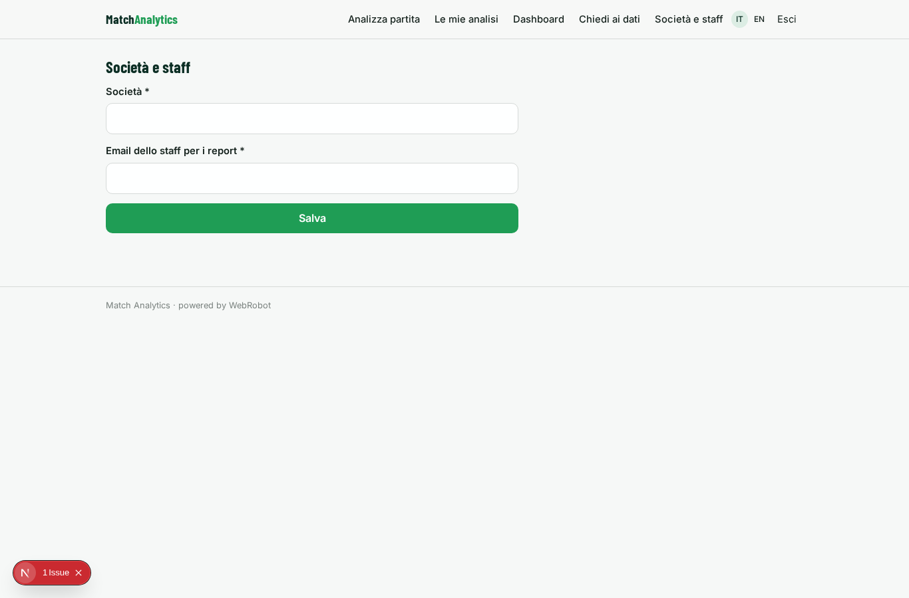
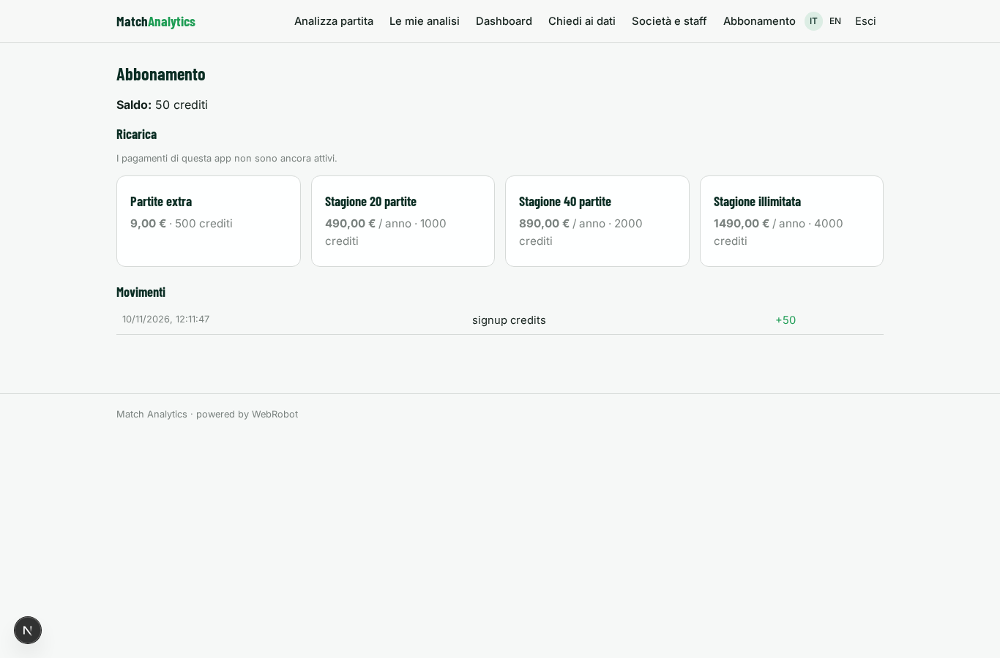

# Match Analytics

_Dai dati di gara alla scheda partita, con metriche confrontabili._

**Manifest:** valid (schema + runtime contract) · **Functional test:** passed (12 checks passed)

## Description given to the app builder (Italian)

Descrivo solo lo strato software di analisi delle partite: il portale che elabora e mostra i dati, non il sistema di tracciamento in tempo reale proprietario, che e un prodotto a parte. L'analista della societa carica o collega i dati di una partita gia raccolti (eventi, posizioni, esiti) concessi in licenza o forniti dal cliente. Un agente applica modelli matematici per calcolare indicatori di prestazione di squadra e di singolo, individua schemi di gioco ricorrenti e produce una scheda partita con metriche confrontabili tra gare e avversari. L'analista vede dashboard con grafici, mappe di gioco e tabelle filtrabili, e puo fare domande in chat tipo "come e cambiato il possesso nel secondo tempo". Un report viene generato dopo ogni partita e inviato allo staff via email. Ogni societa vede solo le proprie partite e i propri dati. Abbonamento stagionale per squadra, con quota per numero di partite analizzate. In italiano e inglese.

## Features not expressible today (spec.extensions)

- **pitch_map**: Heat/play maps on a pitch diagram are not available (the map view is geographic only): zones are shown as a 3x3 table and charts for now.
- **data_link**: Direct connection to provider feeds is not available yet: data comes from file uploads (CSV, JSON, Excel).

## Screenshots (interpretive runtime, no data)

### home-anon

### home-mobile

### home

### new_match

### history

### dashboard

### possession_trend

### metrics_table

### zones_table

### patterns_table

### assistant

### settings

### account

