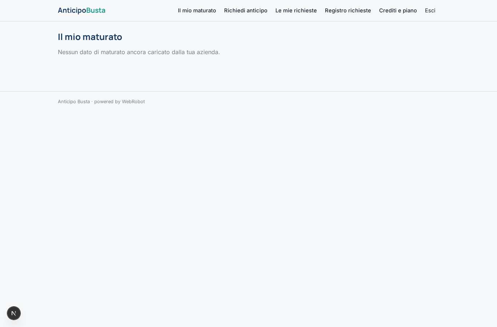
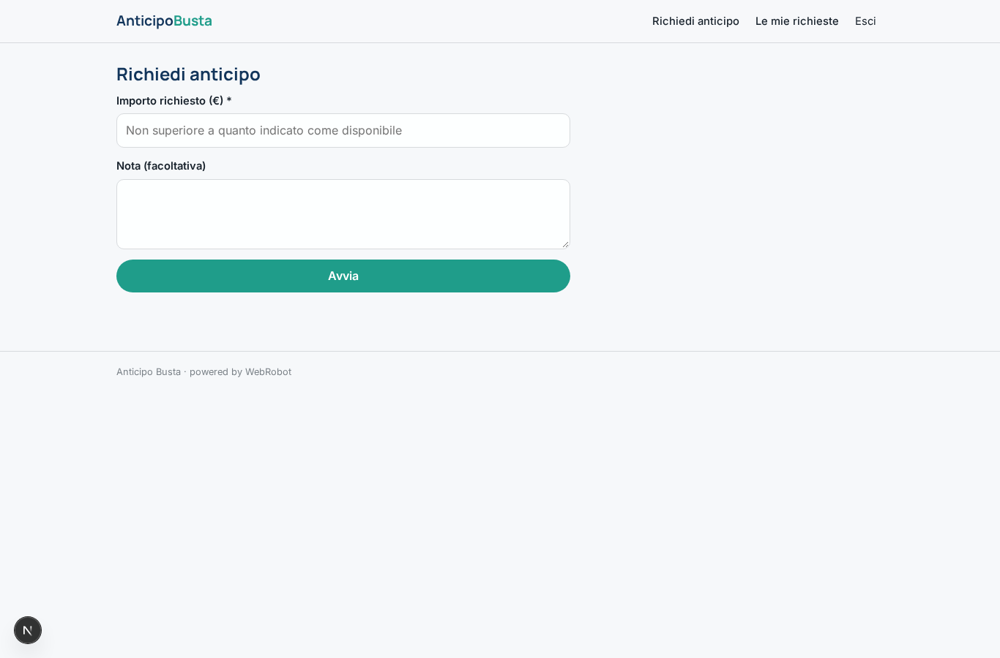
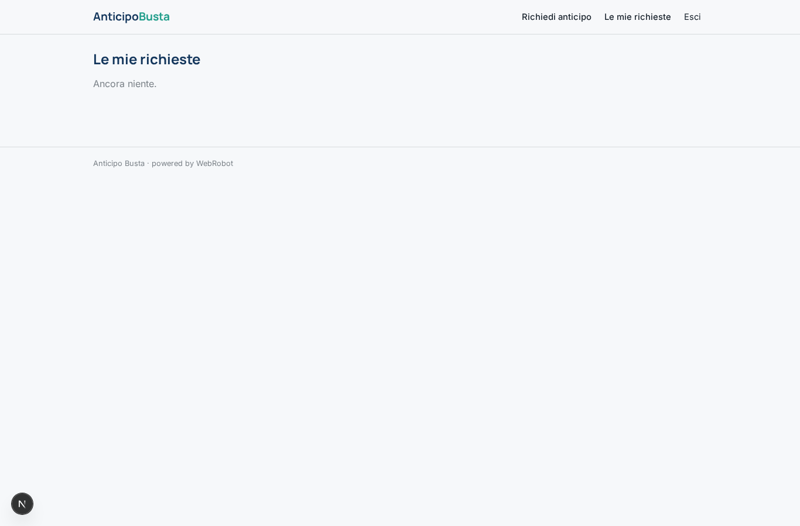
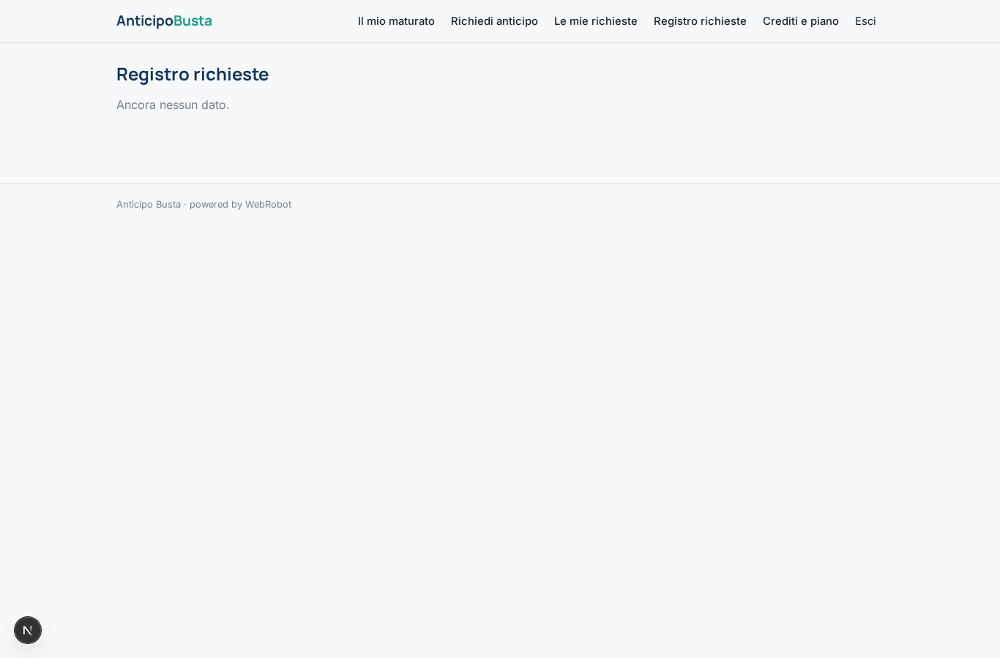
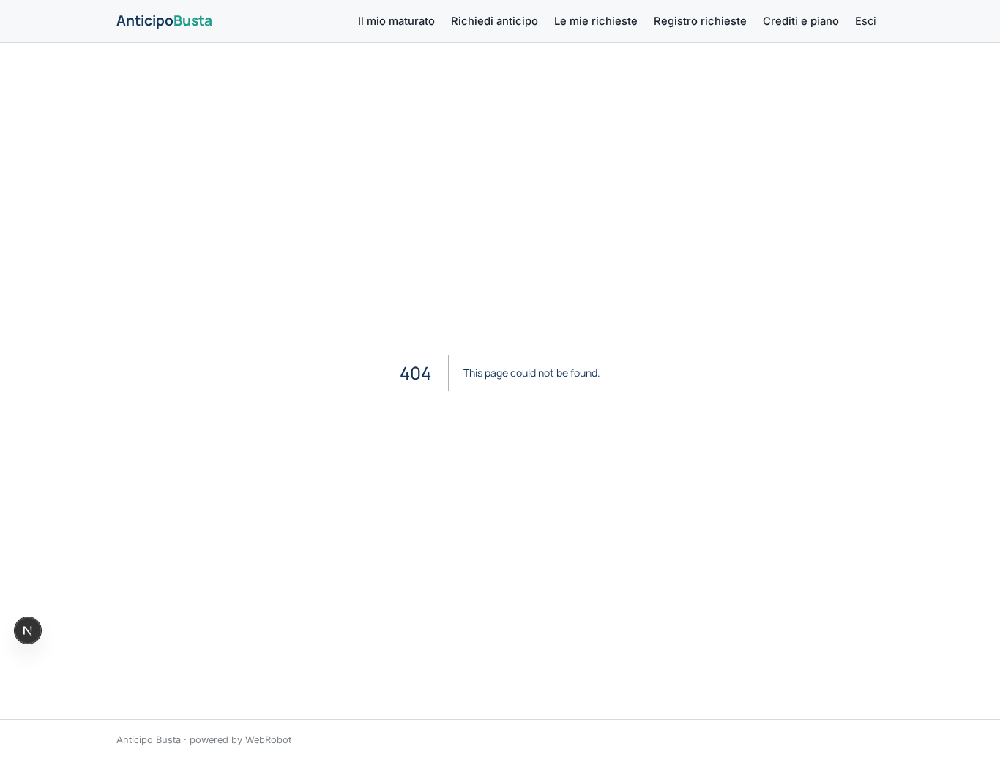
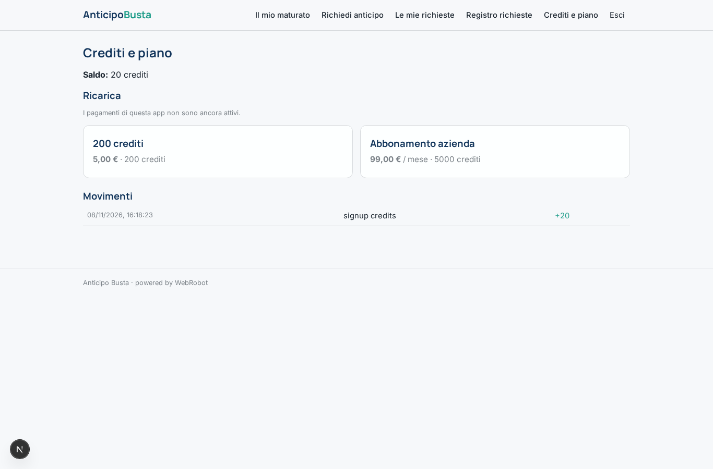

# Anticipo Busta

_Il tuo stipendio maturato, quando ti serve._

**Stato manifest:** valido (validatore Python + contratto runtime)

## Descrizione data all'app builder

Descrivo solo lo strato software di un servizio di anticipo dello stipendio per i dipendenti delle aziende clienti: il portale che calcola e richiede l'anticipo, non l'erogazione del credito, che e un servizio finanziario regolamentato svolto da un partner autorizzato. L'azienda aderisce e carica, tramite un collegamento o un file dal proprio sistema paghe, i dati di maturato dei dipendenti. Il dipendente accede dall'app, vede quanto ha gia maturato nel mese e quanto puo richiedere in anticipo secondo le regole impostate dall'azienda, e invia la richiesta con un modulo. Un agente verifica i limiti (percentuale massima, richieste gia fatte, capienza) e, se tutto e in regola, la approva automaticamente o la manda all'HR per approvazione nei casi fuori soglia; l'erogazione effettiva la esegue il partner finanziario. Alla fine del mese l'importo anticipato viene conguagliato in busta. Il dipendente vede solo le proprie richieste, l'HR quelle dell'azienda. Monetizzazione: abbonamento dell'azienda o piccola commissione per anticipo. In italiano.

## Funzioni non esprimibili oggi (spec.extensions)

- **import_paghe**: Il caricamento automatico dei dati di maturato da collegamento o file del sistema paghe non è disponibile (nessun campo file né connettore con credenziali dell'azienda): per ora il maturato va inserito o incollato come testo.
- **vista_hr_azienda**: La vista HR sulle richieste di tutti i dipendenti della stessa azienda richiede uno scope per azienda sulle collezioni, oggi non espresso: le collezioni dei dipendenti sono per utente, quindi l'HR vede ora solo ciò che passa dalle approvazioni.
- **erogazione_partner**: L'erogazione è svolta dal partner finanziario autorizzato fuori dal portale; l'integrazione con il partner e il conguaglio in busta non sono modellati.
- **commissione_per_anticipo**: La commissione per anticipo (modo per_transaction) va configurata con il partner e le regole di legge applicabili; qui è previsto l'abbonamento aziendale più crediti.
- **notifiche**: Notifiche email di esito o di richiesta in attesa non sono disponibili.

## Screenshot (runtime interpretativo)

### home-anon

### home-mobile

### home

### maturato

### new_run

### storico

### richieste

### approvazioni

### account

