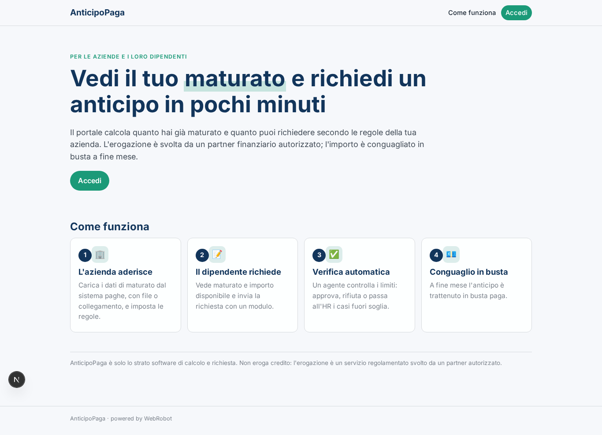
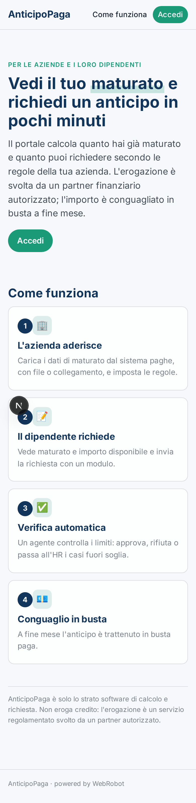
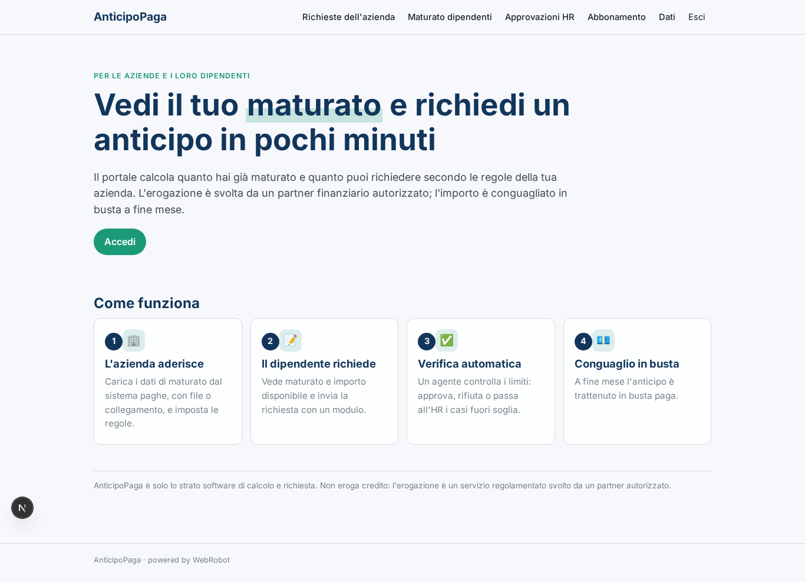
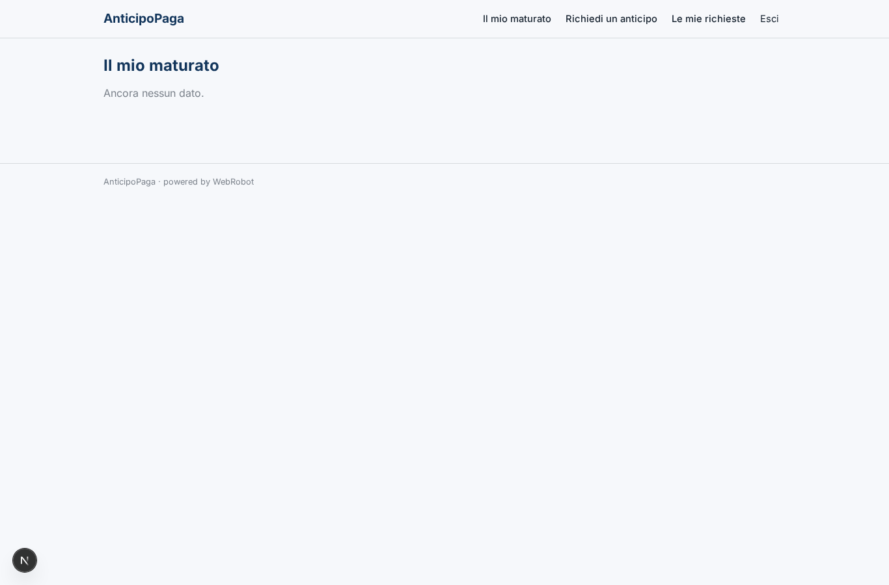
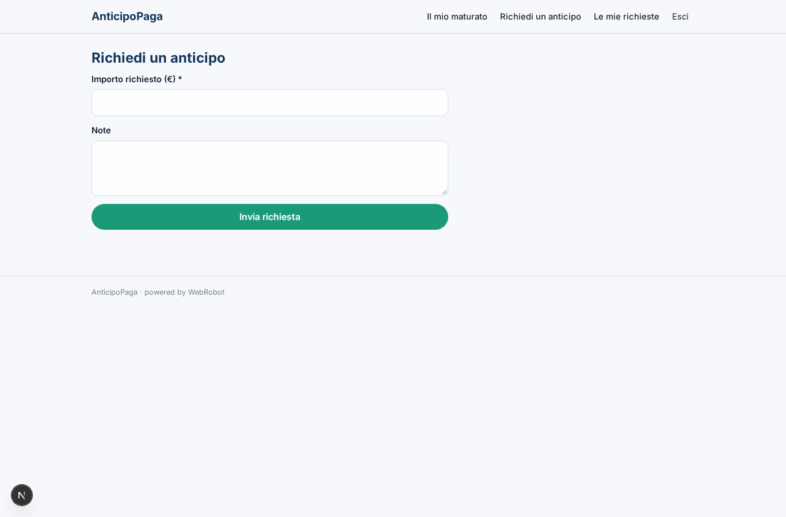
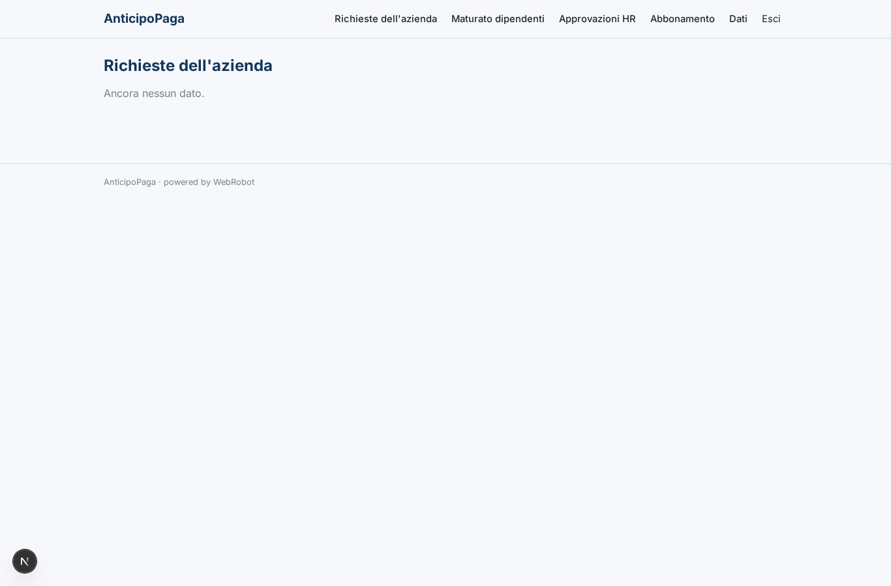
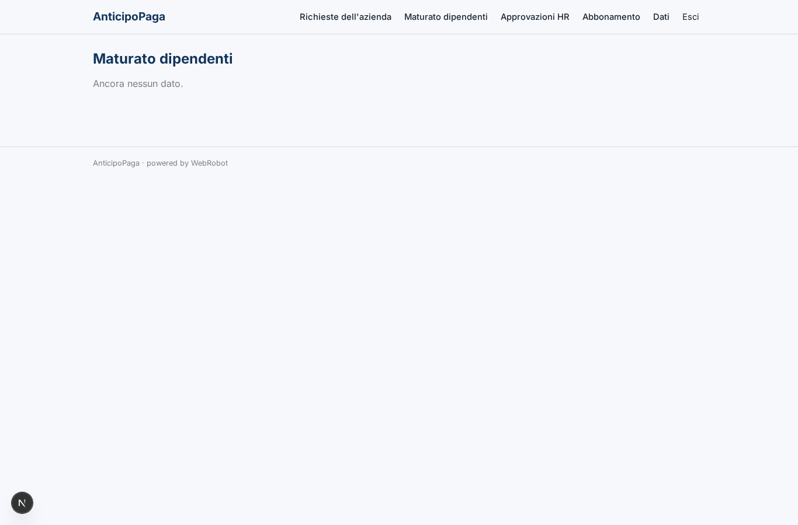
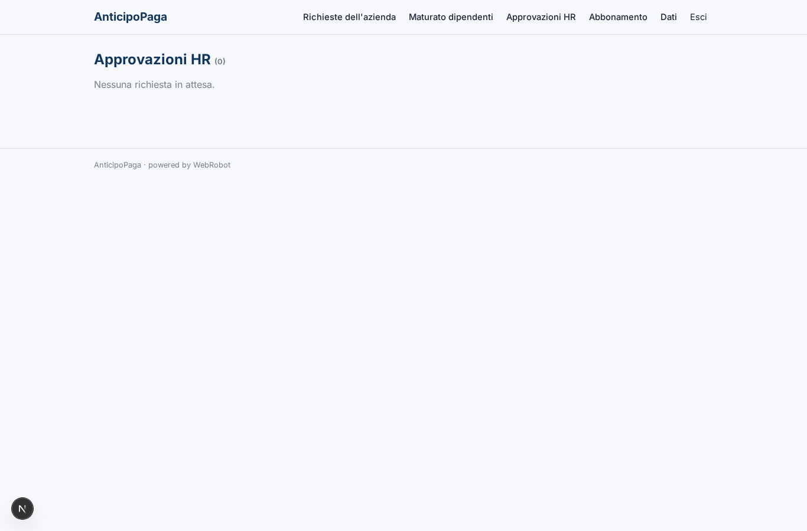
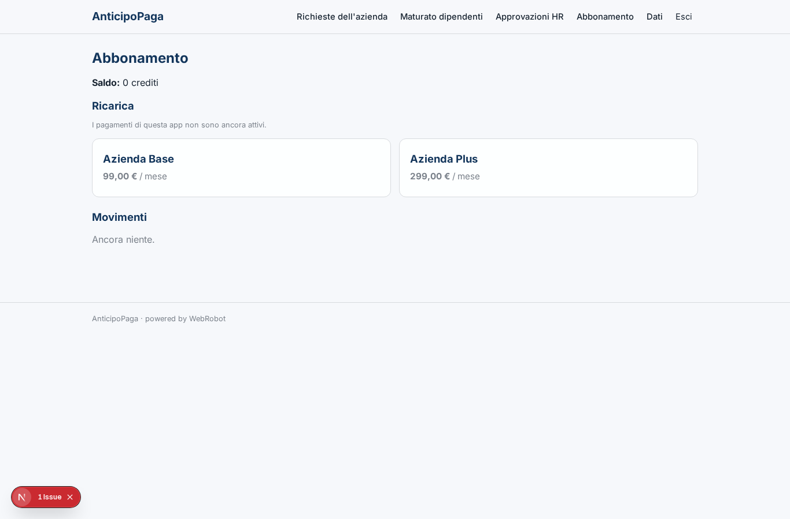

# AnticipoPaga

_Il tuo maturato, quando ti serve._

**Manifest:** valid (schema + runtime contract) · **Functional test:** passed (15 checks passed)

## Description given to the app builder (Italian)

Descrivo solo lo strato software di un servizio di anticipo dello stipendio per i dipendenti delle aziende clienti: il portale che calcola e richiede l'anticipo, non l'erogazione del credito, che e un servizio finanziario regolamentato svolto da un partner autorizzato. L'azienda aderisce e carica, tramite un collegamento o un file dal proprio sistema paghe, i dati di maturato dei dipendenti. Il dipendente accede dall'app, vede quanto ha gia maturato nel mese e quanto puo richiedere in anticipo secondo le regole impostate dall'azienda, e invia la richiesta con un modulo. Un agente verifica i limiti (percentuale massima, richieste gia fatte, capienza) e, se tutto e in regola, la approva automaticamente o la manda all'HR per approvazione nei casi fuori soglia; l'erogazione effettiva la esegue il partner finanziario. Alla fine del mese l'importo anticipato viene conguagliato in busta. Il dipendente vede solo le proprie richieste, l'HR quelle dell'azienda. Monetizzazione: abbonamento dell'azienda o piccola commissione per anticipo. In italiano.

## Functional test: what did not pass

- **saved record shown where its collection is read** (view my_accrual): a record was saved in accruals (by admin-data, admin-data) but the page does not show it (as user) _(warning)_
- **saved record shown where its collection is read** (view company_requests): a record was saved in advance_requests (by user) but the page does not show it (as hr) _(warning)_

## Features not expressible today (spec.extensions)

- **commissione_per_anticipo**: La commissione per anticipo a carico dell'azienda alternativa all'abbonamento richiede un addebito per azienda: non disponibile, per ora solo abbonamento.
- **erogazione_partner**: L'invio dell'ordine di pagamento al partner finanziario autorizzato e il conguaglio in busta richiedono un'integrazione con API del partner e del sistema paghe, da collegare via webhook o chiave API; qui lo stato 'paid' è aggiornato dal partner.
- **oauth_paghe**: Il collegamento diretto con sistemi paghe basati su OAuth non è disponibile: i dati si caricano via file CSV nella pagina Dati o via webhook.

## Screenshots (interpretive runtime, no data)

### home-anon

### home-mobile

### home

### my_accrual

### request

### my_requests

### company_requests

### company_accruals

### approvals

### account

