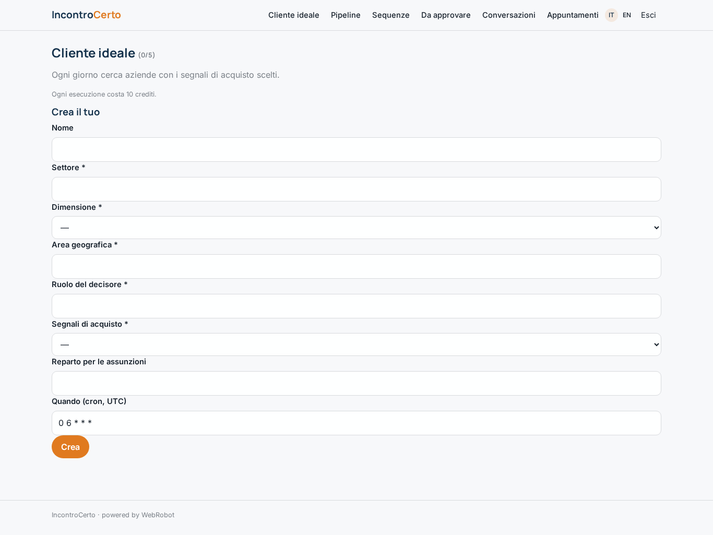
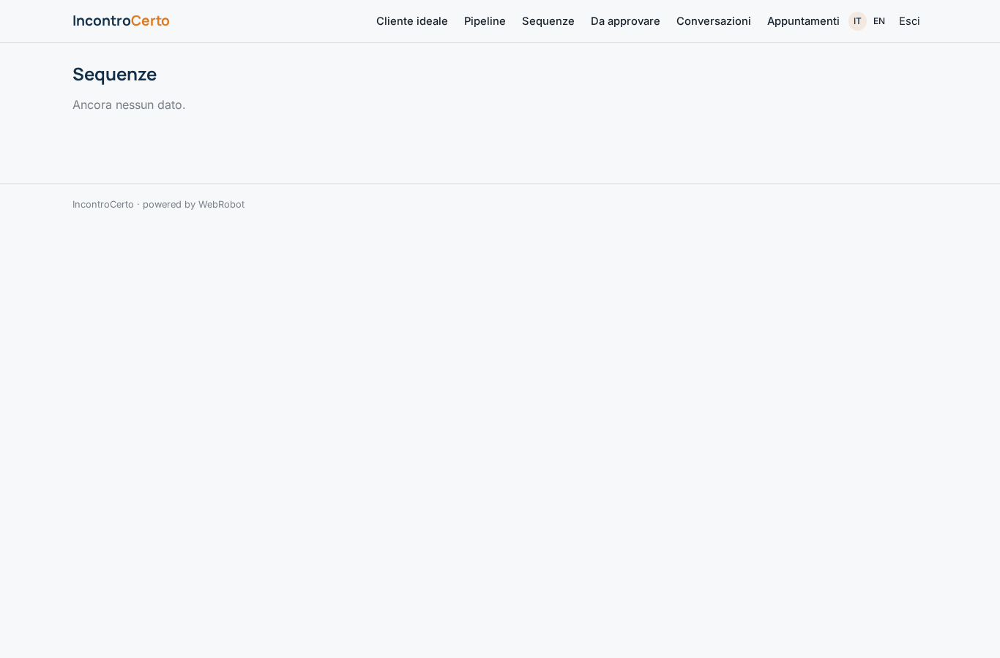
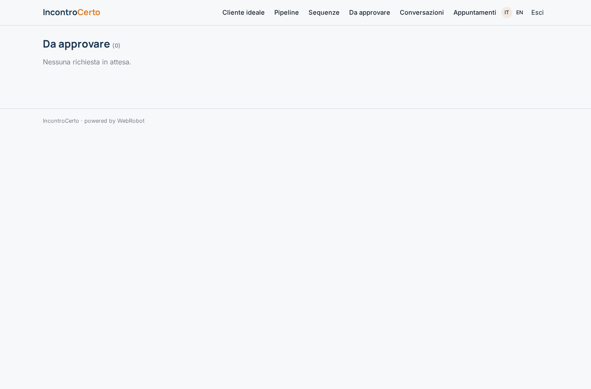
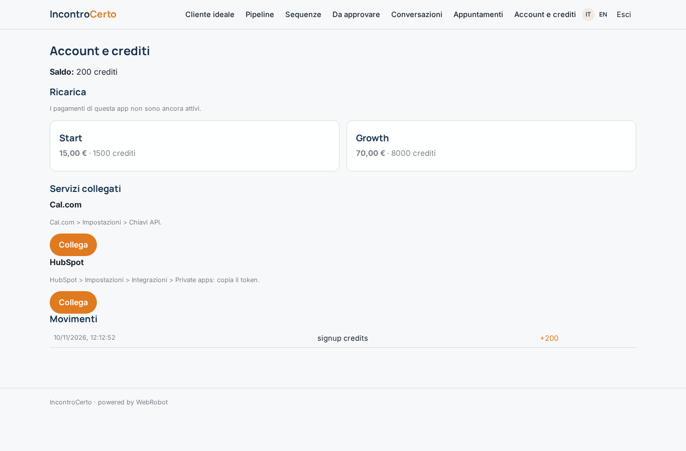

# IncontroCerto

_Appuntamenti B2B qualificati: paghi solo quelli fissati._

**Manifest:** valid (schema + runtime contract) · **Functional test:** passed (8 checks passed)

## Description given to the app builder (Italian)

L'app si chiama IncontroCerto e serve alle aziende B2B che vogliono appuntamenti commerciali qualificati pagando solo quelli fissati. Il cliente definisce il suo cliente ideale: settore, dimensione, area, ruolo del decisore, e i segnali di acquisto che gli interessano (nuovo finanziamento, apertura sede, assunzioni in un reparto). Un agente cerca ogni giorno questi segnali su notizie, comunicati e pagine lavora con noi dei siti aziendali (nessun social che vieti l'estrazione), trova il contatto giusto e un secondo agente scrive una sequenza di email personalizzate. Il cliente approva la prima sequenza, poi l'invio è automatico dalla sua casella collegata; le risposte vengono lette, classificate (interessato, non ora, no) e quando c'è interesse l'agente propone degli orari presi dal calendario del venditore e fissa l'appuntamento, salvandolo anche nel CRM. Ogni appuntamento confermato genera un addebito automatico al cliente. Il cliente vede pipeline, conversazioni e appuntamenti. Italiano e inglese.

## Features not expressible today (spec.extensions)

- **mailbox_send**: Sending the approved sequence from the customer's connected mailbox (Gmail/Microsoft 365 via OAuth) is not available yet. Sequences are approved in the app; sending must be done manually or by an external tool.
- **mailbox_read**: Reading replies from the connected mailbox is not available yet (OAuth). Replies enter via the webhook /api/hooks/reply_in (e.g. from an inbound email forwarding service); the payload must include status 'new'.
- **oauth_calendar**: Google/Outlook calendar via OAuth is not available yet: the seller's calendar is read and booked through a Cal.com API key.

## Screenshots (interpretive runtime, no data)

### home-anon

### home-mobile

### home

### icps

### pipeline

### sequences_view

### approvals_view

### conversations

### appointments

### account

