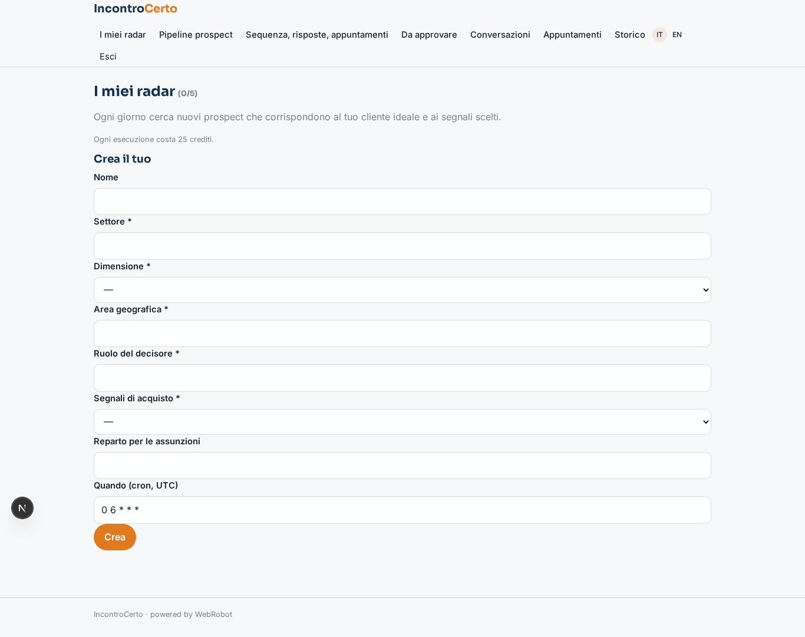
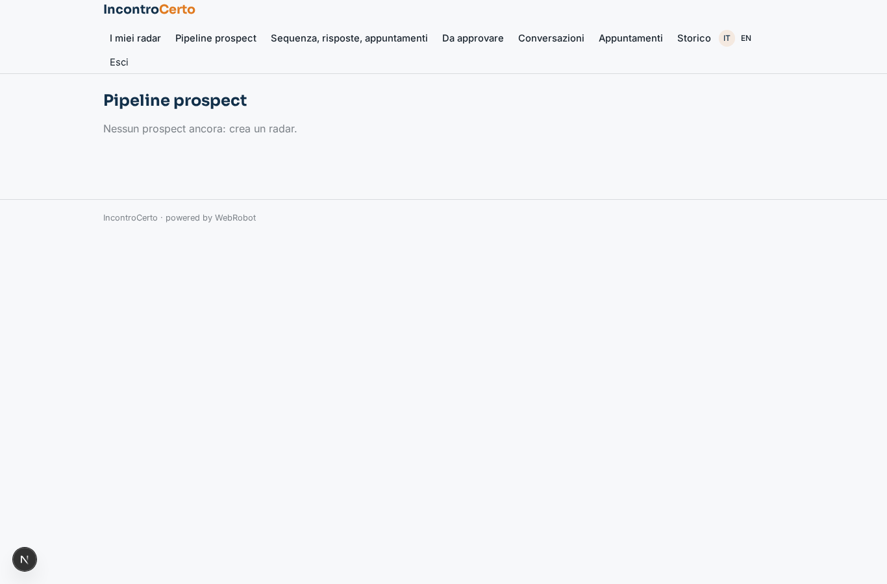
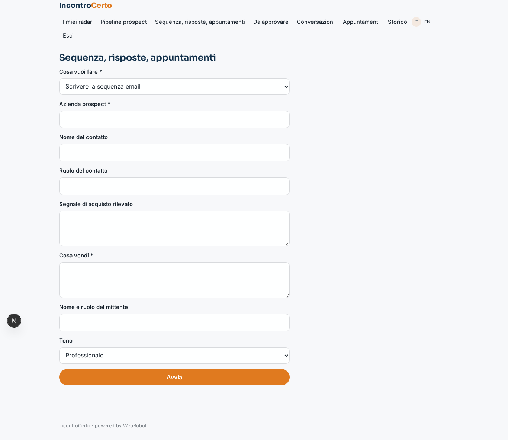
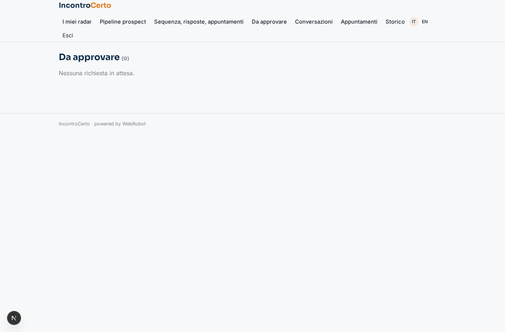
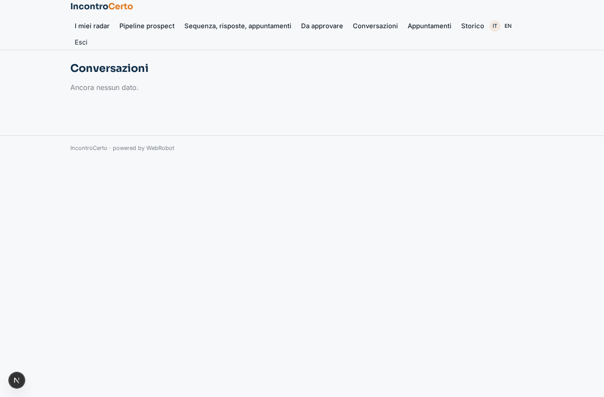
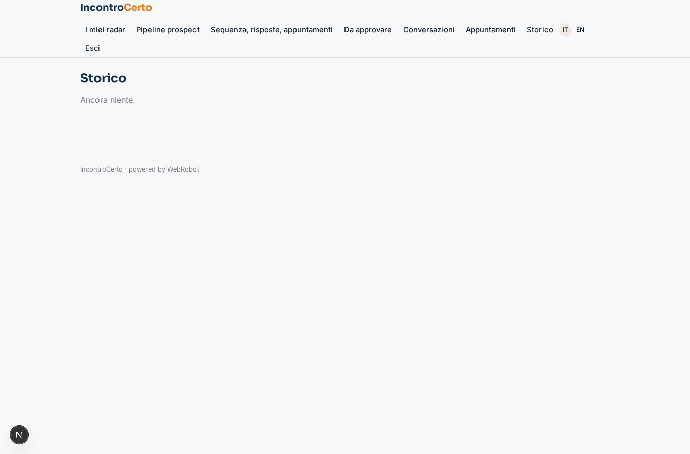
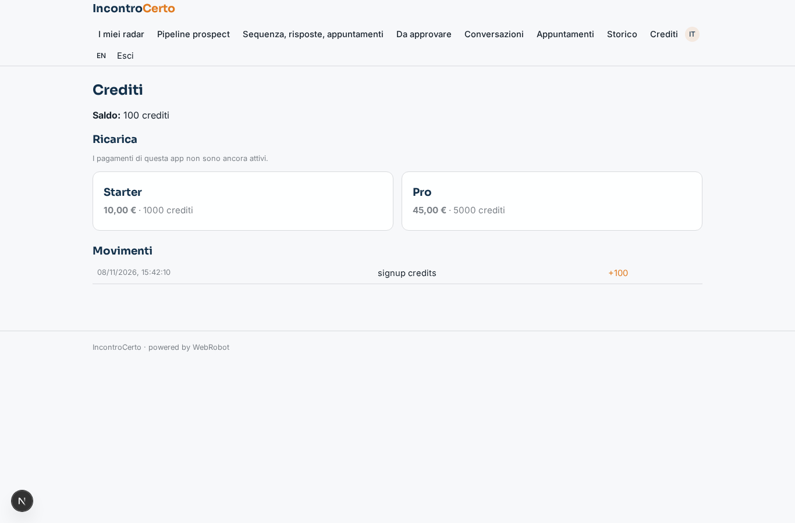

# IncontroCerto

_Appuntamenti B2B qualificati: paghi solo quelli fissati._

**Stato manifest:** valido (validatore Python + contratto runtime)

## Descrizione data all'app builder

L'app si chiama IncontroCerto e serve alle aziende B2B che vogliono appuntamenti commerciali qualificati pagando solo quelli fissati. Il cliente definisce il suo cliente ideale: settore, dimensione, area, ruolo del decisore, e i segnali di acquisto che gli interessano (nuovo finanziamento, apertura sede, assunzioni in un reparto). Un agente cerca ogni giorno questi segnali su notizie, comunicati e pagine lavora con noi dei siti aziendali (nessun social che vieti l'estrazione), trova il contatto giusto e un secondo agente scrive una sequenza di email personalizzate. Il cliente approva la prima sequenza, poi l'invio è automatico dalla sua casella collegata; le risposte vengono lette, classificate (interessato, non ora, no) e quando c'è interesse l'agente propone degli orari presi dal calendario del venditore e fissa l'appuntamento, salvandolo anche nel CRM. Ogni appuntamento confermato genera un addebito automatico al cliente. Il cliente vede pipeline, conversazioni e appuntamenti. Italiano e inglese.

## Funzioni non esprimibili oggi (spec.extensions)

- **mailbox_sending**: Not available yet: automatic sending from the customer's connected mailbox and reading replies automatically. For now the customer copies the approved emails and pastes prospects' replies into the form.
- **calendar_crm**: Not available yet: reading the seller's calendar, creating the calendar event and saving to the customer's CRM (connectors needing customer credentials). For now the seller gives availability as text and the appointment plus a CRM note are saved in the app.
- **auto_charge_per_meeting**: The charge per confirmed appointment is approximated by a fixed credit cost on the booking agent run; a true per-confirmation charge and email notifications are not available yet.

## Screenshot (runtime interpretativo)

### home-anon

### home-mobile

### home

### radars

### pipeline

### new

### approvals

### conversations

### appointments

### history

### account

