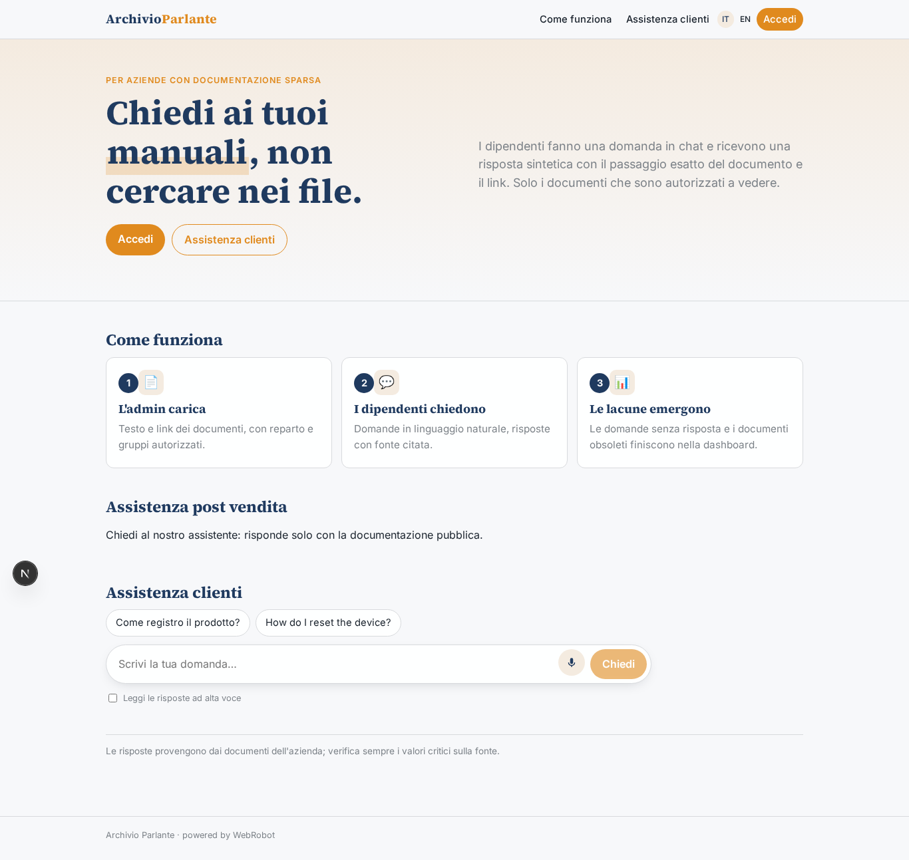
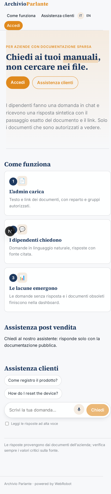
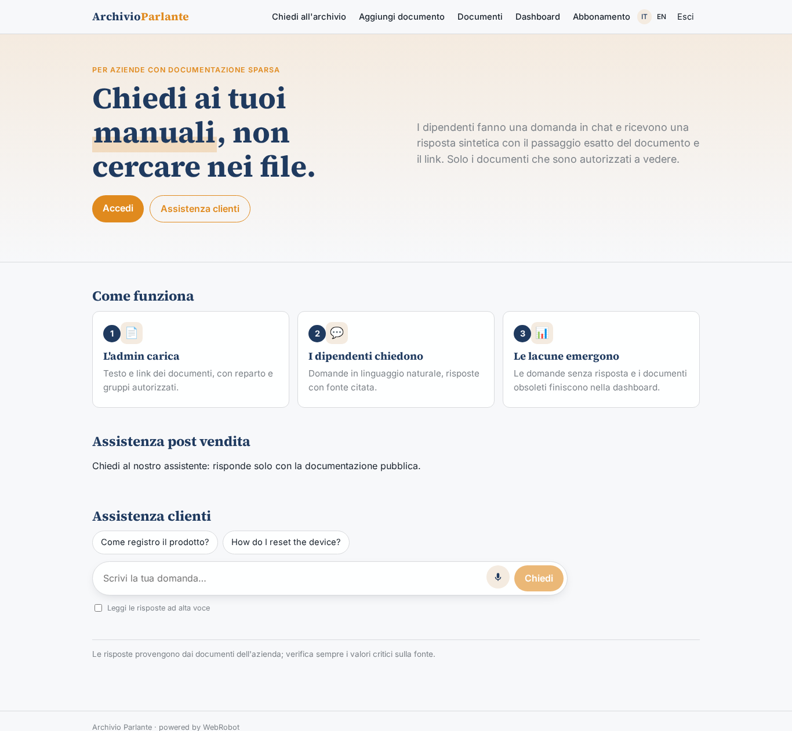
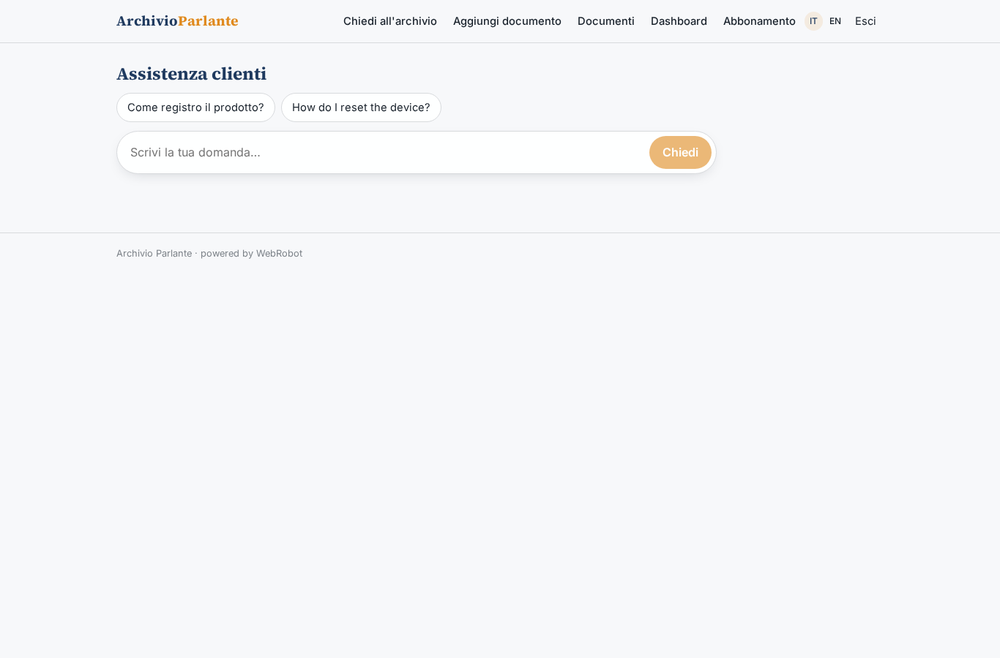
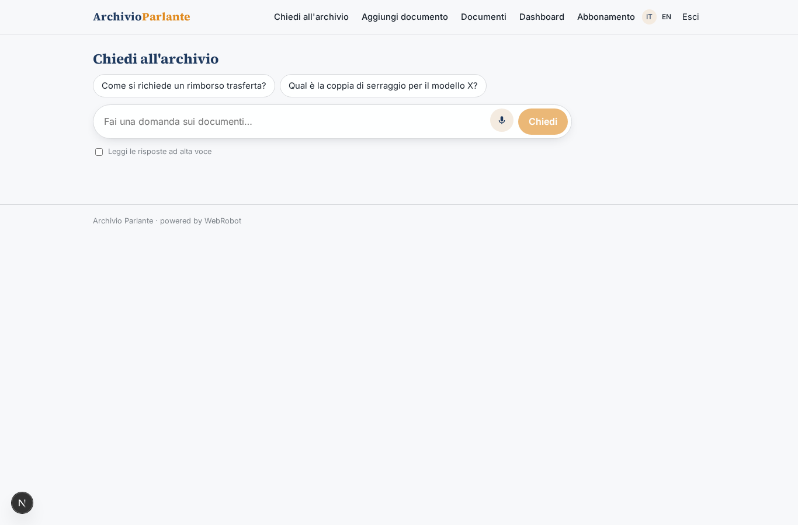
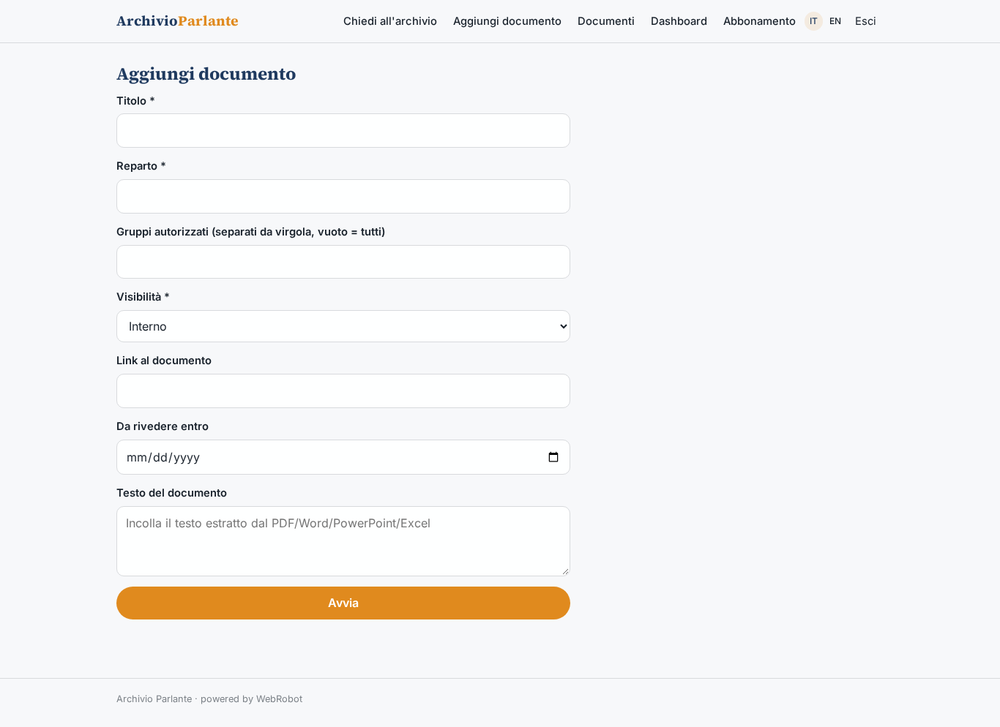
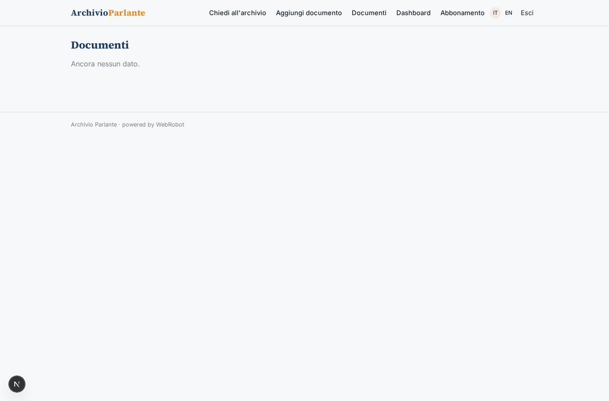
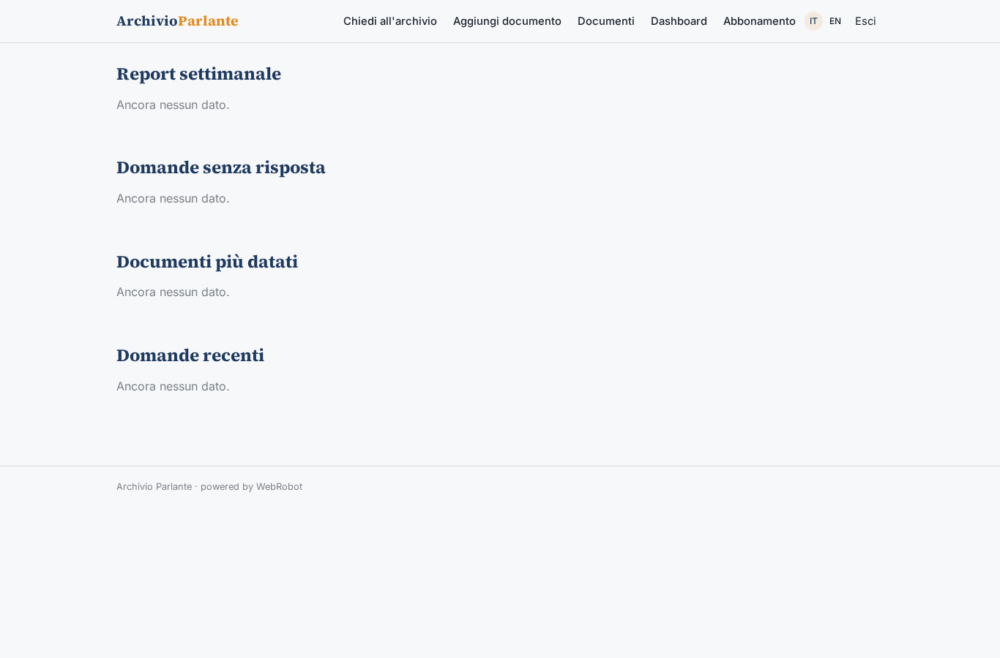
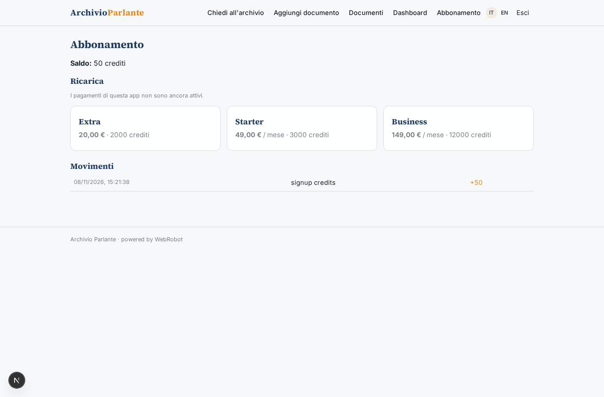

# Archivio Parlante

_Chiedi ai manuali della tua azienda, ricevi la risposta e il passaggio esatto._

**Stato manifest:** valido (validatore Python + contratto runtime)

## Descrizione data all'app builder

Vorrei Archivio Parlante, un motore di ricerca interno per aziende che hanno manuali, procedure e documentazione sparsa. L'admin carica i documenti in PDF, Word, PowerPoint ed Excel, oppure collega una cartella di Google Drive o SharePoint che viene sincronizzata ogni notte. Ogni documento ha un'etichetta di reparto e l'admin decide quali gruppi di utenti possono vederlo. I dipendenti accedono con login aziendale e fanno domande in chat, per esempio come si richiede un rimborso trasferta o quale coppia di serraggio per il modello X. L'agente cerca solo nei documenti che l'utente è autorizzato a vedere, risponde in modo sintetico e mostra il passaggio esatto del documento con link. Se non trova la risposta lo dice e registra la domanda come lacuna. L'admin vede una dashboard con le domande più frequenti, quelle senza risposta e i documenti obsoleti da aggiornare. Si può anche incorporare la chat nel portale clienti per l'assistenza post vendita, limitata ai documenti pubblici. Abbonamento mensile in base al numero di documenti e utenti, italiano e inglese.

## Funzioni non esprimibili oggi (spec.extensions)

- **file_upload**: Il caricamento di PDF, Word, PowerPoint ed Excel non è ancora disponibile: l'admin incolla il testo estratto e il link al documento.
- **drive_sharepoint_sync**: La sincronizzazione notturna di Google Drive / SharePoint richiede credenziali per cliente: non disponibile ancora.
- **sso_login**: Login aziendale (SSO/SAML): oggi solo magic link via email; gli utenti si invitano per ruolo.
- **group_acl**: I gruppi per documento sono un campo 'groups' rispettato dall'agente; un'autorizzazione per gruppo applicata dal runtime e il limite di documenti/utenti per piano non sono ancora disponibili. Per i clienti i documenti pubblici sono in una collezione separata.
- **embed_widget**: Incorporare la chat nel portale clienti (iframe/widget) non è ancora disponibile: usare il link alla vista pubblica.

## Screenshot (runtime interpretativo)

### home-anon

### home-mobile

### home

### public_chat

### chat

### add_doc

### docs

### dashboard

### account

