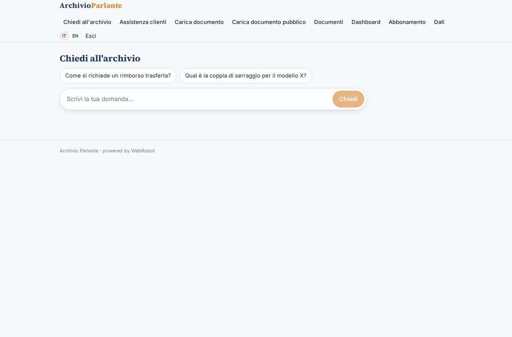
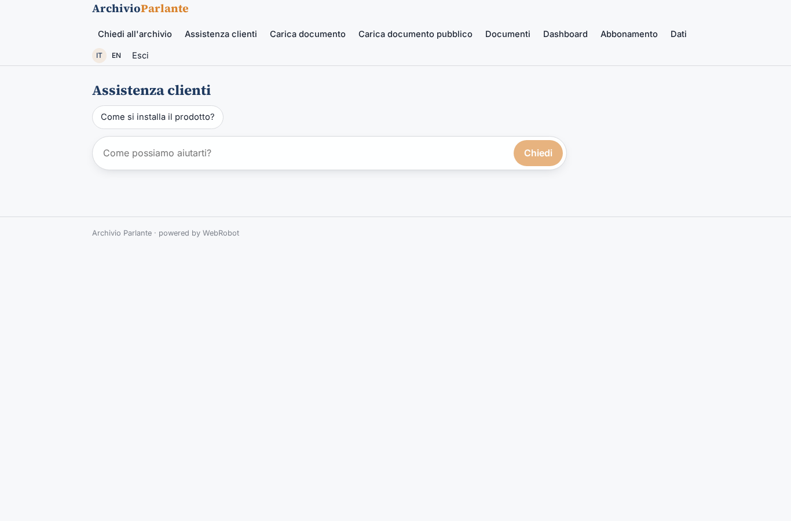
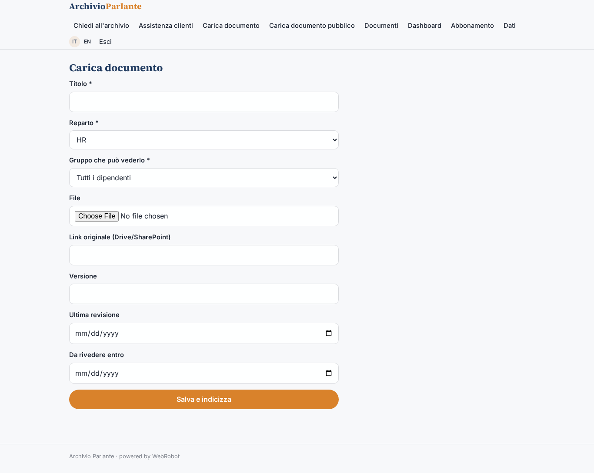
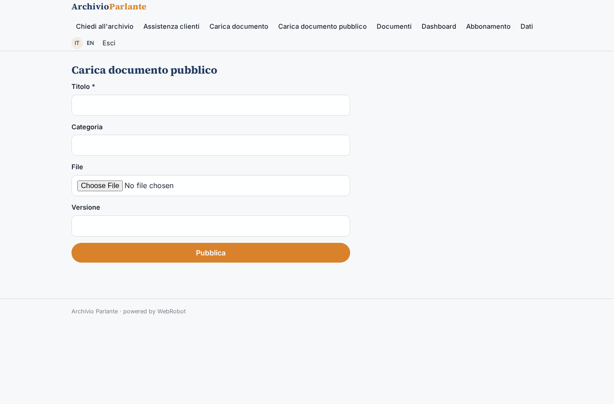
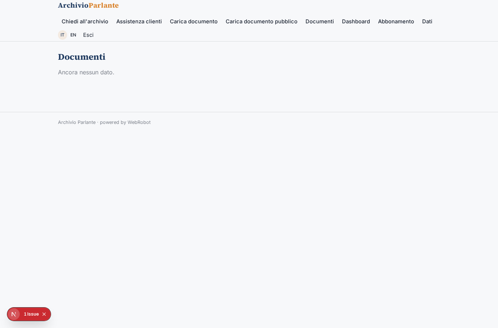
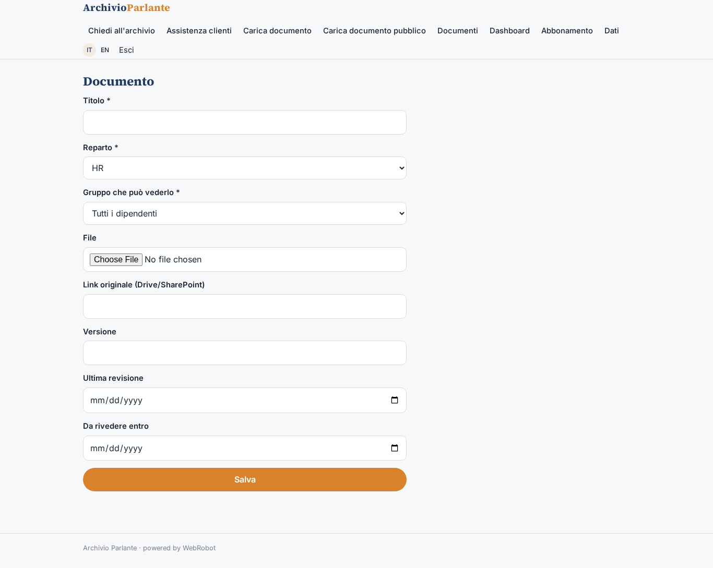
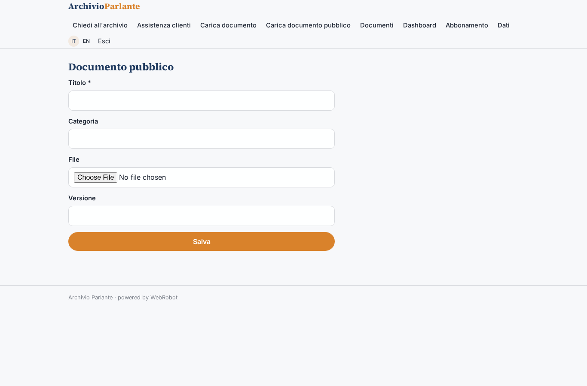
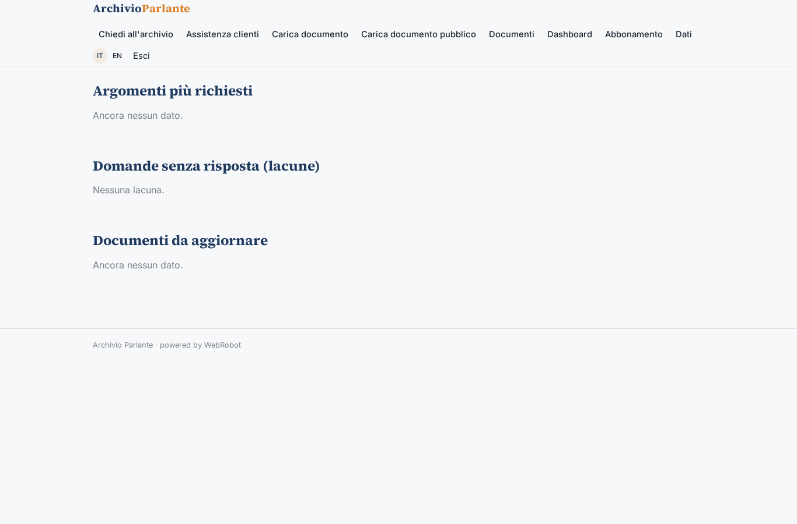
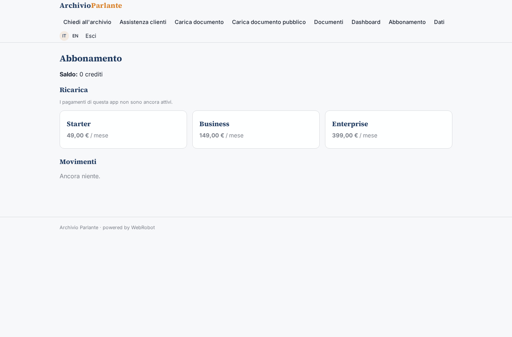

# Archivio Parlante

_Chiedi ai manuali della tua azienda. Risposte brevi, con il passaggio esatto._

**Manifest:** valid (schema + runtime contract) · **Functional test:** 1 failure(s) (24 checks passed)

## Description given to the app builder (Italian)

Vorrei Archivio Parlante, un motore di ricerca interno per aziende che hanno manuali, procedure e documentazione sparsa. L'admin carica i documenti in PDF, Word, PowerPoint ed Excel, oppure collega una cartella di Google Drive o SharePoint che viene sincronizzata ogni notte. Ogni documento ha un'etichetta di reparto e l'admin decide quali gruppi di utenti possono vederlo. I dipendenti accedono con login aziendale e fanno domande in chat, per esempio come si richiede un rimborso trasferta o quale coppia di serraggio per il modello X. L'agente cerca solo nei documenti che l'utente è autorizzato a vedere, risponde in modo sintetico e mostra il passaggio esatto del documento con link. Se non trova la risposta lo dice e registra la domanda come lacuna. L'admin vede una dashboard con le domande più frequenti, quelle senza risposta e i documenti obsoleti da aggiornare. Si può anche incorporare la chat nel portale clienti per l'assistenza post vendita, limitata ai documenti pubblici. Abbonamento mensile in base al numero di documenti e utenti, italiano e inglese.

## Functional test: what did not pass

- **form saves a record** (form public_document): 403 only the app's admins add to this collection (as user)

## Design checks (who fills each collection)

- view public_document: a form for everyone cannot add to public_documents, a shared collection only the admins fill — set roles: [admin] (or drop the form: admins have the data page), or own the records by user

## Features not expressible today (spec.extensions)

- **drive_sharepoint_sync**: Nightly sync of Google Drive / SharePoint folders needs OAuth sign-in to Google/Microsoft 365, not available yet. For now documents are uploaded; source_url keeps the original link.
- **company_sso**: Corporate login (SSO/SAML/Entra ID) is not available yet; employees sign in with a magic link and the admin invites them into the groups.
- **pptx_upload**: PowerPoint files are not accepted by the file field yet; export to PDF before uploading.
- **chat_embed**: Embedding the public chat as a widget in the customer portal: use the public_chat view in an iframe/floating bubble on the portal domain.
- **seat_quota**: Per-plan user count limit is not enforced by the runtime; document limits are enforced via limits.

## Screenshots (interpretive runtime, no data)

### home-anon

### home-mobile

### home

### chat

### public_chat

### upload

### upload_public

### documents

### document

### public_document

### dashboard

### account

