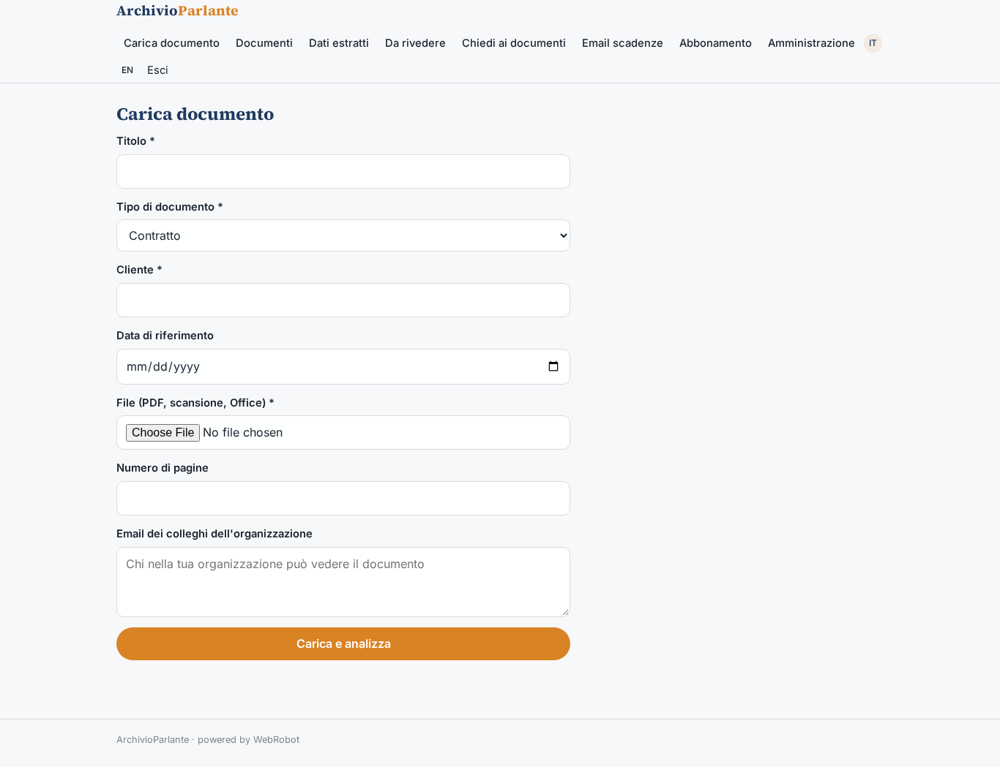
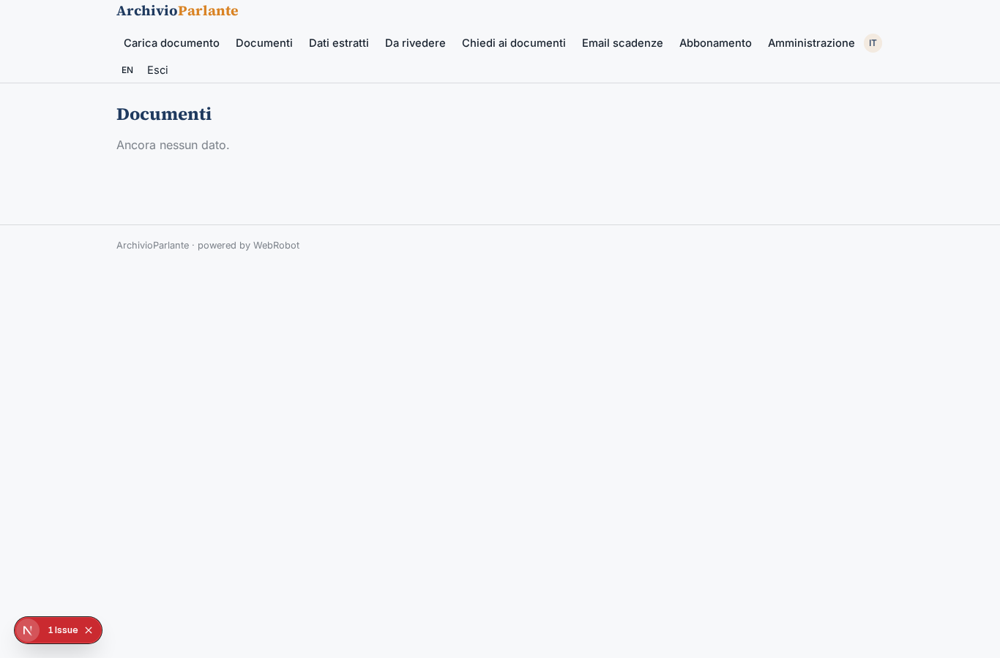
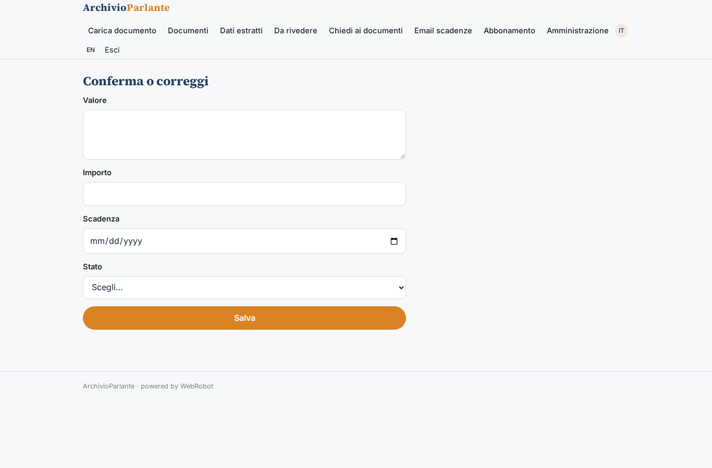
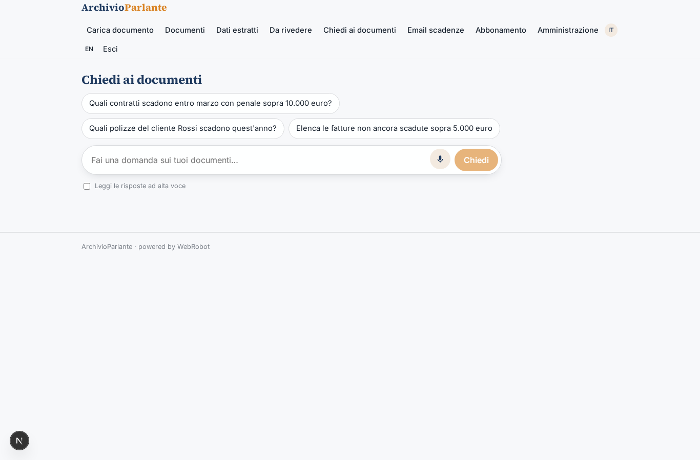
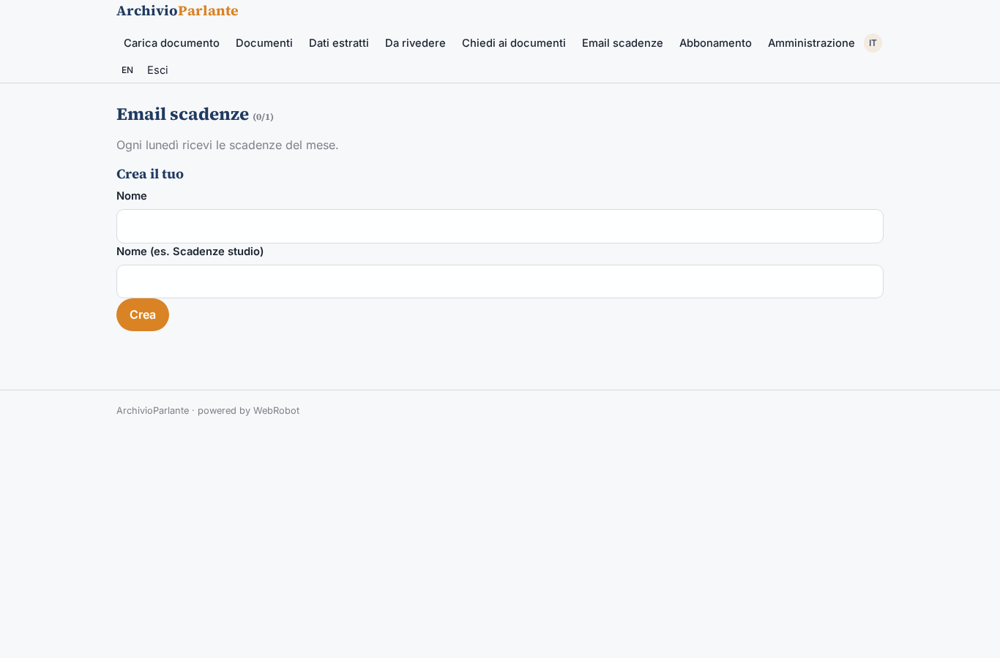
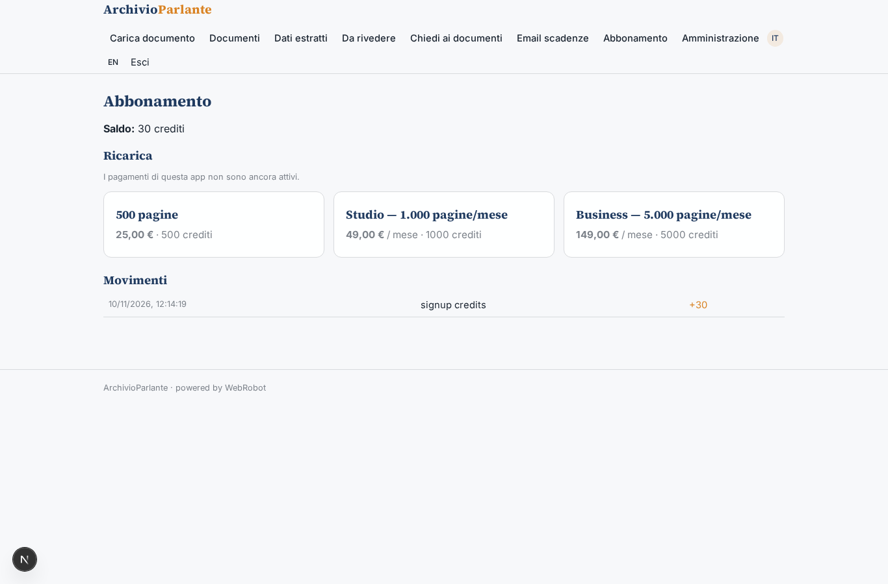
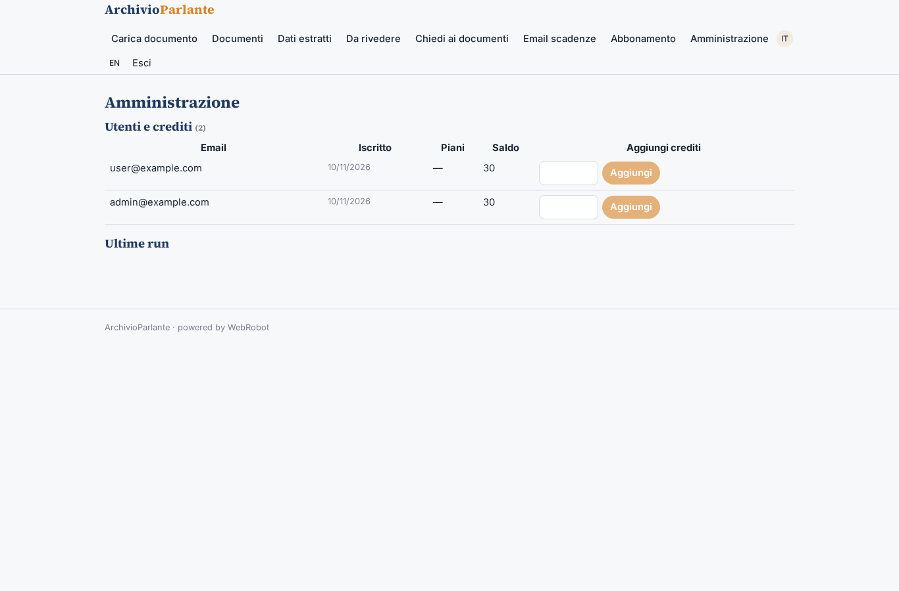

# ArchivioParlante

_Interroga i tuoi documenti come se parlassero._

**Manifest:** valid (schema + runtime contract) · **Functional test:** passed (25 checks passed)

## Description given to the app builder (Italian)

Voglio costruire ArchivioParlante, un'app per uffici amministrativi e studi professionali che hanno migliaia di documenti (contratti, fatture, polizze, verbali) e non riescono a interrogarli. L'operatore carica PDF, scansioni e file Office in una pratica, indicando tipo di documento, cliente e data di riferimento; le scansioni passano da OCR. Un agente classifica ogni documento, estrae i campi chiave secondo uno schema per tipo (per un contratto: parti, oggetto, durata, importo, clausole di recesso, scadenze) e li salva in una collezione strutturata, segnalando con un livello di confidenza i campi incerti. Un revisore umano conferma o corregge i campi a bassa confidenza prima che diventino definitivi. Sopra la collezione c'è un assistente in chat che risponde a domande in linguaggio naturale citando sempre il documento e la pagina di origine, ad esempio 'quali contratti scadono entro marzo con penale sopra 10.000 euro'. Una tabella filtrabile mostra i dati estratti ed è esportabile in CSV; ogni lunedì arriva un'email con le scadenze del mese. Ruoli: admin dell'organizzazione, operatore che carica, revisore, consultatore in sola lettura; ogni organizzazione vede solo i propri documenti. Abbonamento mensile per numero di pagine elaborate. Interfaccia in italiano e inglese.

## Features not expressible today (spec.extensions)

- **org_isolation**: Organizations are separated by the members list (emails) on each document; there is no native per-organization tenant, so operators must list colleagues' emails. Roles are app-wide invites.
- **page_count**: Pages are declared by the operator in the form; automatic page counting of uploads is not available. Extraction is billed by metered usage (tokens and compute), which follows the pages processed.

## Screenshots (interpretive runtime, no data)

### home-anon

### home-mobile

### home

### upload

### documents

### data

### review_list

### review

### chat

### deadlines

### account

### admin_data

