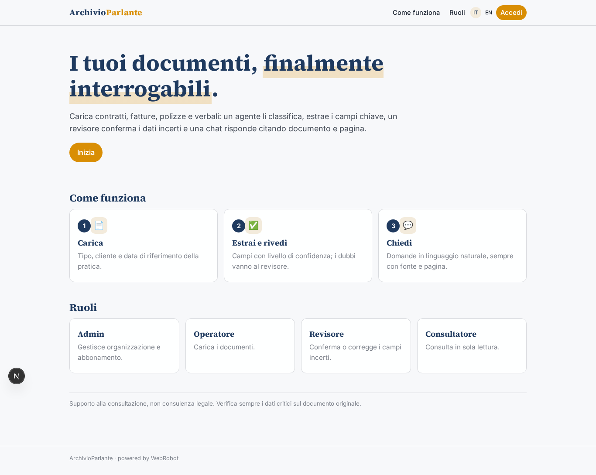
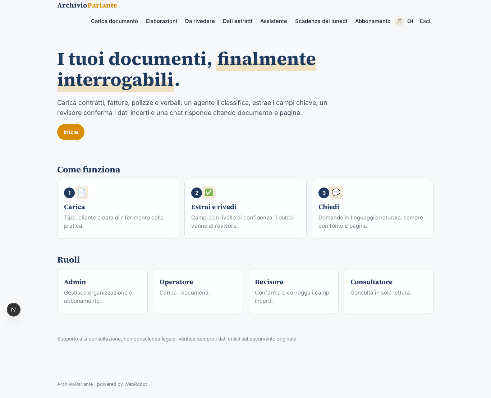
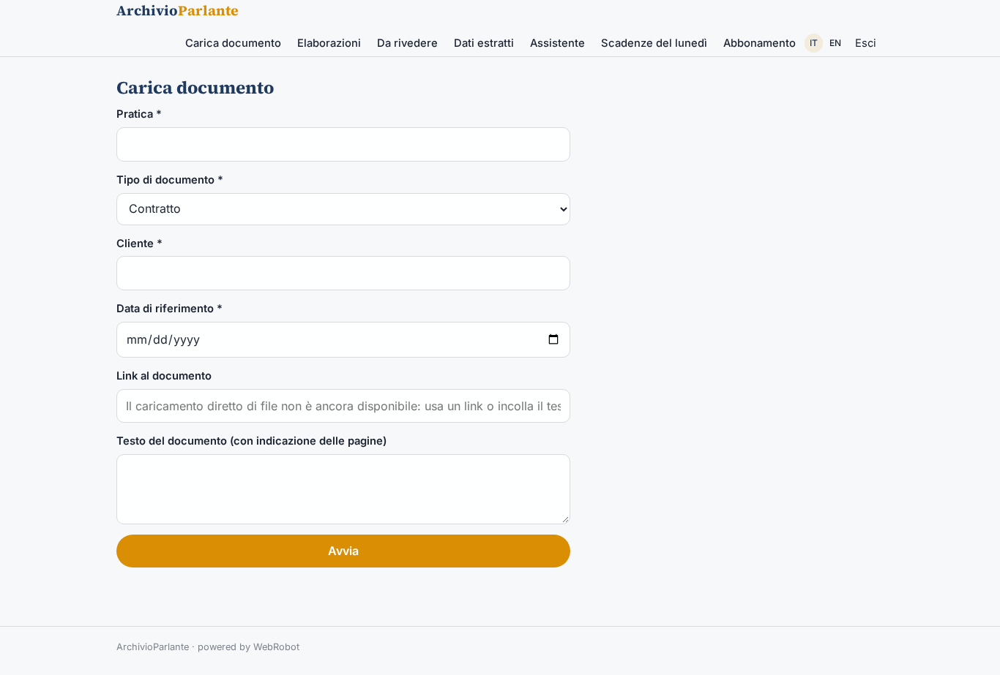
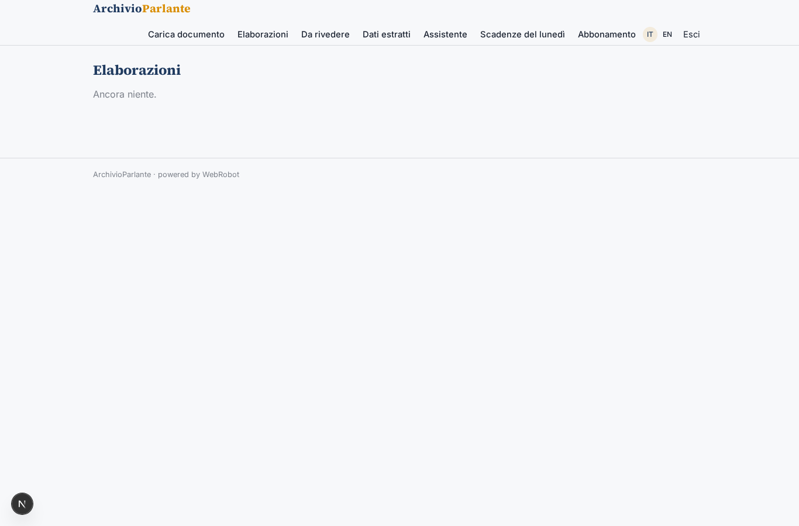
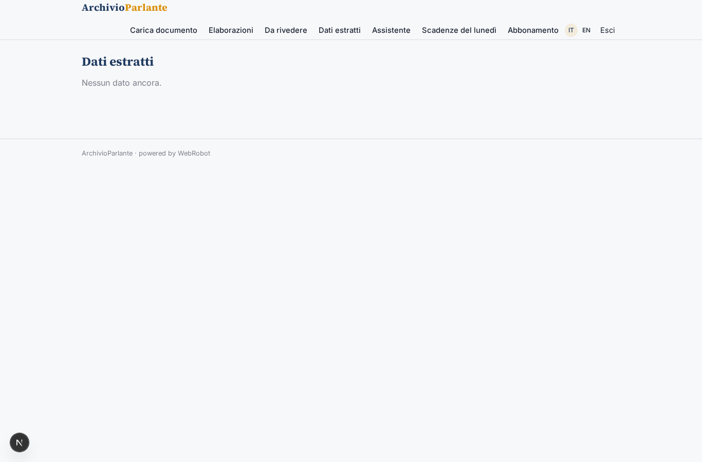
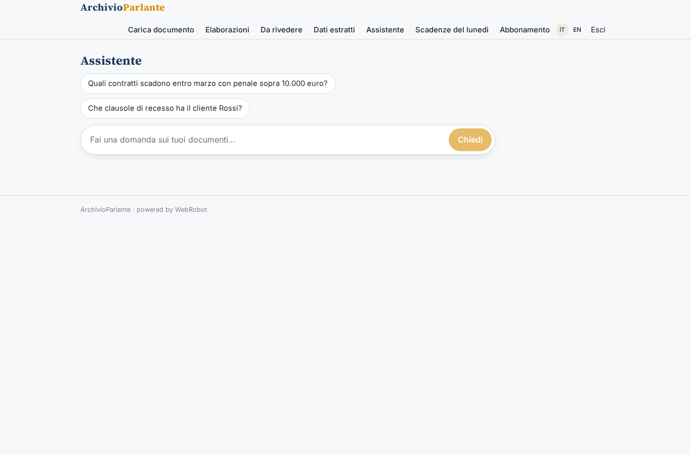
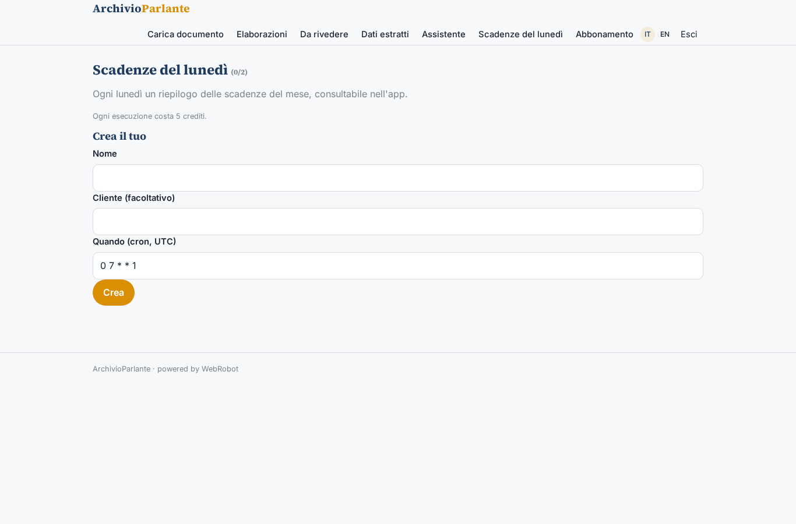
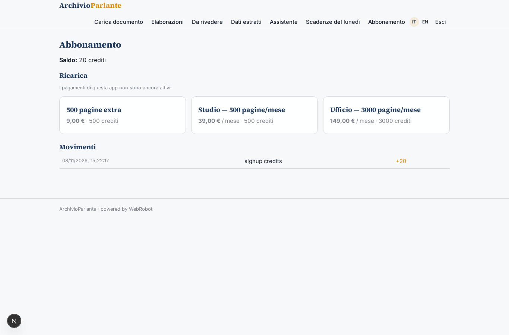

# ArchivioParlante

_Interroga i tuoi documenti come se parlassero._

**Stato manifest:** valido (validatore Python + contratto runtime)

## Descrizione data all'app builder

Voglio costruire ArchivioParlante, un'app per uffici amministrativi e studi professionali che hanno migliaia di documenti (contratti, fatture, polizze, verbali) e non riescono a interrogarli. L'operatore carica PDF, scansioni e file Office in una pratica, indicando tipo di documento, cliente e data di riferimento; le scansioni passano da OCR. Un agente classifica ogni documento, estrae i campi chiave secondo uno schema per tipo (per un contratto: parti, oggetto, durata, importo, clausole di recesso, scadenze) e li salva in una collezione strutturata, segnalando con un livello di confidenza i campi incerti. Un revisore umano conferma o corregge i campi a bassa confidenza prima che diventino definitivi. Sopra la collezione c'è un assistente in chat che risponde a domande in linguaggio naturale citando sempre il documento e la pagina di origine, ad esempio 'quali contratti scadono entro marzo con penale sopra 10.000 euro'. Una tabella filtrabile mostra i dati estratti ed è esportabile in CSV; ogni lunedì arriva un'email con le scadenze del mese. Ruoli: admin dell'organizzazione, operatore che carica, revisore, consultatore in sola lettura; ogni organizzazione vede solo i propri documenti. Abbonamento mensile per numero di pagine elaborate. Interfaccia in italiano e inglese.

## Funzioni non esprimibili oggi (spec.extensions)

- **file_upload_ocr**: Direct upload of PDF, scans and Office files with OCR is not available yet: for now the operator gives a link or pastes the text.
- **weekly_email**: The Monday email with the month's deadlines is not available (no notifications yet): the digest is produced every Monday and read in the app under Monday deadlines.
- **org_sharing**: Records are owned per user; sharing one archive among all users of the same organization (admin, operator, reviewer, viewer) needs an organization-level scope that is not available yet. Role-based read-only enforcement is by view.

## Screenshot (runtime interpretativo)

### home-anon

### home-mobile

### home

### new_doc

### runs

### review

### data_table

### chat

### watches

### account

