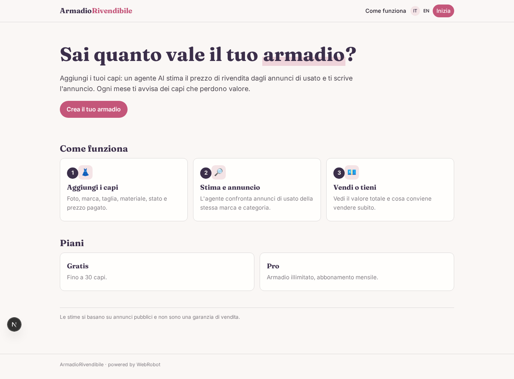
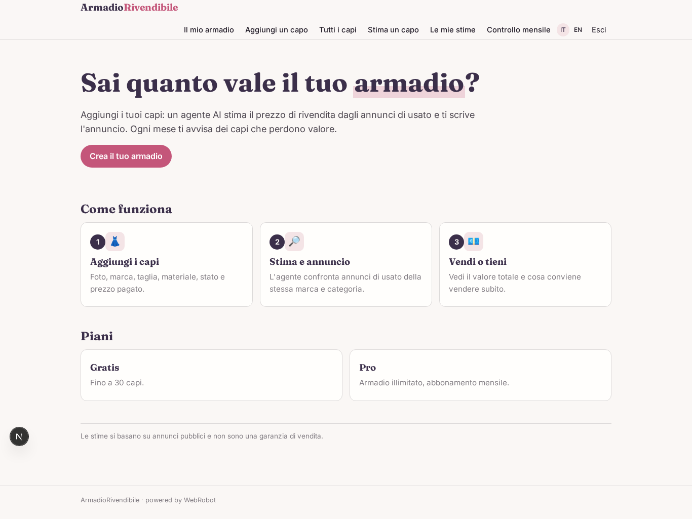
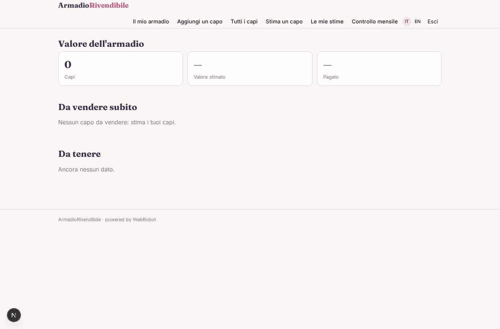
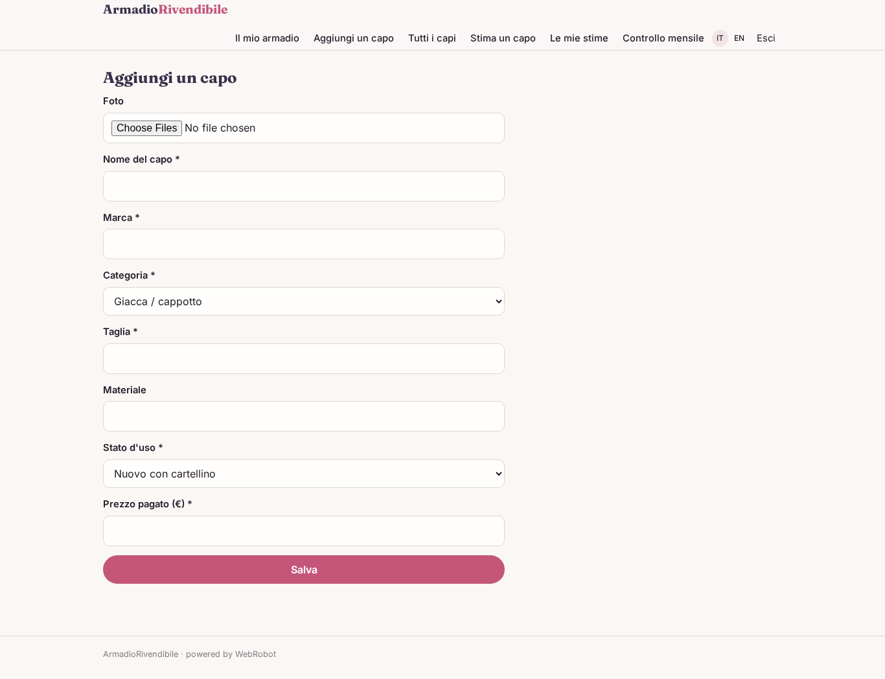
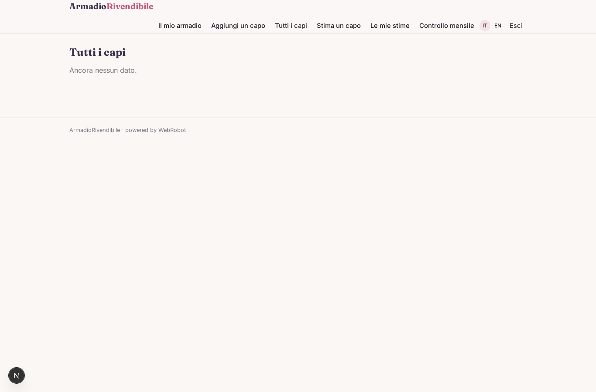
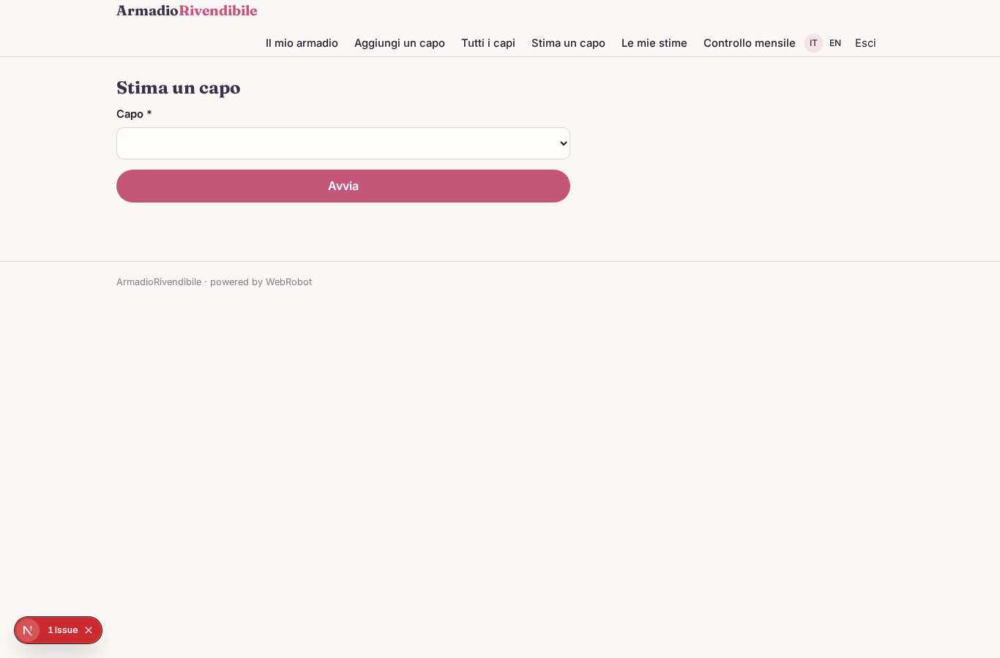
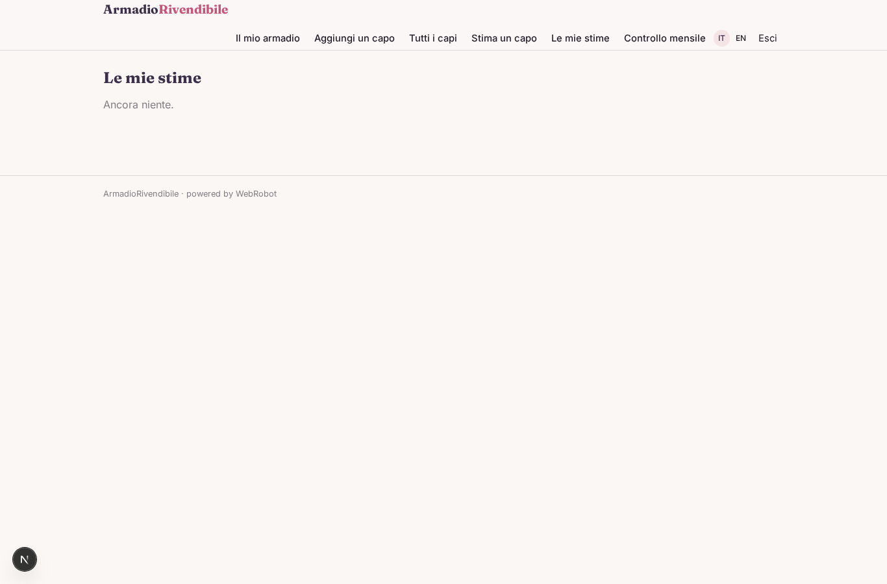
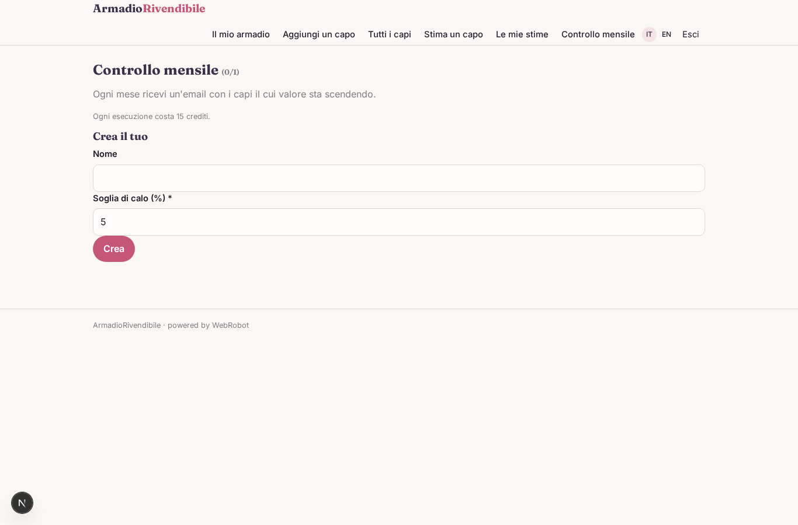
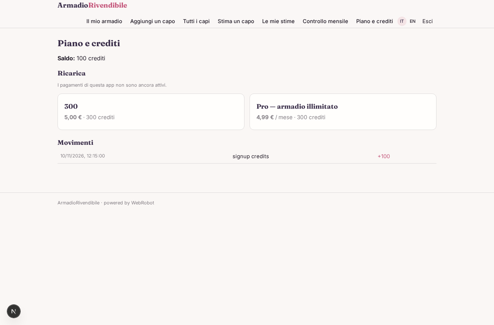

# ArmadioRivendibile

_Il tuo guardaroba digitale: sai quanto vale e cosa conviene vendere._

**Manifest:** valid (schema + runtime contract) · **Functional test:** passed (13 checks passed)

## Description given to the app builder (Italian)

Vorrei ArmadioRivendibile, un guardaroba digitale per chi vuole rivendere i propri capi. L'utente si registra e aggiunge i capi al suo armadio: foto, marca, taglia, materiale, stato d'uso e prezzo pagato. Un agente stima per ogni capo un prezzo di rivendita realistico confrontando annunci pubblici di usato della stessa marca e categoria, e suggerisce titolo e descrizione per l'annuncio. L'utente vede il valore totale del suo armadio, i capi che conviene vendere subito e quelli da tenere. Ogni mese riceve un'email con i capi il cui valore sta scendendo. Ogni utente vede solo il proprio armadio. Piano gratuito fino a 30 capi, abbonamento mensile per armadi più grandi. Italiano e inglese.

## Screenshots (interpretive runtime, no data)

### home-anon

### home-mobile

### home

### overview

### add_item

### wardrobe_list

### appraise

### appraisals

### watches

### account

