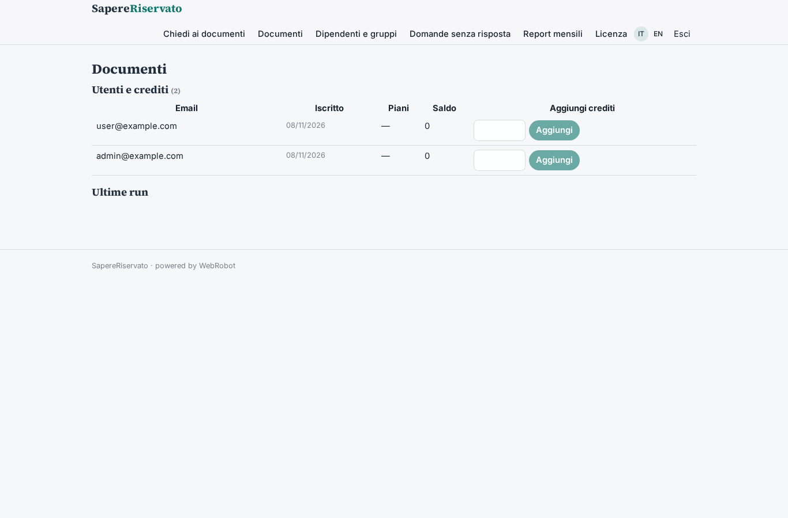
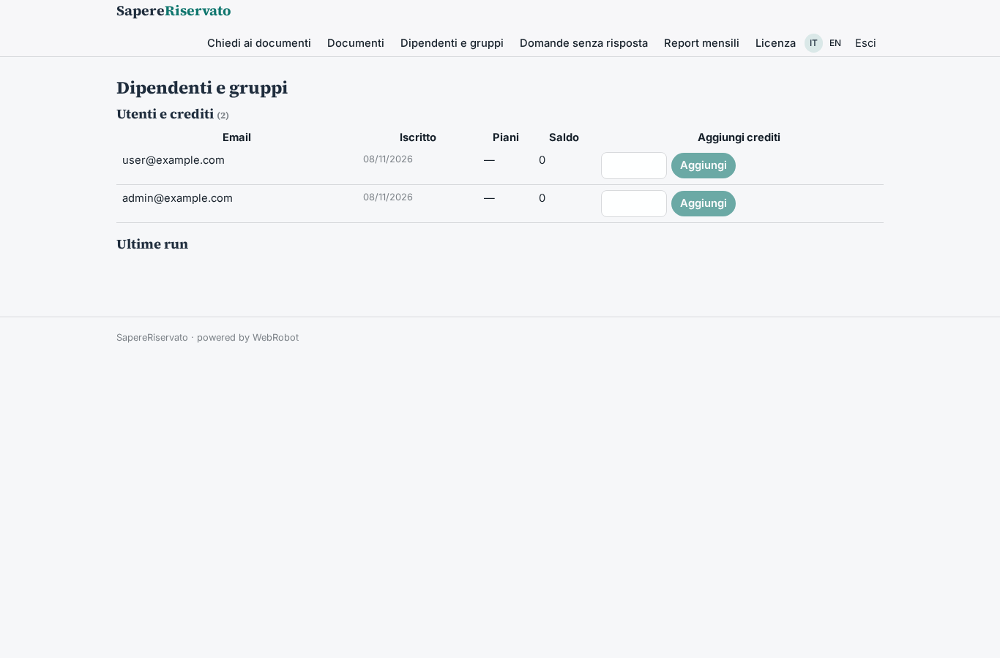

# SapereRiservato

_L'assistente aziendale che risponde dai tuoi documenti, e solo a chi può leggerli._

**Manifest status:** valid (schema validator + runtime contract)

## Description given to the app builder (Italian)

Vorrei SapereRiservato, un assistente AI aziendale per organizzazioni che non vogliono che i propri documenti escano dall'azienda. L'admin carica documenti interni (procedure, contratti, manuali) e definisce quali gruppi di dipendenti possono vederli. I dipendenti fanno domande in chat e ricevono risposte con citazione del documento fonte, solo dai documenti a cui hanno accesso. Il modello linguistico gira su infrastruttura dedicata del cliente, senza servizi esterni. Ogni mese l'admin riceve un report con le domande senza risposta. Licenza annuale per numero di utenti.

## Features not expressible today (spec.extensions)

- **dedicated_llm**: The language model running on the customer's dedicated infrastructure with no external services is a deployment choice, not expressible in the manifest. This draft uses the platform's standard model.
- **file_upload**: Uploading files (PDF, Word) is not available yet: the admin pastes the document text into the documents collection.
- **hard_group_enforcement**: Group filtering is enforced by the assistant's instructions over a shared documents collection. Strict per-group enforcement in the runtime (records filtered by group before the agent sees them) is needed for stronger guarantees.
- **email_report**: Emailing the monthly report to the admin is not available yet: the report appears in the Monthly reports view.
- **seat_limit**: The per-user-count license is modelled as three annual plans by user band; automatic enforcement of the seat count is not available.

## Screenshots (interpretive runtime)

### home-anon

### home-mobile

### home

### chat

### documents_admin

### members_admin

### unanswered

