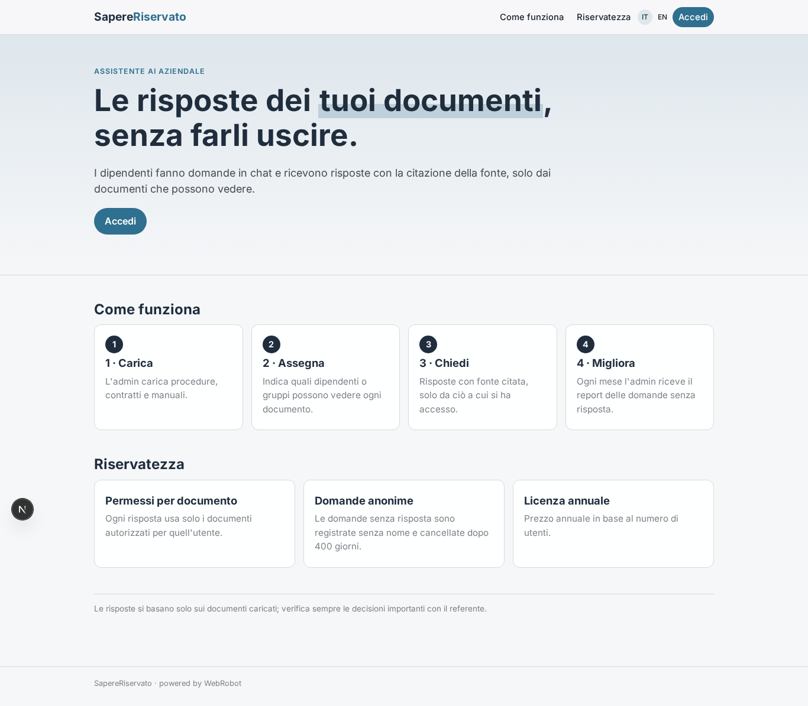
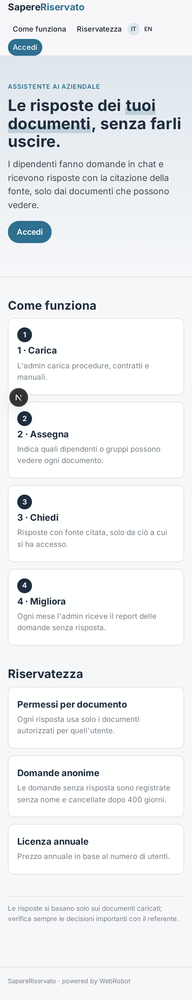
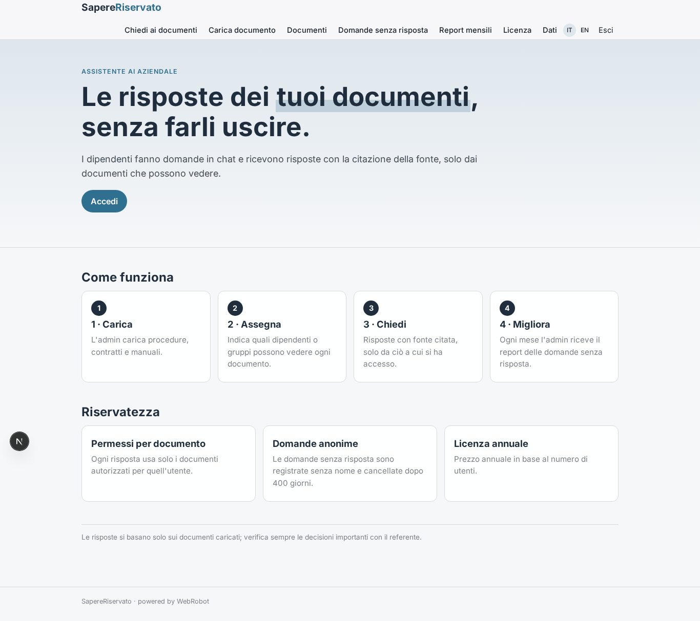
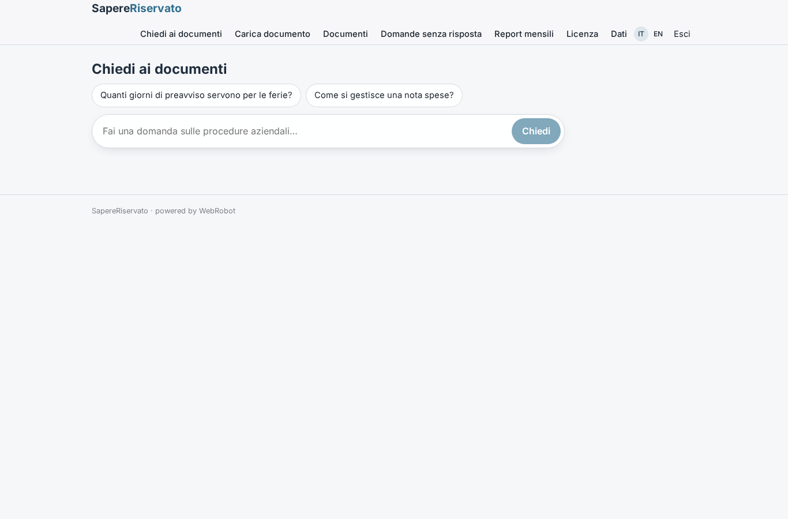
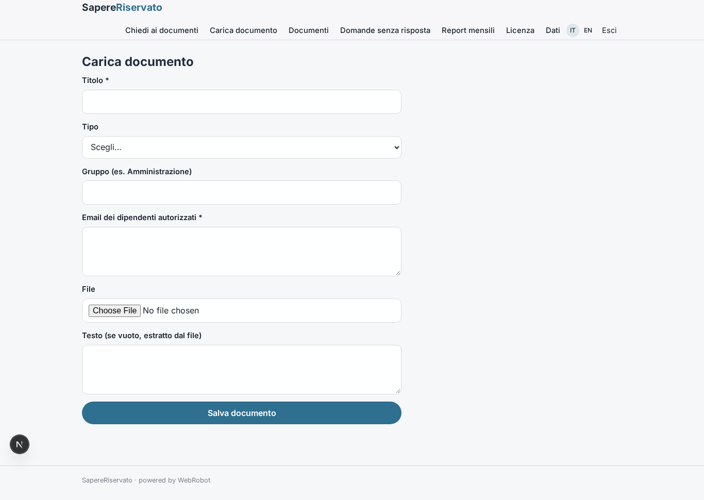
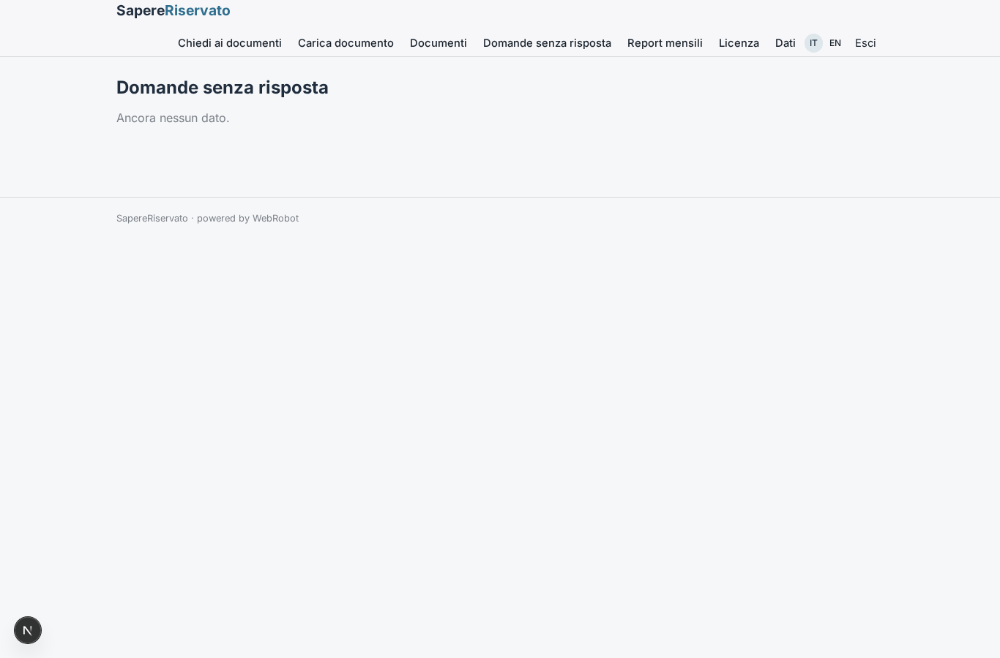
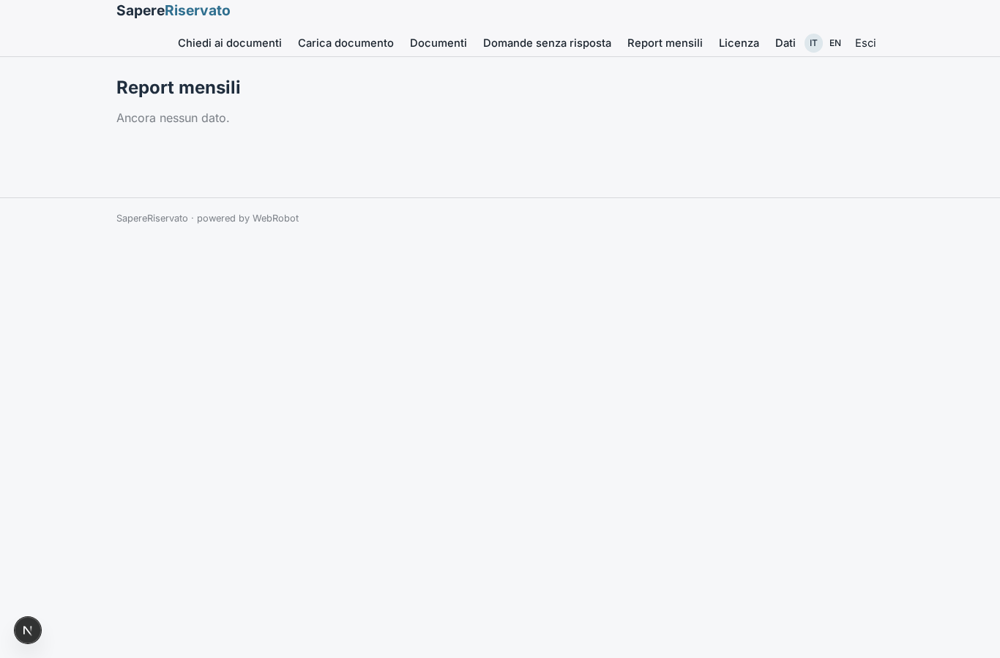
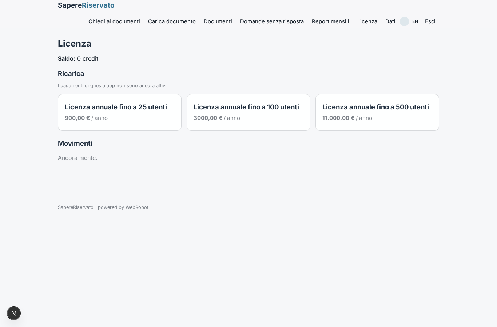

# SapereRiservato

_L'assistente AI che conosce i tuoi documenti e non li fa uscire dall'azienda._

**Manifest:** valid (schema + runtime contract) · **Functional test:** passed (18 checks passed)

## Description given to the app builder (Italian)

Vorrei SapereRiservato, un assistente AI aziendale per organizzazioni che non vogliono che i propri documenti escano dall'azienda. L'admin carica documenti interni (procedure, contratti, manuali) e definisce quali gruppi di dipendenti possono vederli. I dipendenti fanno domande in chat e ricevono risposte con citazione del documento fonte, solo dai documenti a cui hanno accesso. Il modello linguistico gira su infrastruttura dedicata del cliente, senza servizi esterni. Ogni mese l'admin riceve un report con le domande senza risposta. Licenza annuale per numero di utenti.

## Features not expressible today (spec.extensions)

- **dedicated_llm**: Il modello linguistico su infrastruttura dedicata del cliente, senza servizi esterni, non è configurabile dal manifest: richiede un deployment dedicato del runtime e del modello.
- **seat_limit**: Il tetto sul numero di utenti invitati per piano (25/100/500) non è applicabile dal manifest: va controllato dall'admin degli inviti o da logica del runtime.
- **groups_directory**: I gruppi di dipendenti sono gestiti come elenco di email per documento; un'anagrafica gruppi riutilizzabile non è disponibile.

## Screenshots (interpretive runtime, no data)

### home-anon

### home-mobile

### home

### chat

### upload_doc

### docs

### unanswered

### reports

### account

