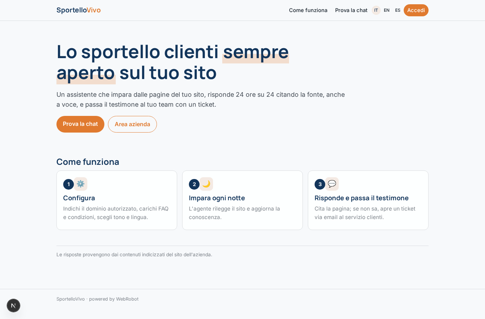
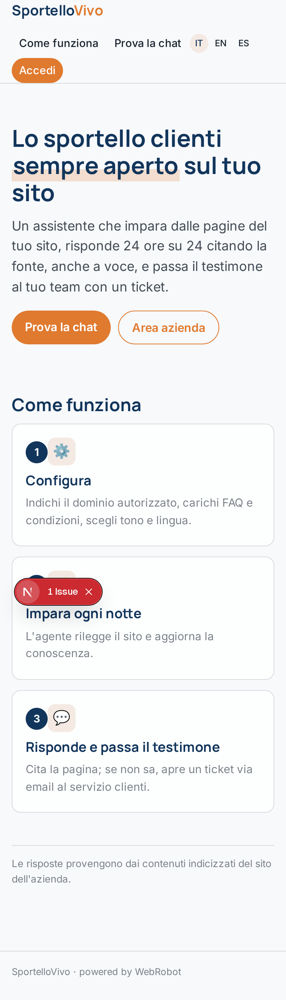
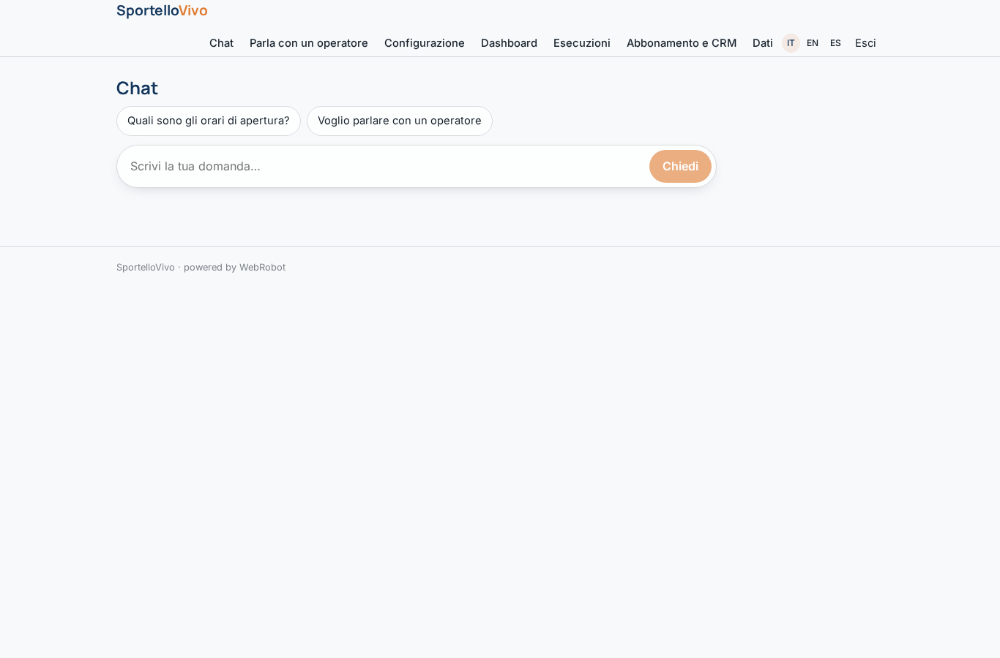
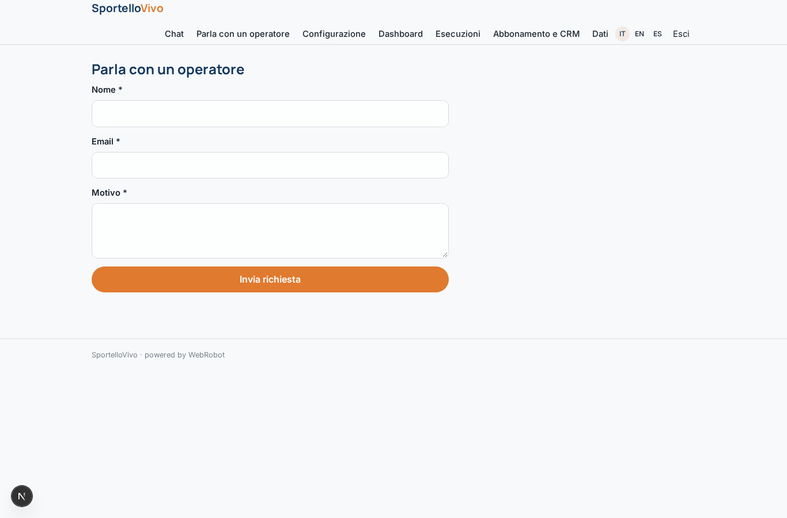
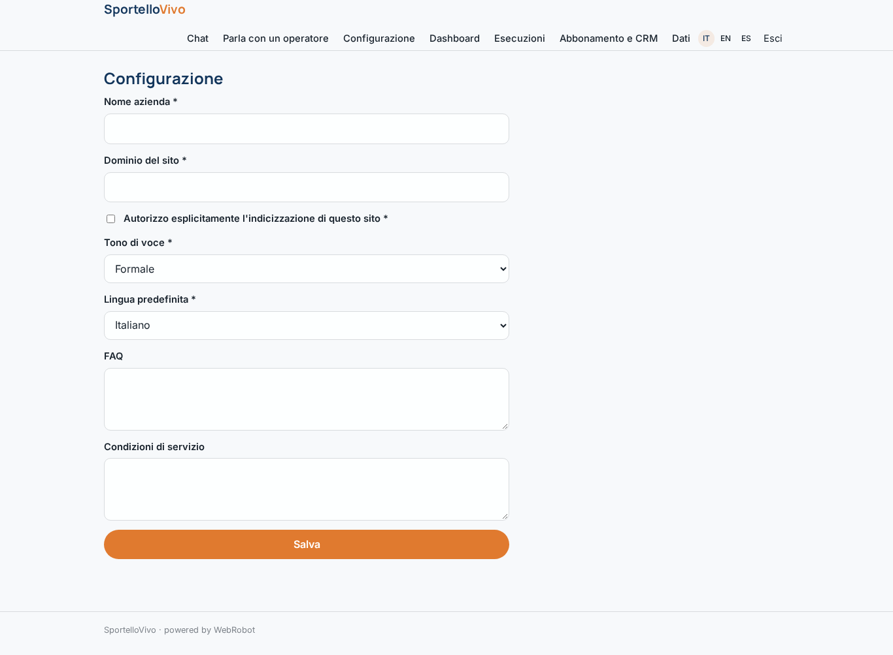
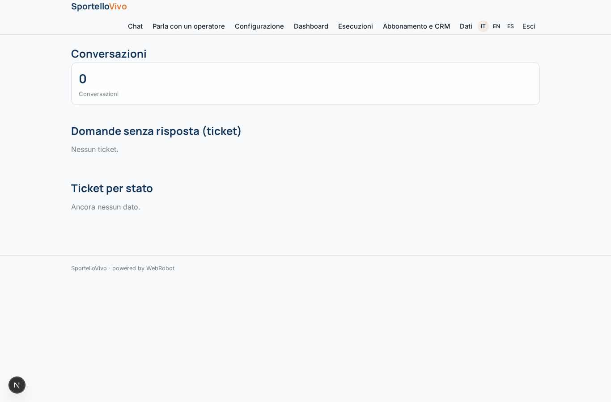
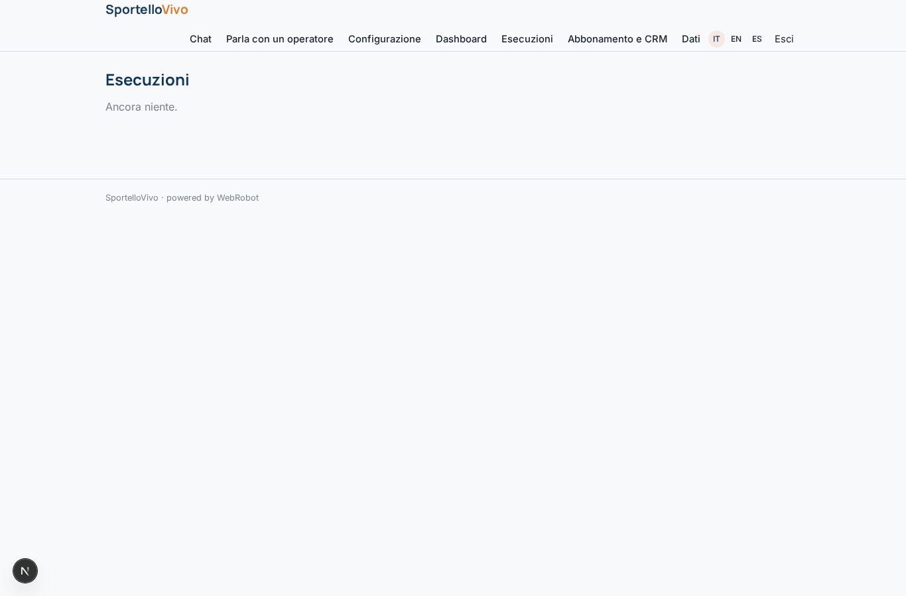
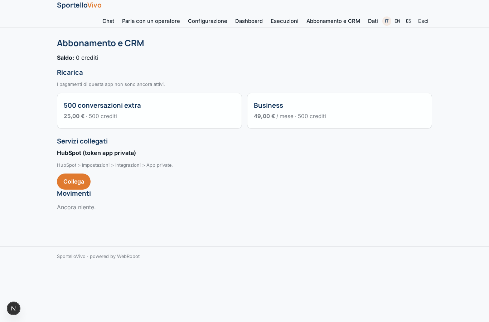

# SportelloVivo

_Lo sportello clienti sempre aperto sul tuo sito._

**Manifest:** valid (schema + runtime contract) · **Functional test:** passed (18 checks passed)

## Description given to the app builder (Italian)

Vorrei creare SportelloVivo, un assistente conversazionale che le aziende mettono sul proprio sito per rispondere ai clienti 24 ore su 24. L'admin dell'azienda indica il dominio del sito (che autorizza esplicitamente a indicizzare), carica FAQ e condizioni di servizio, sceglie tono di voce e lingua. L'agente costruisce una base di conoscenza dalle pagine del sito e risponde ai visitatori anonimi in una chat pubblica incorporabile, citando la pagina da cui prende l'informazione; quando non sa rispondere o il cliente chiede un operatore, raccoglie nome, email e motivo e apre un ticket che arriva via email al servizio clienti. Deve funzionare anche a voce, sia dal browser sia come numero di telefono che risponde alle chiamate, e deve poter leggere e scrivere i contatti nel CRM del cliente (Salesforce, HubSpot) e prendere appuntamenti nel suo calendario. Ogni notte l'agente riallinea la conoscenza con le modifiche al sito. L'admin vede una dashboard con conversazioni, domande senza risposta e tasso di risoluzione. Abbonamento mensile per azienda più crediti per conversazione oltre la soglia. Italiano, inglese, spagnolo.

## Features not expressible today (spec.extensions)

- **salesforce_crm**: Salesforce needs OAuth sign-in, not available yet; only HubSpot (API key) is connected, and only to create contacts from tickets. Reading CRM contacts during anonymous chats is not allowed.
- **calendar_booking**: Booking appointments in the customer's own calendar (Google/Microsoft 365) needs OAuth, not available yet.
- **resolution_rate**: The anonymous agent cannot write conversation logs, so resolution rate and a list of unanswered questions are approximated by runs and tickets; a precise rate needs a code extension.
- **embed_widget**: Embedding: the public chat at /v/chat is embedded with an iframe on the company site; the phone number is activated by the owner in the studio.

## Screenshots (interpretive runtime, no data)

### home-anon

### home-mobile

### home

### chat

### ticket

### settings

### dashboard

### history

### account

