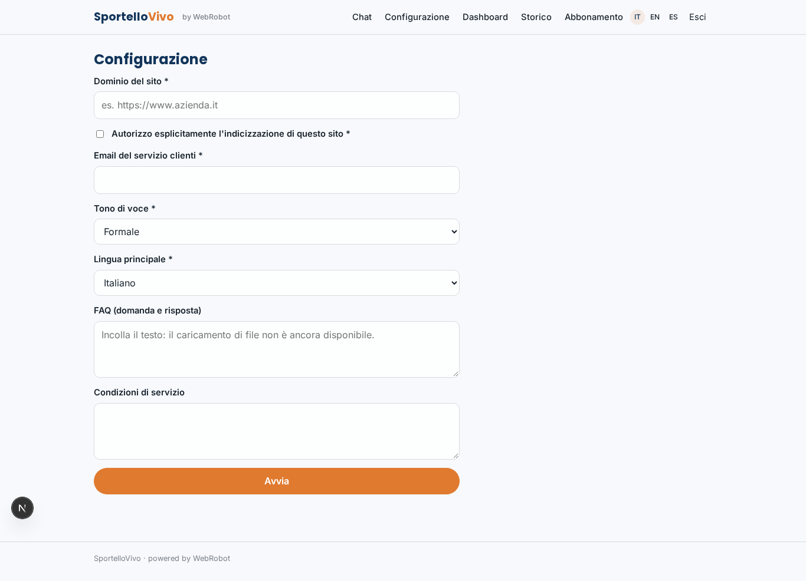
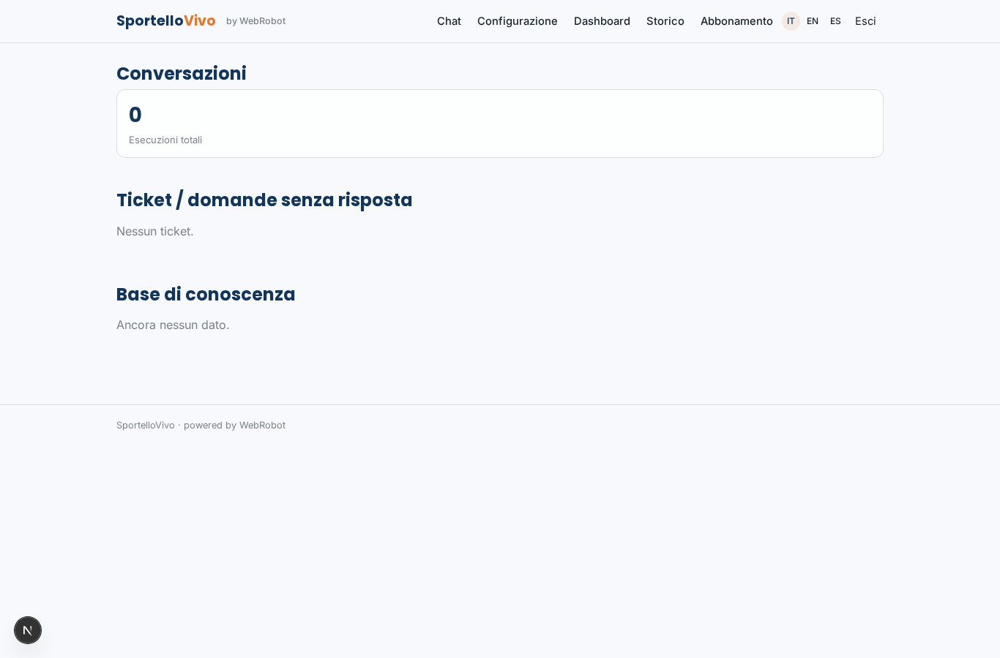
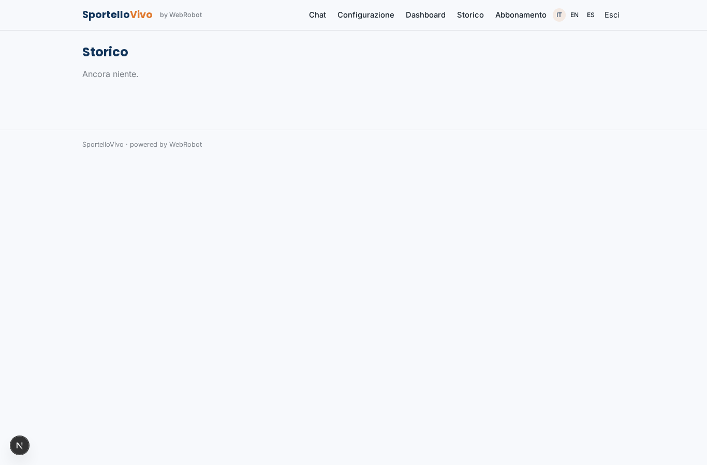
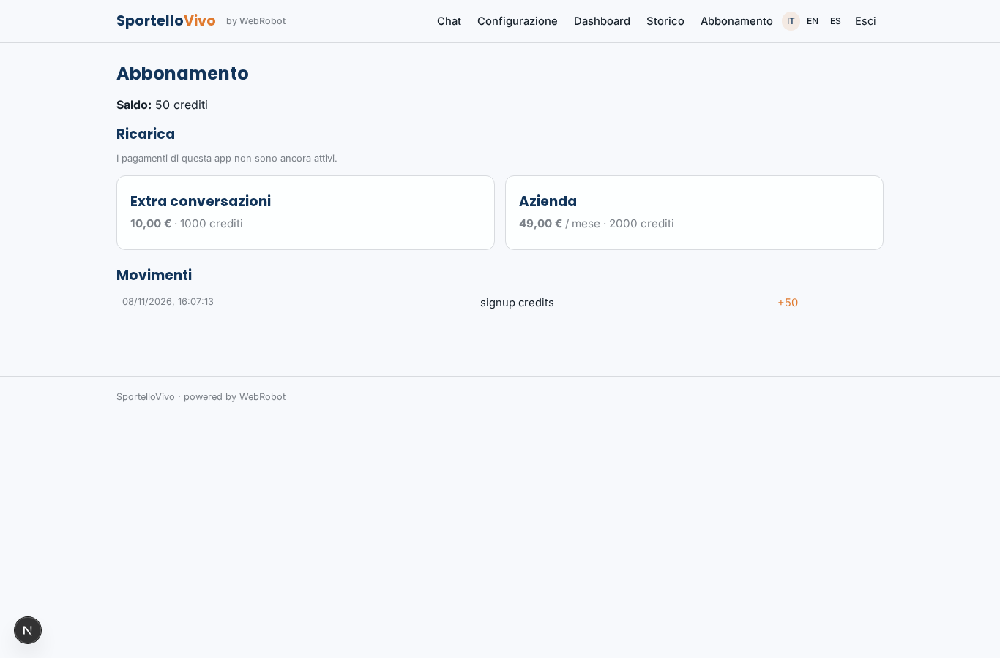

# SportelloVivo

_Lo sportello del tuo sito, aperto 24 ore su 24._

**Stato manifest:** valido (validatore Python + contratto runtime)

## Descrizione data all'app builder

Vorrei creare SportelloVivo, un assistente conversazionale che le aziende mettono sul proprio sito per rispondere ai clienti 24 ore su 24. L'admin dell'azienda indica il dominio del sito (che autorizza esplicitamente a indicizzare), carica FAQ e condizioni di servizio, sceglie tono di voce e lingua. L'agente costruisce una base di conoscenza dalle pagine del sito e risponde ai visitatori anonimi in una chat pubblica incorporabile, citando la pagina da cui prende l'informazione; quando non sa rispondere o il cliente chiede un operatore, raccoglie nome, email e motivo e apre un ticket che arriva via email al servizio clienti. Deve funzionare anche a voce, sia dal browser sia come numero di telefono che risponde alle chiamate, e deve poter leggere e scrivere i contatti nel CRM del cliente (Salesforce, HubSpot) e prendere appuntamenti nel suo calendario. Ogni notte l'agente riallinea la conoscenza con le modifiche al sito. L'admin vede una dashboard con conversazioni, domande senza risposta e tasso di risoluzione. Abbonamento mensile per azienda più crediti per conversazione oltre la soglia. Italiano, inglese, spagnolo.

## Funzioni non esprimibili oggi (spec.extensions)

- **ticket_email**: Ticket arrive by email to customer service: notifications are not available yet. For now tickets are stored in the tickets collection; the admin sees only tickets from their own session until an email/forward step exists.
- **embed_widget**: Embeddable public chat snippet (script/iframe) for the customer's site: the runtime offers the floating chat view; an embed code is not yet part of the manifest.
- **browser_voice**: Voice in the browser (speech in/out) is not declared in the manifest yet; the phone channel is declared, number set by Activate phone.
- **crm_calendar**: Reading/writing contacts in Salesforce/HubSpot and booking appointments in the customer's calendar need the company's own credentials (OAuth): not available yet.
- **multi_company**: Each company runs its own instance of the app (own admin, knowledge, billing). Metrics such as resolution rate and per-conversation credits on anonymous visitors' chats need the runtime to attribute visitor conversations to the company; the dashboard shows runs and tickets for now.

## Screenshot (runtime interpretativo)

### home-anon

### home-mobile

### home

### chat

### setup

### dashboard

### history

### account

