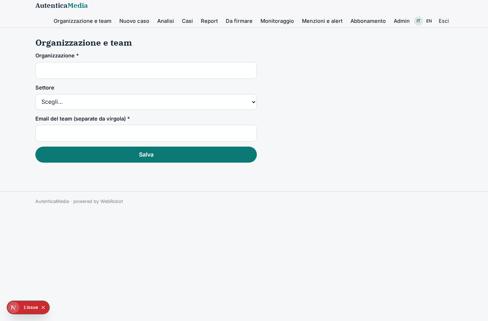
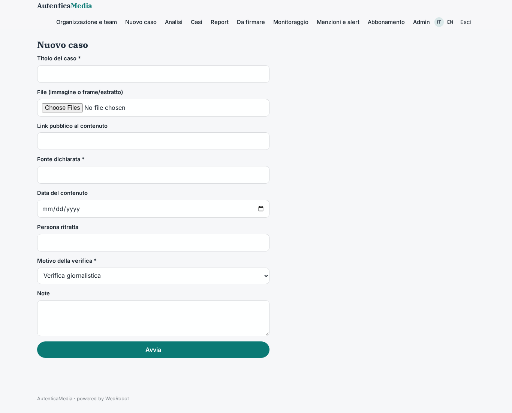
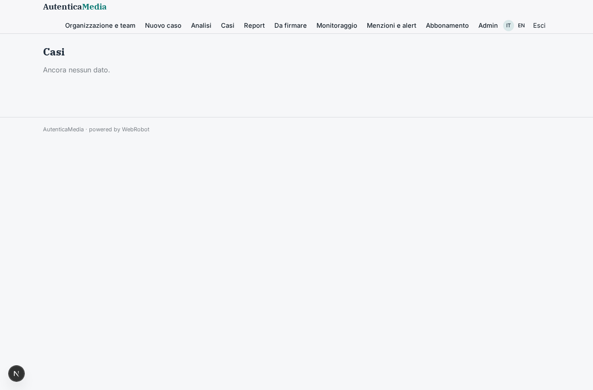
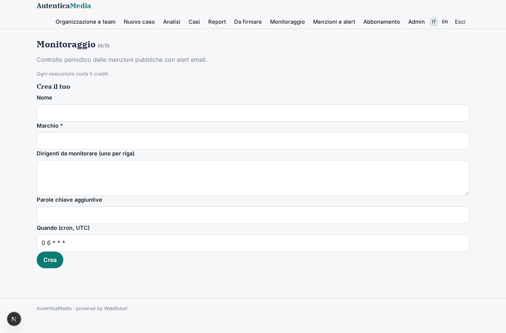
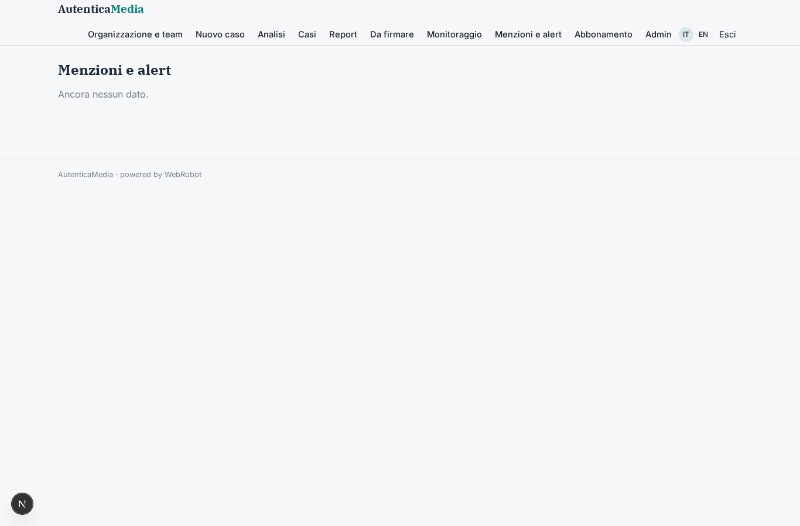
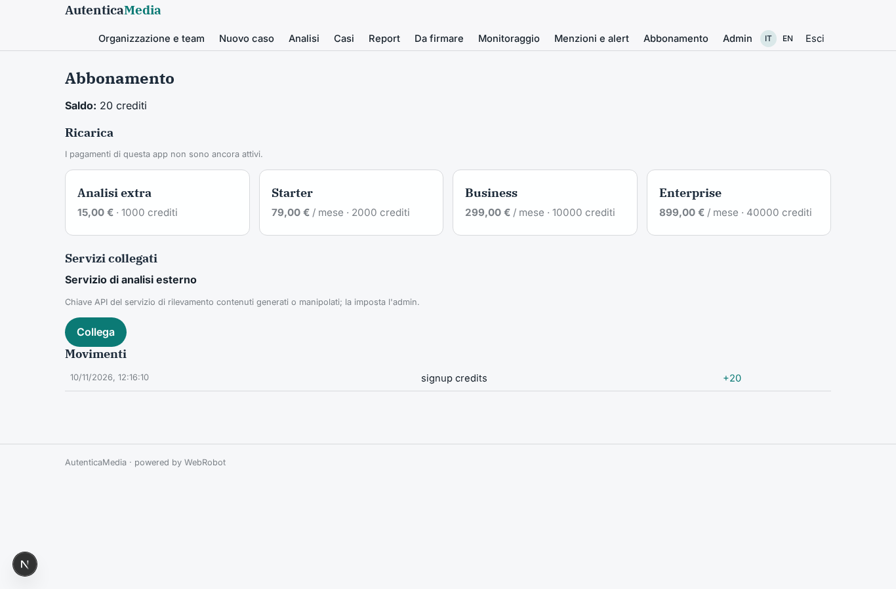
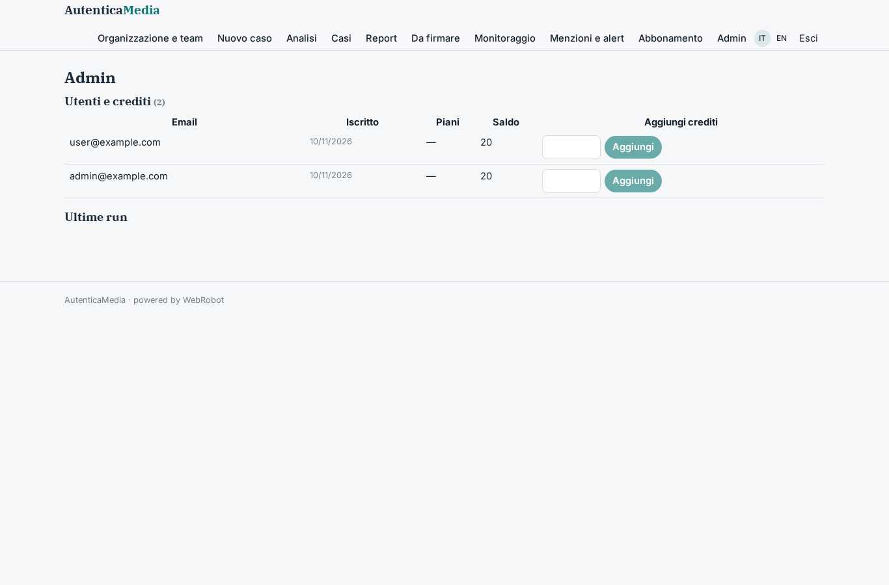

# AutenticaMedia

_Verifica difensiva dell'autenticità di immagini, video e audio, con report firmato da un revisore._

**Manifest:** valid (schema + runtime contract) · **Functional test:** passed (15 checks passed)

## Description given to the app builder (Italian)

Per AutenticaMedia descrivo solo lo strato software di gestione e reportistica: i modelli di rilevamento di contenuti generati o manipolati sono un servizio di analisi esterno. L'uso è esclusivamente difensivo: redazioni giornalistiche, uffici legali, assicurazioni e banche verificano l'autenticità di immagini, video e audio che hanno ricevuto o che riguardano la propria organizzazione. Ruoli: analista, revisore e admin. L'analista apre un caso e carica il file o indica un link pubblico, con contesto: fonte dichiarata, data, persona ritratta, motivo della verifica. Un agente estrae i metadati, invia il contenuto al servizio di analisi, raccoglie i punteggi per ciascun indicatore e cerca versioni precedenti dello stesso contenuto su fonti pubbliche. Un secondo agente redige un report con giudizio motivato (probabilmente autentico, dubbio, probabilmente manipolato), livello di confidenza e limiti dell'analisi. Il revisore umano firma il report prima che possa essere esportato in PDF o condiviso. Per i clienti aziendali c'è il monitoraggio periodico di menzioni del proprio marchio e dei propri dirigenti, con alert email. Ogni organizzazione vede solo i propri casi, accessi registrati. Abbonamento per volume di analisi. Italiano e inglese.

## Features not expressible today (spec.extensions)

- **video_audio_upload**: Direct upload of video and audio files is not available (file fields accept documents and images only): video and audio are verified through a public link.
- **access_audit_log**: A dedicated, exportable log of every read access to cases and reports is not expressible in the manifest; the runtime records runs and approvals decisions only.
- **pdf_export_gate**: Hard blocking of PDF export/sharing until the report is signed is enforced by the approval flow and report status; a runtime-level export lock on unsigned reports is not available.
- **detection_service_contract**: The external analysis service host, request body and response shape are placeholders to align with the contracted provider.

## Screenshots (interpretive runtime, no data)

### home-anon

### home-mobile

### home

### org

### new_case

### history

### cases

### reports_list

### signatures

### watches

### mentions

### account

### admin

