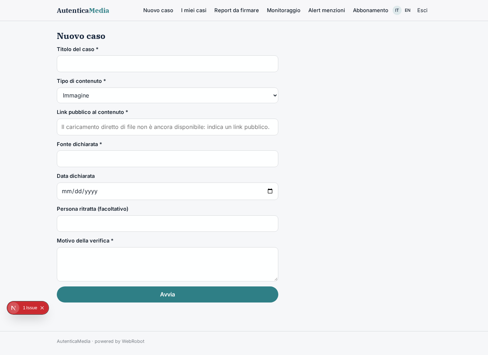
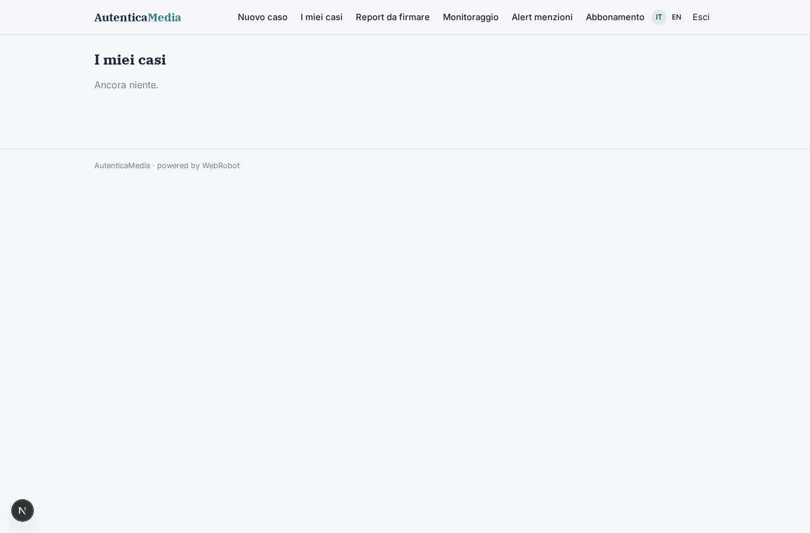
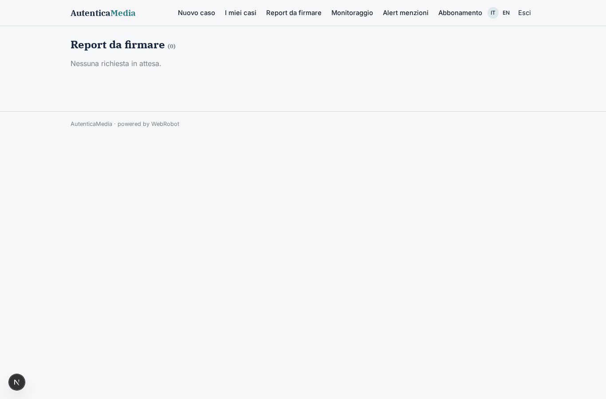
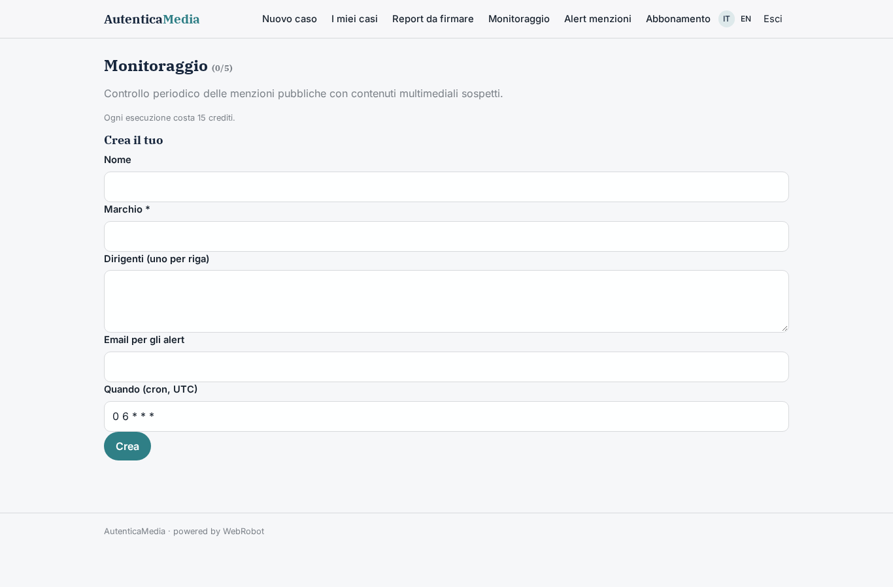
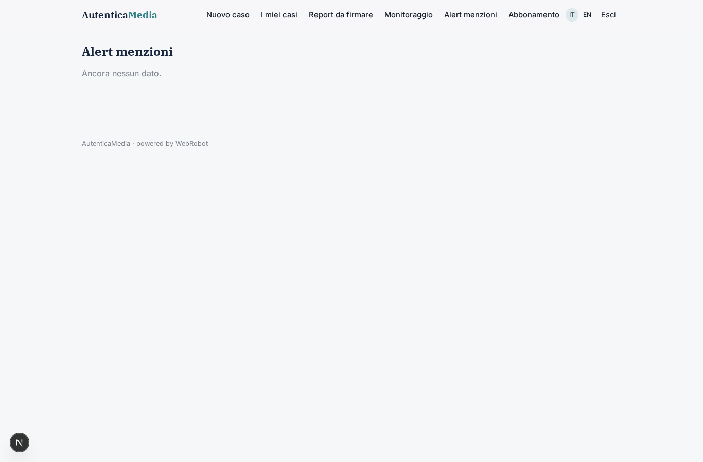
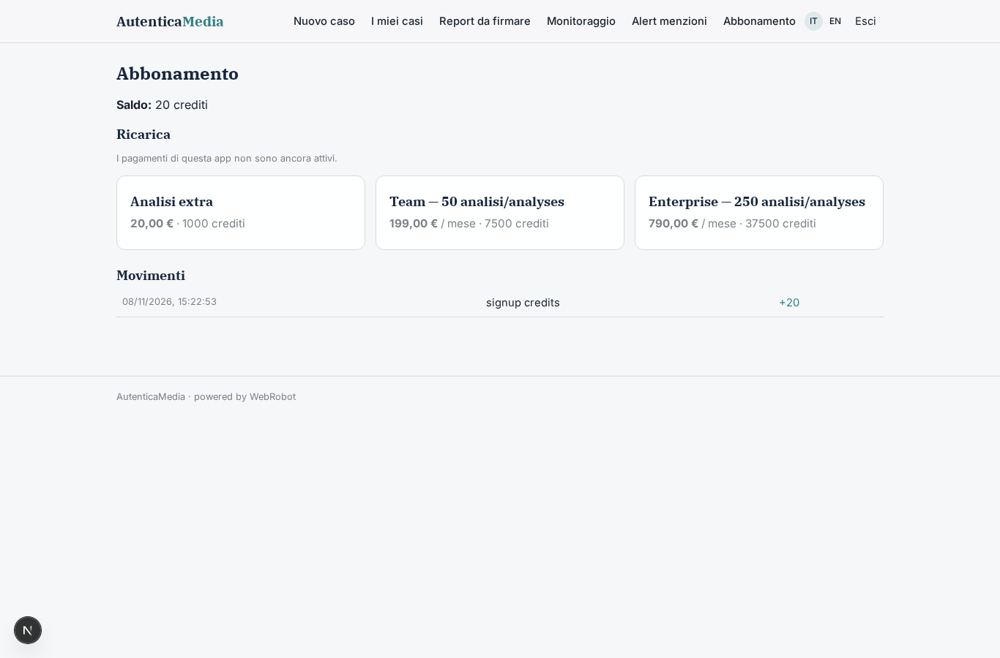

# AutenticaMedia

_Verifica difensiva dell'autenticità di immagini, video e audio._

**Stato manifest:** valido (validatore Python + contratto runtime)

## Descrizione data all'app builder

Per AutenticaMedia descrivo solo lo strato software di gestione e reportistica: i modelli di rilevamento di contenuti generati o manipolati sono un servizio di analisi esterno. L'uso è esclusivamente difensivo: redazioni giornalistiche, uffici legali, assicurazioni e banche verificano l'autenticità di immagini, video e audio che hanno ricevuto o che riguardano la propria organizzazione. Ruoli: analista, revisore e admin. L'analista apre un caso e carica il file o indica un link pubblico, con contesto: fonte dichiarata, data, persona ritratta, motivo della verifica. Un agente estrae i metadati, invia il contenuto al servizio di analisi, raccoglie i punteggi per ciascun indicatore e cerca versioni precedenti dello stesso contenuto su fonti pubbliche. Un secondo agente redige un report con giudizio motivato (probabilmente autentico, dubbio, probabilmente manipolato), livello di confidenza e limiti dell'analisi. Il revisore umano firma il report prima che possa essere esportato in PDF o condiviso. Per i clienti aziendali c'è il monitoraggio periodico di menzioni del proprio marchio e dei propri dirigenti, con alert email. Ogni organizzazione vede solo i propri casi, accessi registrati. Abbonamento per volume di analisi. Italiano e inglese.

## Funzioni non esprimibili oggi (spec.extensions)

- **detection_service**: Connector to the external detection service (endpoint, API terms and response format to be provided). Until connected, the agent reports scores as unavailable and never invents them.
- **file_upload**: Direct upload of files is not available yet: analysts supply a public link.
- **email_alerts**: Email alerts for brand monitoring are not available yet; alerts appear in the Alerts view.
- **org_isolation**: Multi-user organisations sharing cases within the same organisation (cases are per user today) and per-organisation data separation.
- **access_audit_log**: Logging of every access to cases and reports.
- **export_gate**: PDF export and sharing blocked until report_signoff is approved.

## Screenshot (runtime interpretativo)

### home-anon

### home-mobile

### home

### new_case

### cases

### signoffs

### watches

### alerts

### account

