# AutoSereno

_Polizze auto a consumo, con un punteggio di guida chiaro e sconti equi._

**Manifest:** valid (schema + runtime contract) · **Functional test:** passed (29 checks passed)

## Description given to the app builder (Italian)

Di AutoSereno descrivo solo lo strato software: la raccolta dei dati di guida da dispositivi telematici installati sui veicoli è hardware e la fornisce un partner. L'app serve a una compagnia assicurativa o a un intermediario per gestire le polizze auto a consumo. Ruoli: assicurato, agente assicurativo e responsabile tecnico. L'assicurato si registra, inserisce targa, dati del veicolo e della polizza, dà il consenso al trattamento dei dati di guida e prenota l'installazione della scatola nera presso un'officina convenzionata. I dati aggregati di viaggio (chilometri, fasce orarie, frenate brusche, velocità) arrivano dalla piattaforma del partner; un agente calcola ogni mese un punteggio di guida, spiega all'assicurato cosa ha influito e propone consigli pratici. Un secondo agente prepara la proposta di sconto al rinnovo, che l'agente assicurativo approva prima dell'invio. In caso di sinistro l'assicurato apre una denuncia guidata con foto e descrizione; la pratica va in coda al liquidatore. L'assicurato vede solo i propri dati e il punteggio, l'agente i propri clienti, il responsabile la dashboard di portafoglio. Notifiche email e app mobile. Licenza alla compagnia per polizza attiva. Italiano.

## Functional test: what did not pass

- **trigger has its effect** (trigger claim_new): email to role:liquidator: no such recipient in the test (role nobody holds or empty field) _(warning)_

## Features not expressible today (spec.extensions)

- **license_per_policy**: Licenza alla compagnia per polizza attiva: la fatturazione per polizza attiva (veicoli con polizza non scaduta) non è modellata nel manifest e va gestita dal contratto/fatturazione WebRobot con la compagnia.
- **telematics_partner**: Il partner invia i viaggi con POST /api/hooks/trips_in (trip_id, policy_number, plate, date, km, night_km, harsh_braking, speeding_km, max_speed). L'abbinamento del payload all'assicurato tramite numero di polizza va configurato con il partner.

## Screenshots (interpretive runtime, no data)

### home-anon

### home-mobile

### home

### vehicle
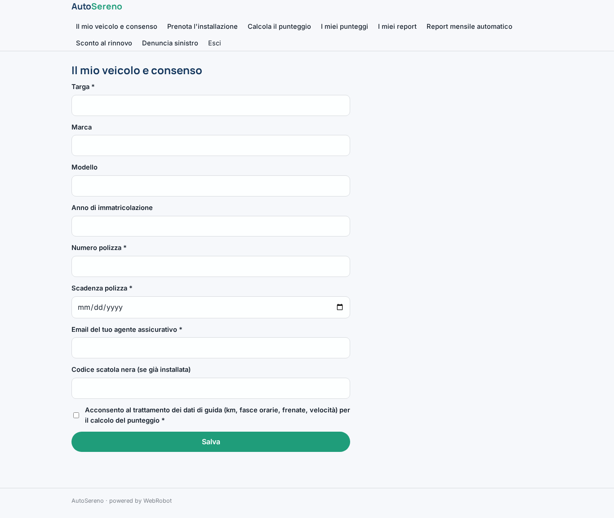

### book
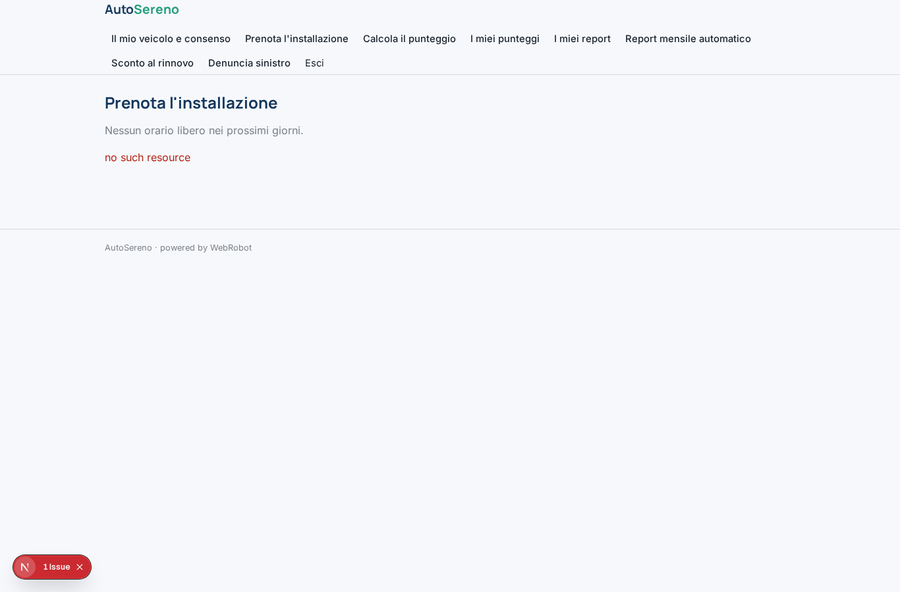

### score_now
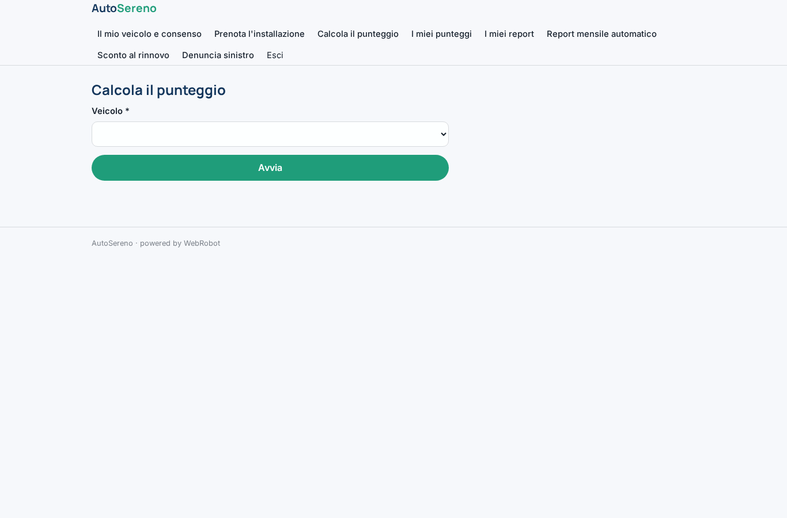

### my_scores
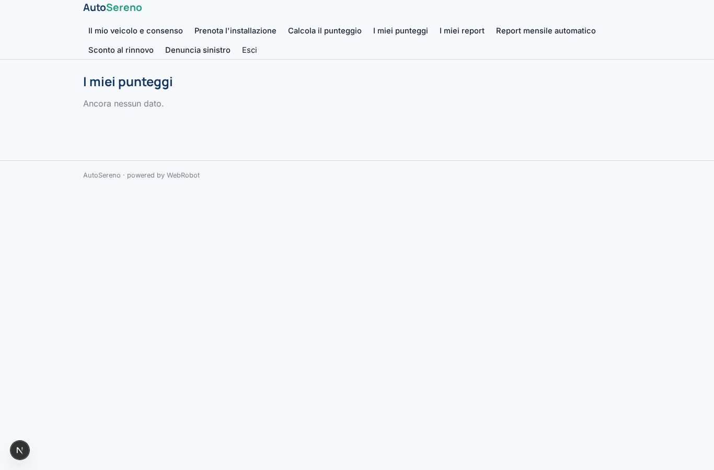

### runs
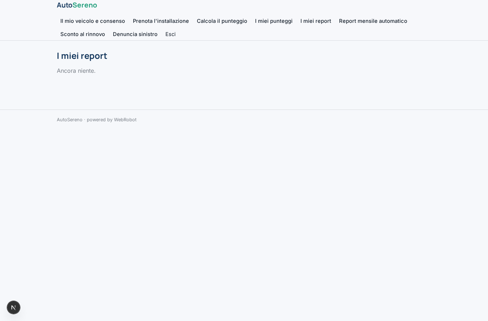

### watches
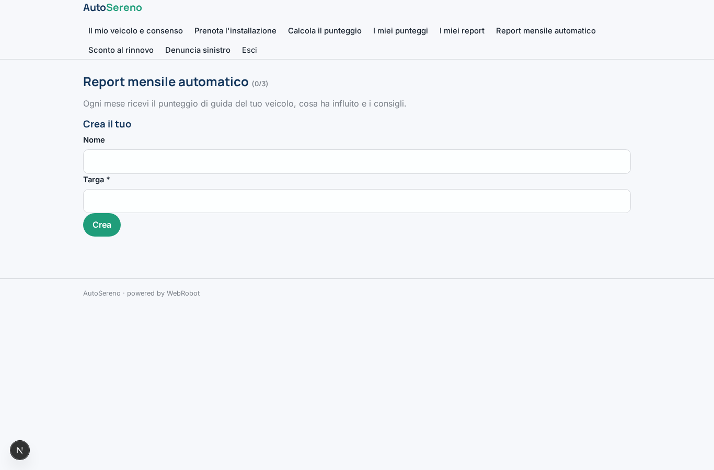

### my_proposals
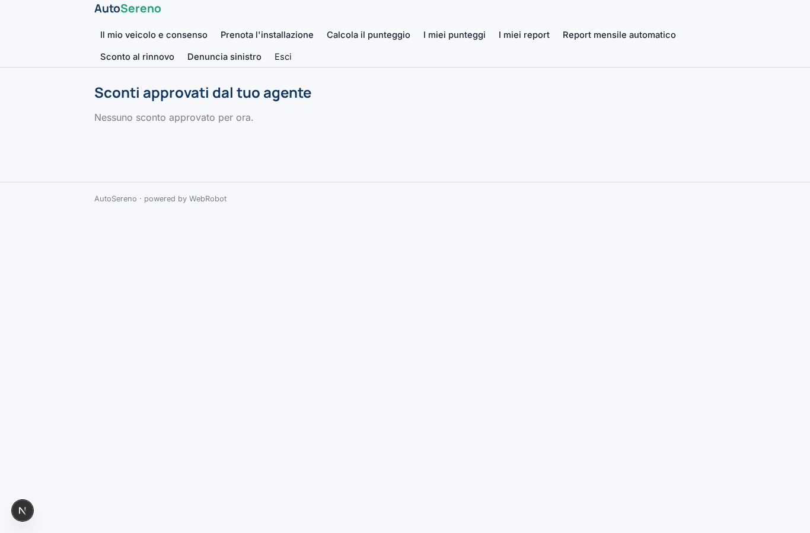

### claim
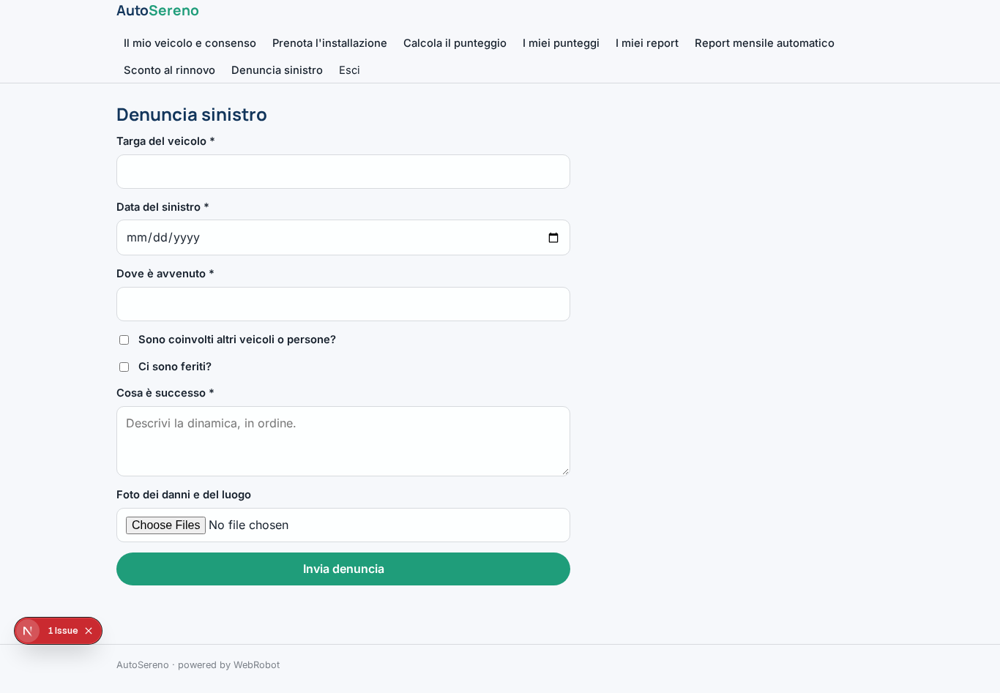

### clients

### client_scores

### approvals
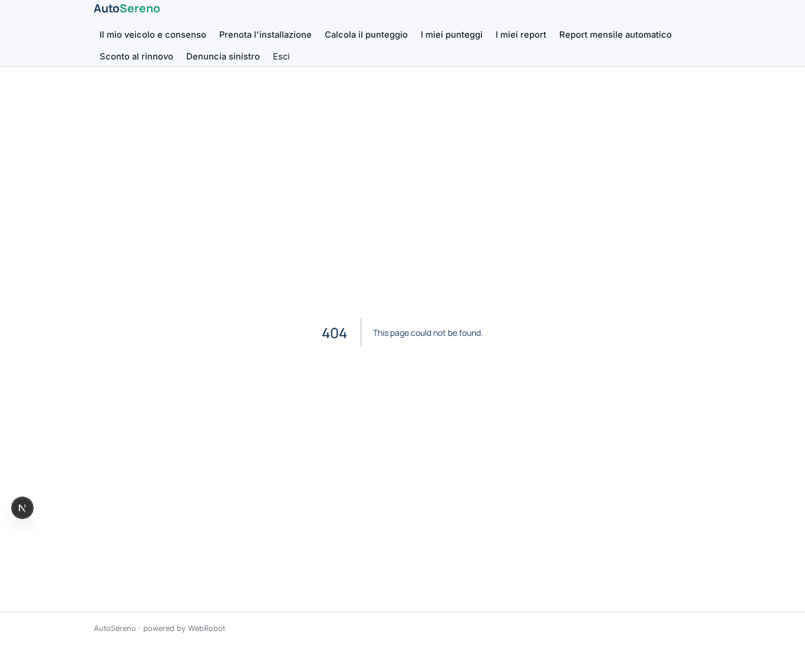

### claims_queue
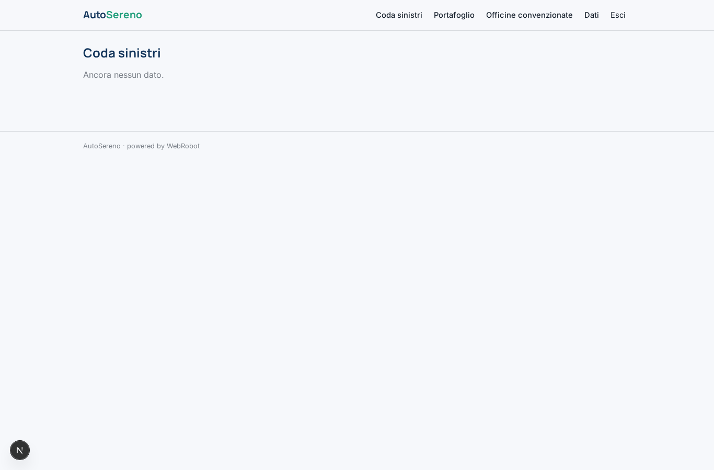

### portfolio
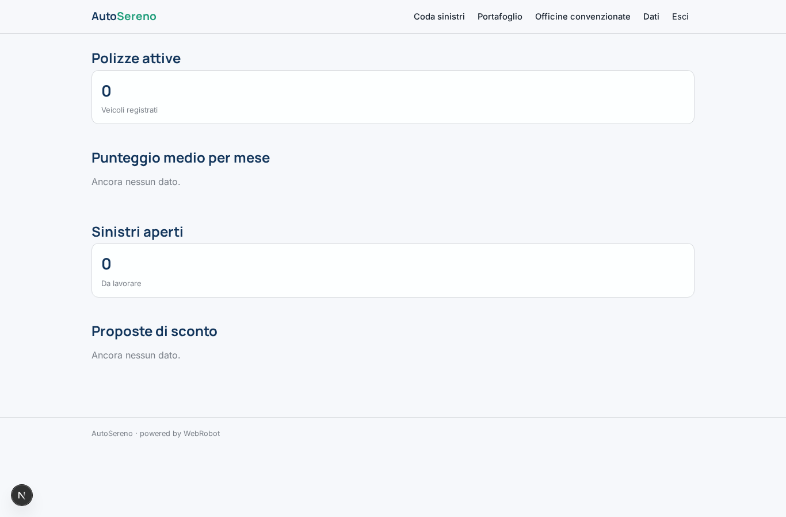

### workshops_admin
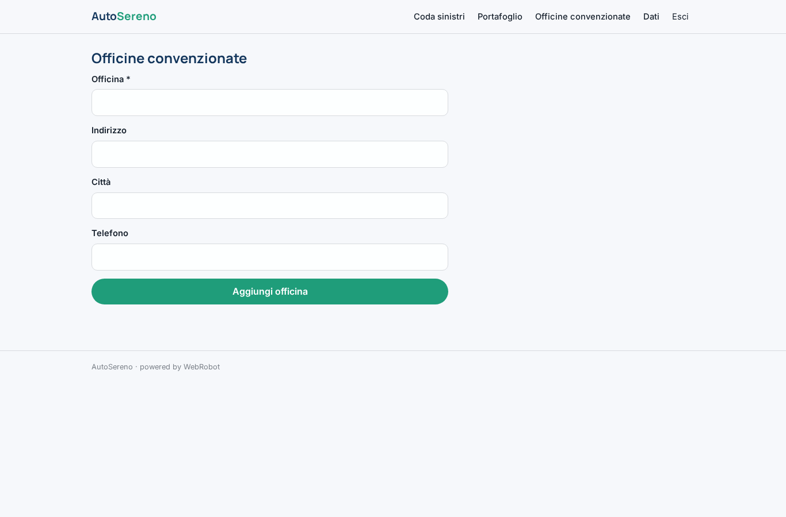
