# AutoSereno

_Polizze auto a consumo, con un punteggio di guida chiaro e sconti equi._

**Stato manifest:** valido (validatore Python + contratto runtime)

## Descrizione data all'app builder

Di AutoSereno descrivo solo lo strato software: la raccolta dei dati di guida da dispositivi telematici installati sui veicoli è hardware e la fornisce un partner. L'app serve a una compagnia assicurativa o a un intermediario per gestire le polizze auto a consumo. Ruoli: assicurato, agente assicurativo e responsabile tecnico. L'assicurato si registra, inserisce targa, dati del veicolo e della polizza, dà il consenso al trattamento dei dati di guida e prenota l'installazione della scatola nera presso un'officina convenzionata. I dati aggregati di viaggio (chilometri, fasce orarie, frenate brusche, velocità) arrivano dalla piattaforma del partner; un agente calcola ogni mese un punteggio di guida, spiega all'assicurato cosa ha influito e propone consigli pratici. Un secondo agente prepara la proposta di sconto al rinnovo, che l'agente assicurativo approva prima dell'invio. In caso di sinistro l'assicurato apre una denuncia guidata con foto e descrizione; la pratica va in coda al liquidatore. L'assicurato vede solo i propri dati e il punteggio, l'agente i propri clienti, il responsabile la dashboard di portafoglio. Notifiche email e app mobile. Licenza alla compagnia per polizza attiva. Italiano.

## Funzioni non esprimibili oggi (spec.extensions)

- **partner_telematics_ingest**: I dati aggregati di viaggio arrivano dalla piattaforma del partner telematico (API/webhook con credenziali della compagnia, non incluse). Servono un connettore che scriva la collection trips per ogni assicurato e l'host del partner in spec.egress.
- **email_notifications**: Notifiche email (installazione confermata, punteggio mensile, sconto approvato, sinistro in lavorazione) non ancora disponibili.
- **claim_photos_upload**: Il caricamento di foto non è ancora disponibile: l'assicurato indica link alle foto.
- **role_scoped_visibility**: Vista dell'agente solo sui propri clienti (via invito per record su policies, campo agent_email) e dashboard di portafoglio aggregata su tutti gli assicurati richiedono logica dedicata: oggi i dati utente sono visibili solo al proprietario o agli invitati.
- **license_per_active_policy**: Licenza alla compagnia per polizza attiva: contratto tra WebRobot e la compagnia, calcolato contando le polizze con status attiva; fuori dal manifest.
- **native_mobile_app**: App mobile tramite shell Capacitor intorno all'app web; funzioni native (push) non incluse.

## Screenshot (runtime interpretativo)

### home-anon
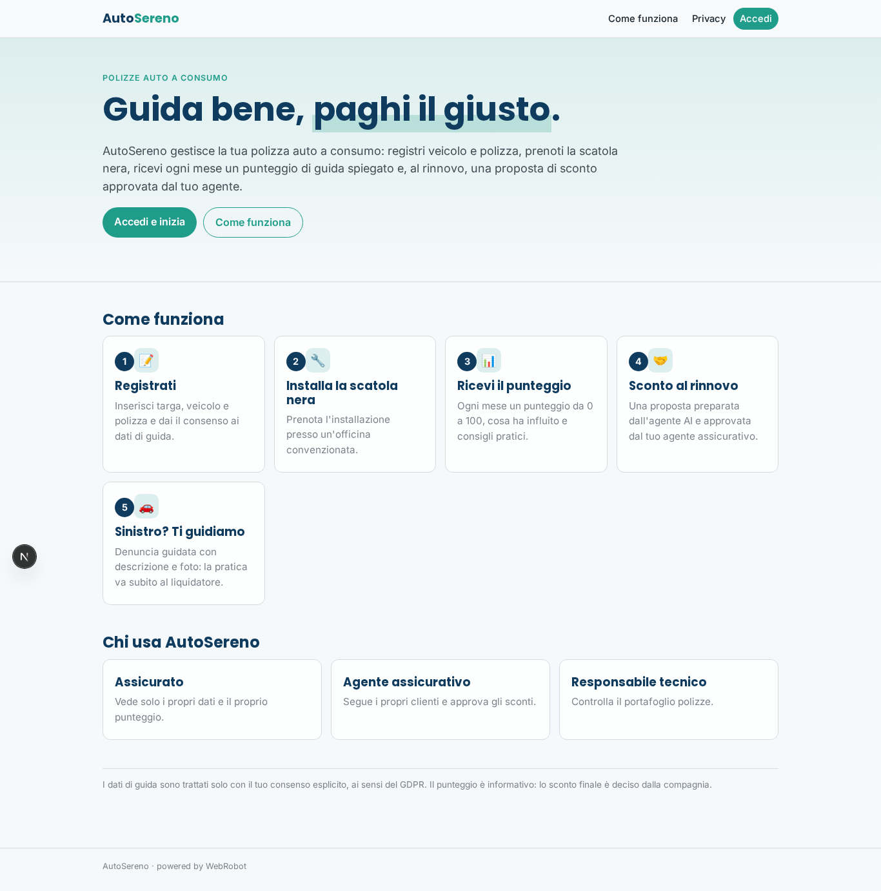

### home-mobile
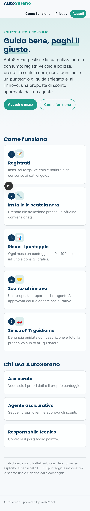

### home
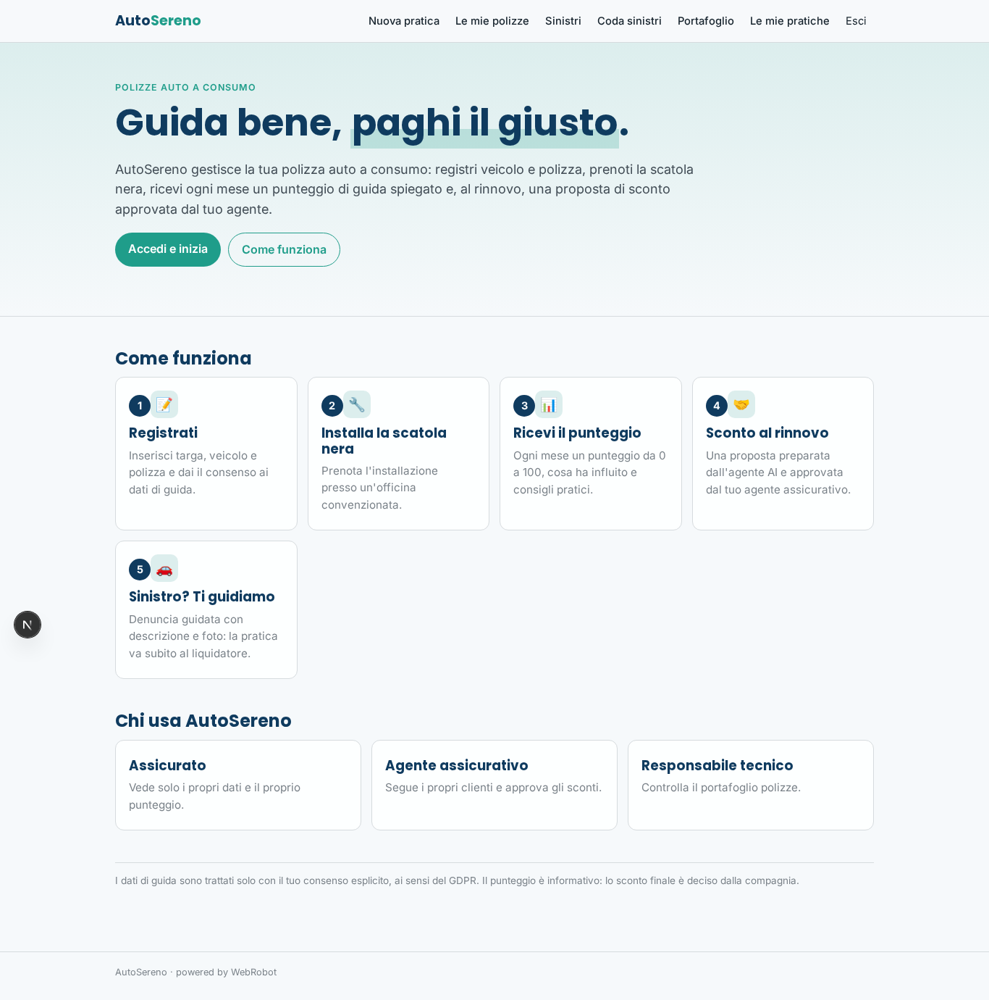

### new
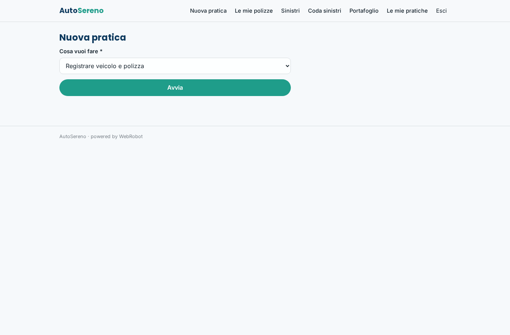

### policies_view

### trips_view
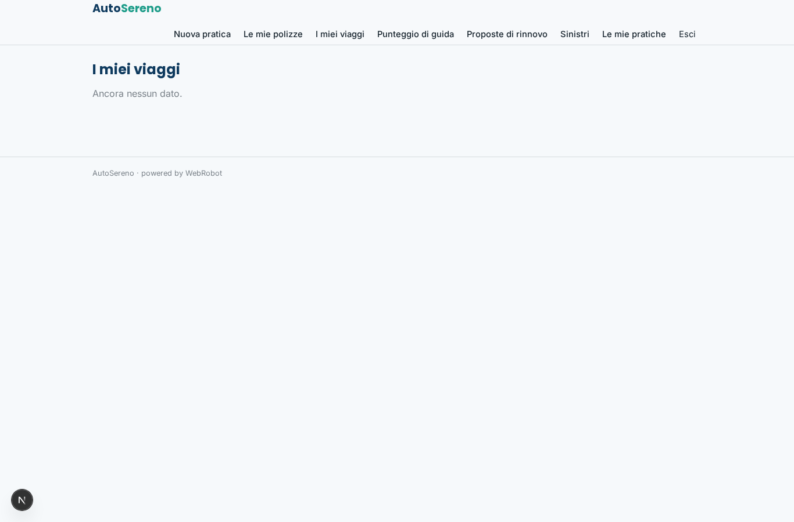

### scores
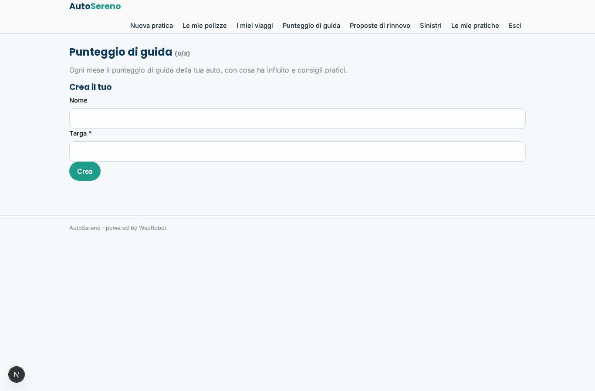

### renewals
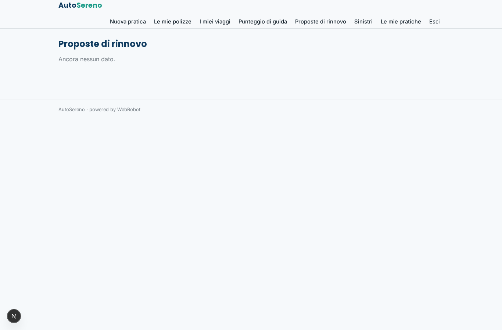

### claims_view
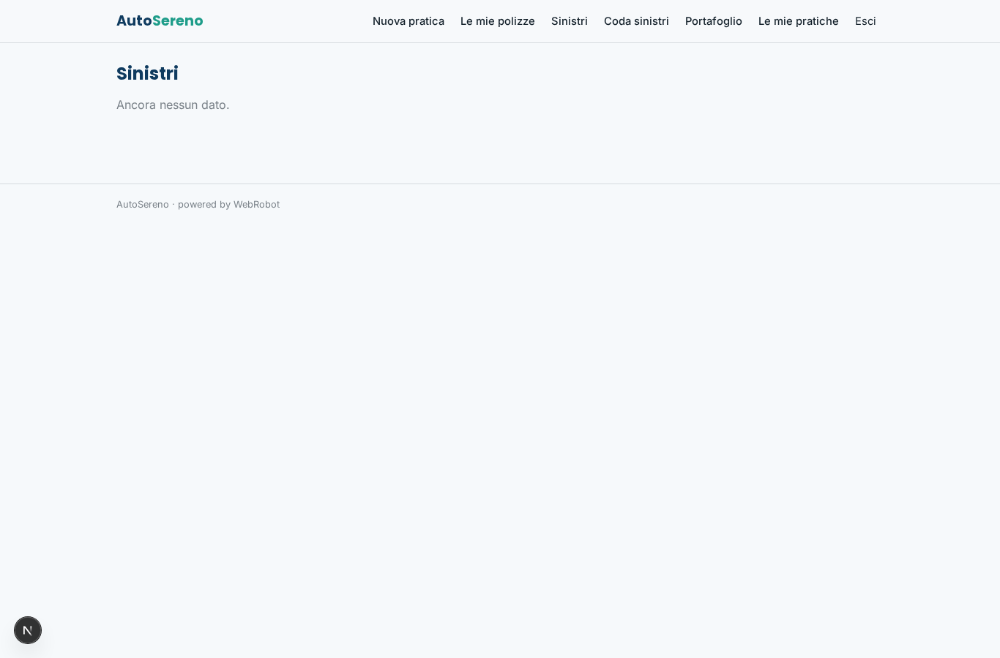

### approve_discounts
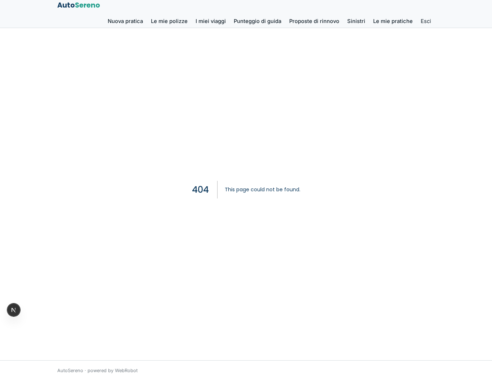

### claims_queue

### portfolio
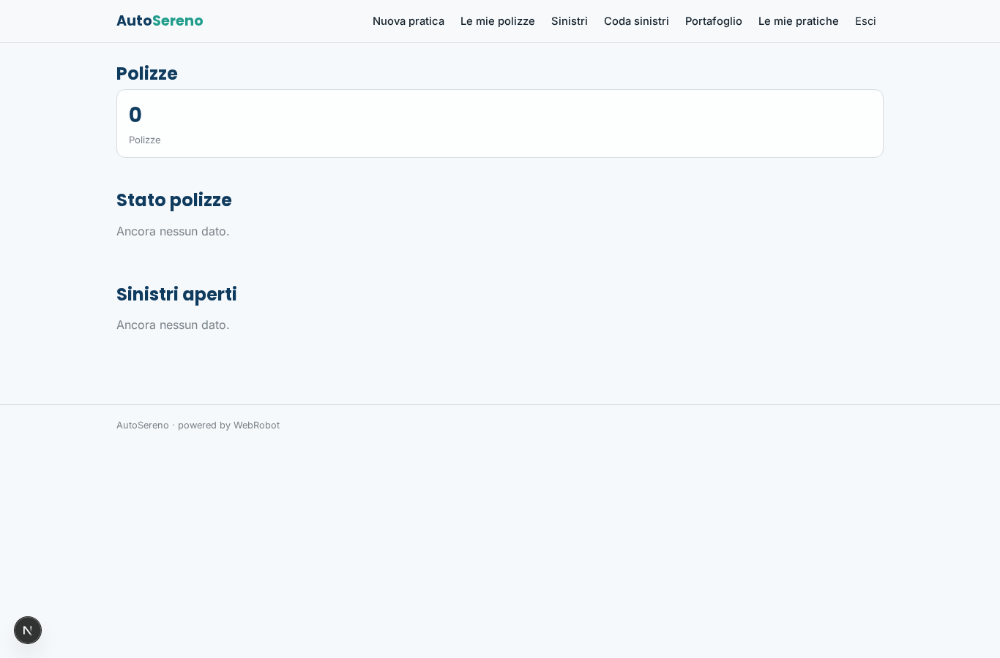

### history
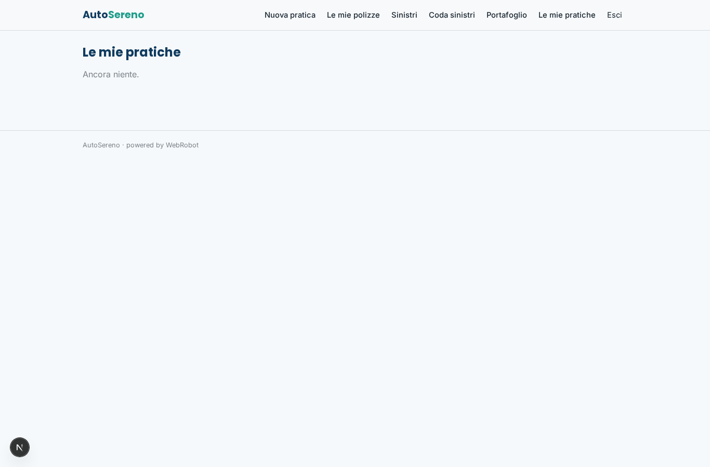

