# AvanzoZero

_Meno scarti in cucina, meno costi, meno emissioni._

**Stato manifest:** valido (validatore Python + contratto runtime)

## Descrizione data all'app builder

Di AvanzoZero descrivo solo lo strato software: le bilance e i cestini intelligenti che pesano e riconoscono gli scarti sono hardware di un fornitore e qui arrivano solo i loro dati. L'app è per mense aziendali e scolastiche, ristoranti e hotel che vogliono ridurre lo spreco alimentare. Ruoli: responsabile della cucina, addetto e direzione. Il responsabile registra le sedi, i menù settimanali con piatti, porzioni e costo per porzione, e il numero di coperti previsti. Ogni giorno arrivano le pesate degli scarti per categoria e piatto dai dispositivi oppure inserite a mano dall'addetto con un modulo rapido. Un agente incrocia scarti, menù e coperti reali, individua i piatti più avanzati e i giorni critici, e stima il costo economico e le emissioni evitabili. Un secondo agente propone ogni settimana correzioni concrete: porzioni da ridurre, quantità da preparare per il giorno successivo, piatti da sostituire; il responsabile approva prima che diventino il piano di produzione. La direzione riceve un report mensile in PDF e una dashboard con l'andamento per sede, utile anche per il bilancio di sostenibilità. Ogni sede vede solo i propri dati. Abbonamento per sede. Italiano e inglese.

## Funzioni non esprimibili oggi (spec.extensions)

- **device_ingest**: Automatic import of weighings from the supplier's scales and smart bins (API/webhook of each vendor) is not available yet; for now data arrives via the quick-entry chat. A dedicated manual entry form and CSV/file upload are also missing.
- **per_site_subscription**: Subscription is per account; one account per site is assumed. Chains with several sites under one account and per-site seat billing need custom logic.
- **monthly_pdf_email**: Monthly report is generated on demand and printed to PDF; automatic emailing to management is not available yet.

## Screenshot (runtime interpretativo)

### home-anon
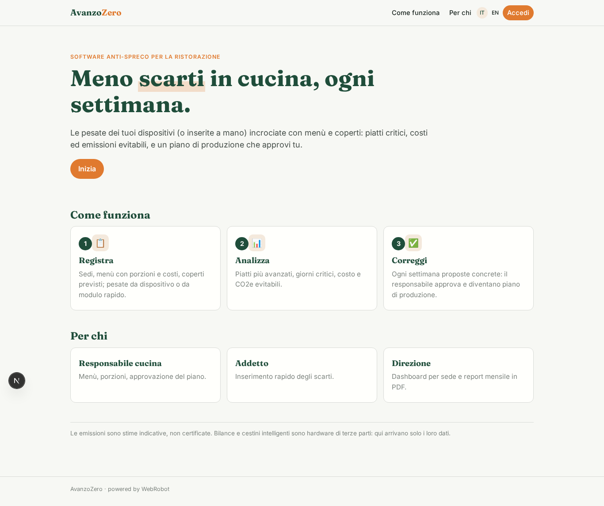

### home-mobile
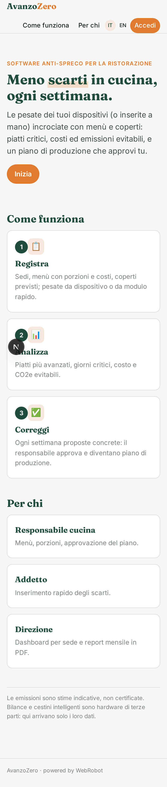

### home
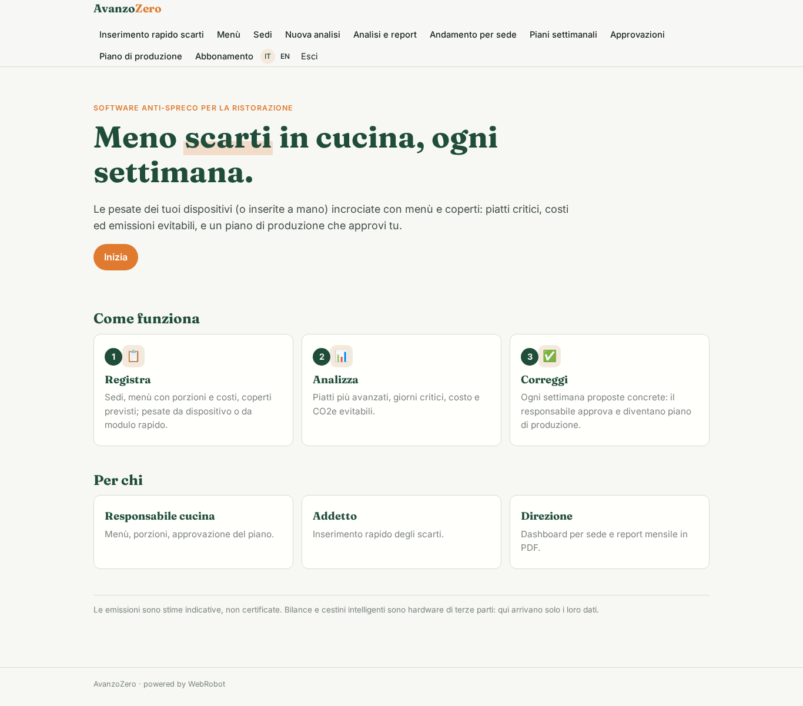

### entry
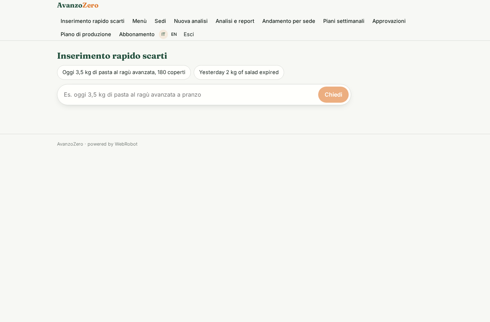

### menus_view
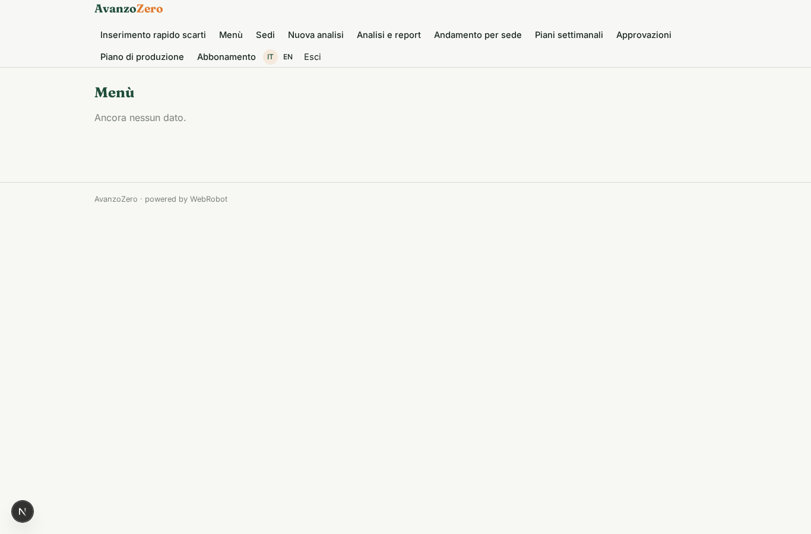

### sites_view
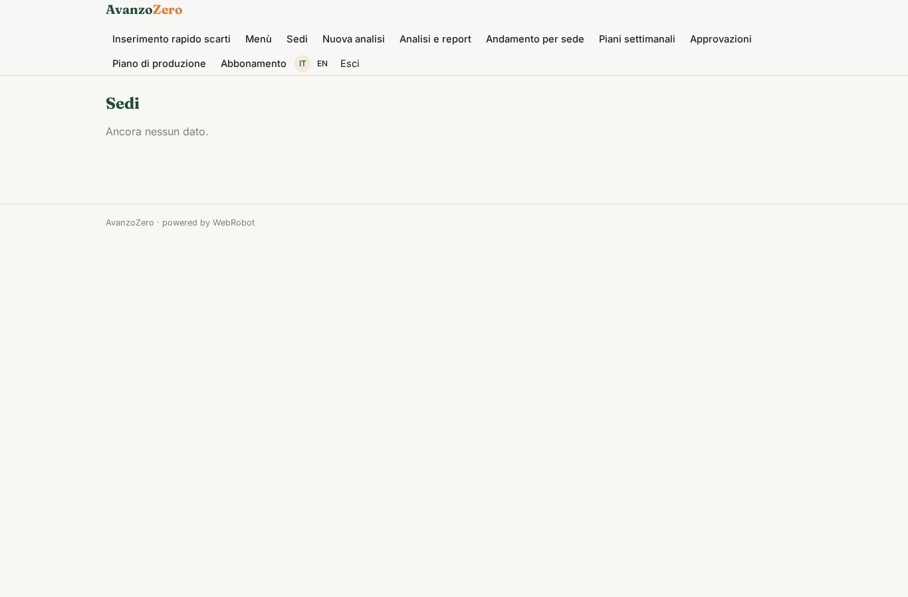

### new_analysis
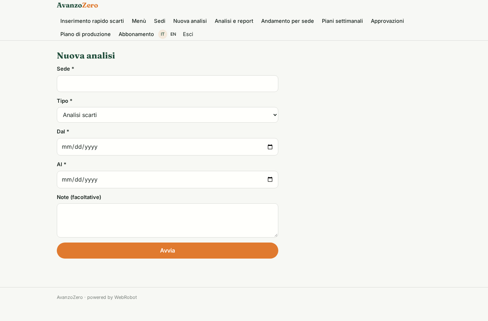

### analyses
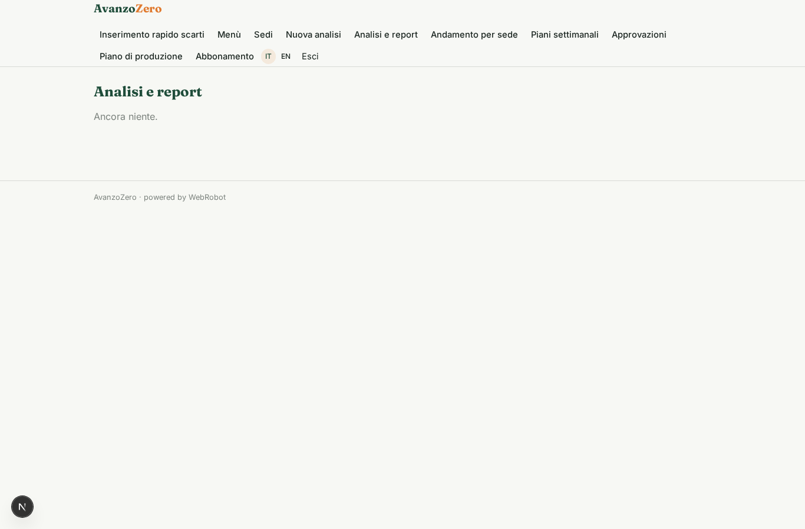

### dashboard
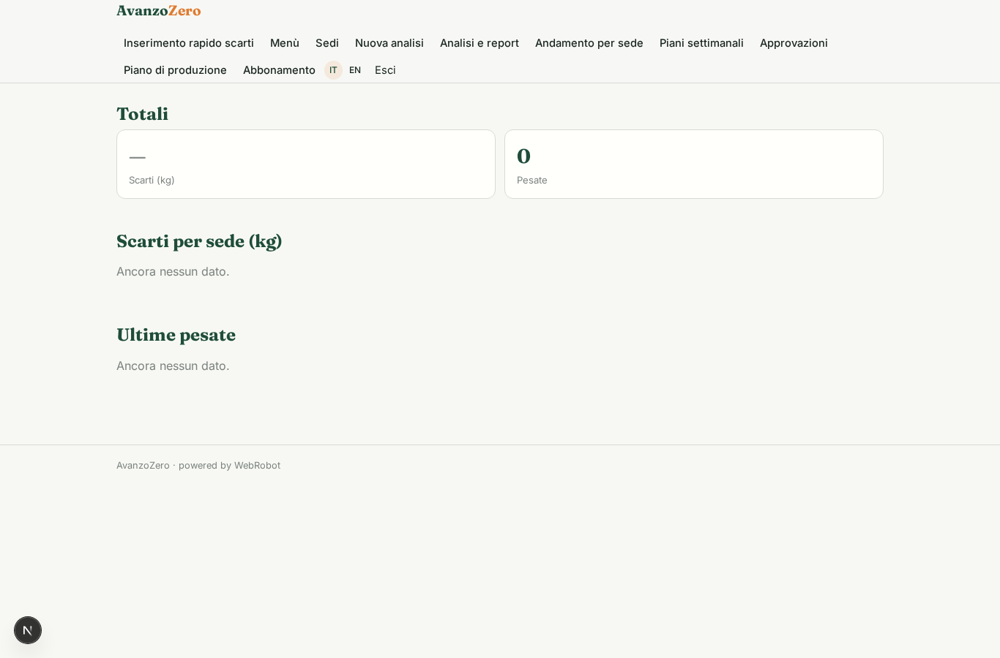

### weekly
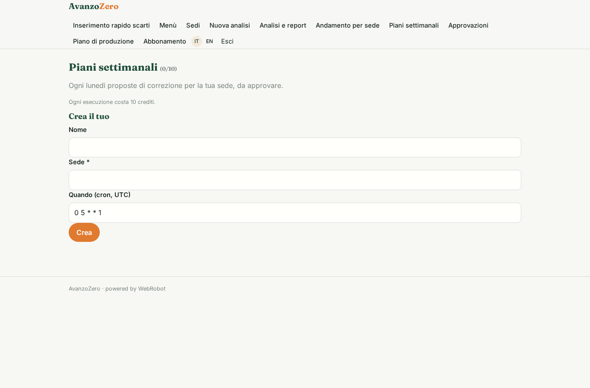

### approve

### plan_view
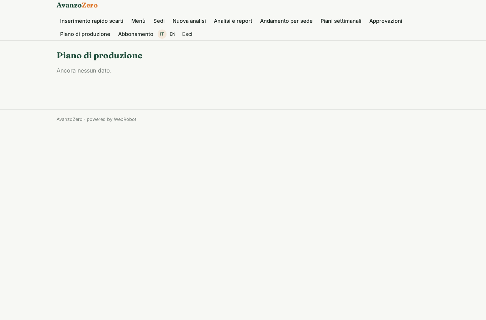

### account
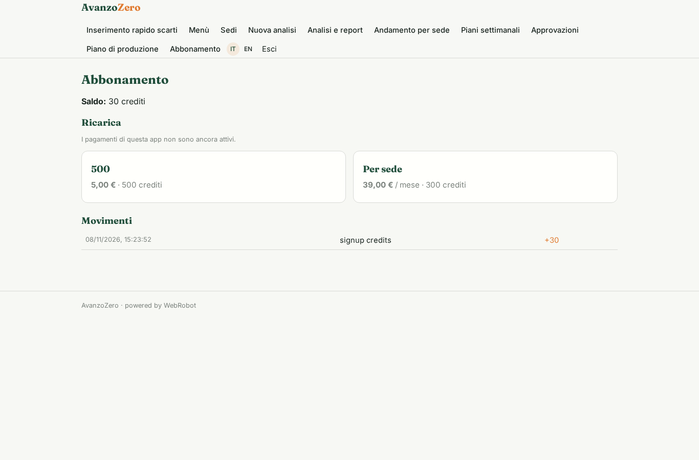

