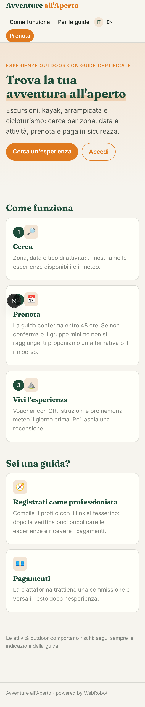
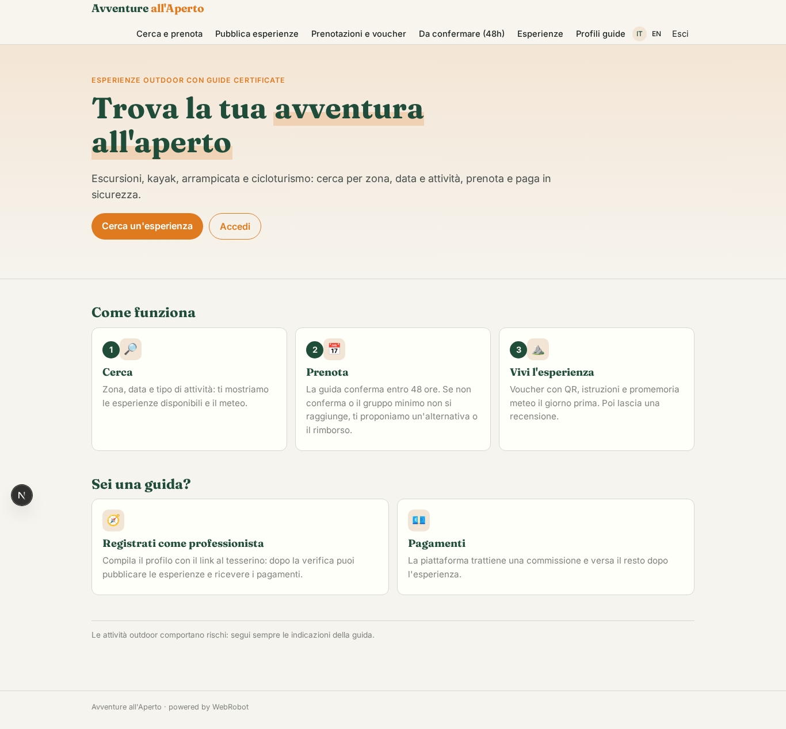
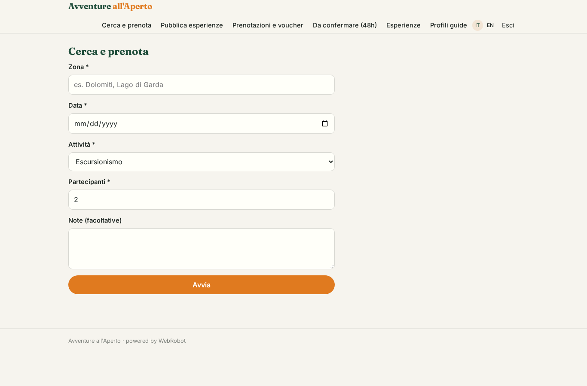
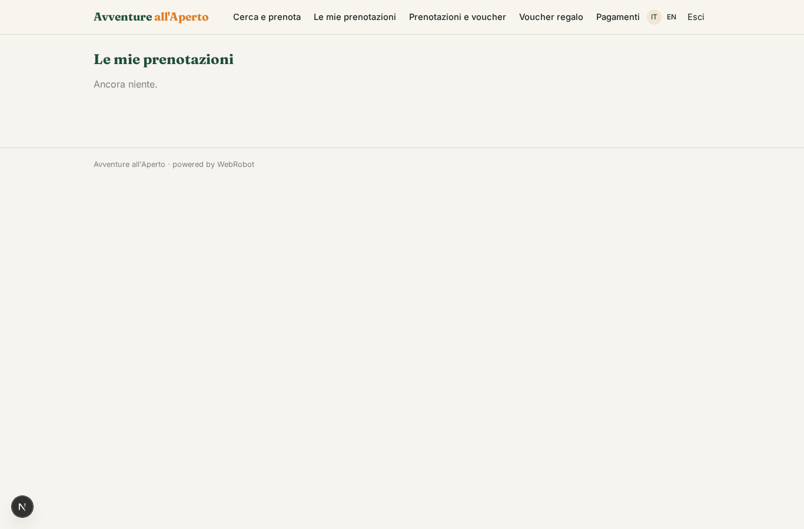
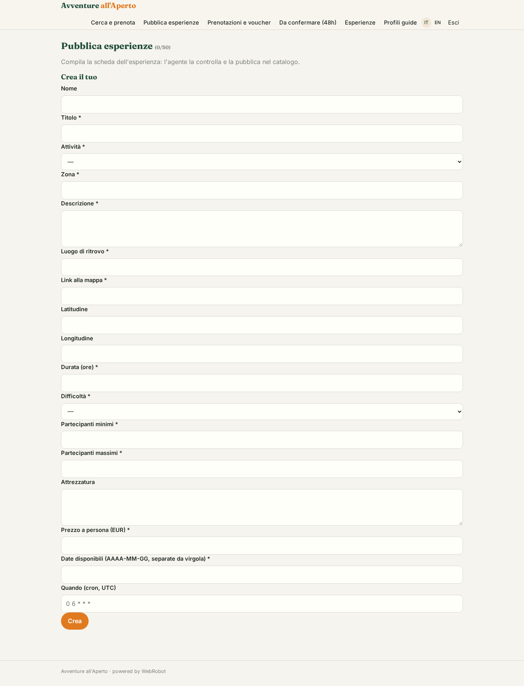
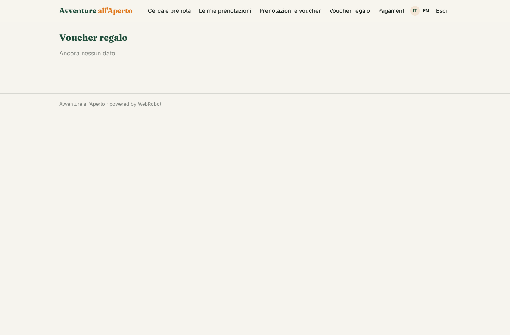
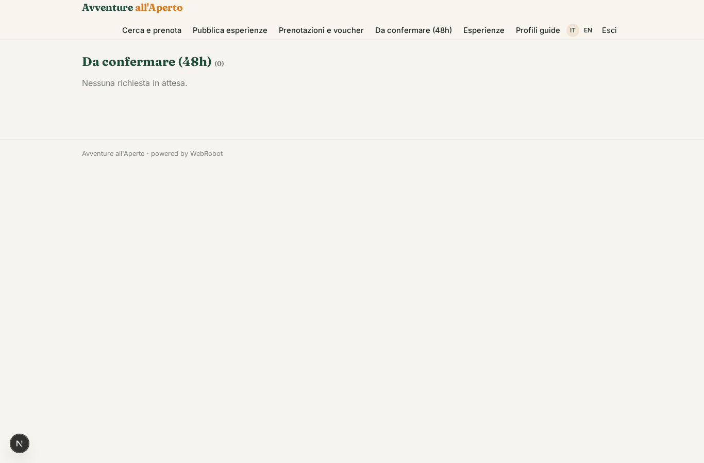
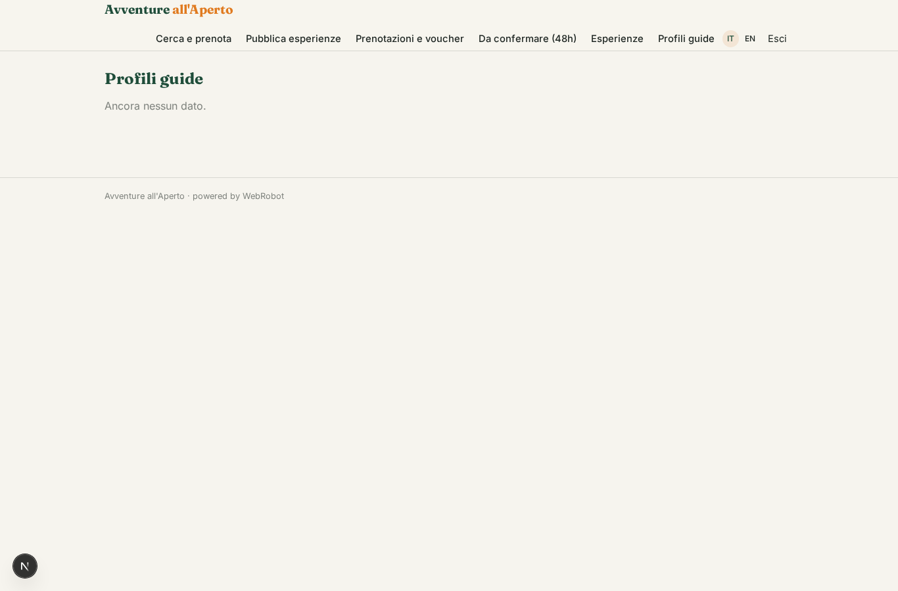
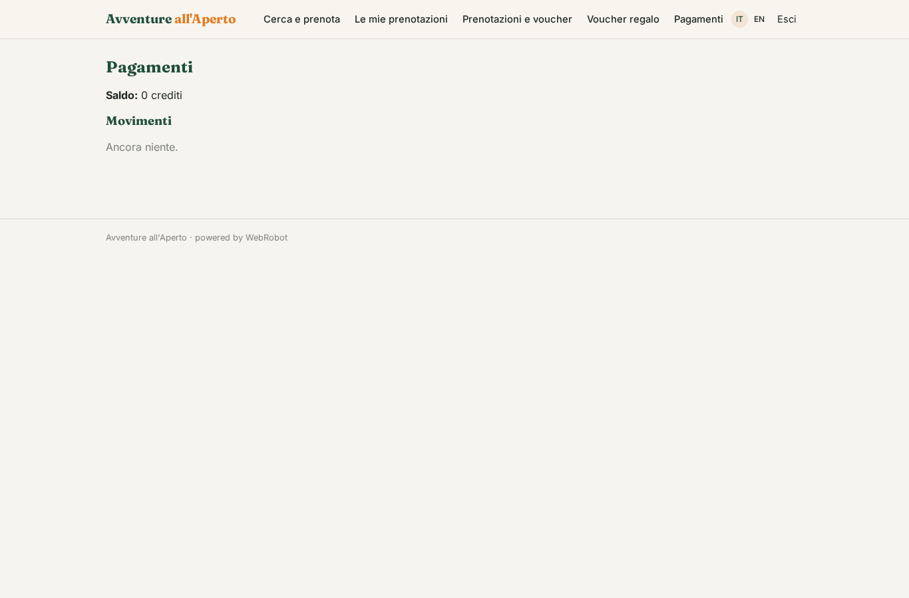

# Avventure all'Aperto

_Escursioni, kayak, arrampicata e cicloturismo con guide certificate._

**Stato manifest:** valido (validatore Python + contratto runtime)

## Descrizione data all'app builder

Voglio realizzare Avventure all'Aperto, un marketplace di esperienze outdoor come escursioni, kayak, arrampicata e cicloturismo. Le guide si registrano come professionisti, caricano il loro tesserino, collegano il conto Stripe per ricevere i pagamenti e pubblicano le esperienze con descrizione, luogo di ritrovo su mappa, durata, difficoltà, numero minimo e massimo di partecipanti, attrezzatura e prezzo. Le date disponibili devono arrivare dal calendario della guida. Il cliente cerca per zona, data e tipo di attività, prenota e paga. La guida riceve una notifica e deve confermare entro 48 ore; se non conferma o il gruppo minimo non si raggiunge, un agente propone al cliente un'alternativa simile o lo rimborsa. Alla conferma il cliente riceve un voucher con QR e le istruzioni, e il giorno prima un promemoria con il meteo. Si possono anche acquistare voucher regalo. Dopo l'esperienza parte una richiesta di recensione. Ogni guida vede solo le sue prenotazioni, l'admin tutto. La piattaforma trattiene una commissione su ogni prenotazione e versa il resto alla guida dopo l'esperienza.

## Funzioni non esprimibili oggi (spec.extensions)

- **guide_licence_upload**: Uploading the guide licence is not available yet: guides paste a link and the admin verifies it, then assigns the guide role.
- **guide_calendar_sync**: Syncing dates from the guide's own calendar (Google/Apple) needs per-guide credentials, not available yet: guides list available dates in the experience.
- **map_picker**: A map pin picker is not available: meeting point is text plus a map link and lat/lon.
- **guide_scoped_bookings**: Each guide should see only the bookings of their experiences while the customer sees their own and the admin all: per-guide filtering of customer-owned records needs a runtime rule.
- **notifications**: Notifications are not available yet: guide notification on a new booking, voucher with QR and instructions on confirmation, the weather reminder the day before, and the post-experience review request all need email/push.
- **stripe_connect_payouts**: Guides connect their Stripe account; the 12% platform fee and payout after the experience, the refund executed on 'refund_requested', and gift voucher checkout are handled by the payment layer, not by agents.
- **reviews**: The review collection and request after the experience depend on notifications.

## Screenshot (runtime interpretativo)

### home-anon

### home-mobile

### home

### new_booking

### my_bookings

### publish_experience

### bookings_list

### gifts

### approvals

### catalogue

### profile

### account

