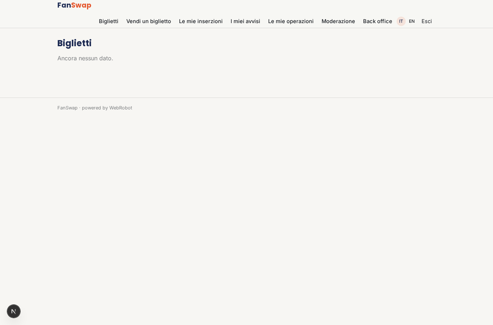
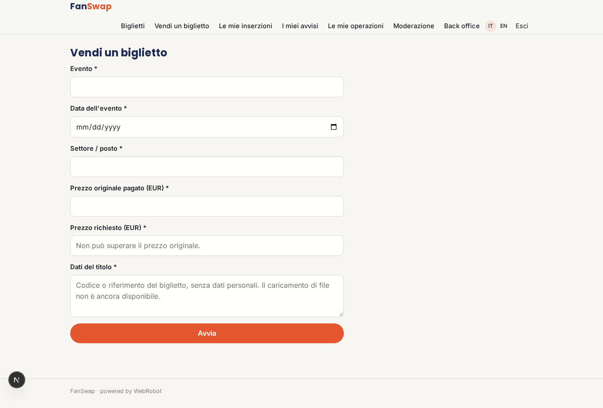
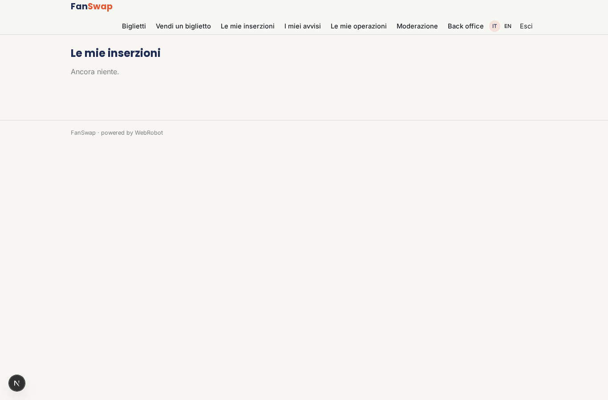
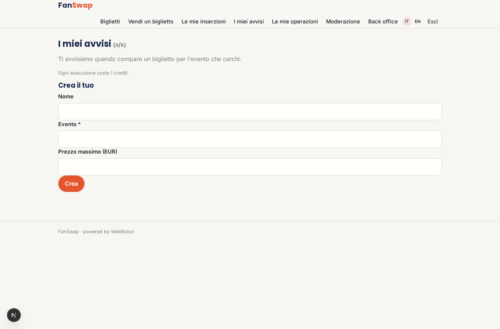
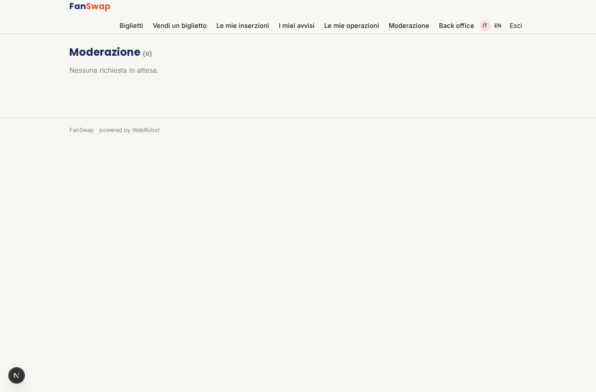
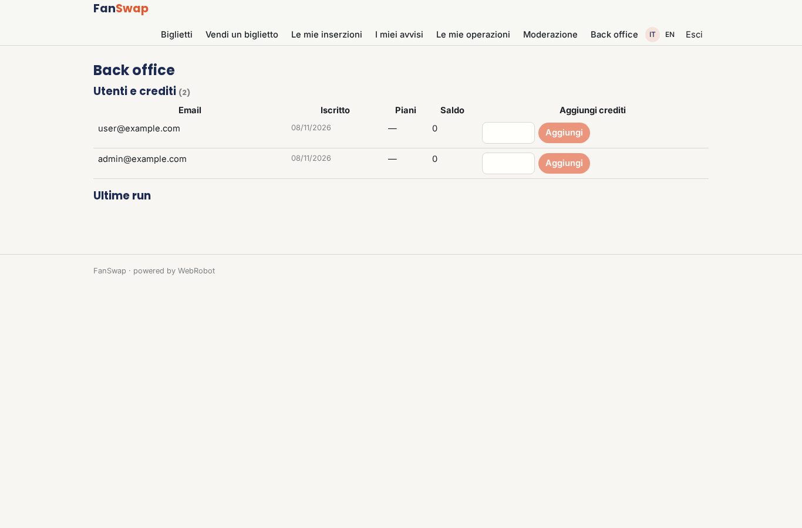
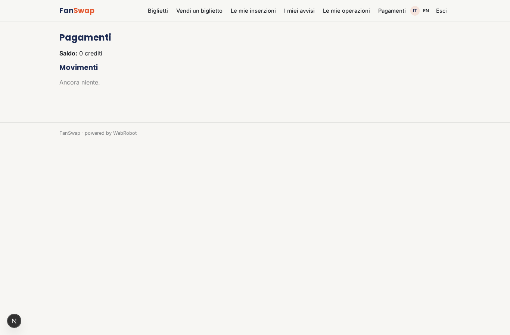

# FanSwap

_Biglietti tra fan, mai oltre il prezzo originale._

**Stato manifest:** valido (validatore Python + contratto runtime)

## Descrizione data all'app builder

Descrivo solo lo strato software di un servizio di rivendita di biglietti tra fan: il portale che fa incontrare chi vende un biglietto che non usa piu e chi lo cerca, a prezzo non superiore a quello originale, senza gestire la biglietteria ufficiale. Chi vende registra il biglietto di un evento (evento, data, settore, prezzo pagato, dati del titolo) e lo mette in vendita entro il limite di prezzo consentito. Chi cerca imposta un avviso per un evento e riceve un'email quando compare un biglietto disponibile. Un agente controlla che il prezzo richiesto non superi quello originale e segnala le inserzioni sospette a un operatore che le modera prima della pubblicazione. Quando avviene la vendita, il pagamento passa dalla piattaforma e il titolo viene trasferito al compratore secondo le regole dell'organizzatore; l'operatore gestisce contestazioni e rimborsi. Venditore e compratore vedono solo le proprie operazioni, l'admin tutto. Monetizzazione: piccola commissione di servizio sulla transazione. In italiano.

## Funzioni non esprimibili oggi (spec.extensions)

- **email_alerts**: Email all'acquirente quando compare un biglietto: le notifiche email non sono ancora disponibili; per ora l'avviso produce un risultato giornaliero visibile nell'app.
- **ticket_transfer**: Trasferimento del titolo al compratore secondo le regole dell'organizzatore: richiede integrazioni per ogni organizzatore, non esprimibili nel manifest.
- **disputes_refunds**: Contestazioni e rimborsi gestiti dall'operatore tramite Stripe e il back office; flusso dedicato da sviluppare.
- **file_upload**: Caricamento del file del biglietto non disponibile: si usa un riferimento testuale.

## Screenshot (runtime interpretativo)

### home-anon

### home-mobile

### home

### listings

### new_listing

### my_listings

### alerts

### my_orders

### moderation_queue

### admin

### account

