# Biglietti tra Fan

_Rivendi o cerca un biglietto al prezzo originale, senza sovrapprezzi._

**Manifest:** valid (schema + runtime contract) · **Functional test:** passed (26 checks passed)

## Description given to the app builder (Italian)

Descrivo solo lo strato software di un servizio di rivendita di biglietti tra fan: il portale che fa incontrare chi vende un biglietto che non usa piu e chi lo cerca, a prezzo non superiore a quello originale, senza gestire la biglietteria ufficiale. Chi vende registra il biglietto di un evento (evento, data, settore, prezzo pagato, dati del titolo) e lo mette in vendita entro il limite di prezzo consentito. Chi cerca imposta un avviso per un evento e riceve un'email quando compare un biglietto disponibile. Un agente controlla che il prezzo richiesto non superi quello originale e segnala le inserzioni sospette a un operatore che le modera prima della pubblicazione. Quando avviene la vendita, il pagamento passa dalla piattaforma e il titolo viene trasferito al compratore secondo le regole dell'organizzatore; l'operatore gestisce contestazioni e rimborsi. Venditore e compratore vedono solo le proprie operazioni, l'admin tutto. Monetizzazione: piccola commissione di servizio sulla transazione. In italiano.

## Functional test: what did not pass

- **saved record shown where its collection is read** (view my_orders): a record was saved in orders (by user) but the page does not show it (as user) _(warning)_
- **saved record shown where its collection is read** (view ops_orders): a record was saved in orders (by user) but the page does not show it (as admin) _(warning)_

## Features not expressible today (spec.extensions)

- **pagamento_e_titolo**: Incasso dal compratore, pagamento al venditore al netto della commissione, rimborsi e trasferimento effettivo del titolo secondo le regole dell'organizzatore non sono automatizzabili con gli strumenti attuali: l'operatore aggiorna lo stato dell'ordine (pagato, titolo_trasferito, rimborsato) e la piattaforma di pagamento gestisce i fondi.
- **privacy_venditore**: L'email del venditore è memorizzata nel catalogo condiviso per collegare gli ordini: le viste non la mostrano, ma serve un meccanismo di riferimento anonimo.

## Screenshots (interpretive runtime, no data)

### home-anon

### home-mobile
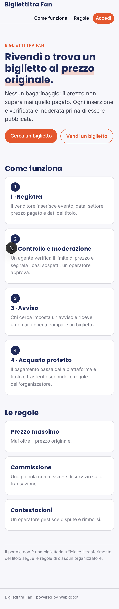

### home

### sell
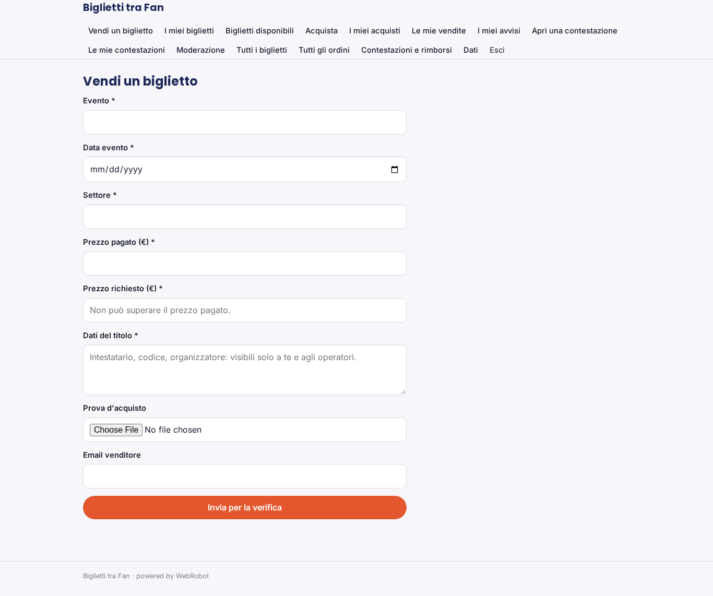

### my_tickets
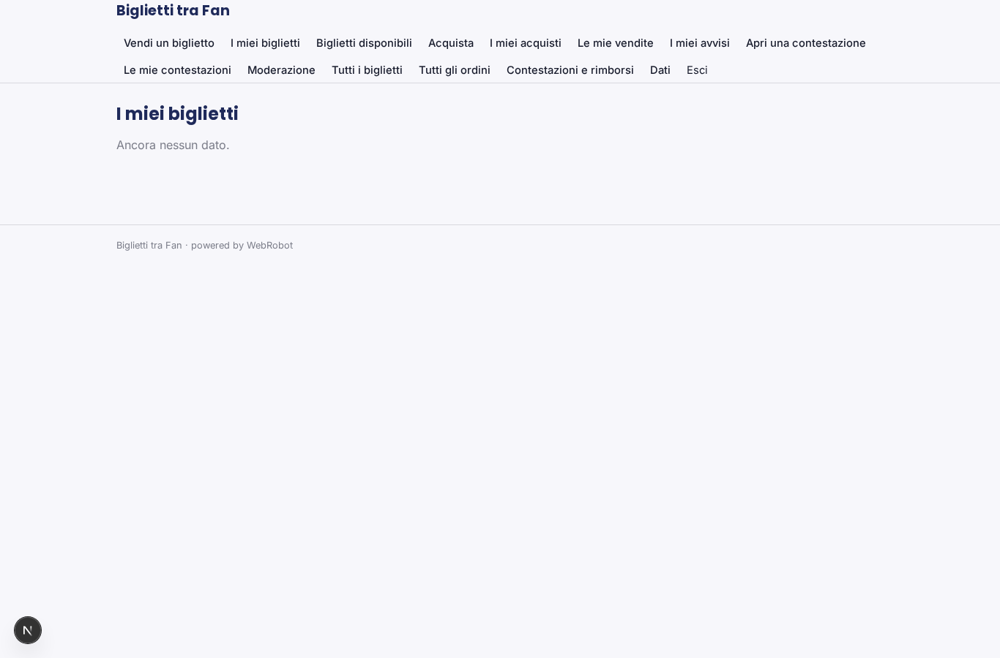

### listings
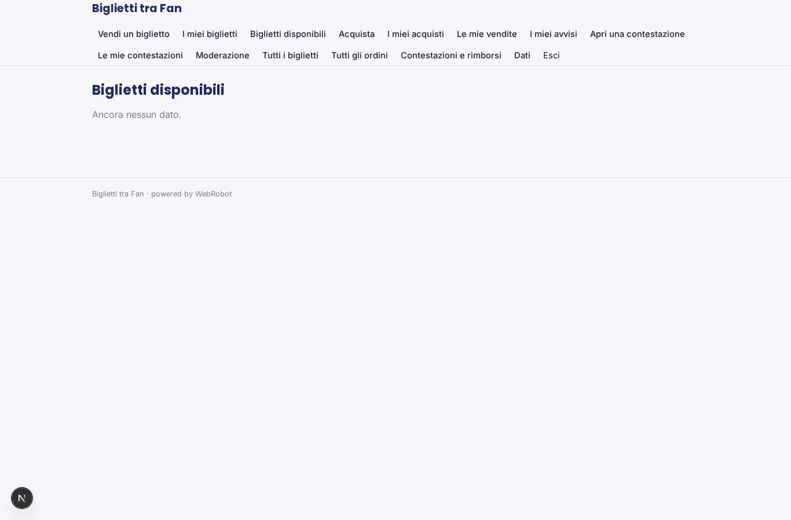

### buy
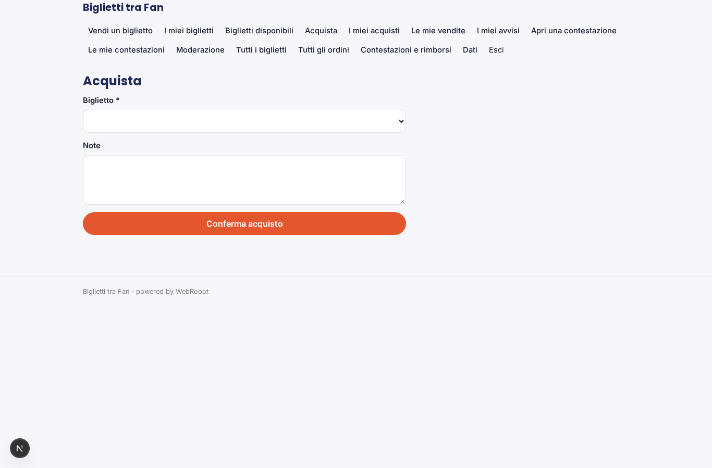

### my_orders
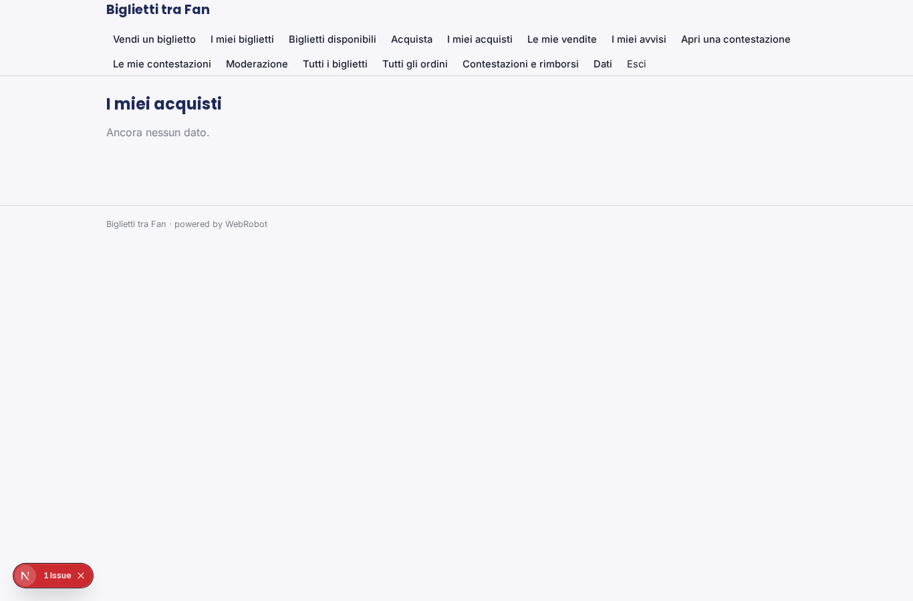

### my_sales

### alerts
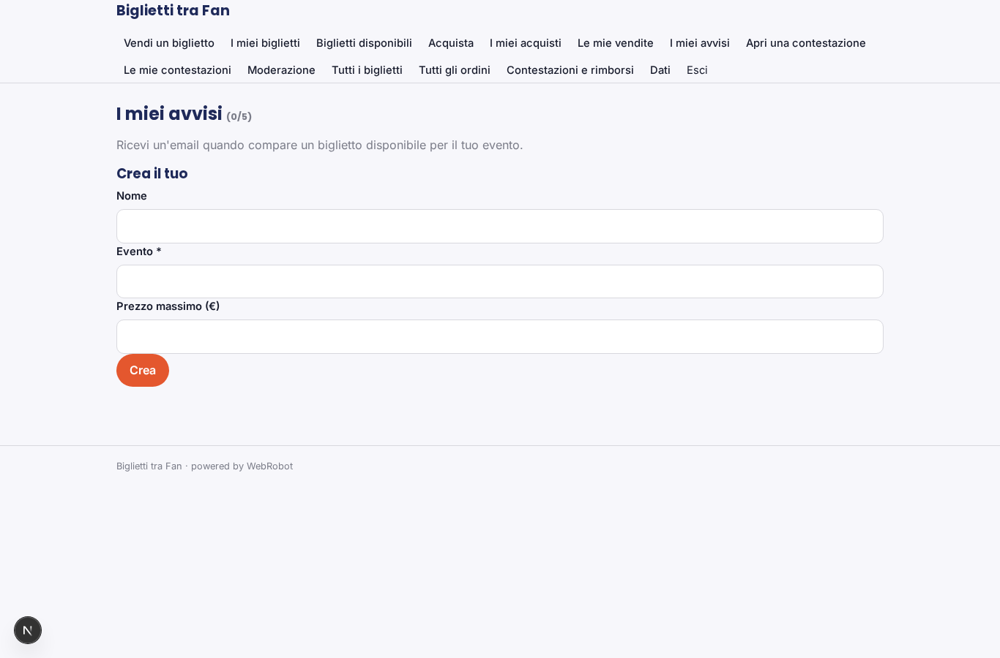

### dispute
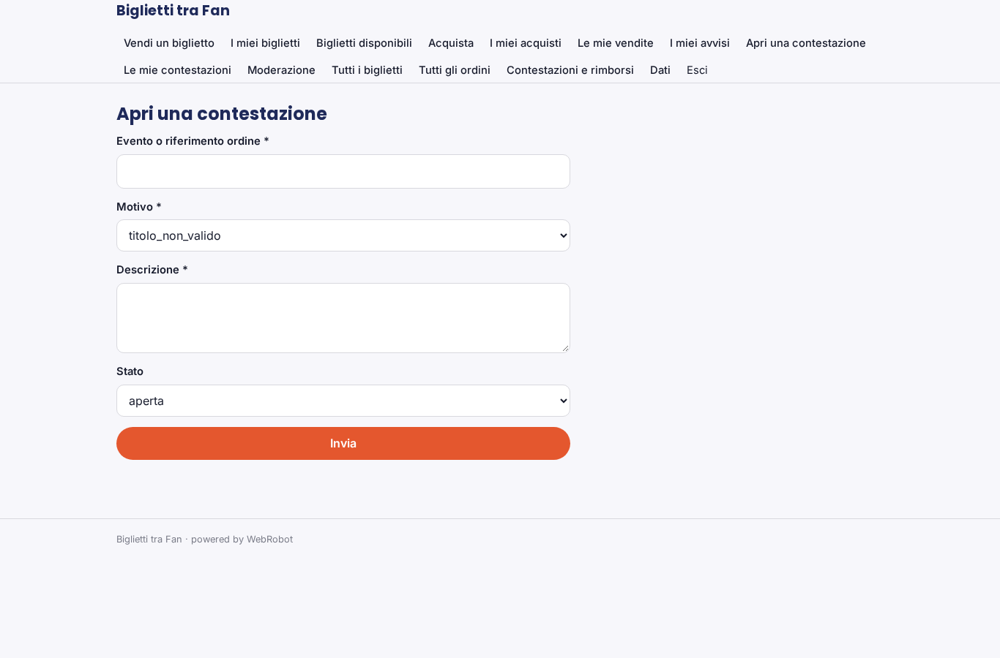

### my_disputes
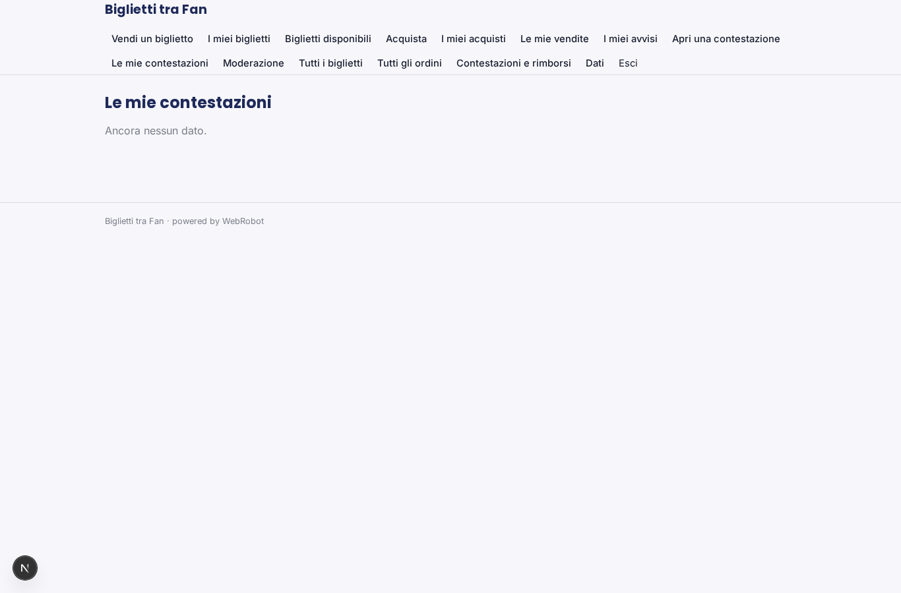

### moderation
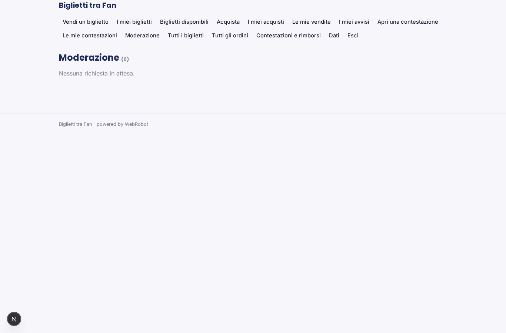

### ops_tickets
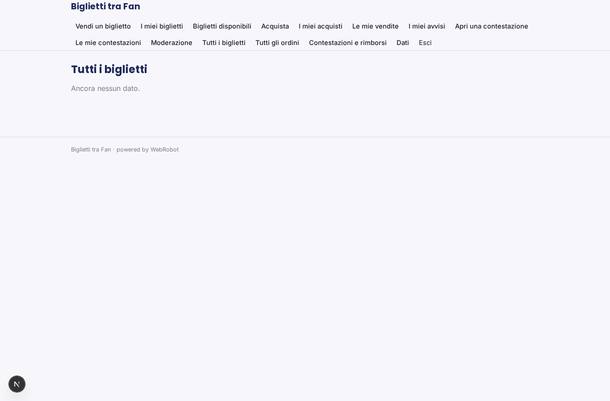

### ops_orders

### ops_disputes
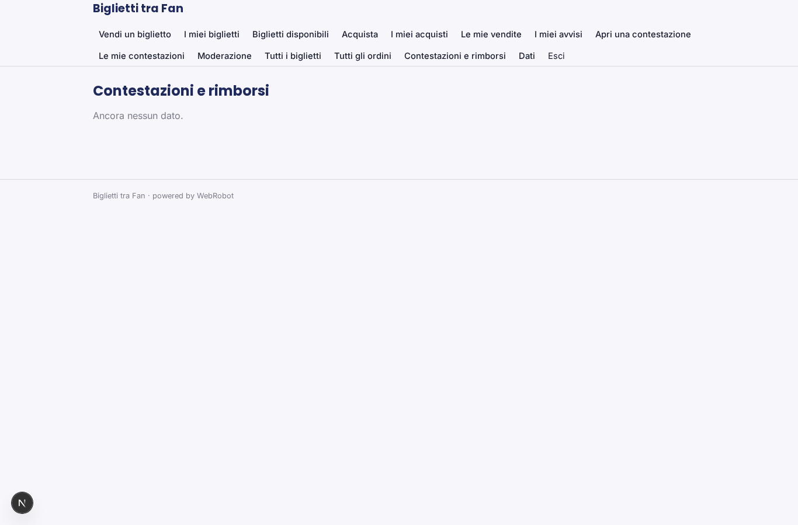
