# Bilancio Carbonio

_Il bilancio delle emissioni della tua PMI, pronto da firmare._

**Manifest:** valid (schema + runtime contract) · **Functional test:** passed (15 checks passed)

## Description given to the app builder (Italian)

Ci serve Bilancio Carbonio, un'app per PMI che devono calcolare le proprie emissioni e preparare un report di sostenibilità. Il referente aziendale si registra e compila un modulo annuale: sedi, consumi di energia elettrica e gas, carburanti della flotta, viaggi di lavoro, rifiuti, spedizioni, acquisti principali, numero di dipendenti e pendolarismo. Un agente applica i fattori di emissione ufficiali di ISPRA e DEFRA secondo la metodologia del GHG Protocol, separa Scope 1, 2 e 3, controlla la coerenza dei dati con l'anno precedente e segnala valori anomali. Il risultato è un report con grafici, intensità per dipendente e per fatturato, e un piano di riduzione con azioni ordinate per impatto e costo. Ogni anno a gennaio l'app ricorda di inserire i nuovi dati e genera il confronto. Su richiesta propone progetti di compensazione certificati per le emissioni residue, che l'azienda può acquistare. Un consulente ESG partner può essere invitato per rivedere e validare il report prima della firma. Ogni azienda vede solo i propri dati. Abbonamento annuale in base alla dimensione aziendale.

## Features not expressible today (spec.extensions)

- **offset_checkout**: L'acquisto diretto dei crediti di compensazione con pagamento in app non è disponibile: l'app propone i progetti e il team contatta l'azienda.
- **consultant_report_access**: Il consulente decide sull'approvazione con il riepilogo del report; la lettura integrale del report del cliente è limitata al profilo azienda.
- **january_comparison**: A gennaio l'app invia il promemoria; il confronto con l'anno precedente viene generato dal report quando l'azienda inserisce i nuovi dati (nessun agente globale legge i dati di tutti i clienti).

## Screenshots (interpretive runtime, no data)

### home-anon
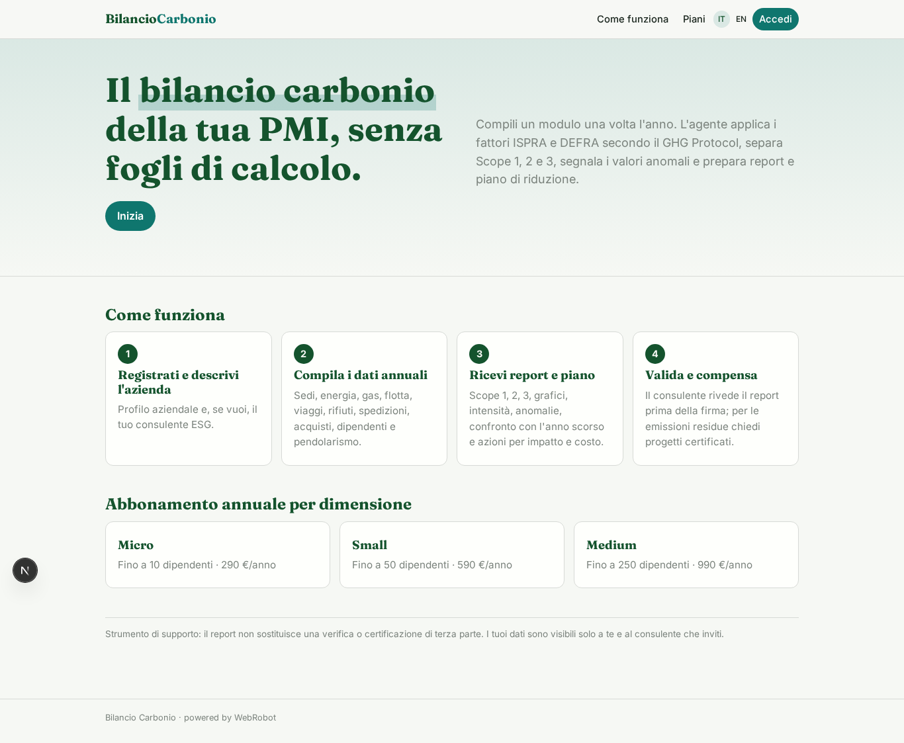

### home-mobile
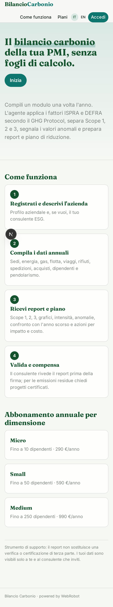

### home
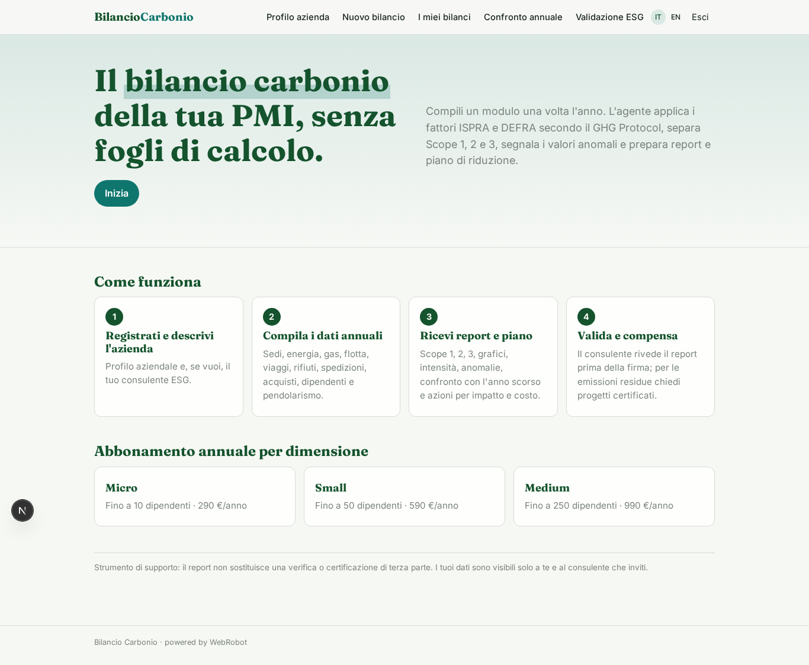

### company
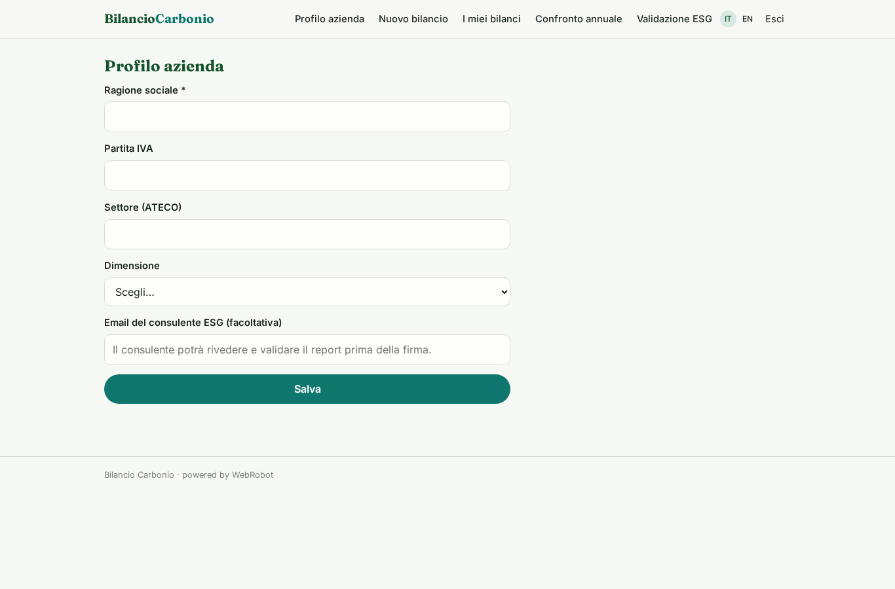

### new_report
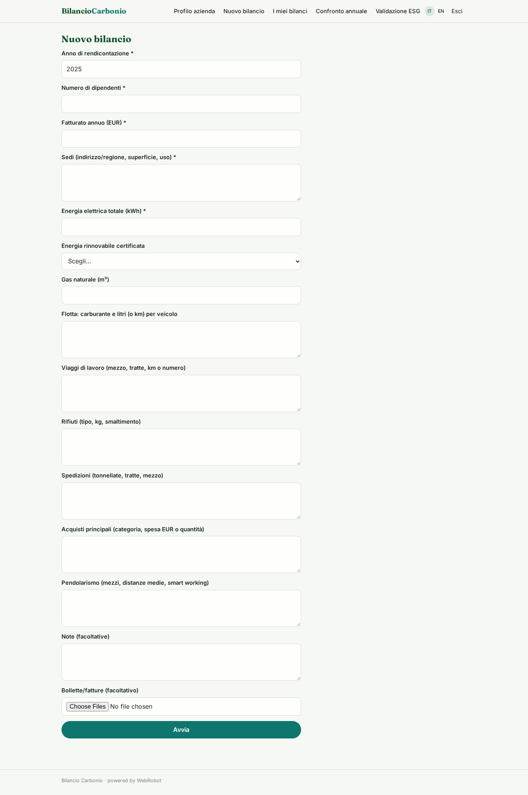

### reports
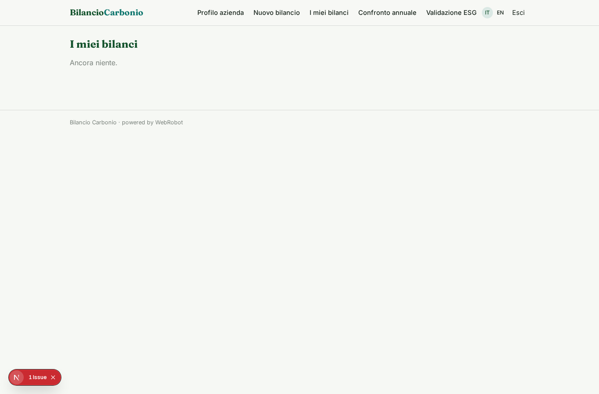

### trend
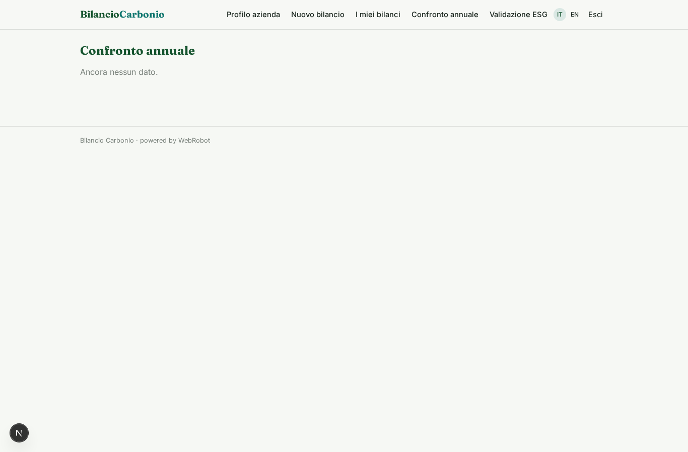

### validation
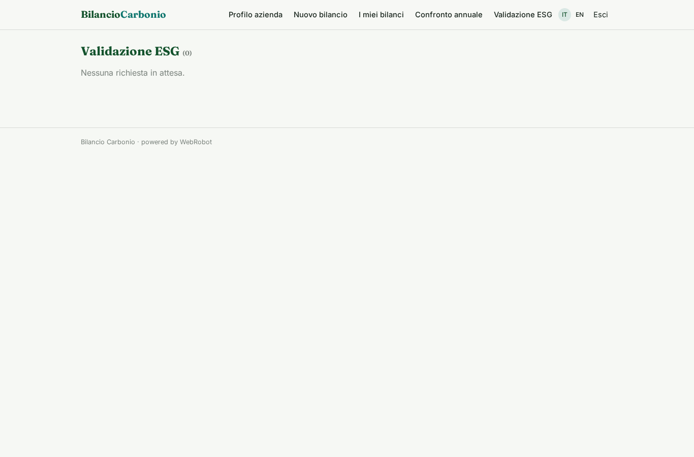

### offset_request
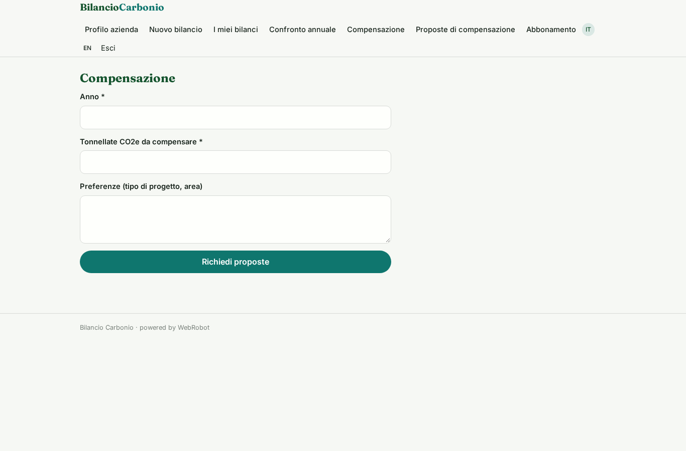

### offset_list
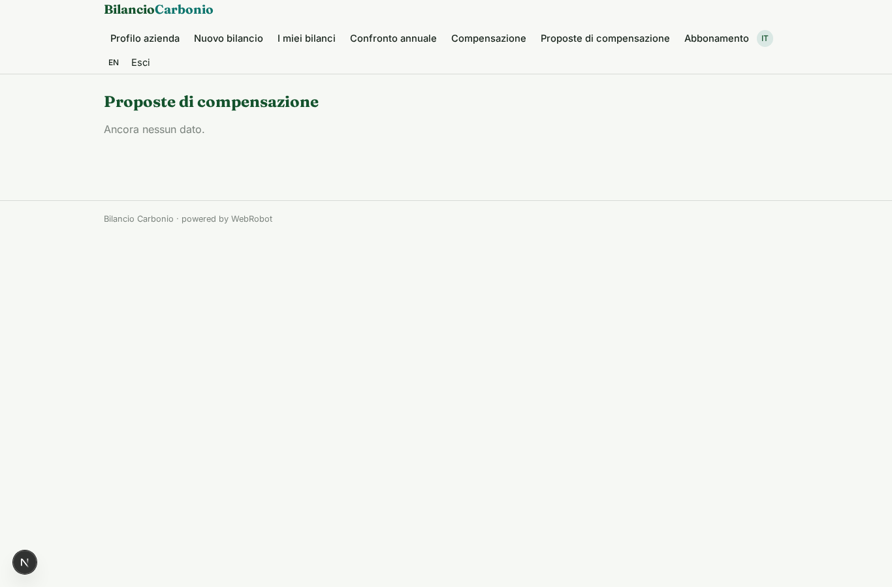

### account
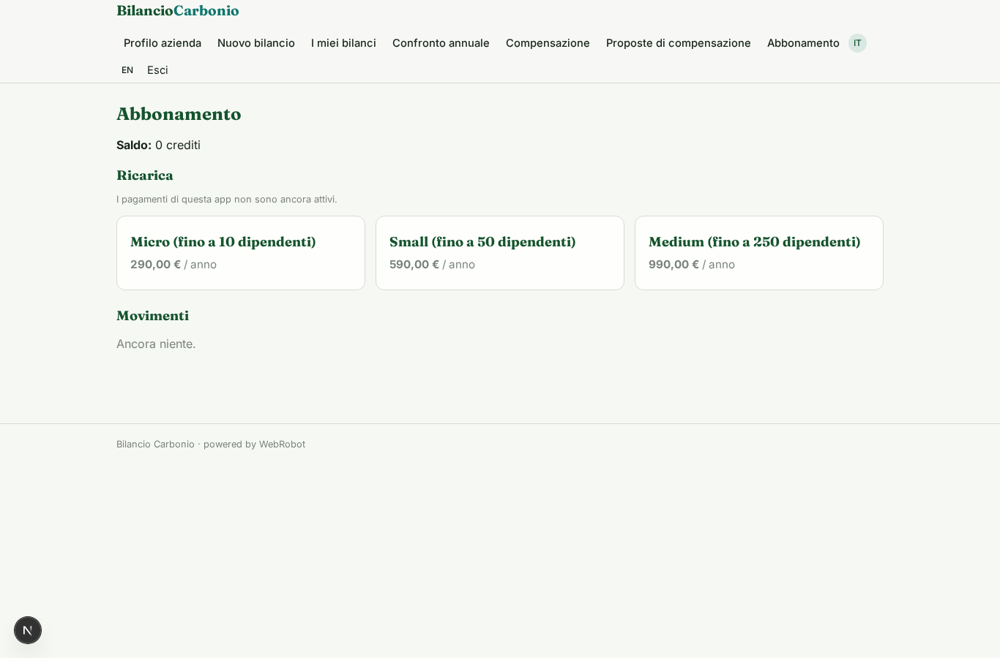
