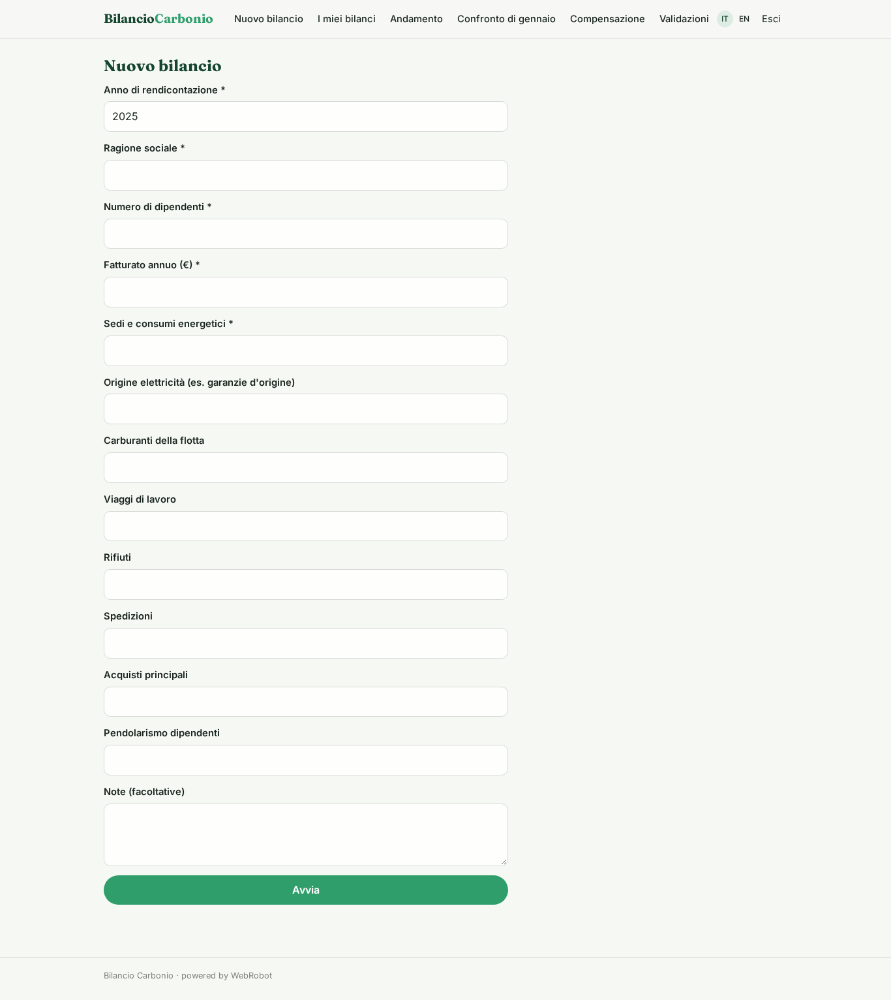
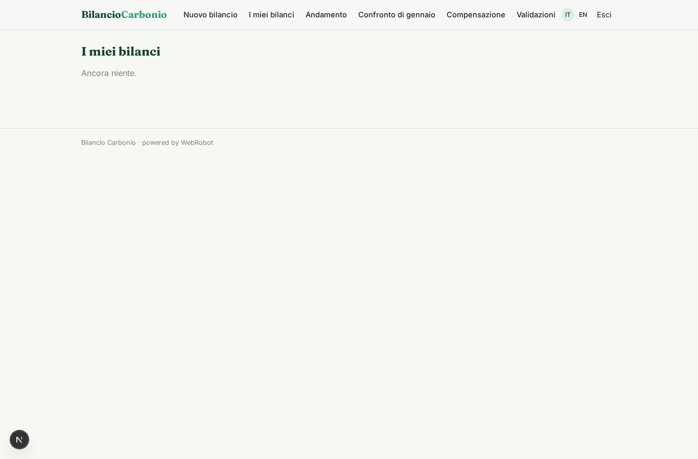
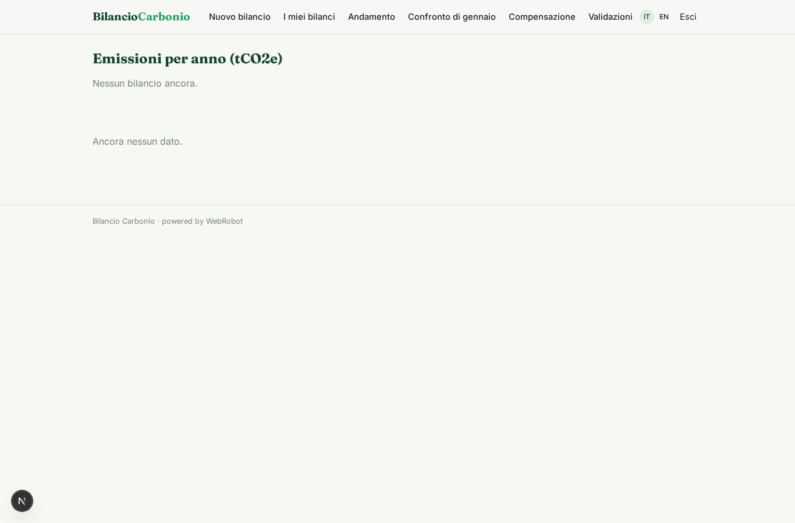
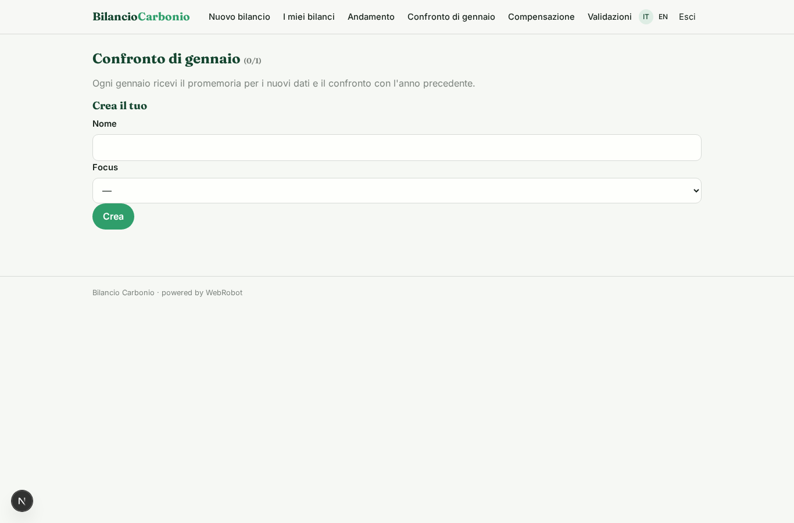
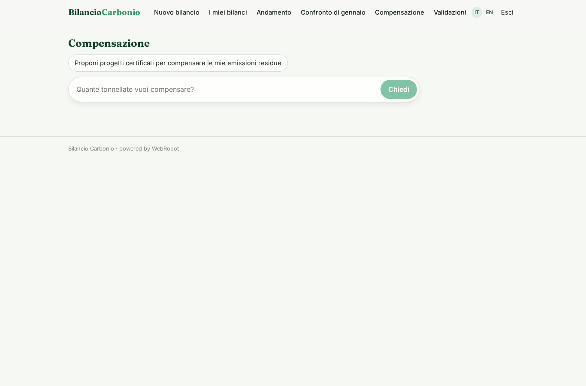
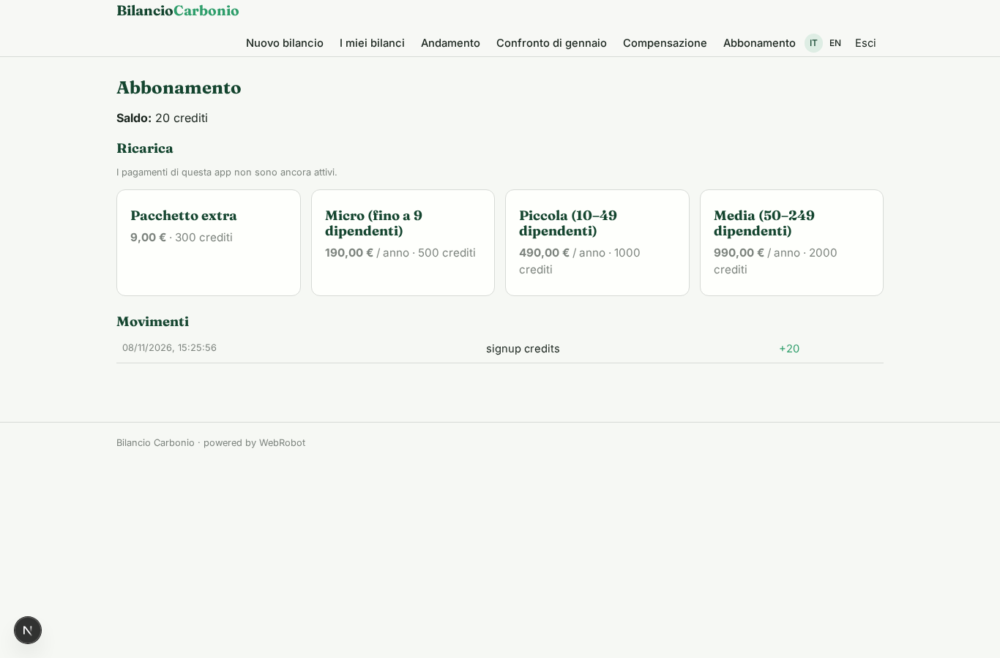

# Bilancio Carbonio

_Calcola le emissioni della tua PMI e prepara il report di sostenibilità._

**Manifest status:** valid (schema validator + runtime contract)

## Description given to the app builder (Italian)

Ci serve Bilancio Carbonio, un'app per PMI che devono calcolare le proprie emissioni e preparare un report di sostenibilità. Il referente aziendale si registra e compila un modulo annuale: sedi, consumi di energia elettrica e gas, carburanti della flotta, viaggi di lavoro, rifiuti, spedizioni, acquisti principali, numero di dipendenti e pendolarismo. Un agente applica i fattori di emissione ufficiali di ISPRA e DEFRA secondo la metodologia del GHG Protocol, separa Scope 1, 2 e 3, controlla la coerenza dei dati con l'anno precedente e segnala valori anomali. Il risultato è un report con grafici, intensità per dipendente e per fatturato, e un piano di riduzione con azioni ordinate per impatto e costo. Ogni anno a gennaio l'app ricorda di inserire i nuovi dati e genera il confronto. Su richiesta propone progetti di compensazione certificati per le emissioni residue, che l'azienda può acquistare. Un consulente ESG partner può essere invitato per rivedere e validare il report prima della firma. Ogni azienda vede solo i propri dati. Abbonamento annuale in base alla dimensione aziendale.

## Features not expressible today (spec.extensions)

- **january_email_reminder**: Email reminder to enter new data each January is not available yet: the app creates the January comparison/reminder as a record in the user's watch, visible in the app.
- **offset_purchase**: Buying offsets inside the app is not available: the agent proposes verified registry projects and links to the provider; payment happens with the provider.
- **file_upload**: Uploading bills or spreadsheets is not available yet: users enter figures in the form or paste text in notes.
- **consultant_invite_scope**: Inviting a consultant to a single company's report: the consultant role is assigned by invite and validates via the approvals view; per-company sharing of the report needs per-record invitations to be wired in the studio.

## Screenshots (interpretive runtime)

### home-anon

### home-mobile

### home

### new_inventory

### inventories_history

### trend

### watches

### offset_chat

### validations

### account

