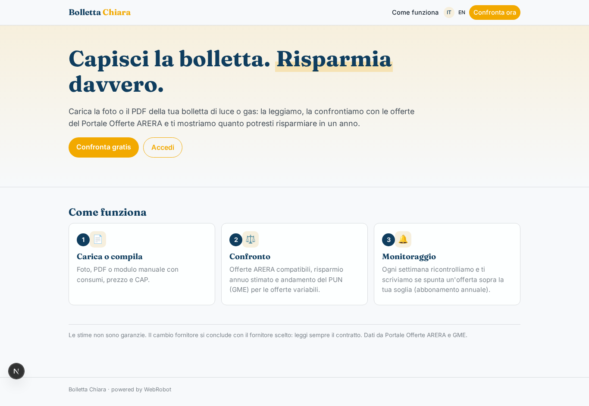
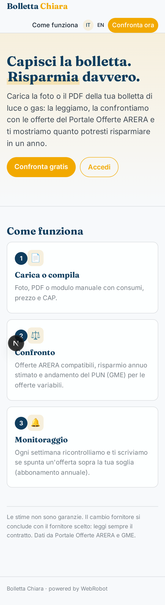
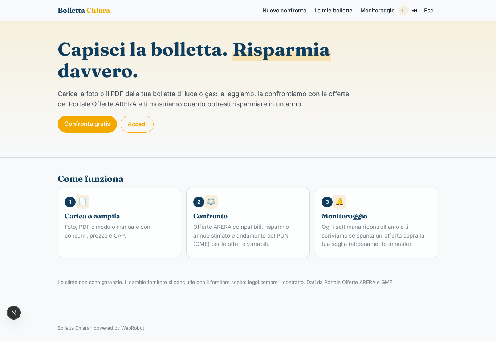
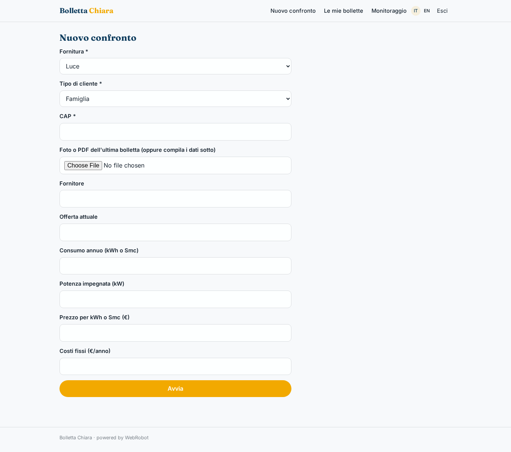
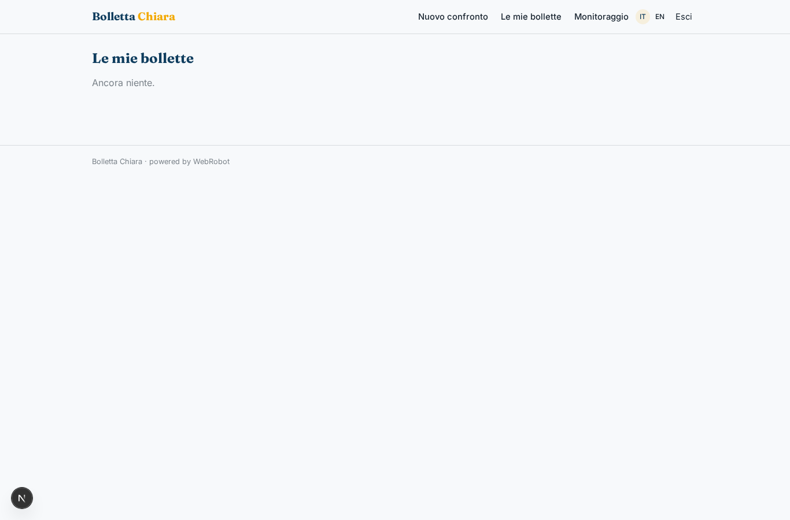
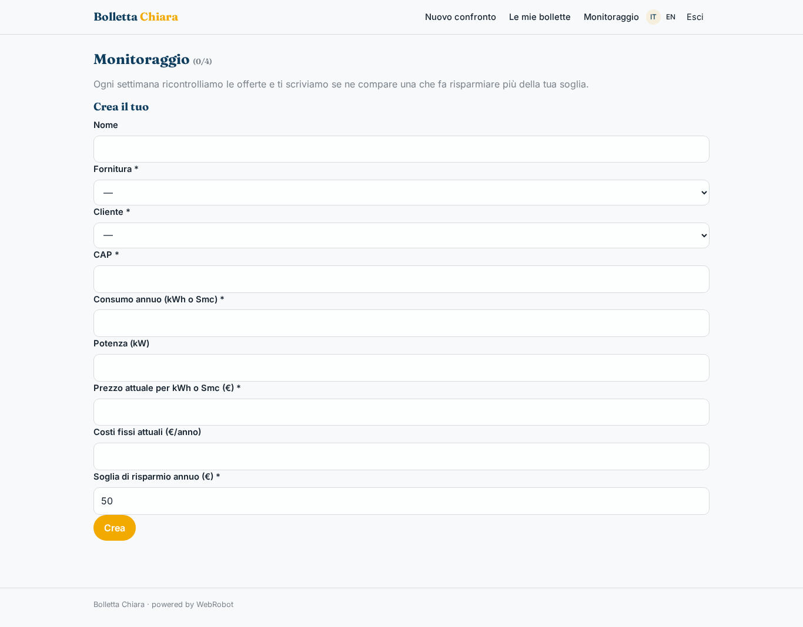
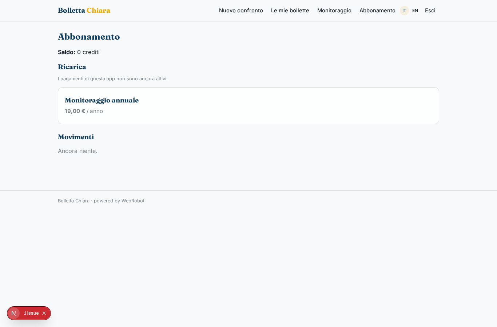

# Bolletta Chiara

_Capisci la bolletta di luce e gas e risparmia._

**Manifest:** valid (schema + runtime contract) · **Functional test:** passed (8 checks passed)

## Description given to the app builder (Italian)

Mi serve Bolletta Chiara, un'app che aiuta famiglie e piccole imprese a capire le bollette di luce e gas e a risparmiare. L'utente carica la foto o il PDF dell'ultima bolletta; l'app la legge ed estrae fornitore, offerta, consumi annui, potenza, prezzo per kWh o per Smc e costi fissi. In alternativa l'utente compila a mano un modulo con questi dati e il CAP. Un agente confronta la spesa attuale con tutte le offerte del Portale Offerte di ARERA compatibili con il profilo, calcola il risparmio annuo stimato per ciascuna e mostra una tabella ordinata con le condizioni da controllare. Tiene conto dell'andamento del PUN pubblicato dal GME per le offerte variabili. L'utente può attivare un monitoraggio: ogni settimana l'agente ricontrolla le offerte e se ne compare una che fa risparmiare più di una certa soglia manda un'email. Vorremmo che, con il consenso dell'utente, il cambio di fornitore venisse avviato direttamente dall'app. Ogni utente vede solo le sue bollette. Il confronto è gratuito, il monitoraggio costa un piccolo abbonamento annuale.

## Features not expressible today (spec.extensions)

- **supplier_switch**: Starting the supplier switch directly from the app (with the user's consent) is not available: it needs a mandate and integration with suppliers/SII, and OAuth or partner APIs that the platform does not offer yet. The report lists the steps and links to complete the switch with the chosen supplier.
- **monitor_alert_only_on_hit**: The weekly email is sent when the report changes (onlyIfNew); a strict 'send only if above threshold' filter on structured results is not expressible yet.

## Screenshots (interpretive runtime, no data)

### home-anon

### home-mobile

### home

### new_run

### history

### watches

### account

