# Bottega Digitale

_Il marketing della tua piccola impresa, gestito da un team di agenti AI._

**Manifest status:** valid (schema validator + runtime contract)

## Description given to the app builder (Italian)

Ci serve Bottega Digitale, un assistente che gestisce il marketing e le operazioni quotidiane delle piccole imprese, come negozi, artigiani e studi professionali. Il titolare si registra e descrive l'attività: settore, zona, clienti tipici, budget mensile, obiettivi (più contatti, più visite in negozio, più vendite online). Un team di agenti prepara un piano mensile: un agente scrive i post per Instagram e Facebook con calendario editoriale, uno propone e ottimizza campagne su Google Ads, uno controlla le recensioni e prepara le risposte, uno produce il report. Le pubblicazioni e le campagne devono partire davvero, collegando via OAuth gli account social e Google Ads del cliente; il titolare approva ogni post e ogni variazione di budget prima che vada online. Ogni lunedì il titolare riceve un report email semplice con risultati, spesa e consigli, e in chat può chiedere cosa conviene fare. Un consulente della nostra rete può seguire più imprese. Ogni impresa vede solo i propri dati. Abbonamento mensile a fasce, con la spesa pubblicitaria pagata a parte.

## Features not expressible today (spec.extensions)

- **oauth_publishing**: Collegamento OAuth degli account Instagram/Facebook e Google Ads del cliente e pubblicazione reale di post e campagne dopo l'approvazione: non ancora disponibile. Per ora gli agenti producono contenuti e proposte approvate, da pubblicare a mano.
- **email_report**: Invio email del report del lunedì: le notifiche non sono ancora disponibili. Il report è consultabile nella vista 'Report del lunedì'.
- **consultant_multi_business**: Un consulente della rete che segue più imprese, con accesso in sola lettura ai dati di ciascuna impresa invitante e nessun accesso incrociato, richiede condivisione per record tra utenti: da progettare. Il ruolo consultant (su invito) è già previsto.
- **ad_spend_separate**: La spesa pubblicitaria è pagata dal cliente direttamente a Google e ai social; l'app fattura solo l'abbonamento e i crediti.
- **reviews_import**: Le recensioni vanno incollate dal titolare (nessuna connessione automatica a Google Business Profile per ora).

## Screenshots (interpretive runtime)

### home-anon
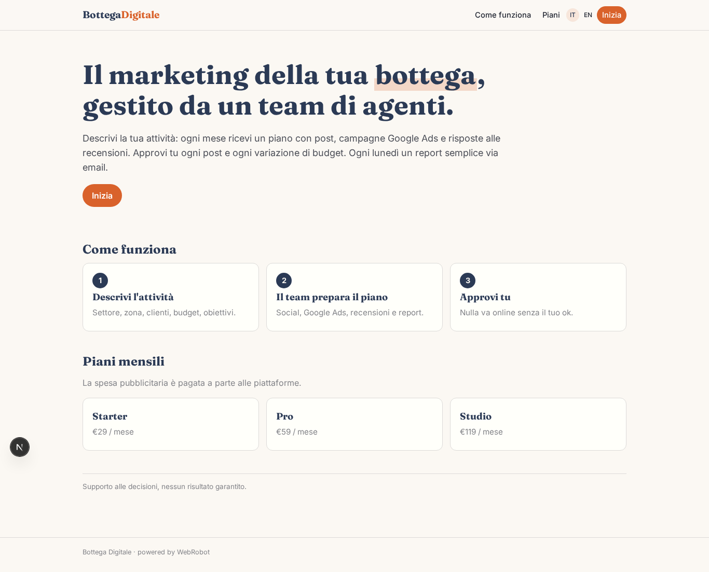

### home-mobile
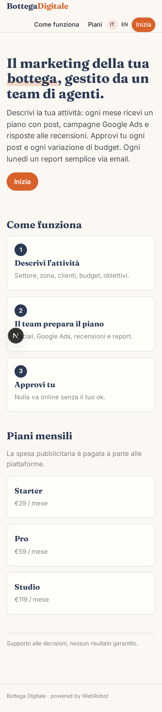

### home
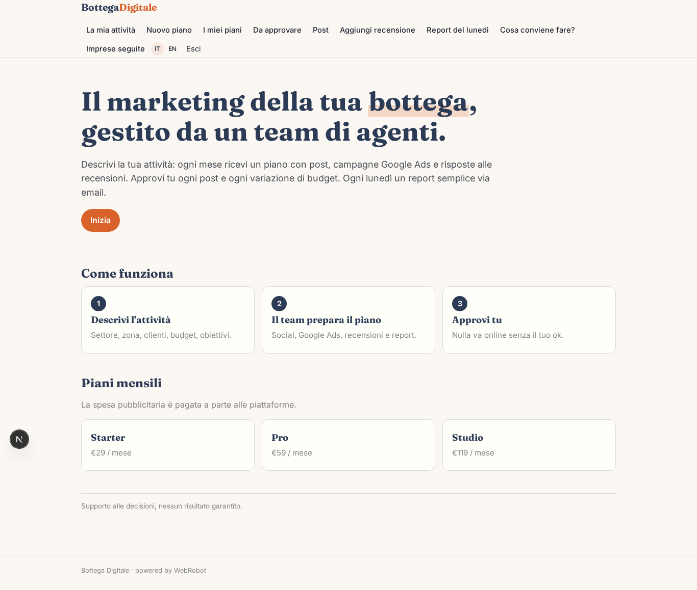

### profile
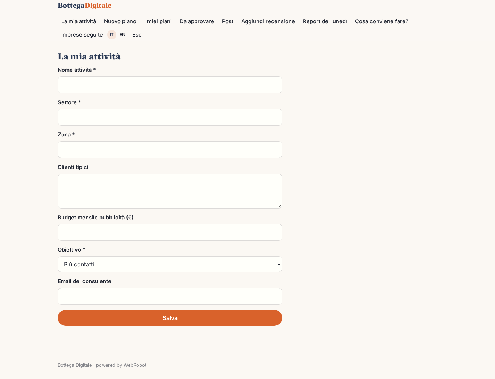

### new_plan
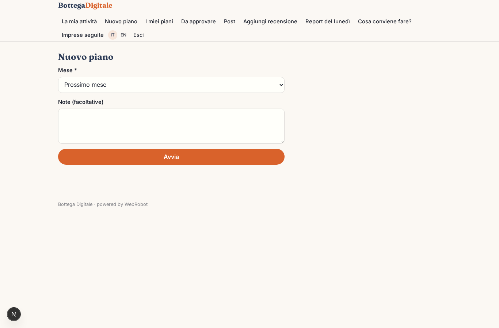

### plans
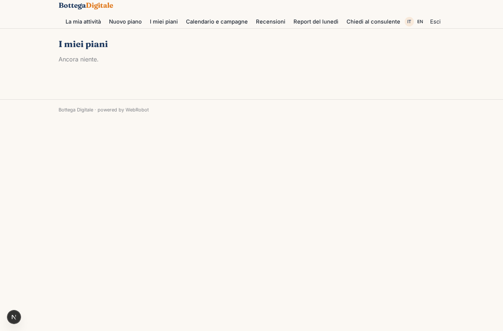

### to_approve
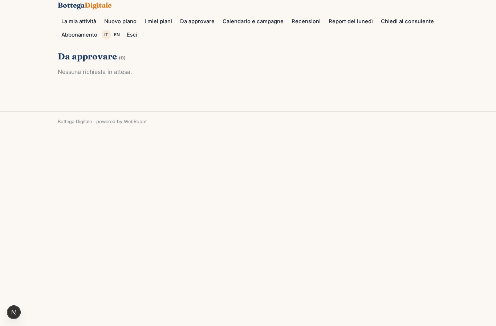

### calendar
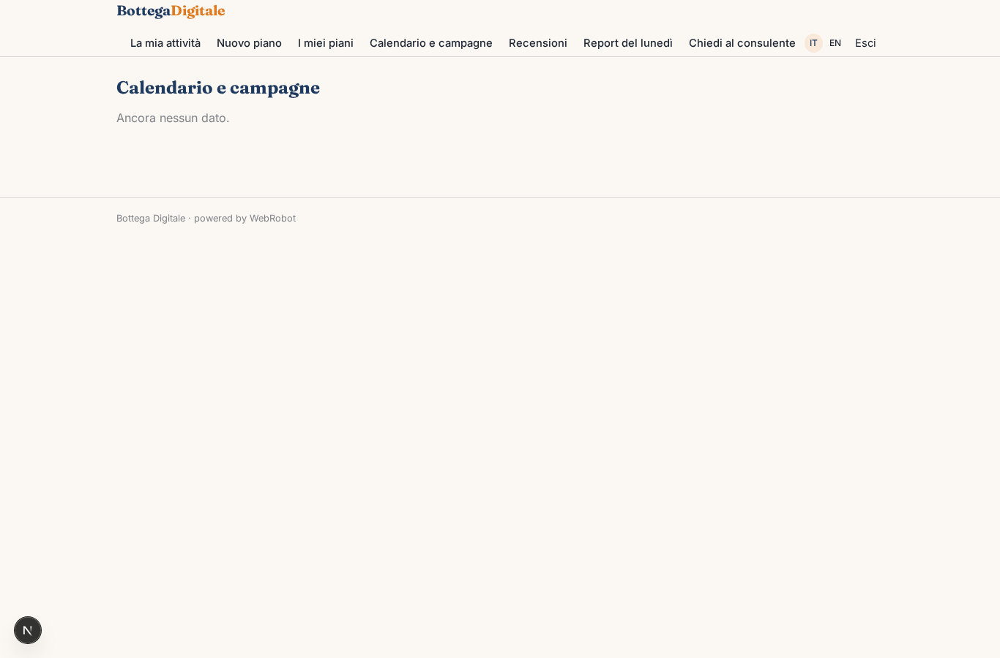

### reviews_list
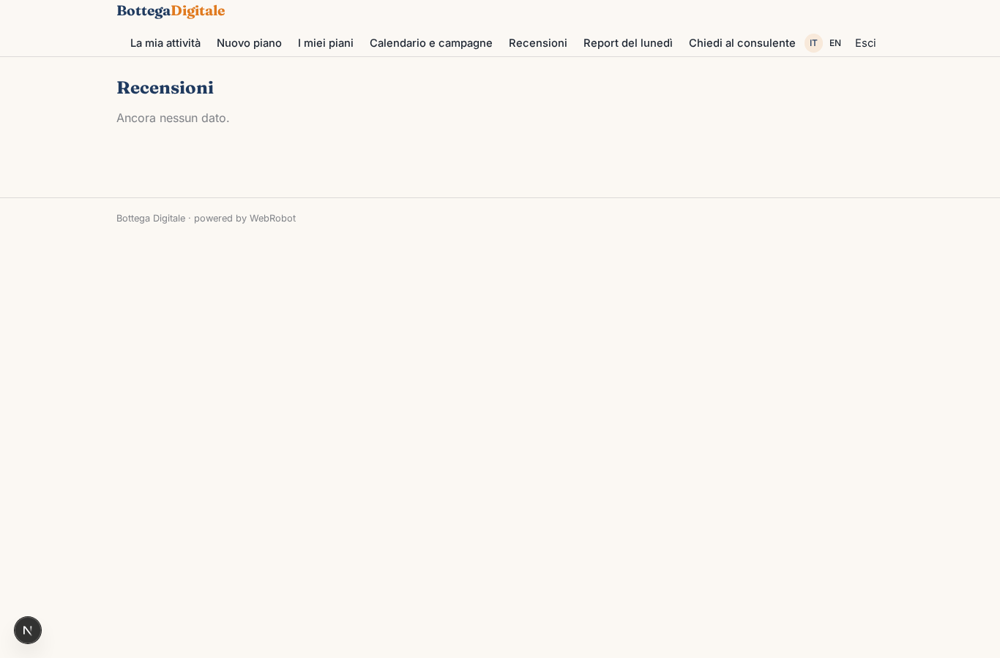

### watches
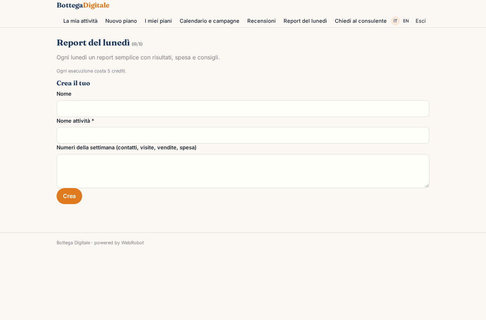

### ask
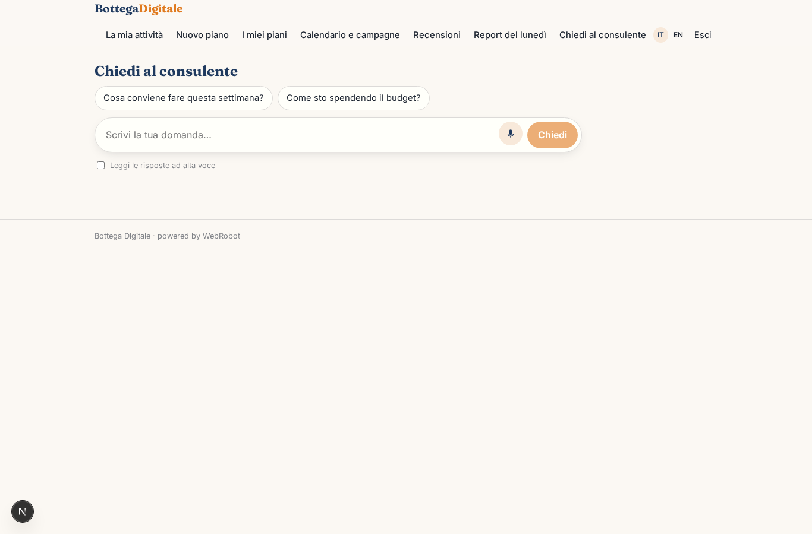

### account
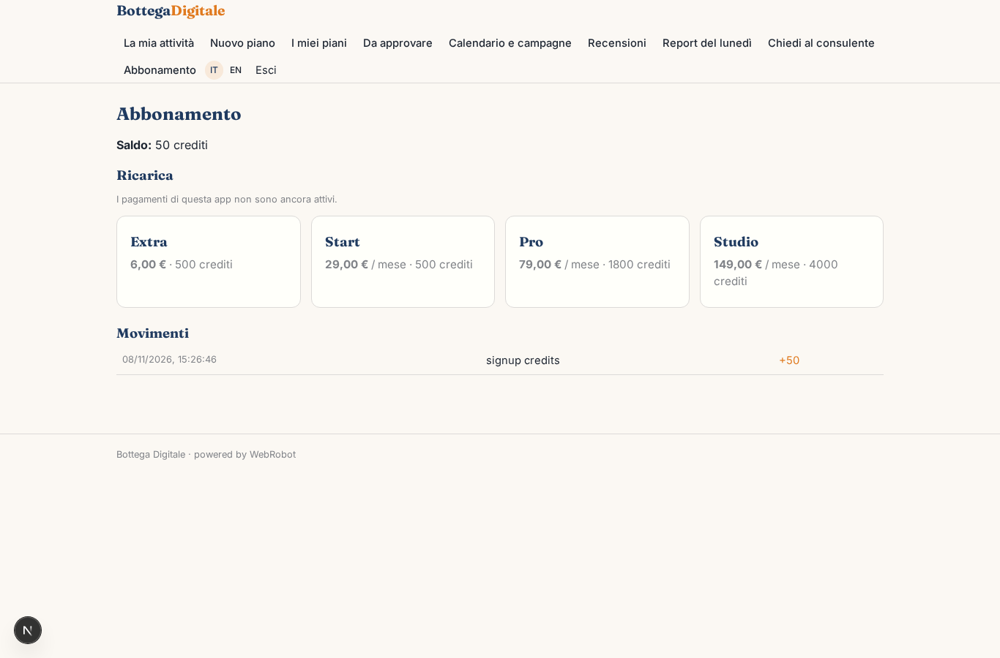

