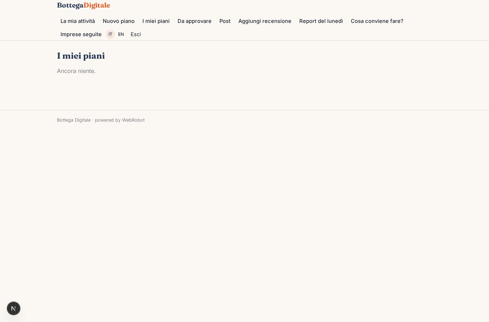
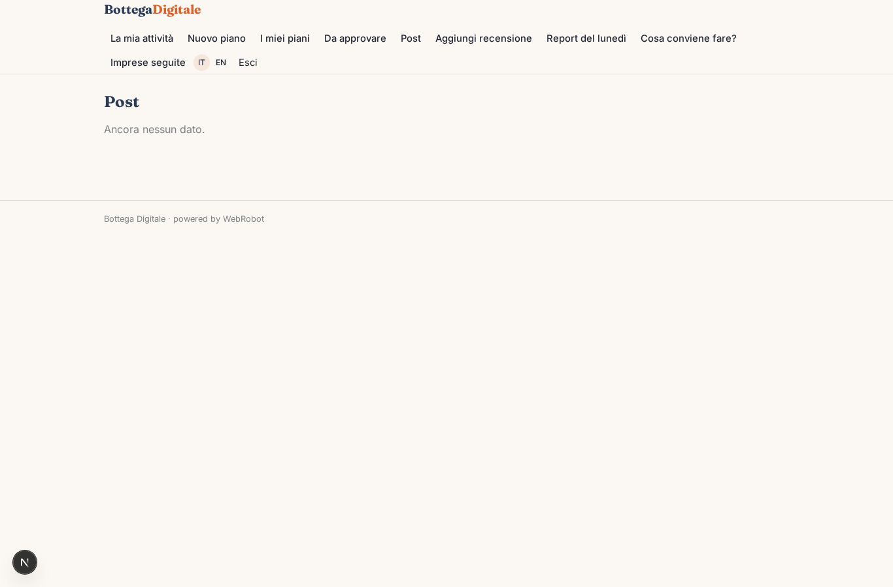
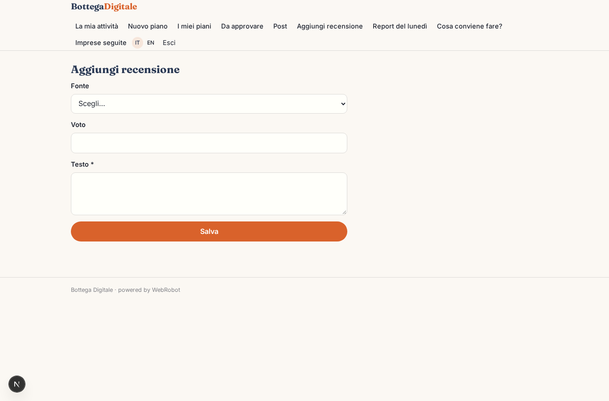
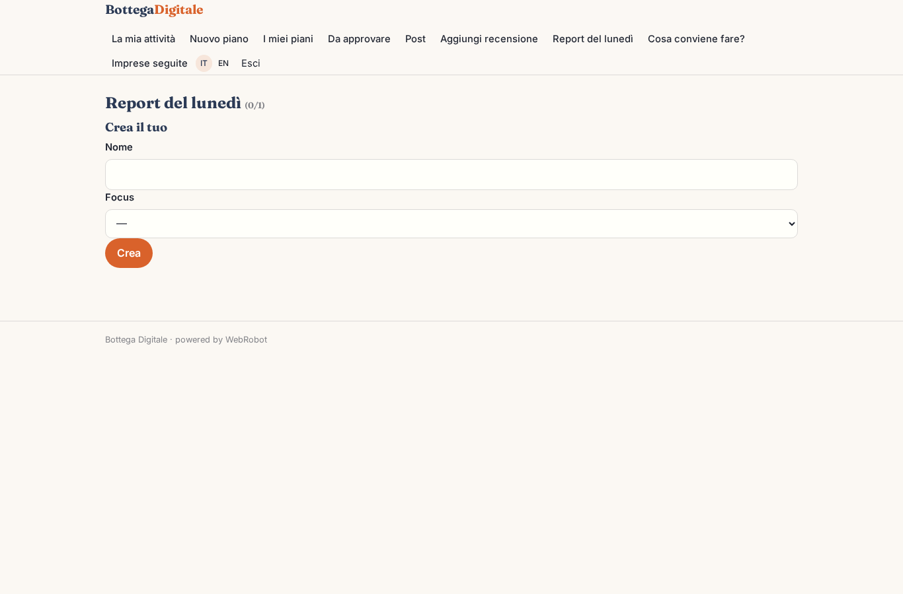
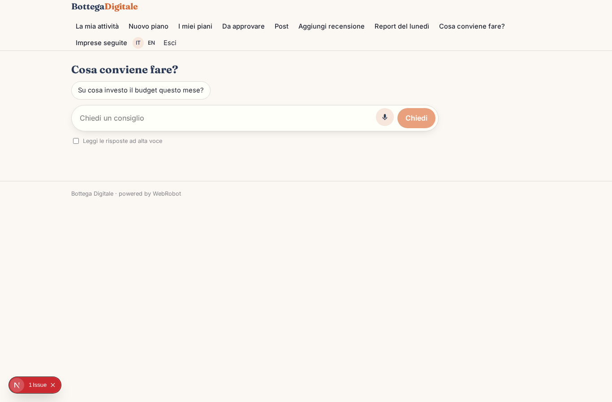
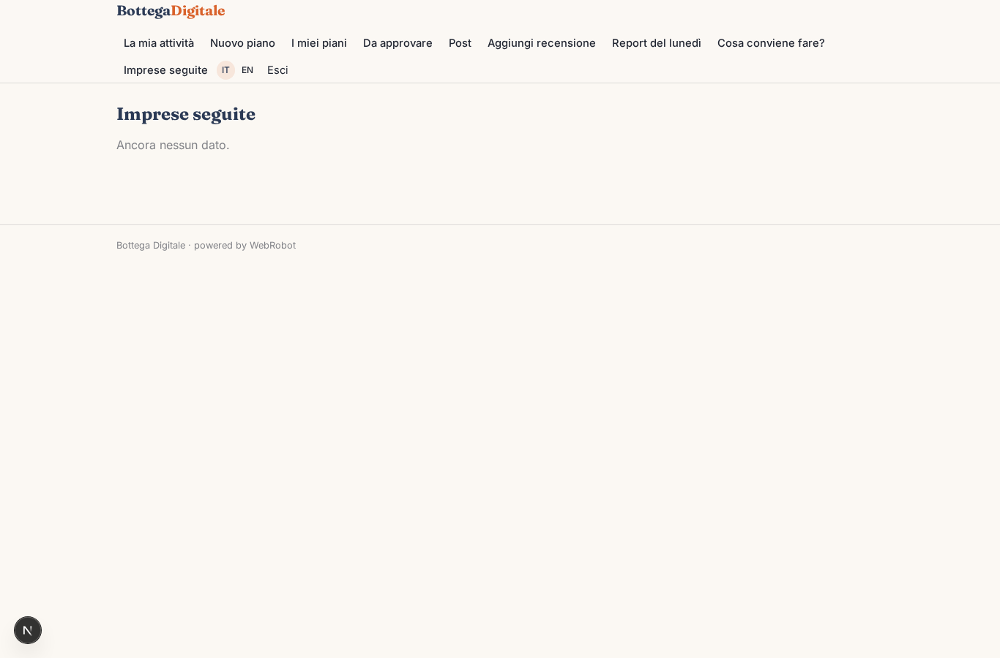
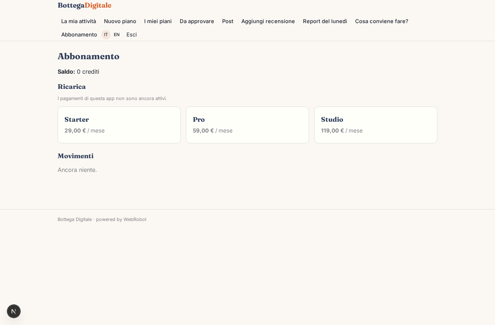

# Bottega Digitale

_Marketing e operazioni quotidiane per la tua piccola impresa, con un team di agenti AI._

**Manifest:** valid (schema + runtime contract) · **Functional test:** passed (16 checks passed)

## Description given to the app builder (Italian)

Ci serve Bottega Digitale, un assistente che gestisce il marketing e le operazioni quotidiane delle piccole imprese, come negozi, artigiani e studi professionali. Il titolare si registra e descrive l'attività: settore, zona, clienti tipici, budget mensile, obiettivi (più contatti, più visite in negozio, più vendite online). Un team di agenti prepara un piano mensile: un agente scrive i post per Instagram e Facebook con calendario editoriale, uno propone e ottimizza campagne su Google Ads, uno controlla le recensioni e prepara le risposte, uno produce il report. Le pubblicazioni e le campagne devono partire davvero, collegando via OAuth gli account social e Google Ads del cliente; il titolare approva ogni post e ogni variazione di budget prima che vada online. Ogni lunedì il titolare riceve un report email semplice con risultati, spesa e consigli, e in chat può chiedere cosa conviene fare. Un consulente della nostra rete può seguire più imprese. Ogni impresa vede solo i propri dati. Abbonamento mensile a fasce, con la spesa pubblicitaria pagata a parte.

## Features not expressible today (spec.extensions)

- **oauth_publishing**: OAuth connection of Instagram, Facebook and Google Ads accounts is not available yet: approved posts and budget changes are recorded and ready, but real publishing on the platforms needs that integration.

## Screenshots (interpretive runtime, no data)

### home-anon

### home-mobile

### home

### profile

### new_plan

### plans_history

### approve

### posts_list

### add_review

### watch

### assistant

### clients

### account

