# BrigataLavoro

_Il lavoro giusto in cucina e in sala, trovato da un agente._

**Manifest:** valid (schema + runtime contract) · **Functional test:** passed (31 checks passed)

## Description given to the app builder (Italian)

BrigataLavoro è un marketplace del lavoro per la ristorazione e l'hotellerie. Da un lato i ristoratori si registrano e pubblicano offerte indicando ruolo (cuoco, cameriere, lavapiatti, barman), città, tipo di contratto, orari, stipendio e requisiti. Dall'altro i lavoratori creano un profilo con esperienze, competenze, disponibilità, zona e aspettative economiche. Un agente fa il matching ogni volta che arriva una nuova offerta o un nuovo profilo, propone ai ristoratori i candidati più adatti con una spiegazione e ai lavoratori le offerte in linea, via email. Il ristoratore può contattare il candidato con un messaggio in piattaforma e fissare una prova. Dopo l'assunzione entrambi lasciano un feedback che migliora i match futuri. I ristoratori vedono solo i profili dei candidati che si sono candidati o che hanno accettato di essere proposti; i lavoratori non vedono i dati degli altri lavoratori. Per i lavoratori è gratuito, i ristoratori pagano un abbonamento mensile o una fee per assunzione. In italiano e inglese.

## Features not expressible today (spec.extensions)

- **fee_waiver_for_subscribers**: The per-hire fee is charged to every employer; waiving it for Pro subscribers is not expressible yet. Admins can refund credits manually.

## Screenshots (interpretive runtime, no data)

### home-anon

### home-mobile

### home

### company
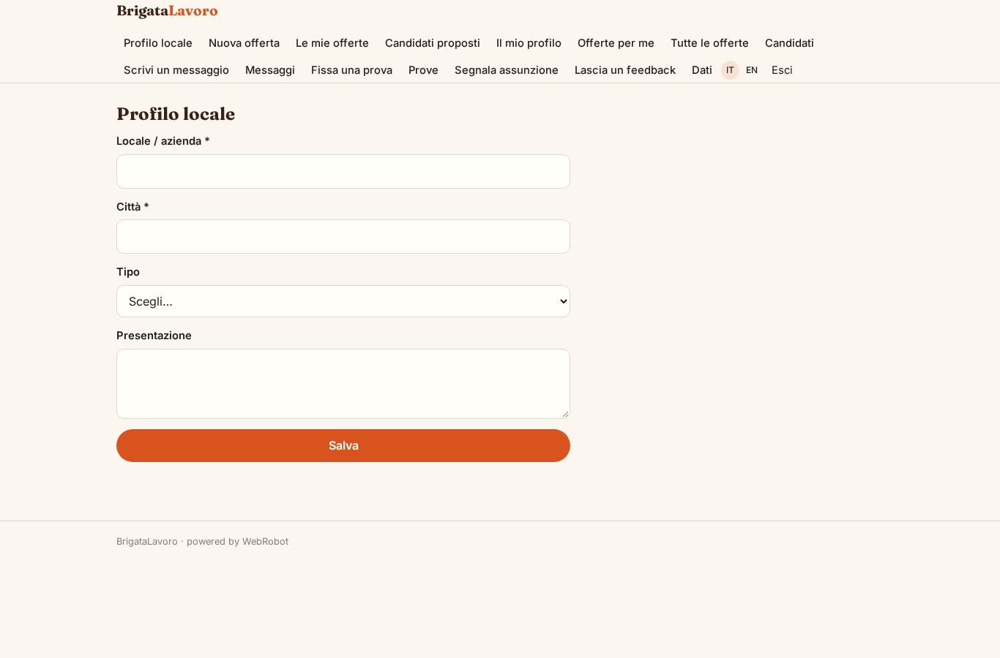

### new_job
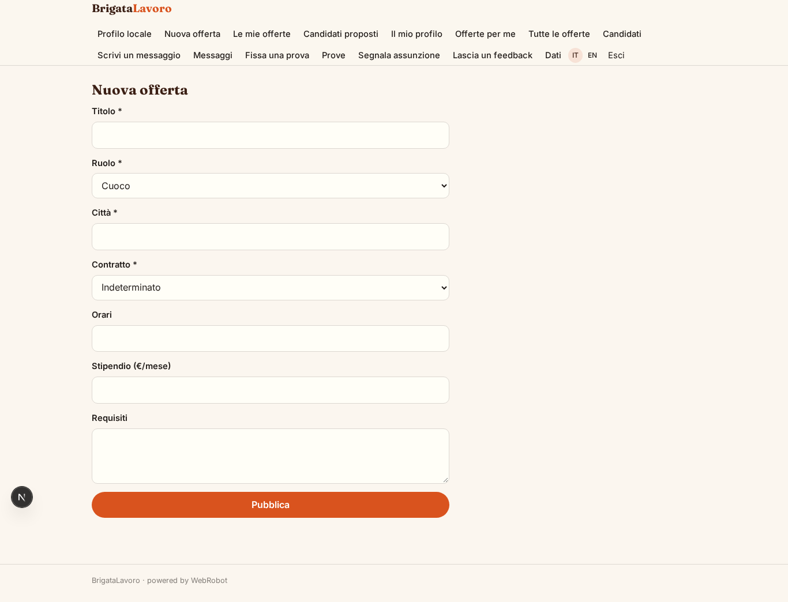

### my_jobs
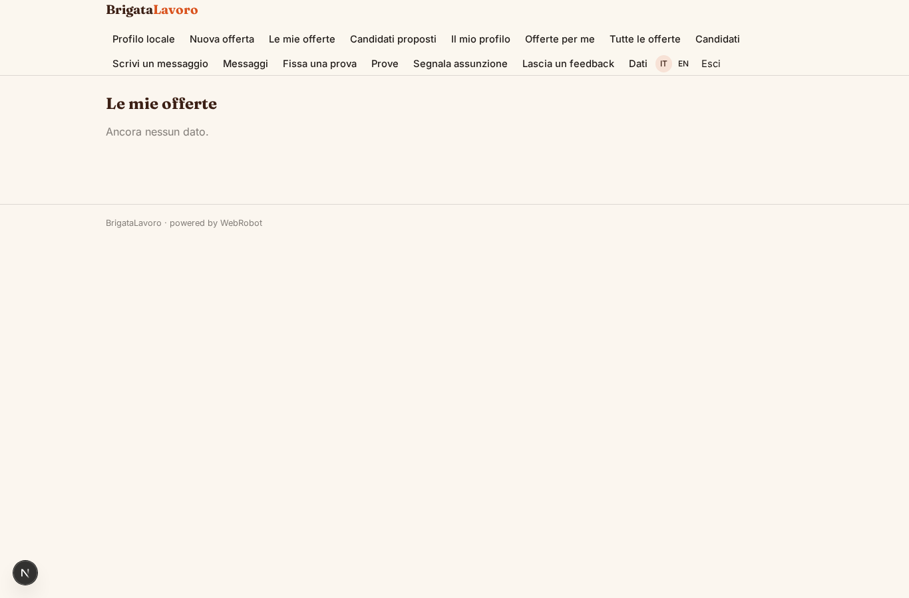

### candidates
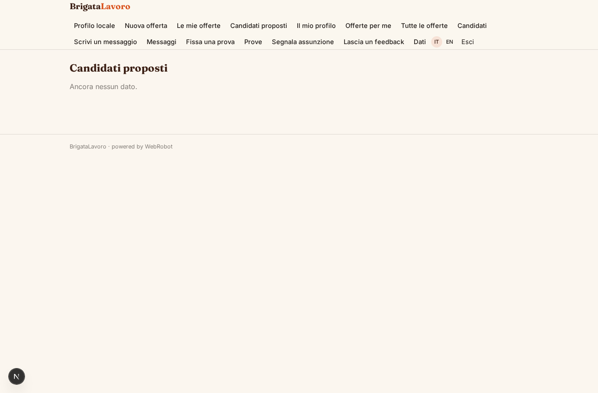

### profile
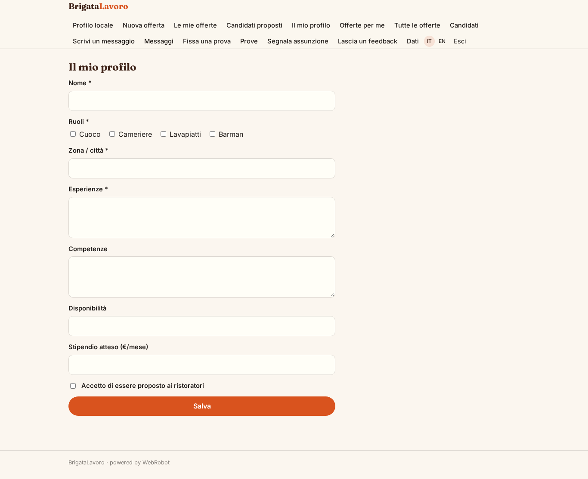

### my_offers
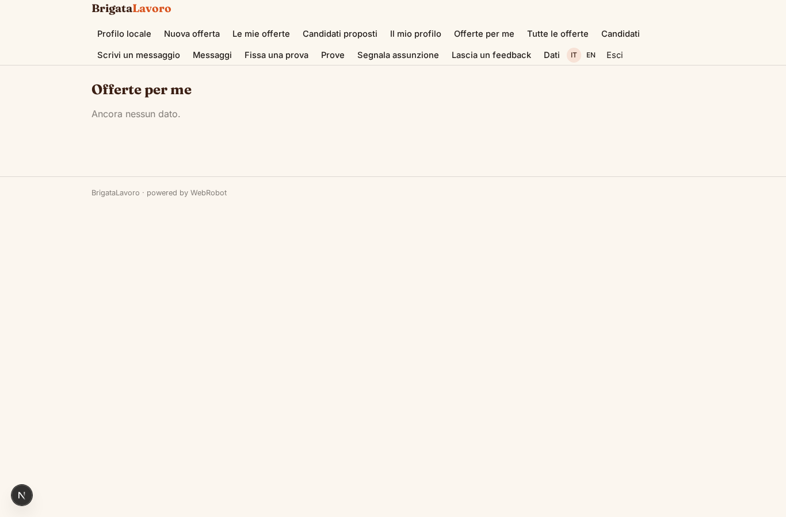

### jobs_board
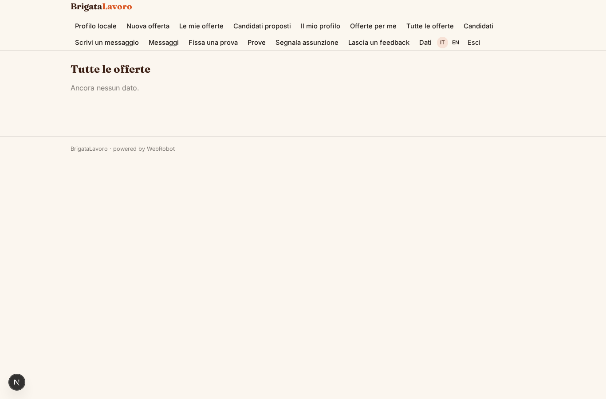

### apply
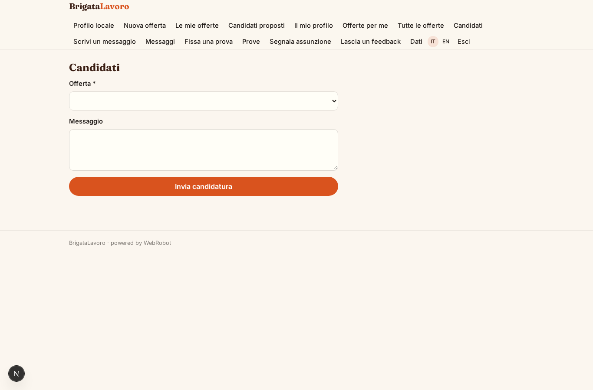

### write
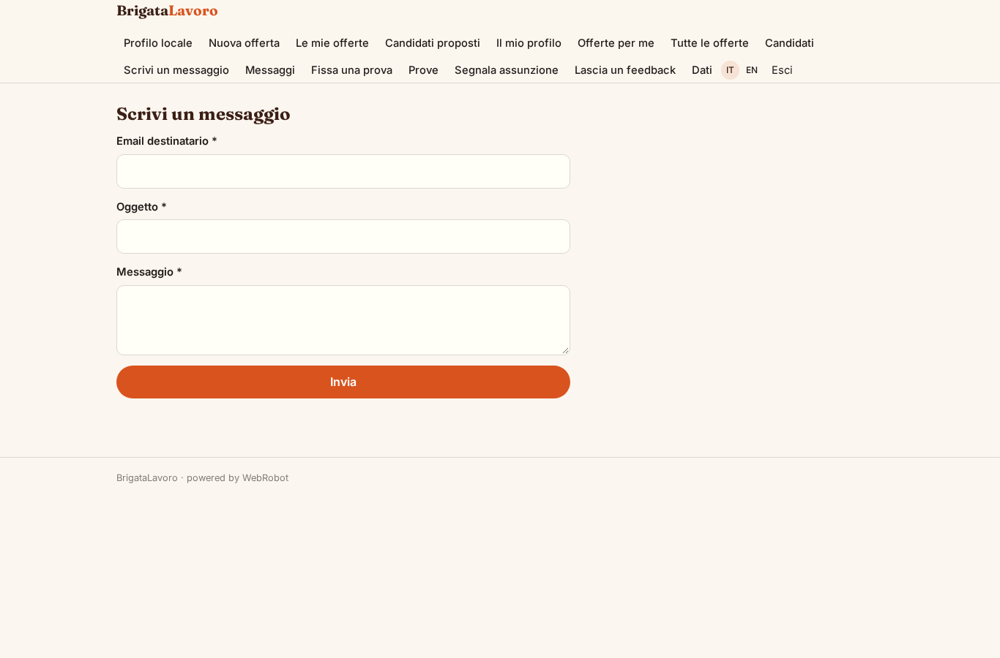

### inbox
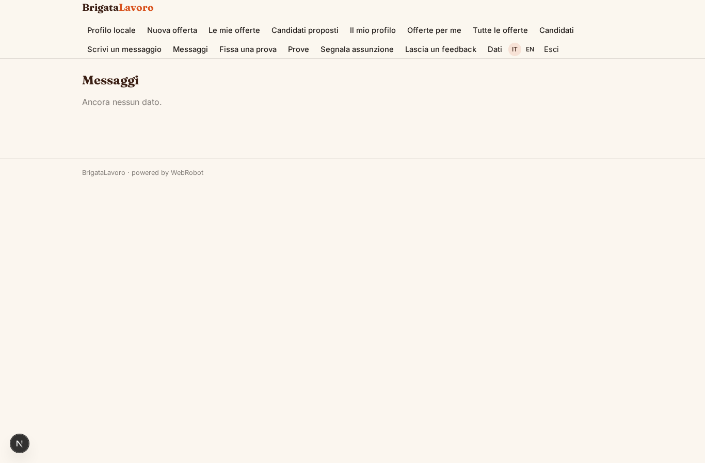

### trial
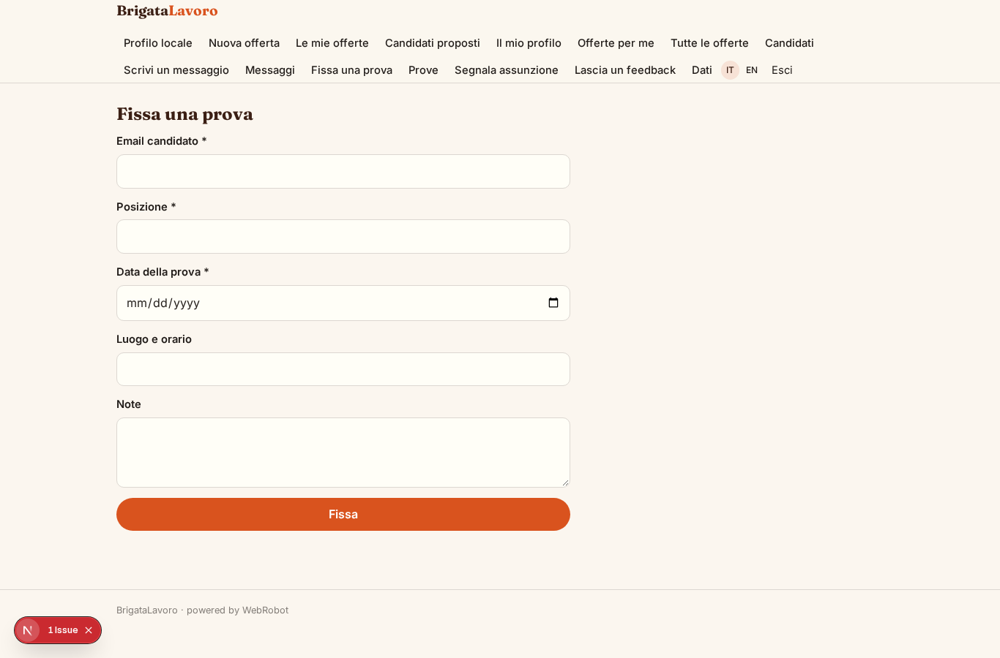

### trials_list
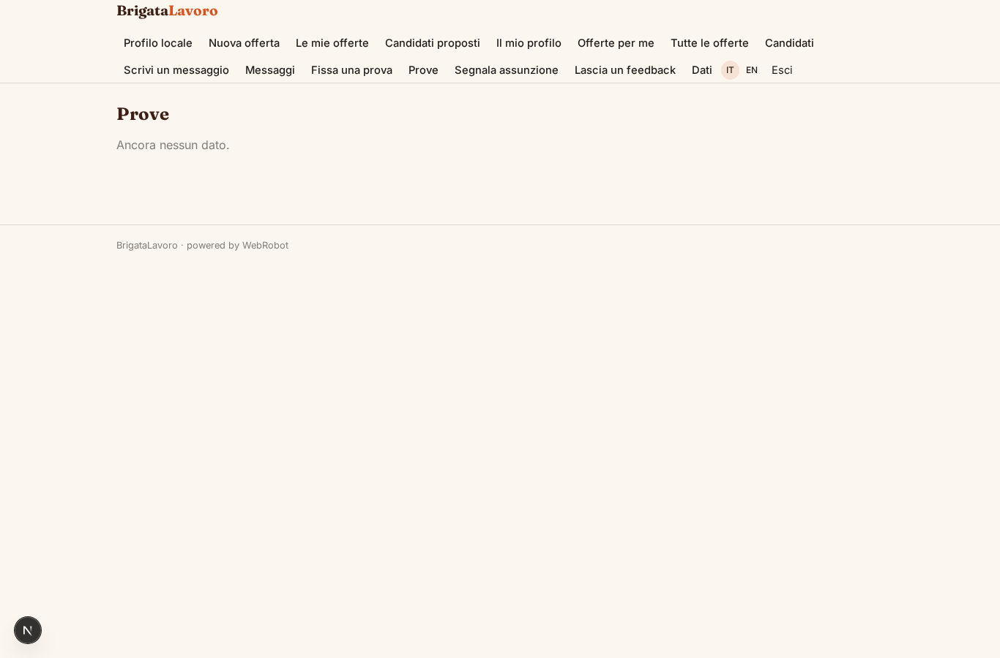

### hire
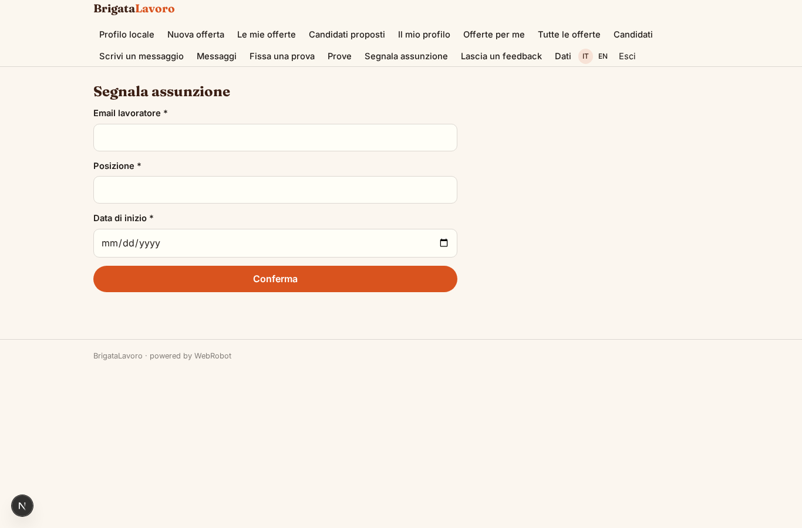

### feedback_form
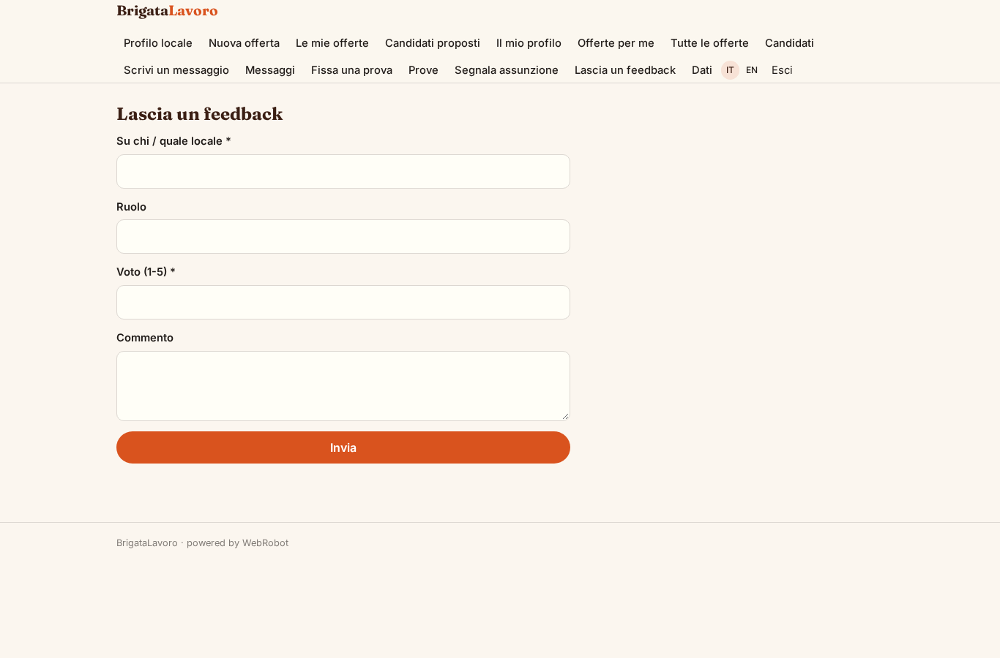

### account
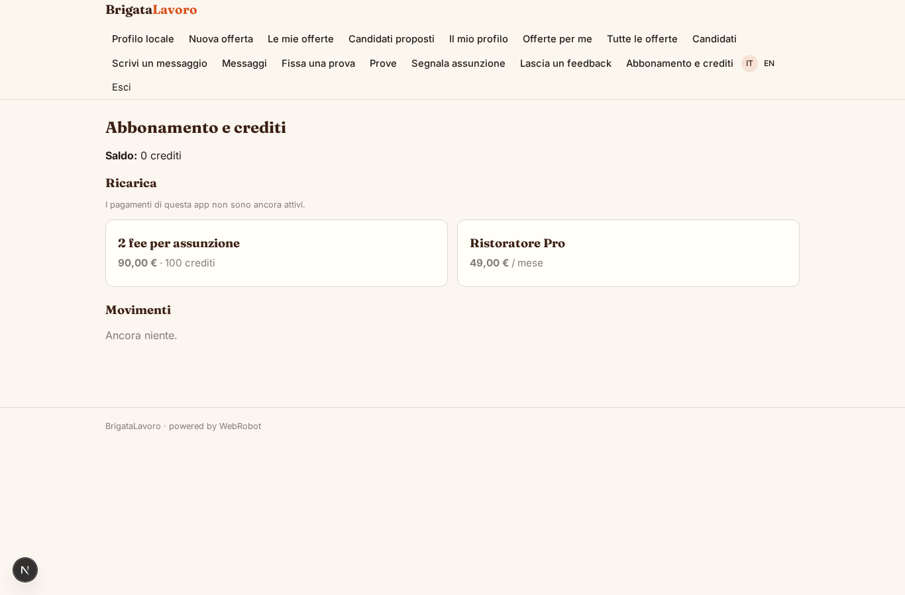
