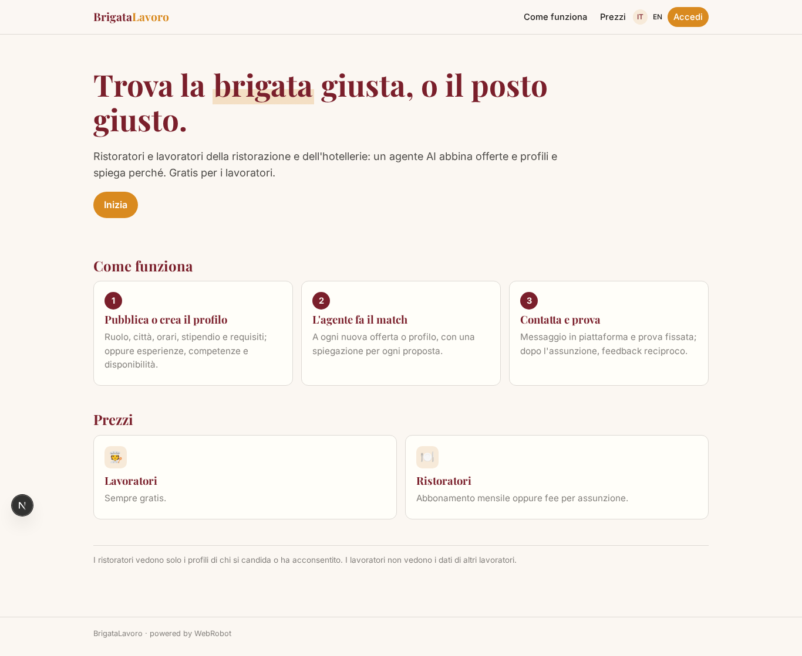
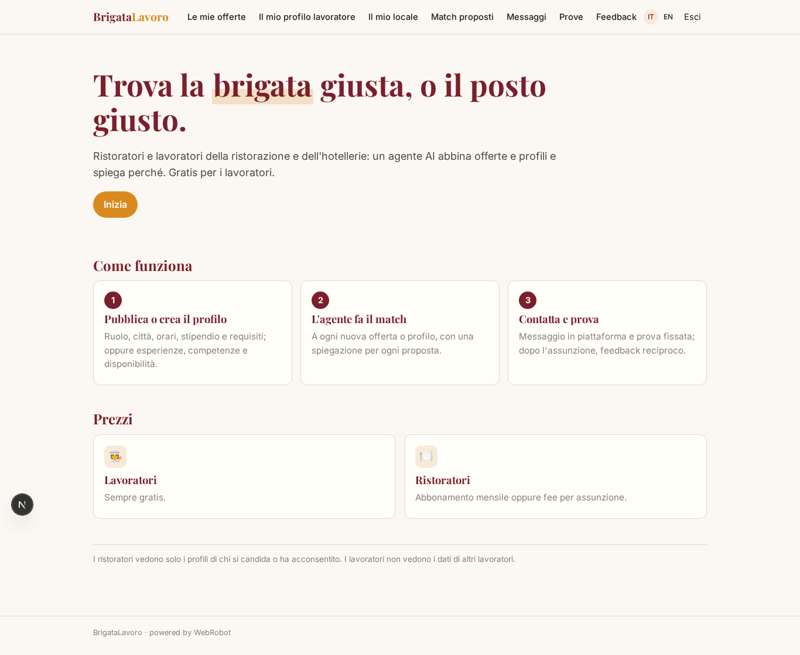
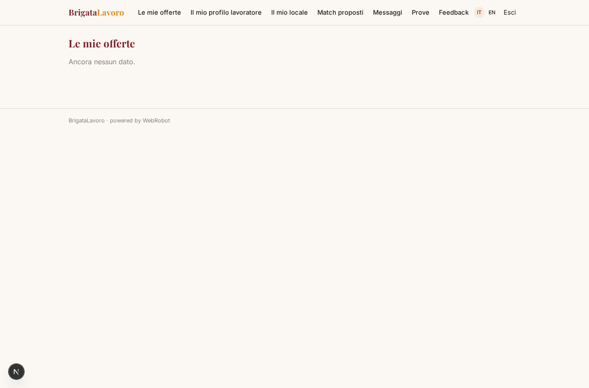
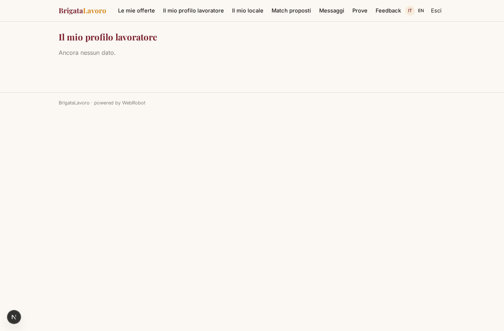
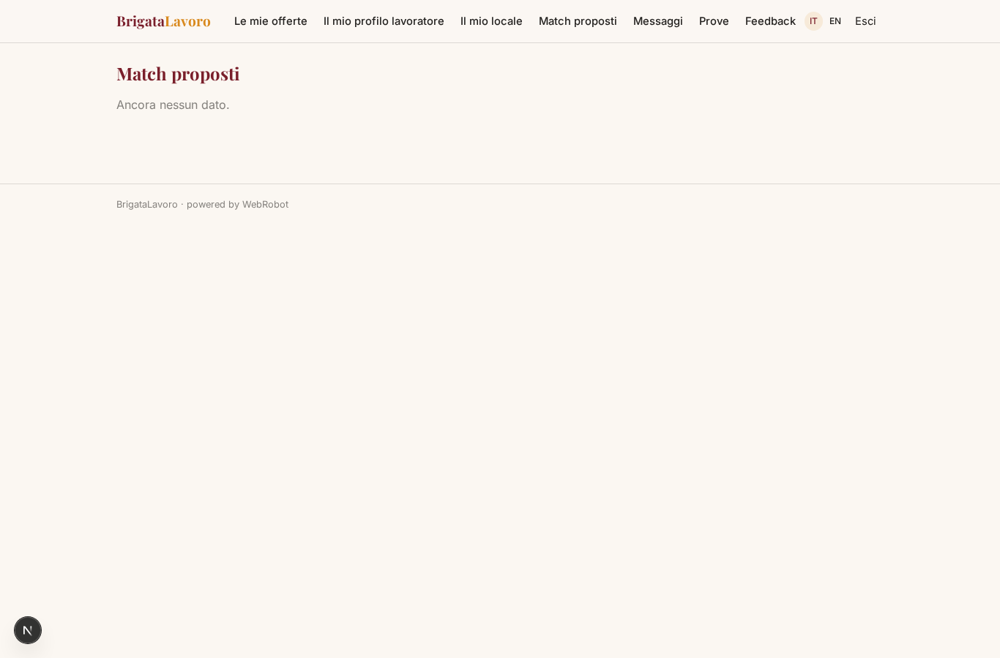
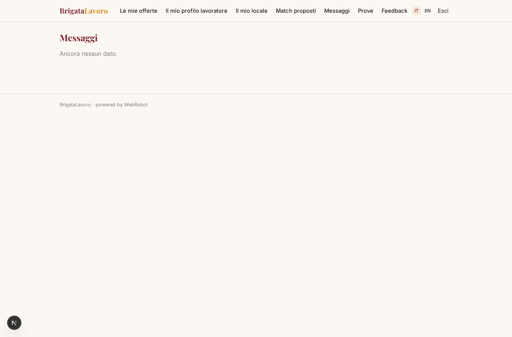
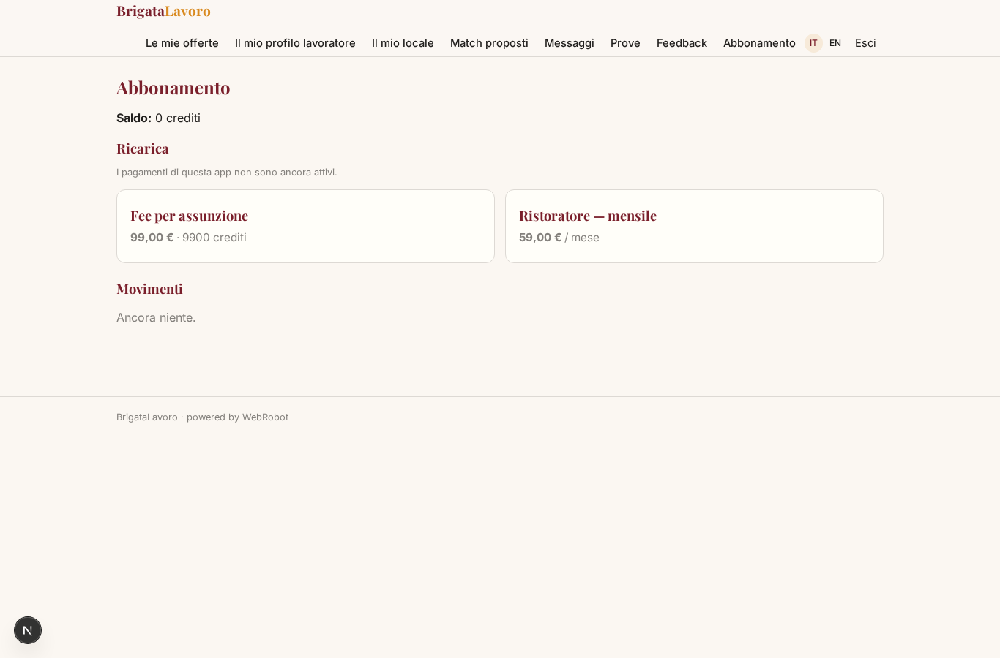

# BrigataLavoro

_Il marketplace del lavoro per ristorazione e hotellerie._

**Manifest status:** valid (schema validator + runtime contract)

## Description given to the app builder (Italian)

BrigataLavoro è un marketplace del lavoro per la ristorazione e l'hotellerie. Da un lato i ristoratori si registrano e pubblicano offerte indicando ruolo (cuoco, cameriere, lavapiatti, barman), città, tipo di contratto, orari, stipendio e requisiti. Dall'altro i lavoratori creano un profilo con esperienze, competenze, disponibilità, zona e aspettative economiche. Un agente fa il matching ogni volta che arriva una nuova offerta o un nuovo profilo, propone ai ristoratori i candidati più adatti con una spiegazione e ai lavoratori le offerte in linea, via email. Il ristoratore può contattare il candidato con un messaggio in piattaforma e fissare una prova. Dopo l'assunzione entrambi lasciano un feedback che migliora i match futuri. I ristoratori vedono solo i profili dei candidati che si sono candidati o che hanno accettato di essere proposti; i lavoratori non vedono i dati degli altri lavoratori. Per i lavoratori è gratuito, i ristoratori pagano un abbonamento mensile o una fee per assunzione. In italiano e inglese.

## Features not expressible today (spec.extensions)

- **email_notifications**: Emailing proposed candidates to employers and offers to workers is not available yet: matches appear in the 'Proposed matches' view instead.
- **cross_user_visibility**: Employers seeing only applicants or consenting workers (and workers never seeing others) needs per-record cross-user access; the matcher runs as the app with explicit rules in its prompt, and the match records are written to the owners. Needs runtime review.
- **account_types**: Employer vs worker are not separate signup roles: a user fills the business profile or the worker profile. Separate roles by account type are a later step.
- **hire_fee_charging**: Fee per hire is a pack the employer buys when marking a hire; automatic charging on hire confirmation is not expressible yet.

## Screenshots (interpretive runtime)

### home-anon

### home-mobile

### home

### offers

### profile

### business

### my_matches

### inbox

### trial_list

### feedback_list

### account

