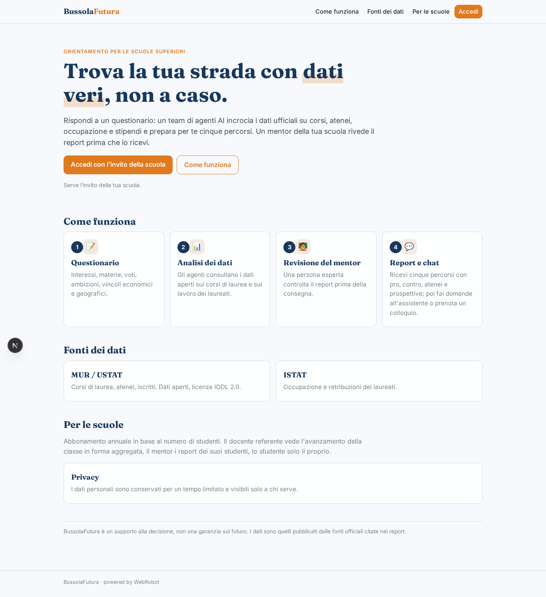
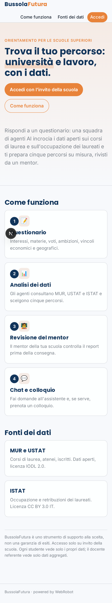
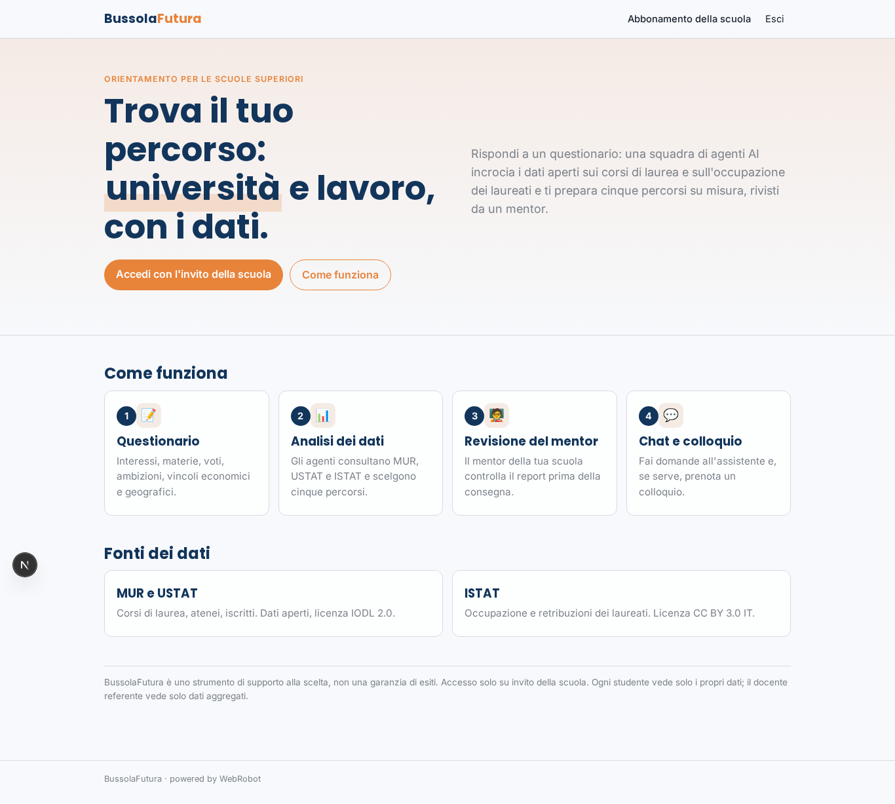
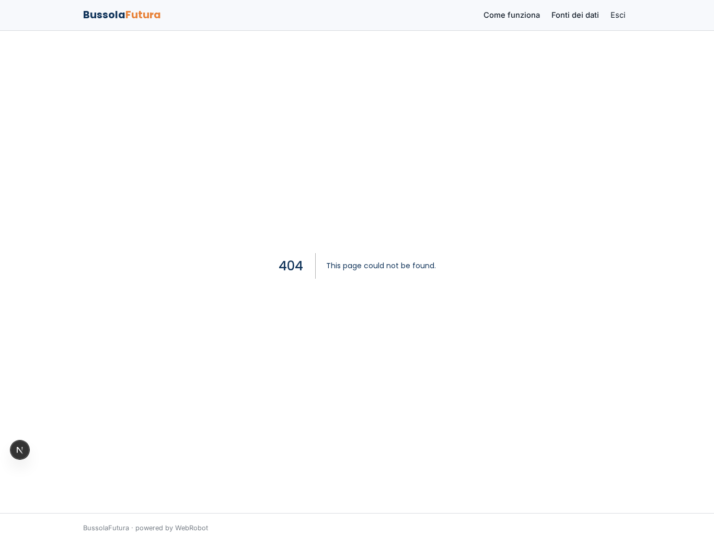
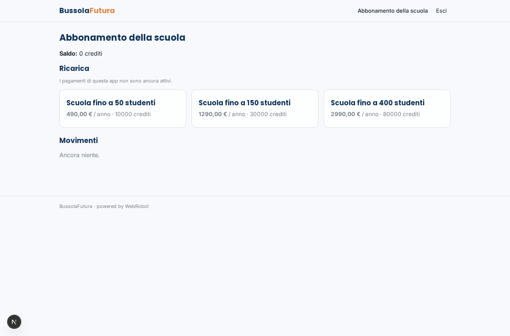

# BussolaFutura

_La bussola per scegliere università e lavoro._

**Manifest status:** valid (schema validator + runtime contract)

## Description given to the app builder (Italian)

BussolaFutura accompagna gli studenti delle superiori nella scelta dell'università e del lavoro. Lo studente, invitato dalla sua scuola, compila un questionario su interessi, materie preferite, voti, ambizioni, vincoli economici e geografici. Una squadra di agenti analizza le risposte, consulta i dati aperti MUR e USTAT sui corsi di laurea (licenza IODL 2.0) e i dati ISTAT su occupazione e retribuzioni dei laureati, e genera un report personale con cinque percorsi consigliati, i pro e contro di ciascuno, gli atenei che li offrono e le prospettive di lavoro. Lo studente può poi fare domande in chat a un assistente di orientamento. Un mentor umano assegnato alla scuola rivede i report prima che vengano consegnati e può prenotare un colloquio con lo studente. Il docente referente vede l'avanzamento della classe in forma aggregata, il mentor i report dei suoi studenti, lo studente solo i propri. Le scuole pagano un abbonamento annuale per numero di studenti. In italiano.

## Features not expressible today (spec.extensions)

- **assegnazione_scuole**: Collegare studenti, mentor e docente alla stessa scuola/classe (inviti con scuola e classe), così che il mentor veda solo i report dei suoi studenti e il docente solo l'aggregato della sua scuola. Oggi i report sono dello studente e la collezione avanzamento_classe va popolata e filtrata per scuola da codice.
- **limite_studenti**: Il numero di studenti invitabili per scuola va fatto rispettare in base al piano acquistato.
- **prenotazione_colloqui**: La prenotazione del colloquio da parte del mentor sul calendario dello studente, e la visibilità reciproca, non sono generiche; mancano notifiche email di invito, promemoria e consegna del report approvato.

## Screenshots (interpretive runtime)

### home-anon

### home-mobile

### home

### nuovo

### miei_report

### assistente_chat

### revisioni

### colloqui_lista

### classe

### account

