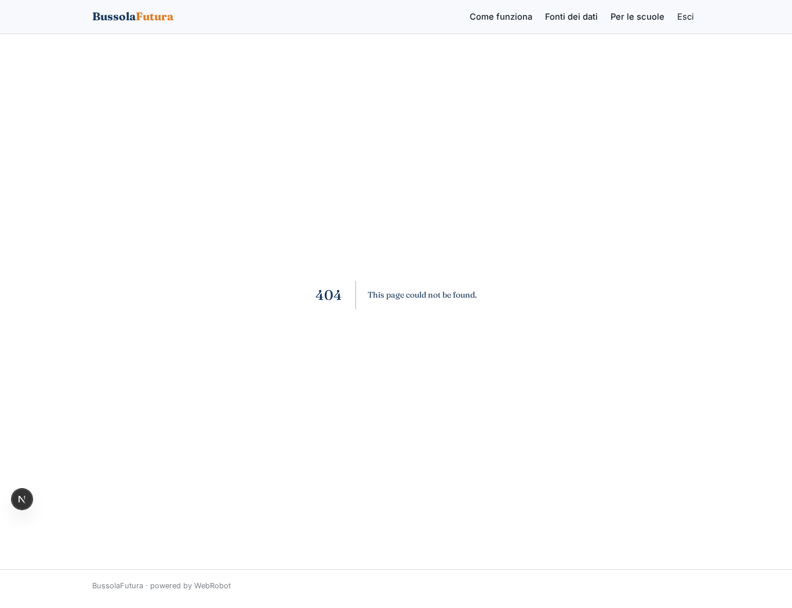
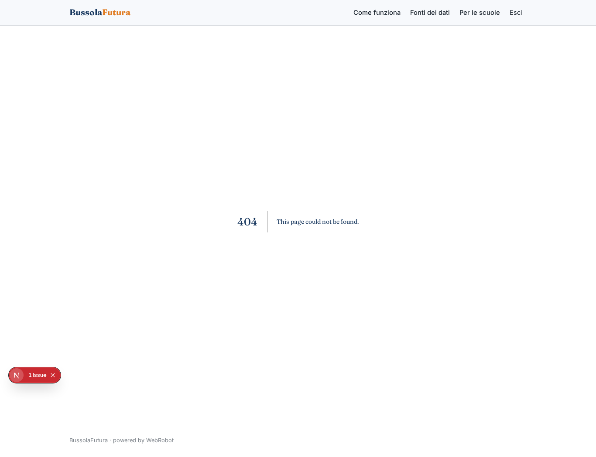
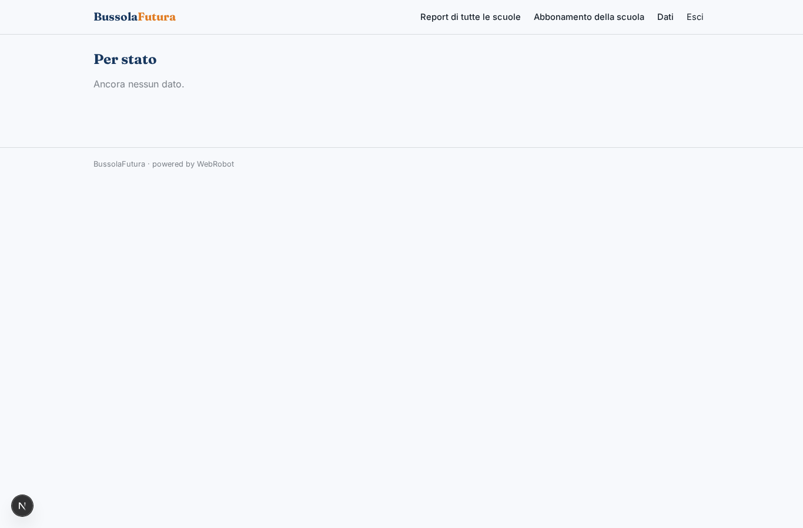
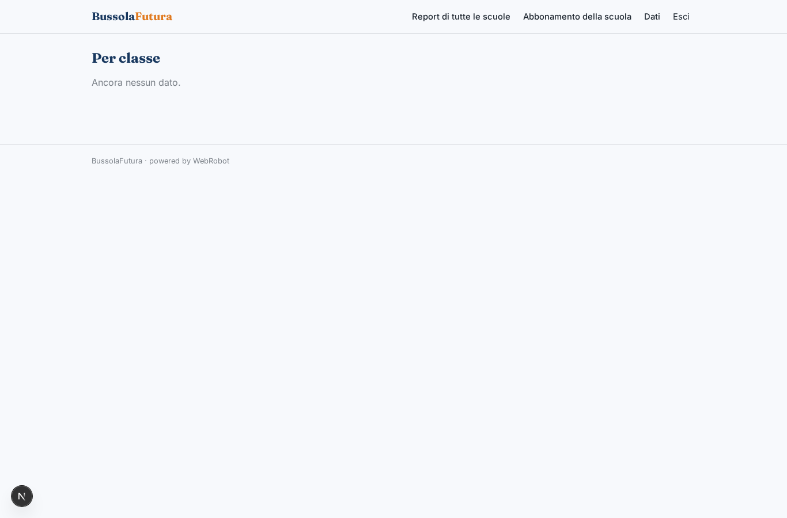
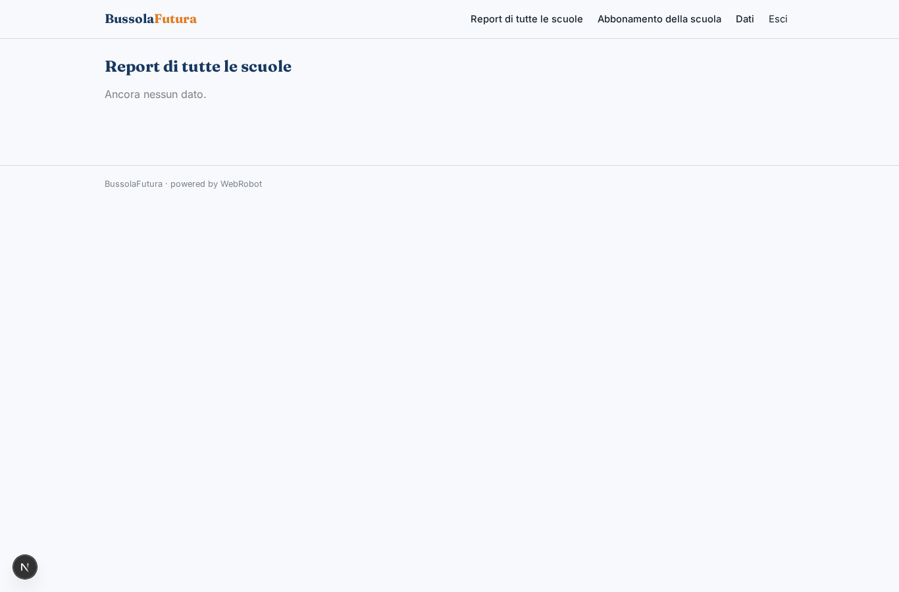
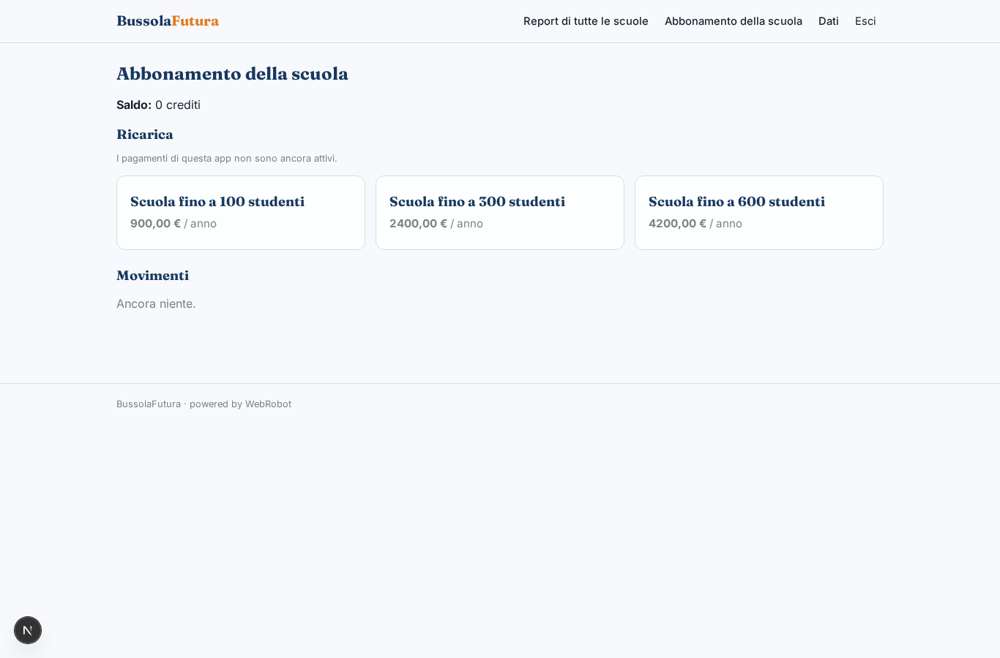

# BussolaFutura

_La bussola per scegliere università e lavoro dopo le superiori._

**Manifest:** valid (schema + runtime contract) · **Functional test:** passed (17 checks passed)

## Description given to the app builder (Italian)

BussolaFutura accompagna gli studenti delle superiori nella scelta dell'università e del lavoro. Lo studente, invitato dalla sua scuola, compila un questionario su interessi, materie preferite, voti, ambizioni, vincoli economici e geografici. Una squadra di agenti analizza le risposte, consulta i dati aperti MUR e USTAT sui corsi di laurea (licenza IODL 2.0) e i dati ISTAT su occupazione e retribuzioni dei laureati, e genera un report personale con cinque percorsi consigliati, i pro e contro di ciascuno, gli atenei che li offrono e le prospettive di lavoro. Lo studente può poi fare domande in chat a un assistente di orientamento. Un mentor umano assegnato alla scuola rivede i report prima che vengano consegnati e può prenotare un colloquio con lo studente. Il docente referente vede l'avanzamento della classe in forma aggregata, il mentor i report dei suoi studenti, lo studente solo i propri. Le scuole pagano un abbonamento annuale per numero di studenti. In italiano.

## Functional test: what did not pass

- **form saves a record** (form profile): only role student may fill it, and the test cannot hold that role _(warning)_
- **form saves a record** (form review): only role mentor may fill it, and the test cannot hold that role _(warning)_
- **page opened by a role allowed to** (view profile): only role student may open it, the test cannot hold it _(warning)_
- **page opened by a role allowed to** (view new): only role student may open it, the test cannot hold it _(warning)_
- **page opened by a role allowed to** (view reports): only role student may open it, the test cannot hold it _(warning)_
- **page opened by a role allowed to** (view coach): only role student may open it, the test cannot hold it _(warning)_
- **page opened by a role allowed to** (view book): only role student may open it, the test cannot hold it _(warning)_
- **page opened by a role allowed to** (view to_review): only role mentor may open it, the test cannot hold it _(warning)_
- **page opened by a role allowed to** (view review): only role mentor may open it, the test cannot hold it _(warning)_
- **page opened by a role allowed to** (view class_progress): only role teacher may open it, the test cannot hold it _(warning)_
- **saved record shown where its collection is read** (view progress_stage): a record was saved in progress (by admin-data, admin-data) but the page does not show it (as user) _(warning)_
- **saved record shown where its collection is read** (view progress_class): a record was saved in progress (by admin-data, admin-data) but the page does not show it (as user) _(warning)_

## Features not expressible today (spec.extensions)

- **seat_limit**: Il limite di studenti per piano scolastico (100/300/600) non è applicato automaticamente: l'amministratore invita gli studenti entro il numero acquistato.
- **school_mentor_assignment**: L'assegnazione del mentor e del docente alla scuola avviene all'invito da parte dell'amministratore; lo studente indica nel profilo le email già comunicate dalla scuola.

## Screenshots (interpretive runtime, no data)

### home-anon

### home-mobile

### home

### profile

### new

### reports

### coach

### book

### to_review

### review

### class_progress

### progress_stage

### progress_class

### schools

### account

