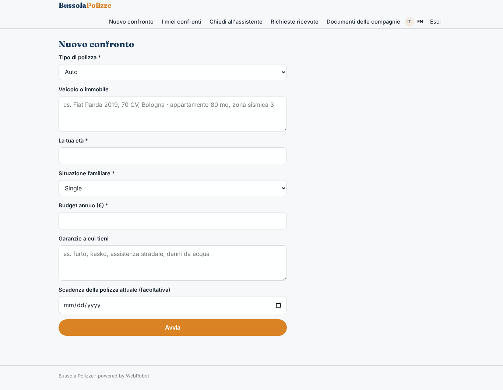
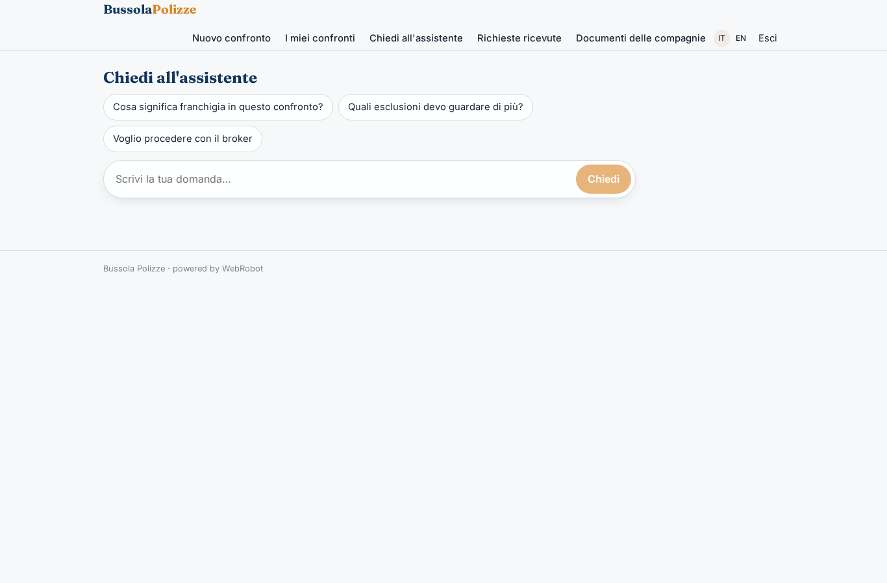
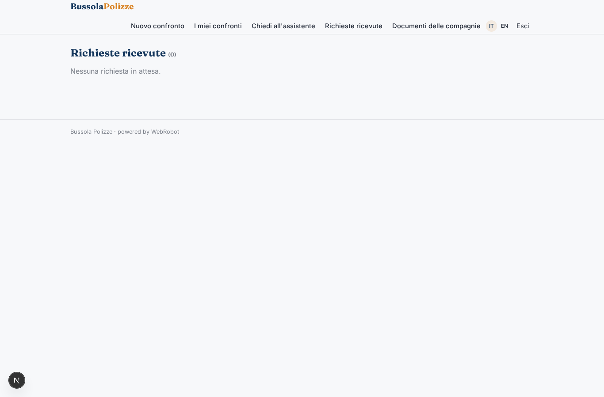
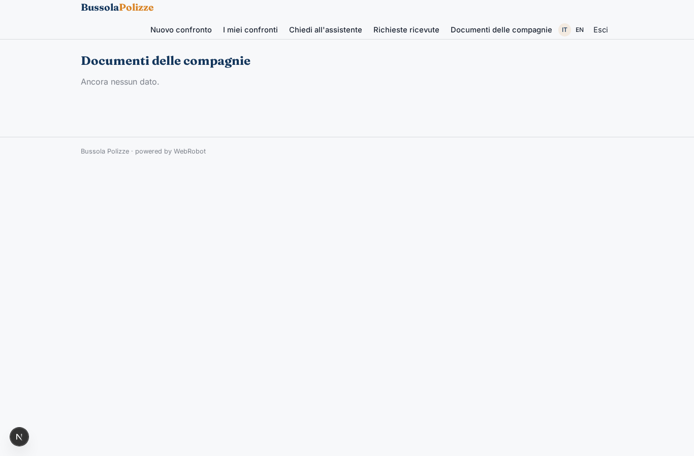
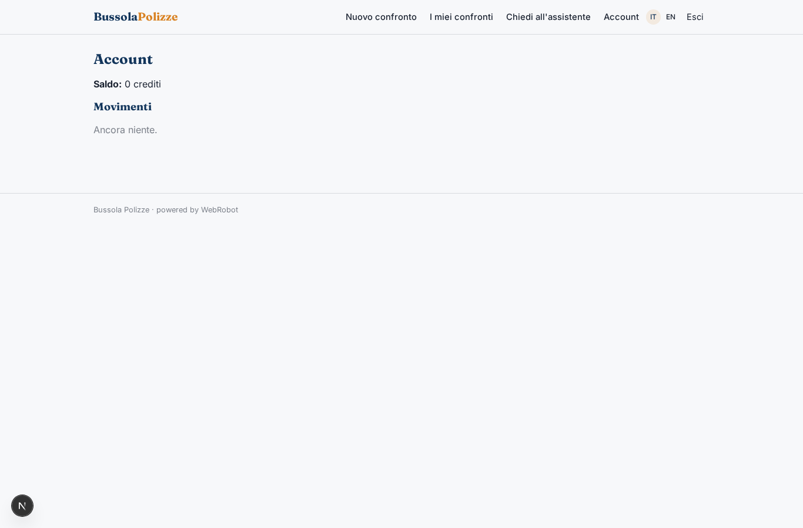

# Bussola Polizze

_Capisci quale assicurazione fa per te, prima di parlare con il broker._

**Manifest status:** valid (schema validator + runtime contract)

## Description given to the app builder (Italian)

Mi serve Bussola Polizze, un orientatore per chi deve scegliere un'assicurazione auto, casa o vita. Descrivo solo lo strato software: l'intermediazione e la vendita restano al broker iscritto al registro, e non raccogliamo preventivi dai siti delle compagnie, che lo vietano. L'utente compila un modulo sul bisogno: tipo di polizza, dati del veicolo o dell'immobile, età, situazione familiare, budget annuo, garanzie a cui tiene. Un agente legge i documenti informativi che le compagnie partner hanno caricato nella piattaforma e confronta le coperture, le esclusioni, le franchigie e i massimali, producendo una tabella comparativa spiegata in modo semplice e una raccomandazione motivata. L'utente può fare domande in chat. Se vuole procedere, la richiesta passa al broker, che verifica l'adeguatezza, prepara il preventivo vero e lo contatta. Prima della scadenza della polizza l'utente riceve un'email che lo invita a rifare il confronto. L'utente vede solo le sue richieste; il broker vede le richieste ricevute; le compagnie partner vedono solo statistiche aggregate. Gratis per l'utente, il broker paga una quota per contatto.

## Features not expressible today (spec.extensions)

- **expiry_reminder_email**: Email to the user before their policy expires, inviting them to redo the comparison (expiry date is saved in the request). Notifications are not available yet; for now the date is stored and shown in the history.
- **document_upload**: Partner insurers cannot upload files yet: documents (DIP/IPID) are pasted as text into policy_docs by staff or by the insurer; file upload is needed later.
- **insurer_aggregate_stats**: Aggregate, anonymous statistics for partner insurers (requests by type, budget bands). Needs a privacy-safe aggregation that does not read customers' records through an app-wide tool; not expressible yet.
- **broker_fee_per_contact**: The broker pays a fee for each contact received (each approved broker_handoff). Per-contact charging to a role is not available yet: invoice manually from the approvals list, or later via per_transaction billing.

## Screenshots (interpretive runtime)

### home-anon

### home-mobile

### home

### new_run

### history

### ask

### broker_inbox

### docs

### account

