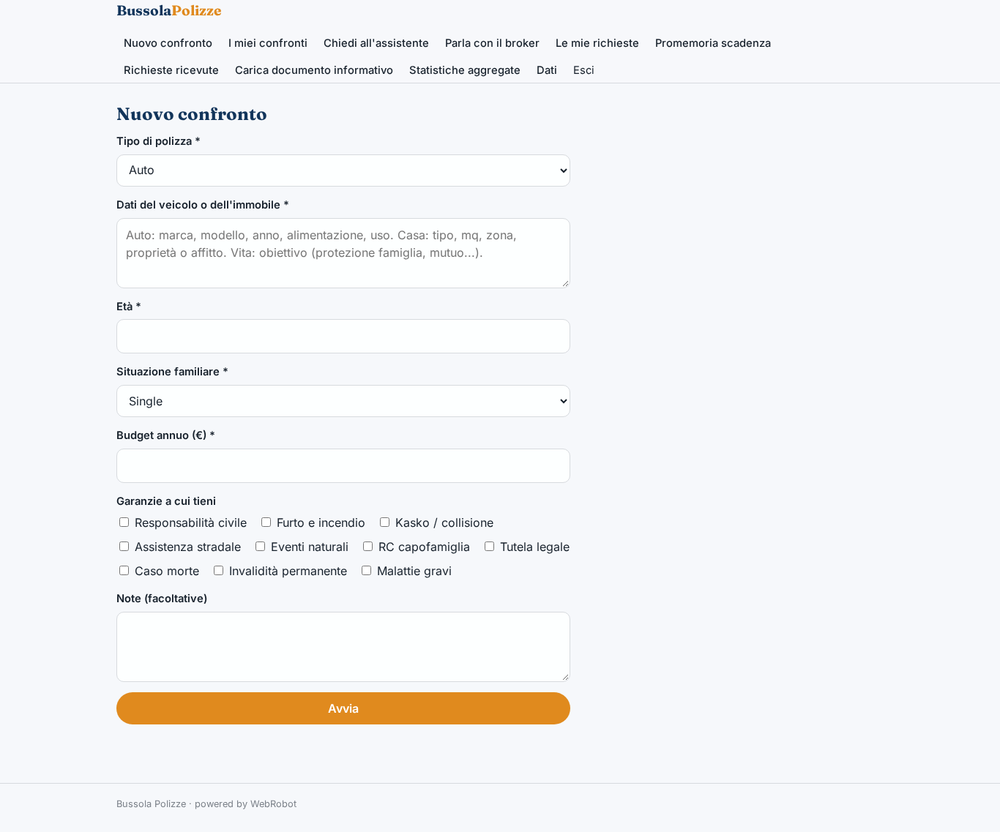
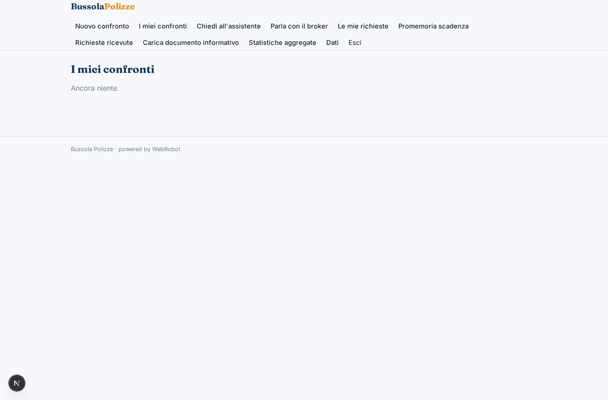
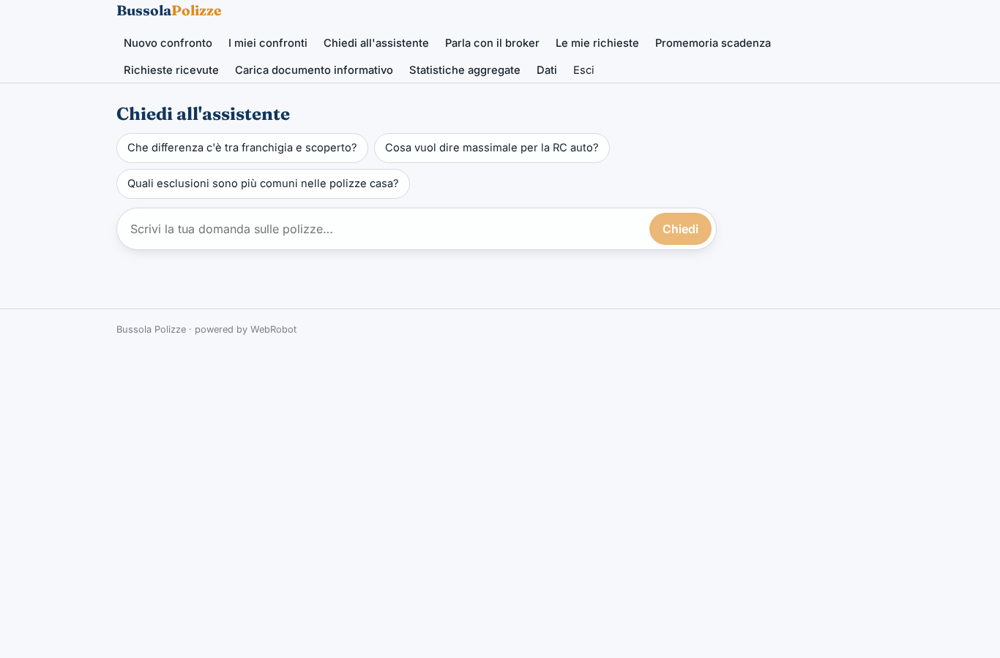
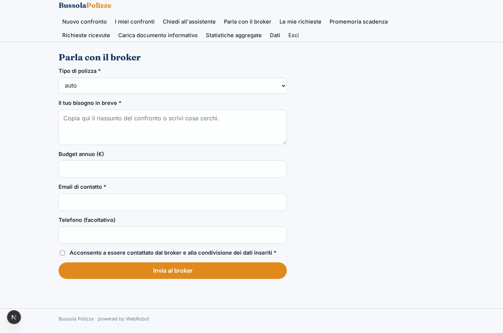
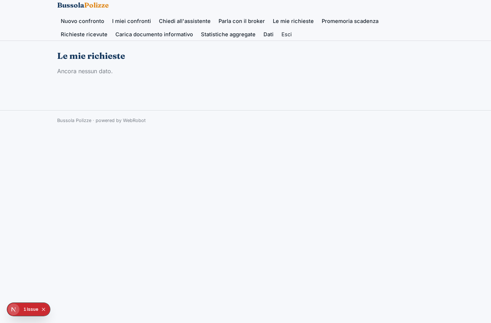
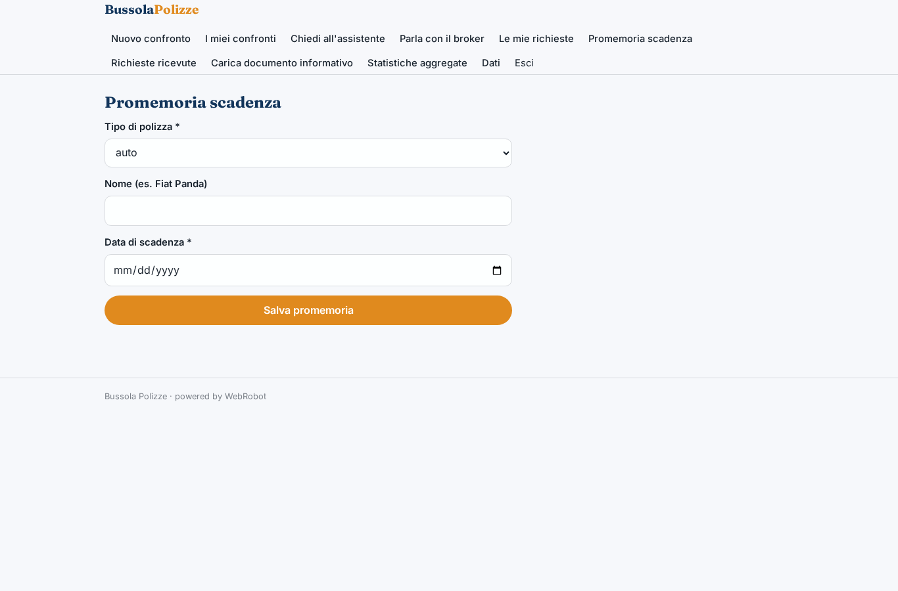
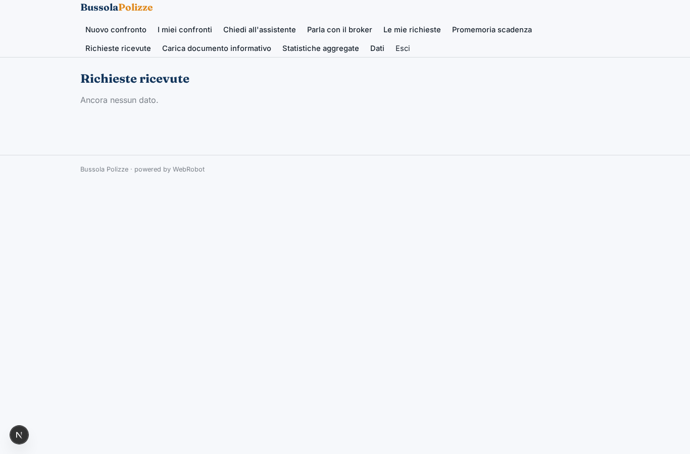
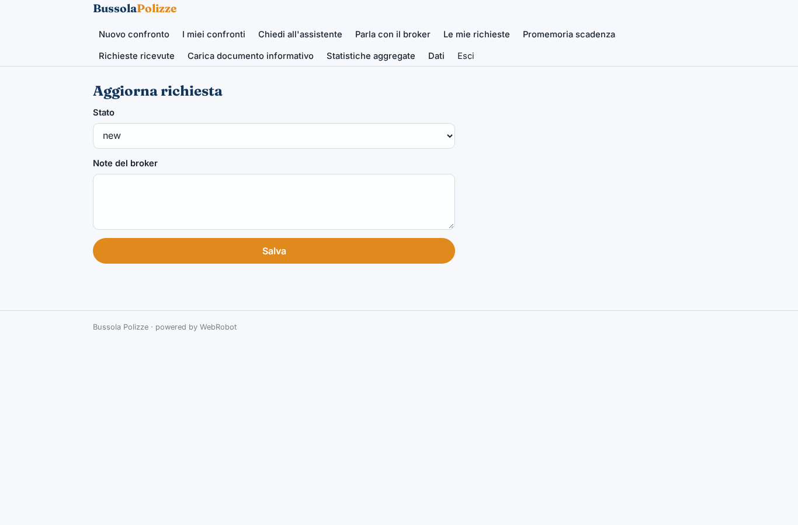
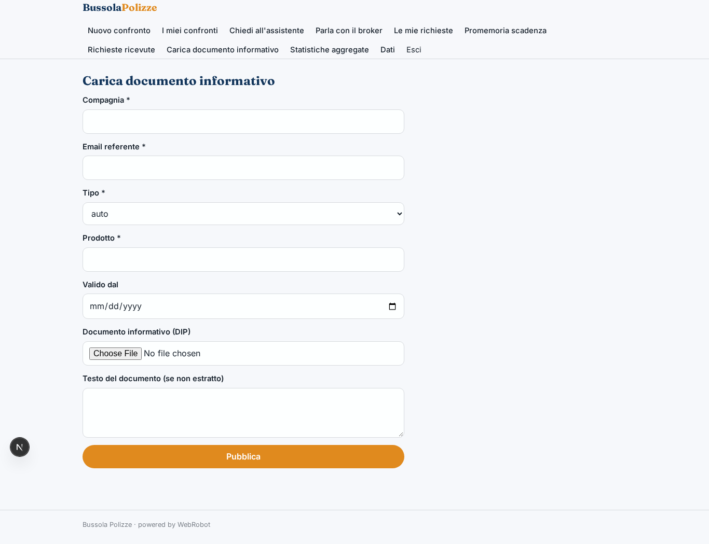
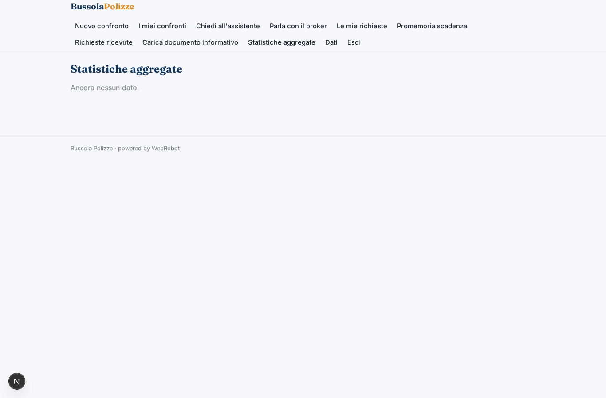

# Bussola Polizze

_Capisci quale polizza auto, casa o vita fa per te, prima di parlare con il broker._

**Manifest:** valid (schema + runtime contract) · **Functional test:** passed (23 checks passed)

## Description given to the app builder (Italian)

Mi serve Bussola Polizze, un orientatore per chi deve scegliere un'assicurazione auto, casa o vita. Descrivo solo lo strato software: l'intermediazione e la vendita restano al broker iscritto al registro, e non raccogliamo preventivi dai siti delle compagnie, che lo vietano. L'utente compila un modulo sul bisogno: tipo di polizza, dati del veicolo o dell'immobile, età, situazione familiare, budget annuo, garanzie a cui tiene. Un agente legge i documenti informativi che le compagnie partner hanno caricato nella piattaforma e confronta le coperture, le esclusioni, le franchigie e i massimali, producendo una tabella comparativa spiegata in modo semplice e una raccomandazione motivata. L'utente può fare domande in chat. Se vuole procedere, la richiesta passa al broker, che verifica l'adeguatezza, prepara il preventivo vero e lo contatta. Prima della scadenza della polizza l'utente riceve un'email che lo invita a rifare il confronto. L'utente vede solo le sue richieste; il broker vede le richieste ricevute; le compagnie partner vedono solo statistiche aggregate. Gratis per l'utente, il broker paga una quota per contatto.

## Functional test: what did not pass

- **trigger has its effect** (trigger new_request_broker): email to role:broker: no such recipient in the test (role nobody holds or empty field) _(warning)_
- **saved record shown where its collection is read** (view partner_stats): a record was saved in requests (by user, admin) but the page does not show it (as admin) _(warning)_

## Design checks (who fills each collection)

- view partner_docs: roles insurer cannot add to policy_docs, a shared collection only the admins fill — keep roles: [admin], or own the records by user

## Features not expressible today (spec.extensions)

- **broker_fee_per_contact**: La quota per contatto pagata dal broker non è esprimibile ora: il trigger 'charge' addebita l'utente dell'evento (il cliente), non il broker. Va gestita fuori piattaforma (fatturazione mensile in base al numero di richieste) finché non è disponibile l'addebito a un ruolo.
- **doc_text_extraction**: L'estrazione automatica del testo dai PDF caricati dalle compagnie in una collezione non è garantita: il campo 'text' consente di incollare il testo del documento.

## Screenshots (interpretive runtime, no data)

### home-anon

### home-mobile

### home

### new

### history

### chat

### contact_broker

### my_requests

### expiry

### broker_inbox

### broker_update

### partner_docs

### partner_stats

