# CalcioAnalytics

_Indicatori avanzati su giocatori e squadre, aggiornati dopo ogni giornata._

**Manifest:** valid (schema + runtime contract) · **Functional test:** passed (19 checks passed)

## Description given to the app builder (Italian)

CalcioAnalytics e uno strumento di data intelligence per societa calcistiche, osservatori e settori giovanili. L'analista della societa inserisce le squadre e i giocatori da seguire e importa i dati delle partite da fonti dati calcistiche concesse in licenza o inserite dal cliente (eventi di gioco, minuti, esiti). Un agente calcola indicatori avanzati per ogni giocatore e squadra, per esempio contributo atteso, qualita delle conclusioni e tendenze di rendimento, e li aggiorna dopo ogni giornata. L'analista vede dashboard e schede giocatore con grafici confrontabili tra atleti e periodi, e puo fare domande in chat tipo "mostrami i centrocampisti in crescita nelle ultime cinque partite". Un report settimanale via email riassume le variazioni di forma della rosa. I dati da dispositivi indossabili dei giocatori restano fuori: qui si tratta solo dello strato software di analisi, senza raccolta da wearable. Ogni societa vede solo i propri dati. Abbonamento stagionale per numero di squadre. In italiano e inglese.

## Features not expressible today (spec.extensions)

- **licensed_feeds**: Direct connectors to licensed football data providers are not available; data enters as files uploaded by the club (or via its own API key if a provider offers one).

## Screenshots (interpretive runtime, no data)

### home-anon
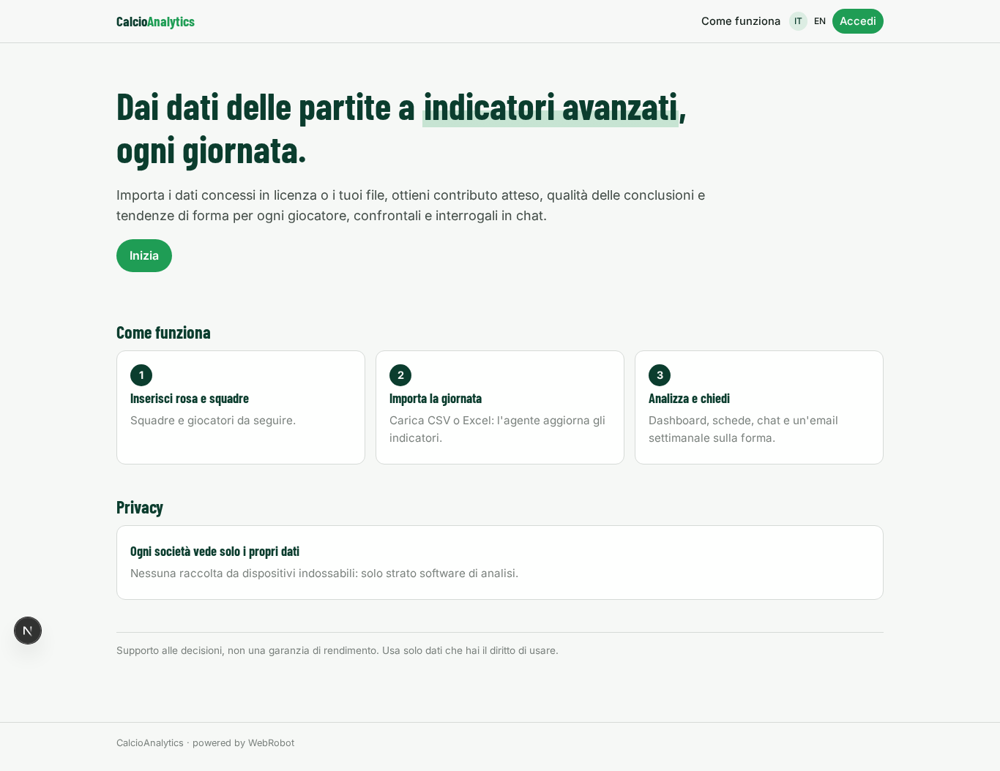

### home-mobile
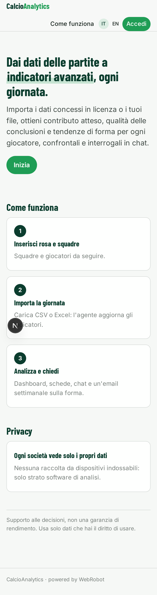

### home
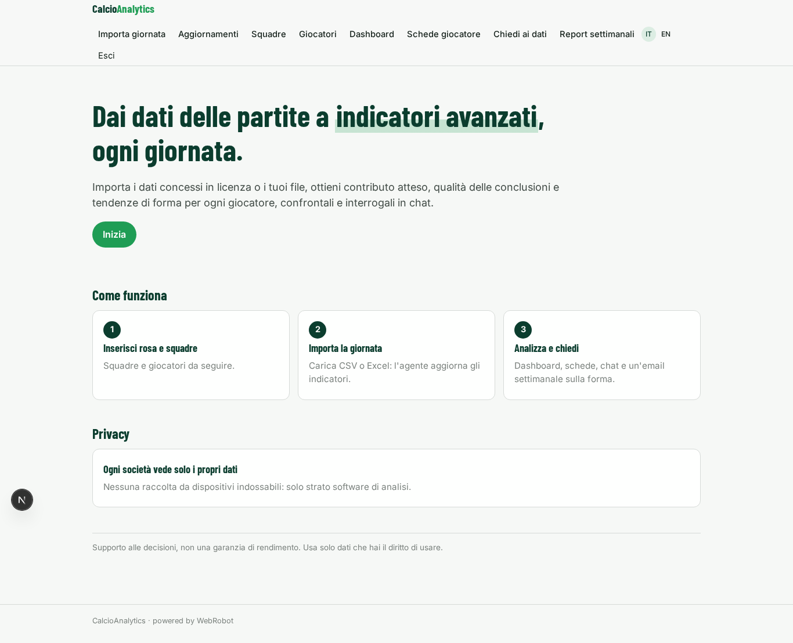

### import
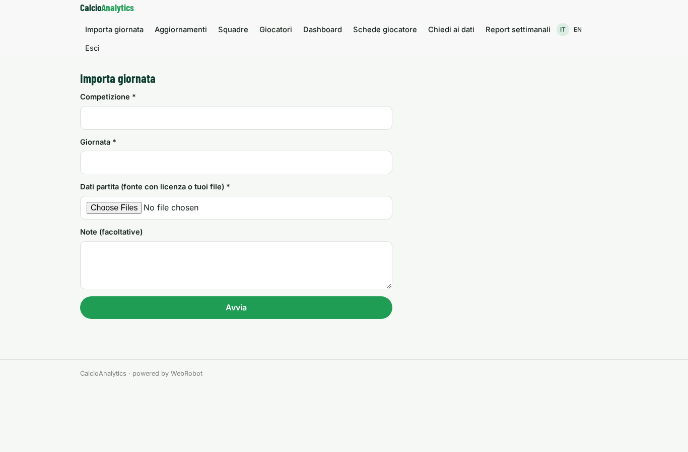

### imports
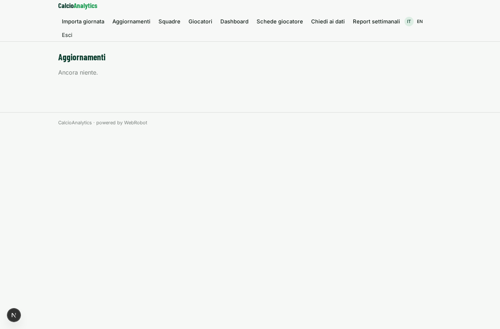

### team_form
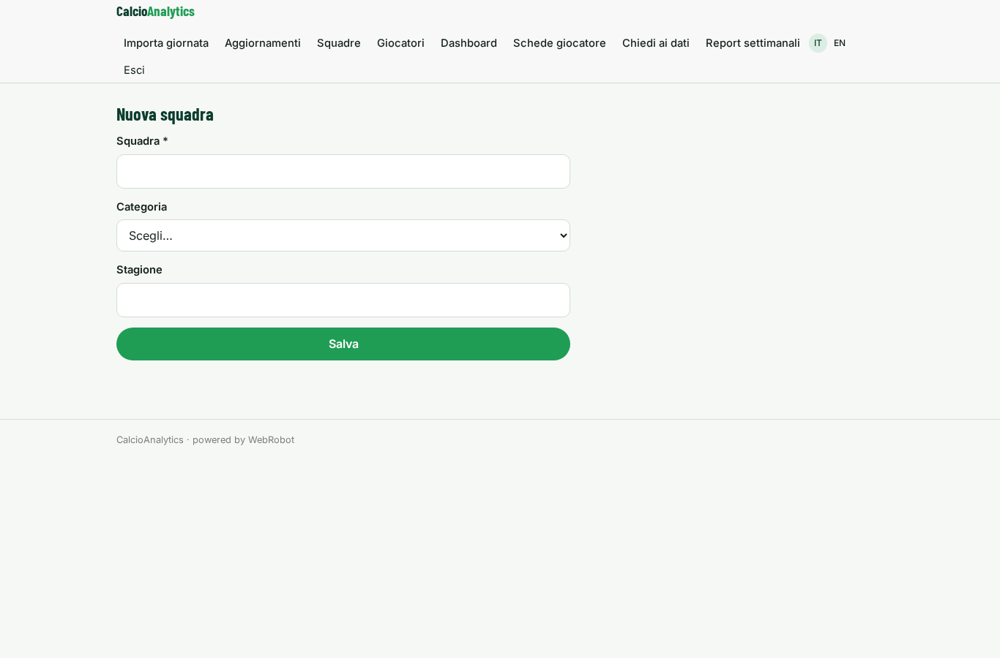

### teams
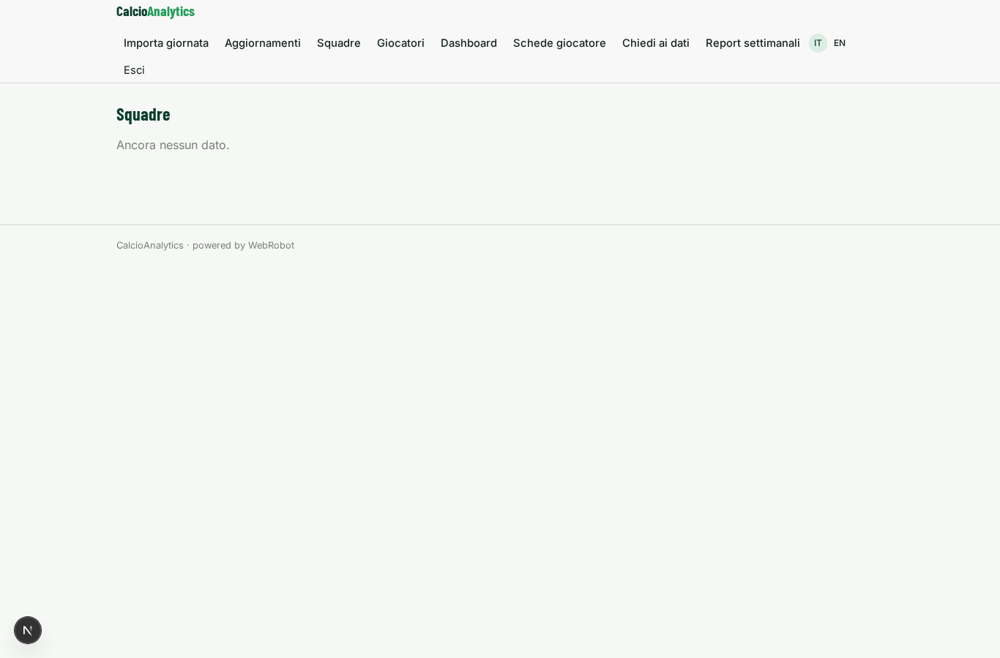

### player_form
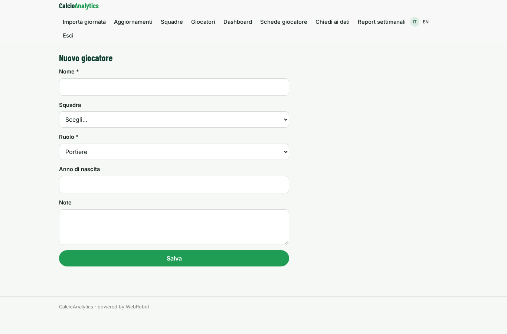

### players
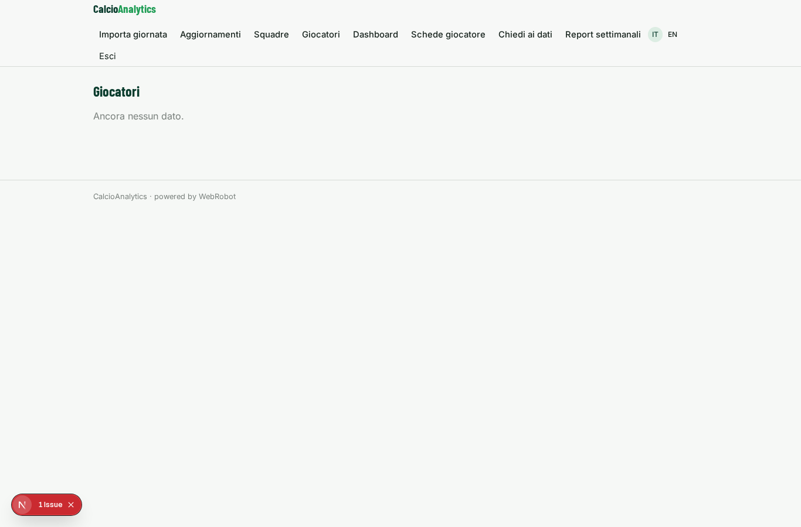

### dashboard
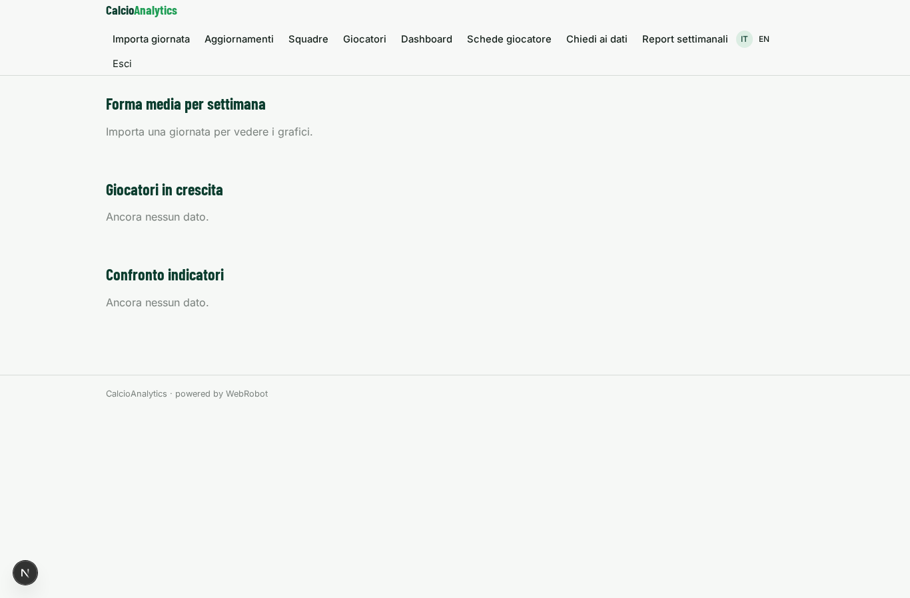

### metrics

### ask
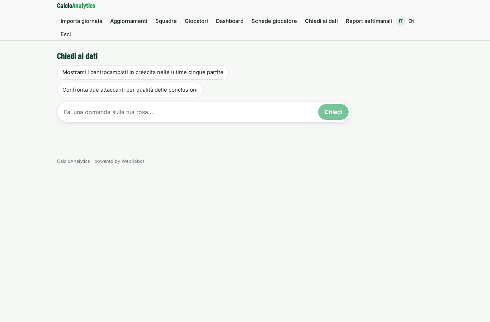

### watches
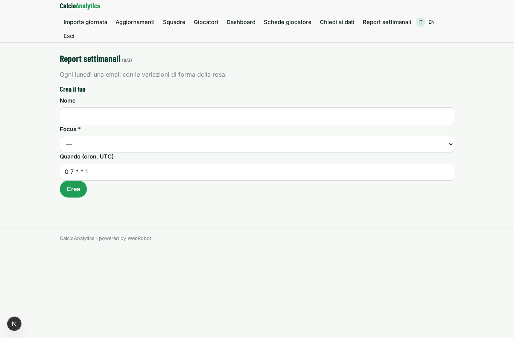

### account
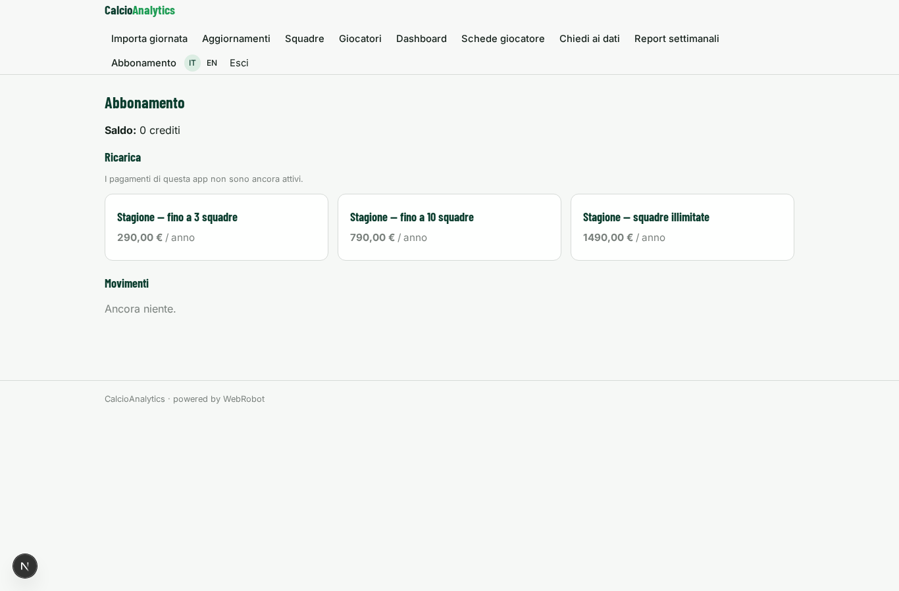
