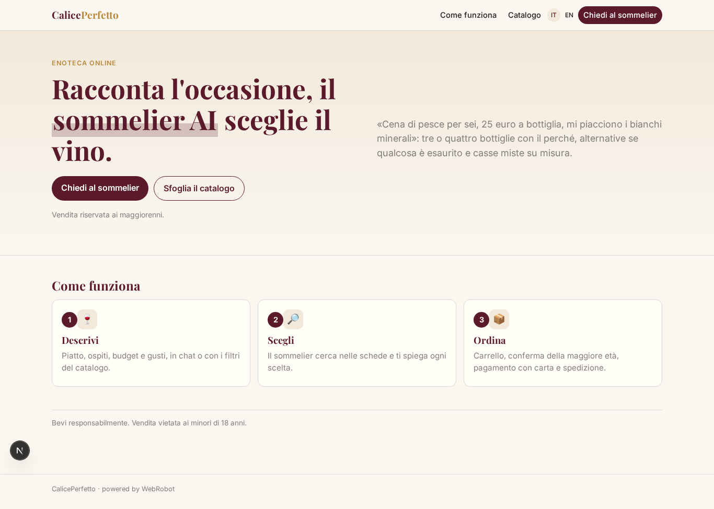
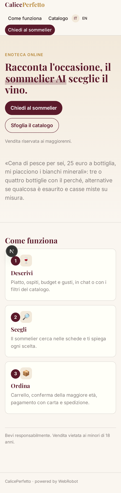
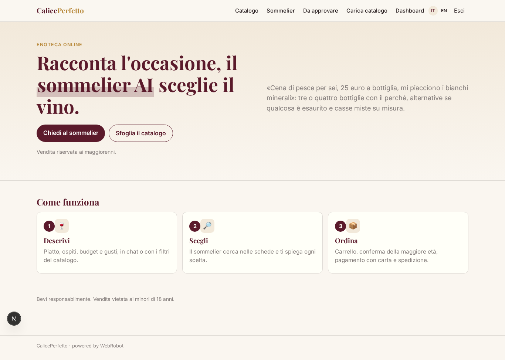
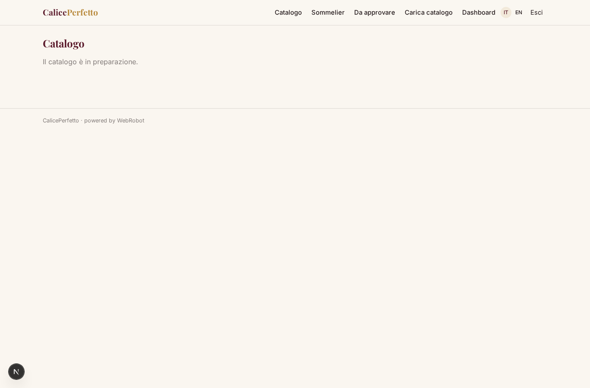
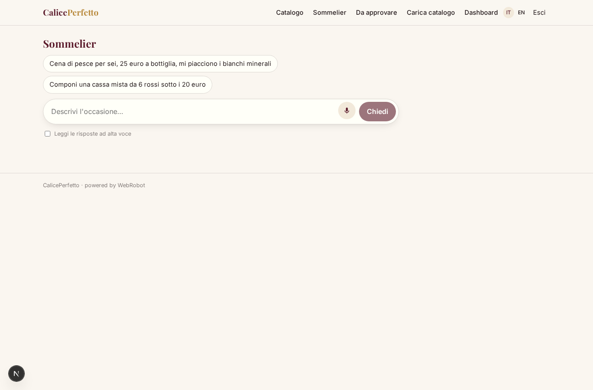
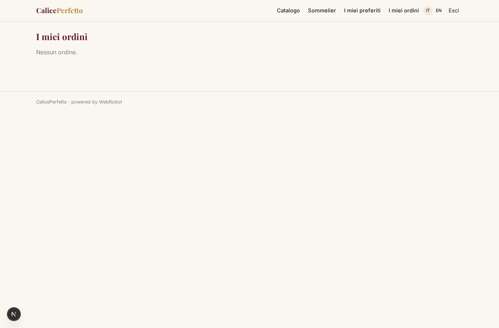
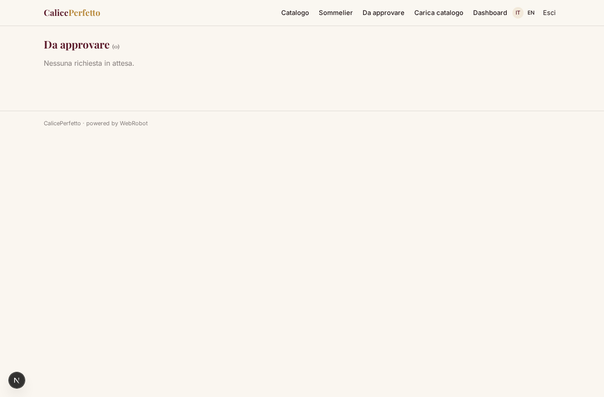
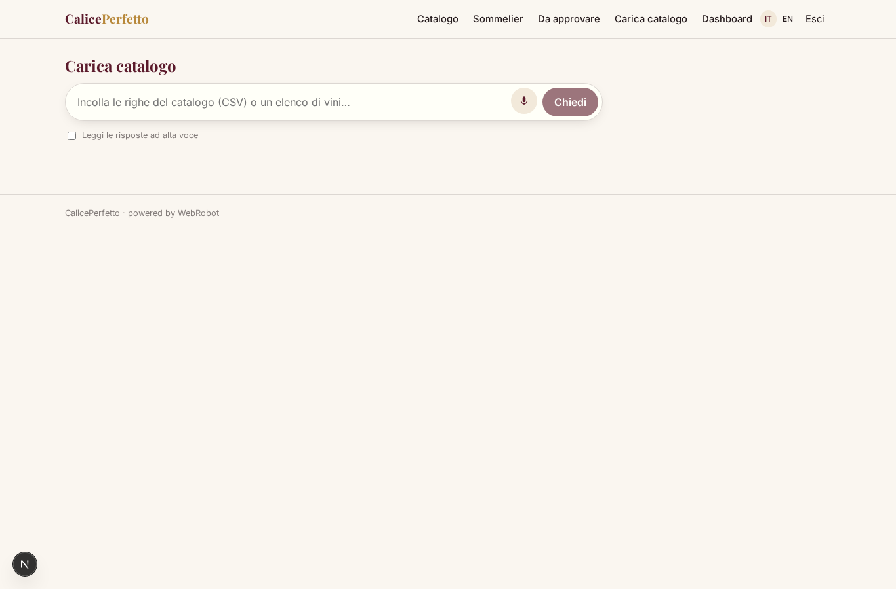
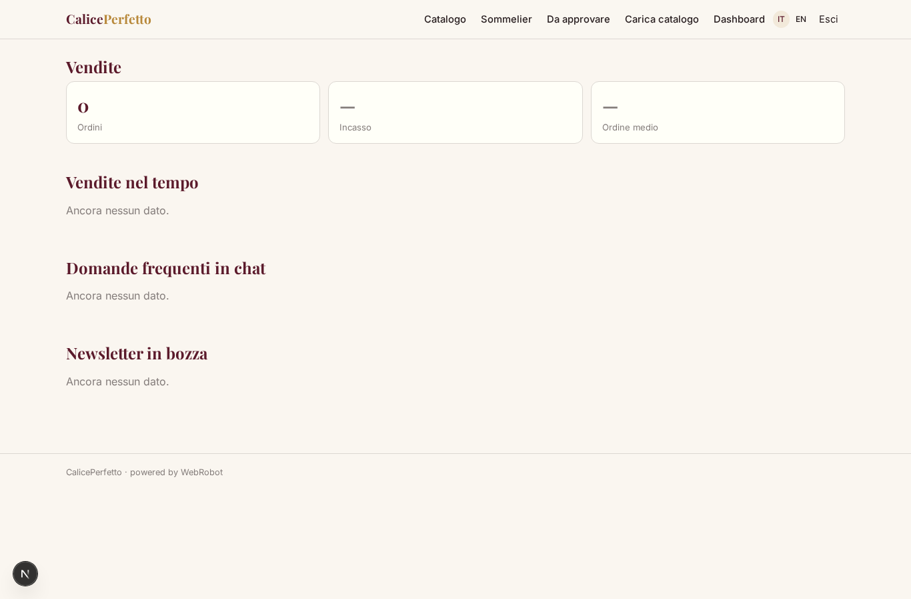
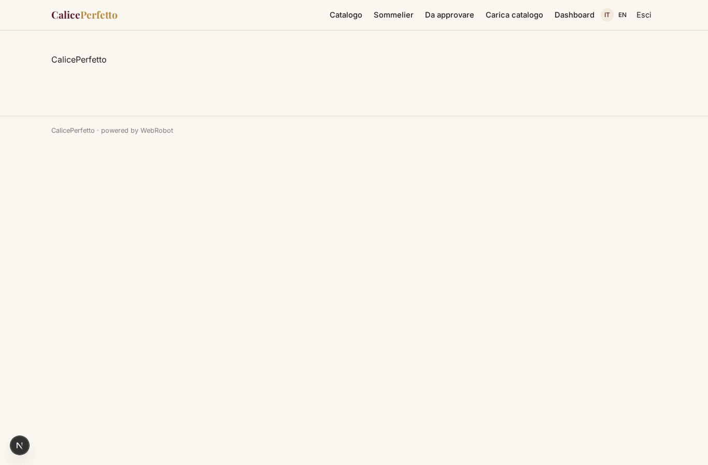

# CalicePerfetto

_L'enoteca online con il sommelier AI che trova il vino giusto per ogni occasione._

**Stato manifest:** valido (validatore Python + contratto runtime)

## Descrizione data all'app builder

Voglio un'enoteca online con sommelier AI, che chiamerò CalicePerfetto. L'admin dell'enoteca carica il catalogo vini con upload di un file o dal proprio gestionale: etichetta, cantina, regione, vitigni, annata, gradazione, abbinamenti, note di degustazione, prezzo, giacenza e foto. Il cliente naviga il catalogo con filtri oppure apre la chat e descrive l'occasione: "cena di pesce per sei, budget 25 euro a bottiglia, mi piacciono i bianchi minerali". Un agente sommelier cerca nel catalogo con ricerca semantica sulle schede, propone tre o quattro bottiglie spiegando il perché, suggerisce alternative se qualcosa è esaurito e può comporre una cassa mista. Il cliente aggiunge al carrello e paga con carta; l'ordine passa al magazziniere, che conferma la preparazione, e la spedizione viene prenotata col corriere con tracking via email. È richiesta la conferma della maggiore età all'acquisto. Il cliente vede storico ordini e una lista dei vini preferiti; l'agente impara dai suoi acquisti per i consigli successivi. L'admin vede dashboard vendite, bottiglie più consigliate e domande frequenti in chat. Newsletter mensile con selezione personalizzata, inviata solo dopo approvazione dell'enoteca. Lingua italiana e inglese; margine sul prodotto, nessun abbonamento.

## Funzioni non esprimibili oggi (spec.extensions)

- **file_upload_and_erp_sync**: Catalogue upload from a file and sync from the shop's management system are not available yet: the admin pastes CSV text or a list into the Load catalogue chat. Photos are links.
- **card_checkout_with_margin**: Card payment of the goods with the shop's margin (no subscription, no credits) needs a product checkout that is not declared here yet; orders are created with status placed and payment must be connected in the studio.
- **courier_and_tracking_email**: Booking the courier and sending the tracking by email are not available yet (no notifications, no courier connector). The warehouse enters the tracking link on the order.
- **personalised_newsletter_sending**: Sending emails is not available yet: the newsletter is drafted monthly and approved by the shop, but delivery and per-customer personalisation need the notification feature.
- **age_gate**: Age confirmation is collected by the sommelier before the order is placed and stored on the order (age_confirmed); a blocking checkbox on the card checkout is still to be added.

## Screenshot (runtime interpretativo)

### home-anon

### home-mobile

### home

### catalog

### sommelier

### favorites

### my_orders

### approvals

### import

### dashboard

### settings

