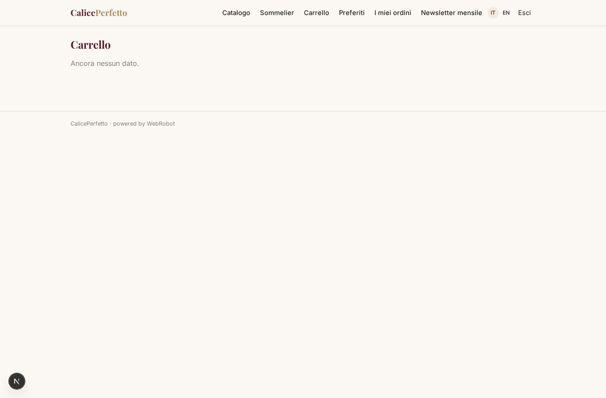
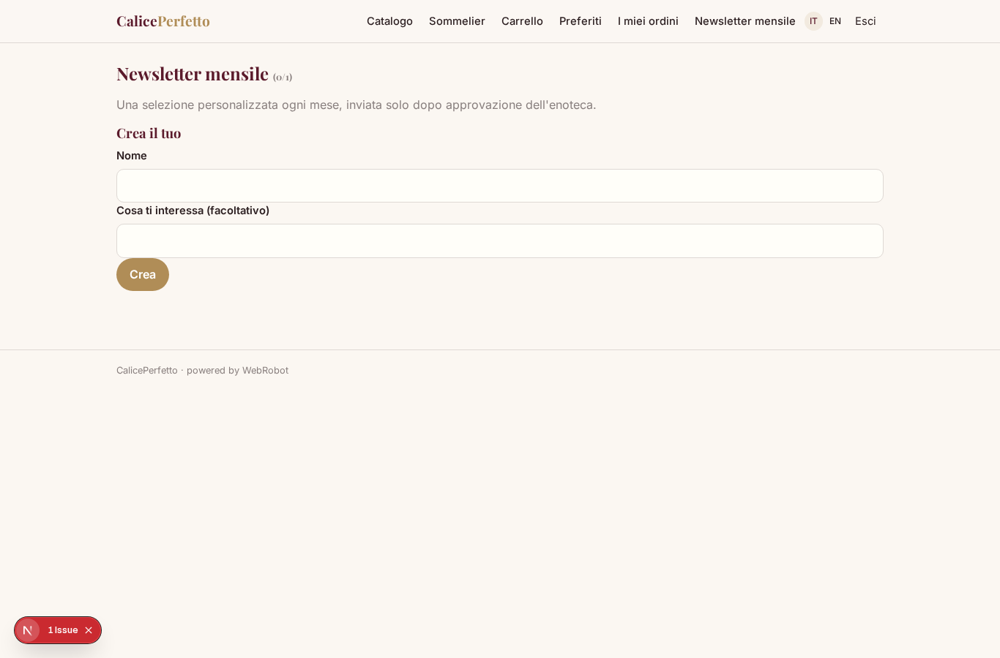
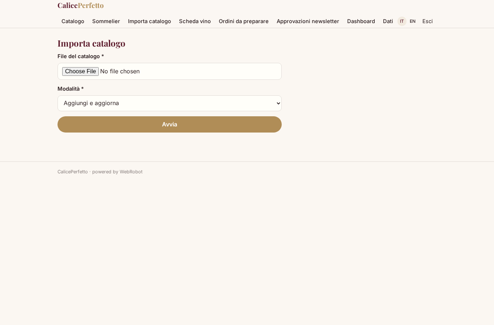
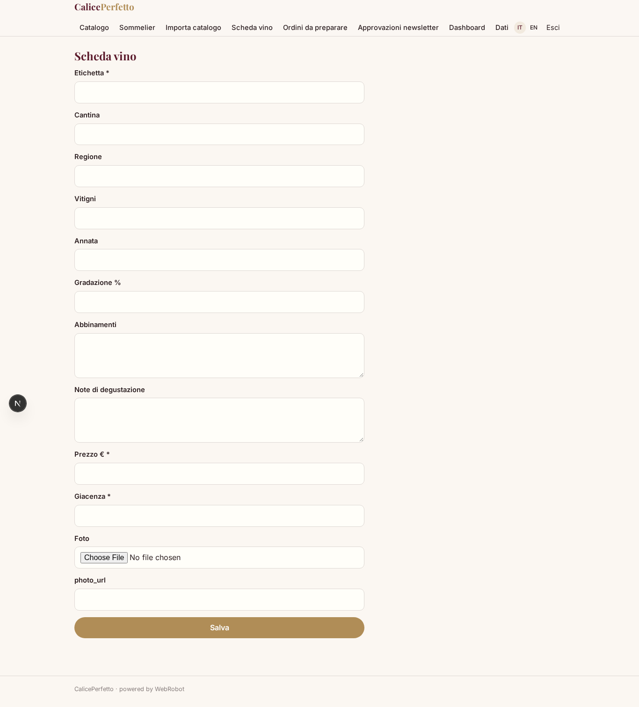
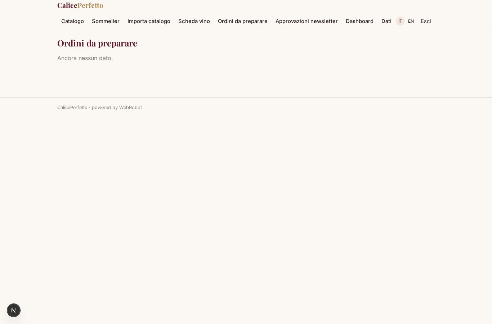
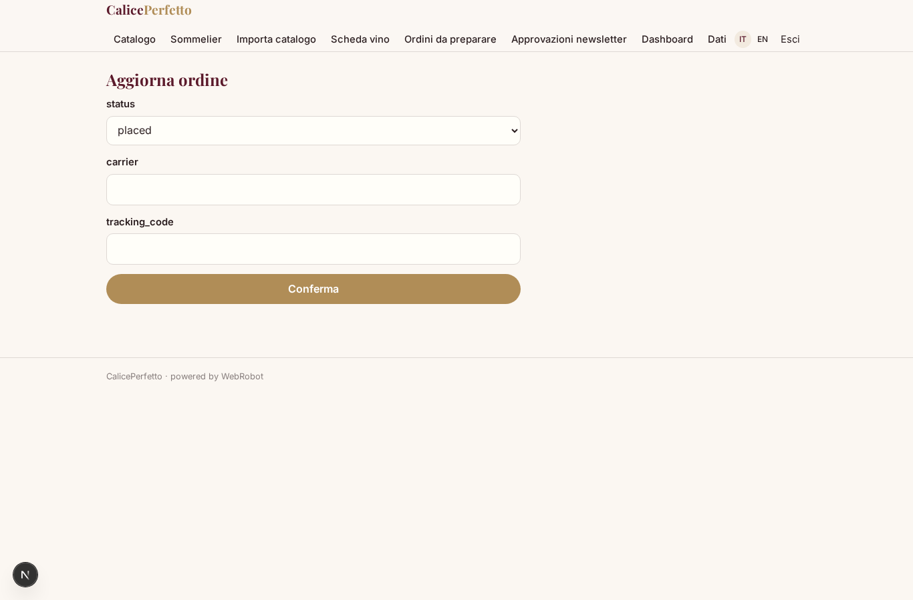
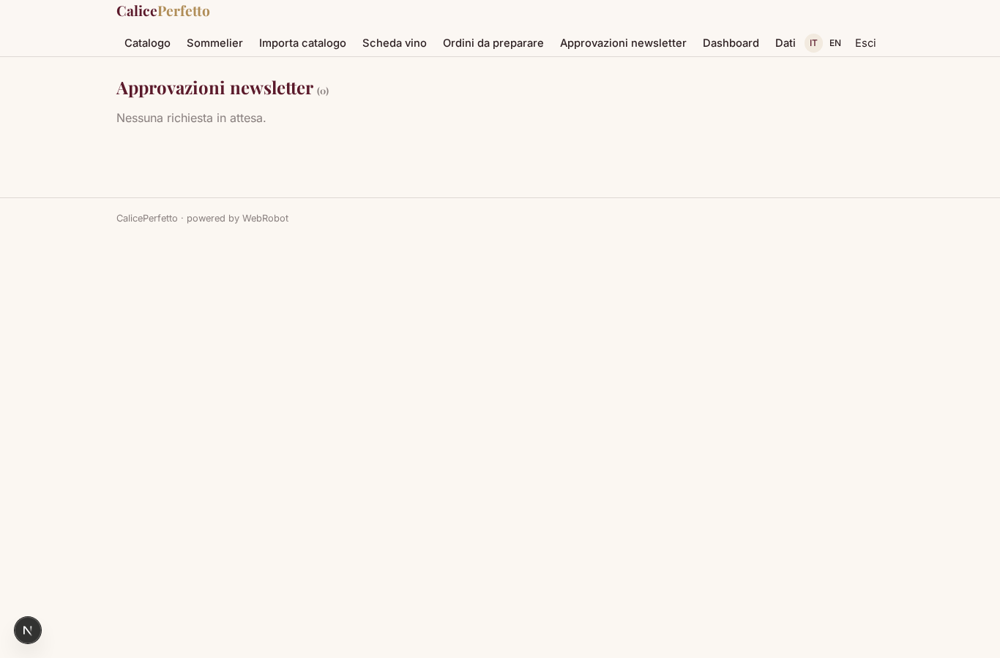
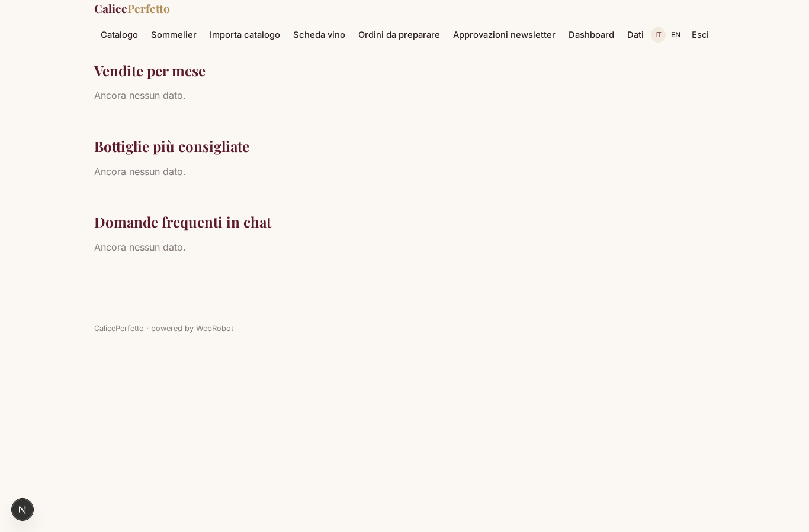

# CalicePerfetto

_L'enoteca online con il sommelier AI che sceglie il vino giusto per ogni occasione._

**Manifest:** valid (schema + runtime contract) · **Functional test:** passed (24 checks passed)

## Description given to the app builder (Italian)

Voglio un'enoteca online con sommelier AI, che chiamerò CalicePerfetto. L'admin dell'enoteca carica il catalogo vini con upload di un file o dal proprio gestionale: etichetta, cantina, regione, vitigni, annata, gradazione, abbinamenti, note di degustazione, prezzo, giacenza e foto. Il cliente naviga il catalogo con filtri oppure apre la chat e descrive l'occasione: "cena di pesce per sei, budget 25 euro a bottiglia, mi piacciono i bianchi minerali". Un agente sommelier cerca nel catalogo con ricerca semantica sulle schede, propone tre o quattro bottiglie spiegando il perché, suggerisce alternative se qualcosa è esaurito e può comporre una cassa mista. Il cliente aggiunge al carrello e paga con carta; l'ordine passa al magazziniere, che conferma la preparazione, e la spedizione viene prenotata col corriere con tracking via email. È richiesta la conferma della maggiore età all'acquisto. Il cliente vede storico ordini e una lista dei vini preferiti; l'agente impara dai suoi acquisti per i consigli successivi. L'admin vede dashboard vendite, bottiglie più consigliate e domande frequenti in chat. Newsletter mensile con selezione personalizzata, inviata solo dopo approvazione dell'enoteca. Lingua italiana e inglese; margine sul prodotto, nessun abbonamento.

## Functional test: what did not pass

- **saved record shown where its collection is read** (view orders_view): a record was saved in orders (by admin) but the page does not show it (as user) _(warning)_

## Features not expressible today (spec.extensions)

- **card_checkout**: Pagamento con carta del carrello (checkout Stripe sul totale dell'ordine) e passaggio a 'paid': non esprimibile ancora con il manifest, l'ordine nasce 'placed'.
- **courier_booking**: Prenotazione automatica della spedizione e tracking col corriere via API: per ora il magazziniere inserisce corriere e codice, e il cliente riceve l'email.
- **erp_sync**: Sincronizzazione del catalogo dal gestionale: ora via upload di file (CSV/Excel/JSON); API del gestionale da collegare.

## Screenshots (interpretive runtime, no data)

### home-anon

### home-mobile

### home

### catalog

### sommelier

### cart_view

### favorites_view

### orders_view

### newsletters_view

### import_catalog

### wine_form

### warehouse_orders

### order_update

### approvals_view

### admin_dashboard

