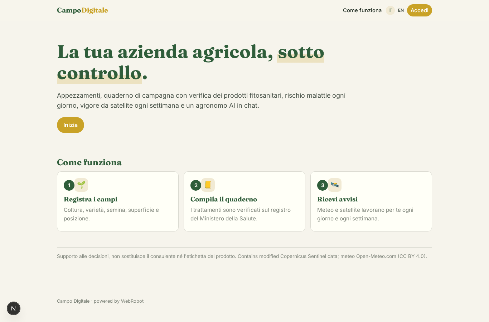
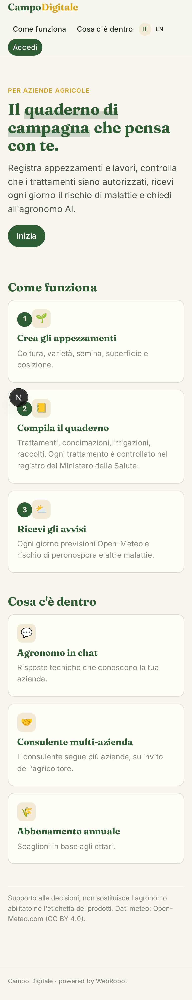
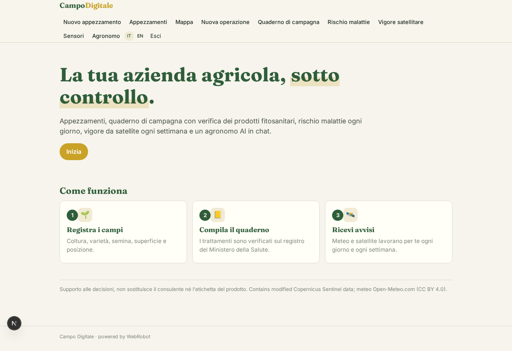
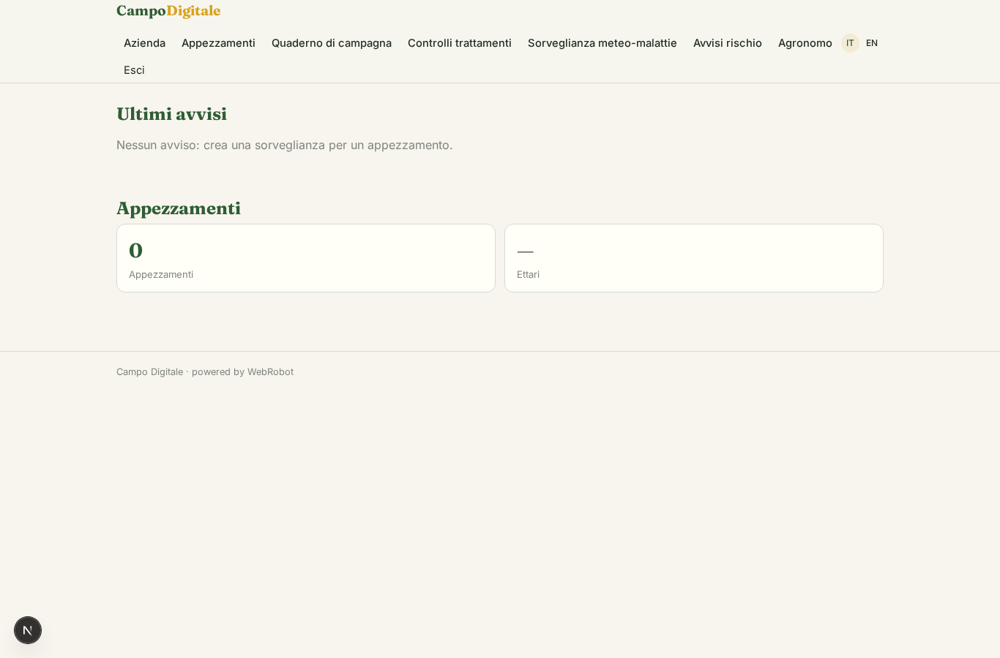
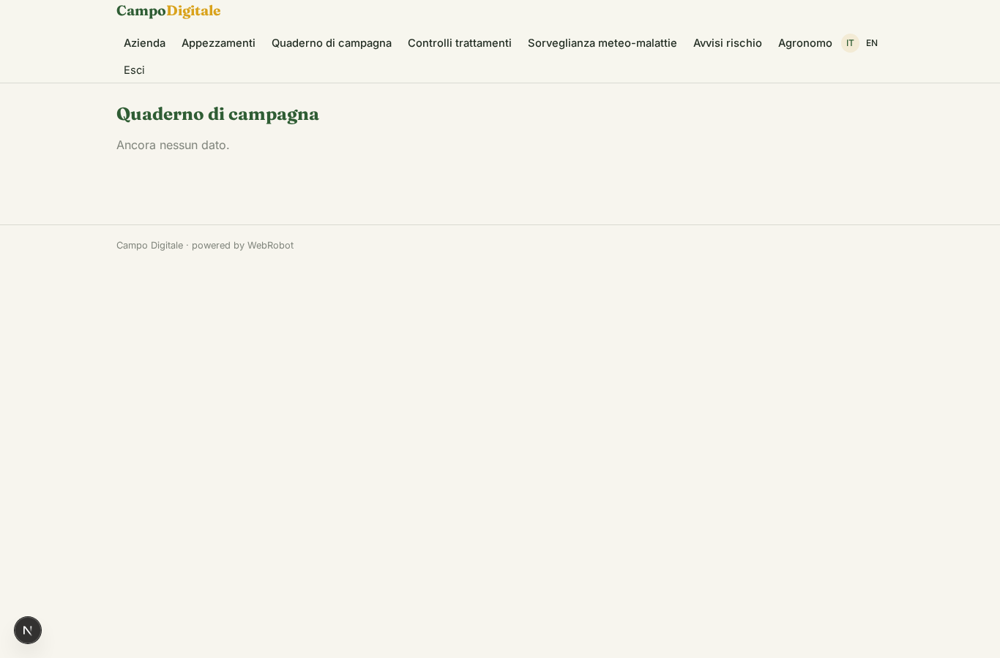
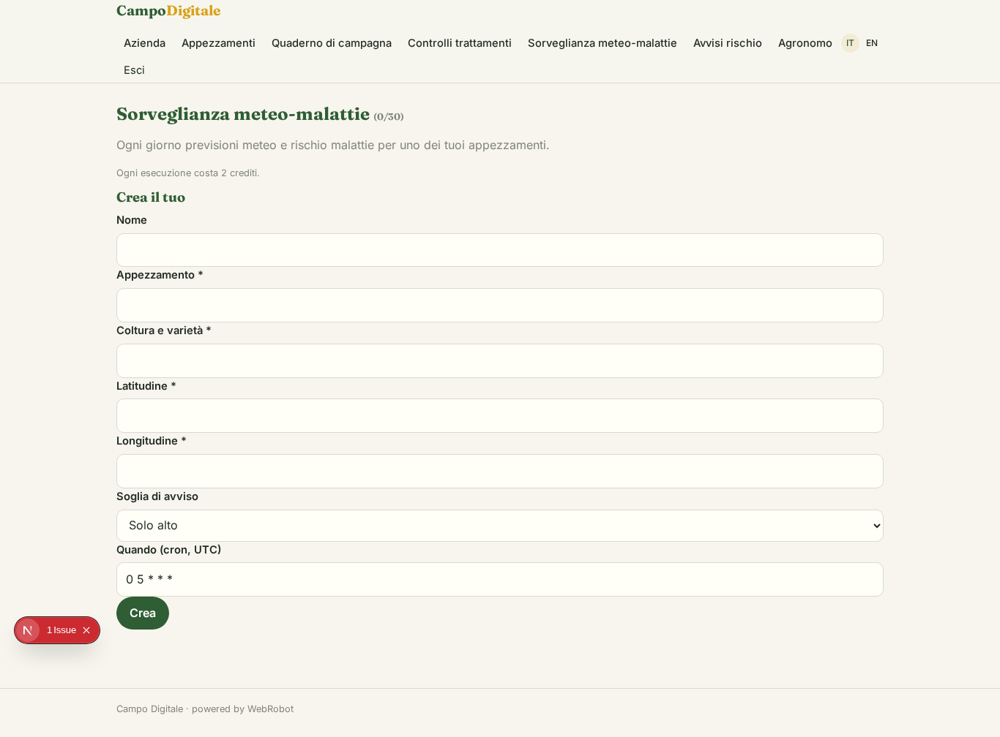
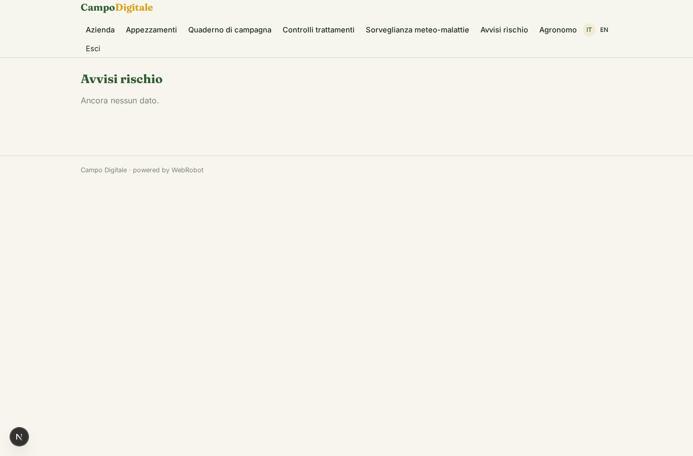
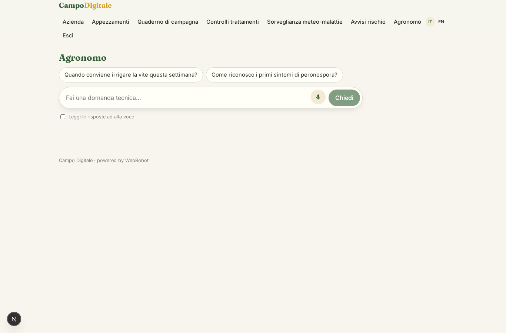
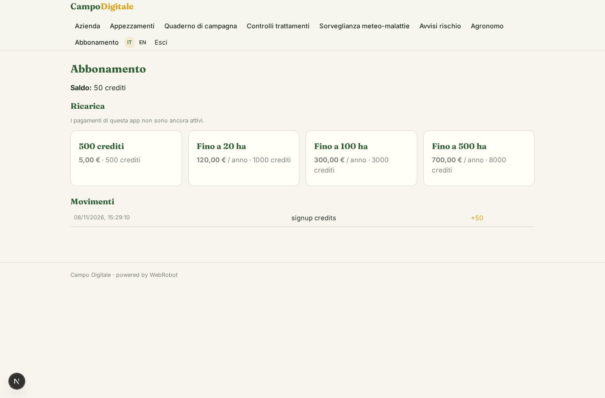

# Campo Digitale

_Il quaderno di campagna che controlla i trattamenti e ti avvisa dei rischi._

**Manifest status:** valid (schema validator + runtime contract)

## Description given to the app builder (Italian)

Ci serve Campo Digitale, un gestionale per aziende agricole. L'agricoltore si registra e disegna i suoi appezzamenti su una mappa, indicando coltura, varietà, data di semina e superficie. Durante la stagione registra trattamenti, concimazioni, irrigazioni e raccolti nel quaderno di campagna; quando registra un trattamento l'app controlla nel registro pubblico dei prodotti fitosanitari del Ministero della Salute che il prodotto sia autorizzato su quella coltura e il dosaggio sia corretto. Ogni giorno un agente scarica le previsioni di Open-Meteo per ogni appezzamento, stima il rischio di malattie come la peronospora con modelli semplici, e quando il rischio supera la soglia manda un avviso. Ogni settimana usa le immagini satellitari Copernicus per calcolare un indice di vigore e segnala zone in sofferenza. Un agente agronomo risponde in chat alle domande tecniche. I sensori in campo (stazioni meteo, sonde di umidità) devono essere collegati, e serve un'app mobile da usare offline in campagna. Il consulente agronomo può seguire più aziende. Abbonamento annuale per ettari.

## Features not expressible today (spec.extensions)

- **map_editor**: Disegno degli appezzamenti su mappa: non disponibile; per ora perimetro come GeoJSON incollato e coordinate del centro.
- **vigor_ndvi**: Indice di vigore settimanale da immagini Copernicus/Sentinel-2 e segnalazione zone in sofferenza: richiede accesso autenticato a Copernicus Data Space e analisi raster, non esprimibile oggi.
- **sensors**: Collegamento di stazioni meteo e sonde di umidità: richiede credenziali per cliente o ingest dai dispositivi, non disponibile.
- **offline_mobile**: App mobile con uso offline in campagna e sincronizzazione: il guscio nativo c'è, la modalità offline no.
- **notifications**: Avvisi push o email quando il rischio supera la soglia: per ora gli avvisi compaiono nell'app.
- **per_hectare_billing**: Abbonamento annuale calcolato per ettaro: approssimato con scaglioni di ettari.
- **consultant_multi_farm**: Vista unica del consulente su più aziende: oggi via condivisione per record (viewer/editor) di appezzamenti e quaderno.

## Screenshots (interpretive runtime)

### home-anon

### home-mobile

### home

### overview

### plots

### log

### checks

### watches

### alerts

### chat

### account

